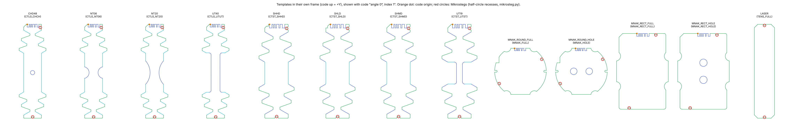

# Specimen templates `CTLG_261102`

*Generated by `cutting-sheets/scripts/make_templates.py` from the lab catalogue `specimen_templates_261029_barcoded.dxf + specimen_templates_extra_MNAK_RECT.dxf`.*

One template per specimen type, **without notch code**. The code (angle + index) is added by `make_plan.py` for each specimen ordered. Types are the block families of the catalogue (block name without its number); the model of each type is its block `_00`.

| Type | Names in the order file | Size (mm) | Holes | Angles in the source | Code origin (mm) |
|---|---|---|---|---|---|
| CTLG_CHCH | `CHD48`, `CHCH`, `CH` | 105.9 × 30.0 | 1 | 0°, 45°, 90° | (-6.000, 52.944) |
| CTLG_NT06 | `NT06`, `NT6.67` | 105.9 × 30.0 | 0 | 0°, 45°, 90° | (-6.000, 52.944) |
| CTLG_NT20 | `NT20` | 105.9 × 30.0 | 0 | 0°, 45°, 90° | (-6.000, 52.944) |
| CTLG_UTUT | `UT40`, `UTUT`, `UT` | 105.9 × 30.0 | 0 | 0°, 15°, 30°, 45°, 60°, 75°, 90° | (-6.000, 52.944) |
| CTST_SHHD | `SHHD` | 80.8 × 30.0 | 0 | 0°, 45°, 90°, 135° | (-6.000, 40.394) |
| CTST_SHLD | `SHLD` | 80.8 × 30.0 | 0 | 0°, 45°, 90°, 135° | (-6.000, 40.394) |
| CTST_SHMD | `SHMD` | 80.8 × 30.0 | 0 | 0°, 45°, 90°, 135° | (-6.000, 40.394) |
| CTST_UTST | `UT19`, `UTST` | 80.8 × 30.0 | 0 | 0°, 15°, 30°, 45°, 60°, 75°, 90° | (-6.000, 40.394) |
| MNAK_FULL | `MNAK_ROUND_FULL`, `MNAK_FULL`, `DISC0` | 60.0 × 54.0 | 0 | 0°, 45°, 90° | (-7.000, 27.000) |
| MNAK_HOLE | `MNAK_ROUND_HOLE`, `MNAK_HOLE`, `DISC2` | 60.0 × 54.0 | 2 | 0°, 45°, 90° | (-7.000, 27.000) |
| MNAK_RECT_FULL | `MNAK_RECT_FULL` | 80.0 × 54.0 | 0 | 0°, 45°, 90° | (-6.000, 40.000) |
| MNAK_RECT_HOLE | `MNAK_RECT_HOLE`, `MNAK_RECT` | 80.0 × 54.0 | 2 | 0°, 45°, 90° | (-6.000, 40.000) |
| TENS_FULL | `LASER`, `TENS_FULL`, `STRIP` | 140.0 × 30.0 | 0 | – | no code |

Template frame: centre of the minimum bounding rectangle at the origin, code towards +Y. The angle of a specimen is the direction of its code end, measured from the rolling direction (+Y), counter-clockwise, minus the angle offset of the type (MNAK_RECT: −90°). For discs with two holes, the holes are perpendicular to the code direction (angle 90° = holes along the rolling direction); MNAK_RECT has the same hole orientation as the disc of the same angle.

Every specimen also gets 2 internal Mikrostegs: half-circle recesses of radius 1.5 mm in its outline, added by `mikrosteg.py` when the specimens are built (red circles in the figure); the templates themselves stay without recesses.

## Validation

Every specimen of the source was rebuilt from its template and the code read on it, then compared with the original. For the catalogue, the code read must also be the block number (block `_21` = angle 2 × 15° = 30°, index 1).

| Type | Specimens | Indices | Code = block number | Code lines: max deviation (mm) | Outline: max deviation (mm) |
|---|---|---|---|---|---|
| CTLG_CHCH | 30 | 0–9 | 30 / 30 | 0.0064 | 0.0137 |
| CTLG_NT06 | 30 | 0–9 | 30 / 30 | 0.0059 | 0.0135 |
| CTLG_NT20 | 30 | 0–9 | 30 / 30 | 0.0064 | 0.0105 |
| CTLG_UTUT | 70 | 0–9 | 70 / 70 | 0.0119 | 0.0173 |
| CTST_SHHD | 40 | 0–9 | 40 / 40 | 0.0050 | 0.0113 |
| CTST_SHLD | 40 | 0–9 | 40 / 40 | 0.0050 | 0.0113 |
| CTST_SHMD | 40 | 0–9 | 40 / 40 | 0.0050 | 0.0113 |
| CTST_UTST | 70 | 0–9 | 70 / 70 | 0.0088 | 0.0148 |
| MNAK_FULL | 30 | 0–9 | 30 / 30 | 0.0039 | 0.0055 |
| MNAK_HOLE | 30 | 0–9 | 30 / 30 | 0.0039 | 0.0055 |
| MNAK_RECT_FULL | 30 | 0–9 | 30 / 30 | 0.0048 | 0.0048 |
| MNAK_RECT_HOLE | 30 | 0–9 | 30 / 30 | 0.0048 | 0.0048 |
| TENS_FULL | 1 | – | – | – | 0.0004 |

Details per specimen: `validation.csv`.
