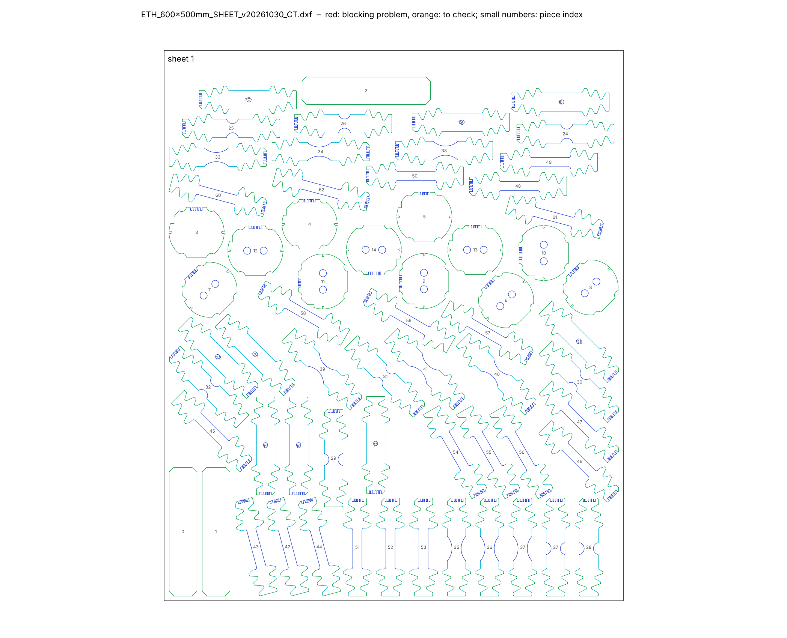

# Cutting plan `ETH_600x500mm_SHEET_v20261030_CT`

*Generated on 2026-10-30 by `cutting-sheets/scripts/make_plan.py` from the order `CT_v20260901.yaml` and the templates `CT_v20260901`.*

## Order

| Type | Angle to RD | Number | Indices (notch code) |
|---|---|---|---|
| UT | 0° | 3 | 1, 2, 3 |
| UT | 15° | 3 | 1, 2, 3 |
| UT | 30° | 3 | 1, 2, 3 |
| UT | 45° | 3 | 1, 2, 3 |
| UT | 60° | 3 | 1, 2, 3 |
| UT | 75° | 3 | 1, 2, 3 |
| UT | 90° | 3 | 1, 2, 3 |
| NT20 | 0° | 3 | 1, 2, 3 |
| NT20 | 45° | 3 | 1, 2, 3 |
| NT20 | 90° | 3 | 1, 2, 3 |
| NT6.67 | 0° | 3 | 1, 2, 3 |
| NT6.67 | 45° | 3 | 1, 2, 3 |
| NT6.67 | 90° | 3 | 1, 2, 3 |
| CH | 0° | 3 | 1, 2, 3 |
| CH | 45° | 3 | 1, 2, 3 |
| CH | 90° | 3 | 1, 2, 3 |
| DISC0 | 0° | 3 | 1, 2, 3 |
| DISC2 | 90° | 3 | 1, 2, 3 |
| DISC2 | 45° | 3 | 1, 2, 3 |
| DISC2 | 0° | 3 | 1, 2, 3 |
| STRIP | 0° | 2 | 1, 2 |
| STRIP | 90° | 1 | 1 |

## Result

63 specimens on 1 sheet(s) of 500 × 600 mm (gap ≥ 5 mm, margin ≥ 5 mm).

| Sheet | Specimens | Height used (mm) |
|---|---|---|
| 1 | 63 | 571.0 |

## Checks of the final DXF

| Check | Status | Detail |
|---|---|---|
| Units | OK | $INSUNITS = 4 (millimetres) |
| Sheets | OK | 1 sheet frame(s): 500 × 600 mm |
| Closed contours | OK | all cutting contours are closed |
| Duplicate lines | OK | none |
| Colours = EDM quality | OK | cutting lines use only colours 3 / 4 / 5 (Q3 / Q4 / Q5): {3: 3828, 4: 858, 5: 1347} |
| Overlaps | OK | none |
| Gap between pieces | OK | smallest gap 5.25 mm; 0 pair(s) below 5.0 mm, 0 more below 5.0 mm |
| Margin to sheet edge | OK | smallest margin 5.1 mm (limit 5.0 mm) |
| ID codes | OK | 60 of 60 specimens carry a notch code; 31 distinct codes; 11 code(s) shared only by specimens of different types (distinguishable by their shape) |
| Notch codes / angles | OK | 63 of 63 specimens: code read in the DXF = code ordered, direction = angle ordered |

## Files

- `ETH_600x500mm_SHEET_v20261030_CT.dxf`: the plan for the workshop (mm, layers `Q3_NORMAL` / `Q4_MEDIUM` / `Q5_HIGH`, no Mikrosteg).
- `notice.pdf`: one page per sheet (specimen numbers, proposed Mikrosteg in red, qualities, rolling direction) and the specimen list.
- `registry.csv`: one line per specimen: number, sheet, type, angle, notch code (angle digit, index), position, specimen ID (when the batch and geometry codes are given in the order).
- `placement.csv`, `specimens.dxf`: blocks and their insertion; `check/`: report of `check_sheet.py`.
