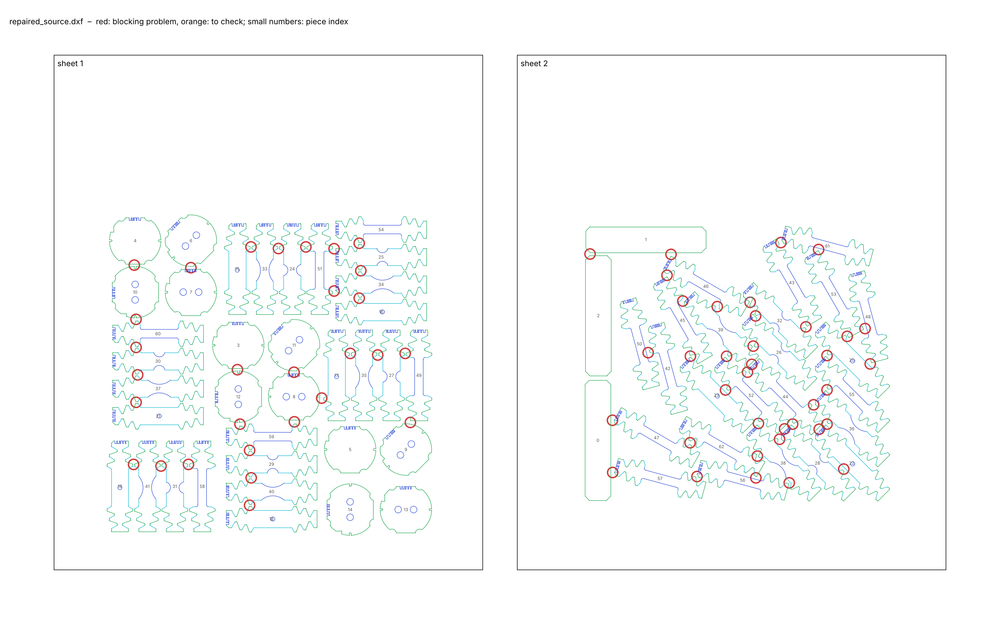
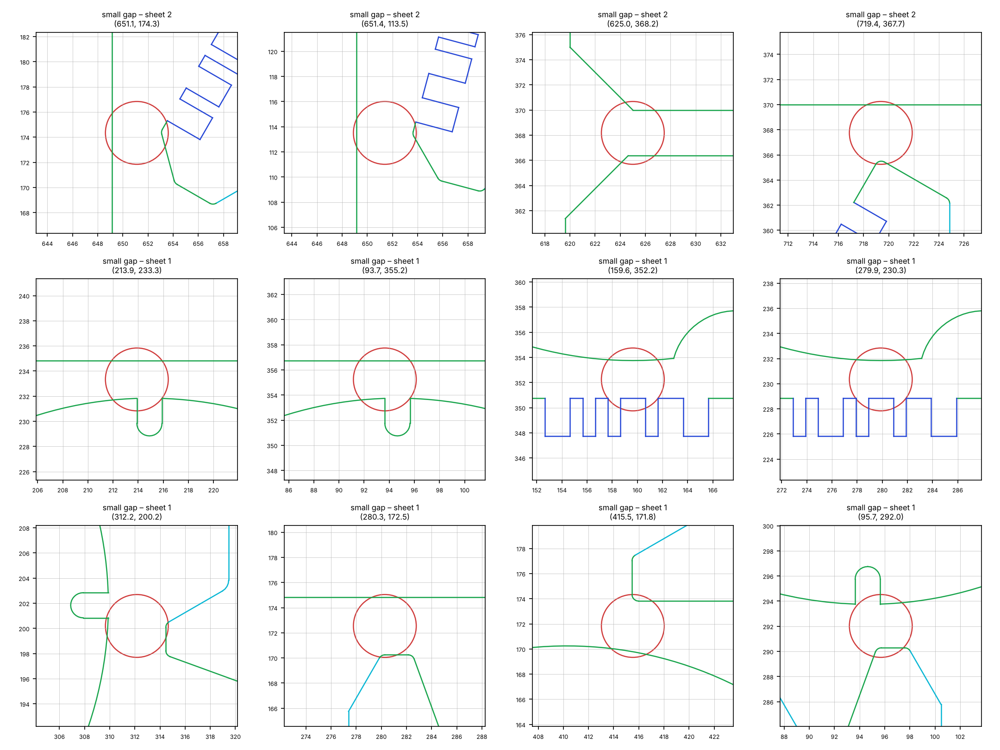

# Cutting sheet check – `repaired_source.dxf`

*Generated by `cutting-sheets/scripts/check_sheet.py`. Limits: gap between pieces ≥ 5.0 mm (warning below 5.0 mm), margin to the sheet edge ≥ 5.0 mm (gap: rule of the supervisors; margin: provisional).*

**Verdict: NOT READY for the workshop** – 66 blocking problem(s) in 1 check(s), 0 check(s) with warnings.

## Checks

| Check | Status | Detail |
|---|---|---|
| Units | OK | $INSUNITS = 4 (millimetres) |
| Sheets | OK | 2 sheet frame(s): 500 × 600 mm, 500 × 600 mm |
| Closed contours | OK | all cutting contours are closed |
| Duplicate lines | OK | none |
| Colours = EDM quality | OK | cutting lines use only colours 3 / 4 / 5 (Q3 / Q4 / Q5): {3: 3828, 4: 858, 5: 1347} |
| Overlaps | OK | none |
| Gap between pieces | ERROR | smallest gap 1.67 mm; 66 pair(s) below 5.0 mm, 0 more below 5.0 mm |
| Margin to sheet edge | OK | smallest margin 40.3 mm (limit 5.0 mm) |
| ID codes | OK | 60 of 60 specimens carry a notch code; 31 distinct codes; 11 code(s) shared only by specimens of different types (distinguishable by their shape) |

## Specimens found

| Type (provisional name) | Orientation to rolling direction × number | Total |
|---|---|---|
| CH_D4.8_L106 | 0° × 3, 45° × 3, 90° × 3 | 9 |
| DISC_0H | × 3 | 3 |
| DISC_2H_00 | × 3 | 3 |
| DISC_2H_45 | × 3 | 3 |
| DISC_2H_90 | × 3 | 3 |
| NT_R20.00_L106 | 0° × 3, 45° × 3, 90° × 3 | 9 |
| NT_R6.67_L106 | 0° × 3, 45° × 3, 90° × 3 | 9 |
| STRIP_140x30 | 0° × 2, 90° × 1 | 3 |
| UT_L106 | 0° × 3, 15° × 3, 30° × 3, 45° × 3, 60° × 3, 75° × 3, 90° × 3 | 21 |

*Type names are derived from the geometry: UT = uniaxial tension, NT_R = notched tension with notch radius R, CH_D = central hole of diameter D, DISC_nH = disc with n holes (2H_xx: axis of the holes at xx° to the rolling direction), STRIP / BLANK = rectangle without a gauge section (BLANK: with a notch code); L = length in mm. Orientation: angle between the specimen axis and the rolling direction (drawing +Y), folded into 0–90° (orthotropic sheet). Per-piece list: `pieces.csv`.*

| Sheet | Size | Pieces | Area used | Smallest margin |
|---|---|---|---|---|
| 1 | 500 × 600 mm | 36 | 25 % | 40.3 mm |
| 2 | 500 × 600 mm | 27 | 18 % | 65.6 mm |

> **Figure 1 – The cutting sheet and its problems.**
>
> *Plotted* – every line of the DXF in its EDM quality colour (green Q3, cyan Q4, blue Q5), sheet frames in black, piece index in small grey numbers; red circles: blocking problems; orange circles: points to check.
>
> *Source* – `repaired_source.dxf`.
>
> *How to read it* – each circle is listed in the table below with its coordinates (drawing millimetres).

> **Figure 2 – Zoom on each blocking problem.**
>
> *Plotted* – a 16 mm window around each problem (24 mm for margins), same colours as Figure 1, red circle at the problem.
>
> *Source* – same drawing.
>
> *How to read it* – an open contour shows as two line ends that do not meet.

## Problems

| # | Severity | Problem | Sheet | Position (mm) | Detail |
|---|---|---|---|---|---|
| 1 | ERROR | small gap | 1 | (92.8, 122.9) | 2.00 mm between pieces 19 (CH_D4.8_L106) and 41 (NT_R20.00_L106) |
| 2 | ERROR | small gap | 1 | (93.7, 355.2) | 3.02 mm between pieces 4 (DISC_0H) and 10 (DISC_2H_00) |
| 3 | ERROR | small gap | 1 | (95.7, 292.0) | 3.48 mm between pieces 10 (DISC_2H_00) and 60 (UT_L106) |
| 4 | ERROR | small gap | 1 | (95.7, 195.3) | 2.00 mm between pieces 21 (CH_D4.8_L106) and 37 (NT_R20.00_L106) |
| 5 | ERROR | small gap | 1 | (95.7, 259.3) | 2.00 mm between pieces 30 (NT_R6.67_L106) and 60 (UT_L106) |
| 6 | ERROR | small gap | 1 | (97.6, 227.3) | 2.00 mm between pieces 30 (NT_R6.67_L106) and 37 (NT_R20.00_L106) |
| 7 | ERROR | small gap | 1 | (124.8, 121.0) | 2.00 mm between pieces 31 (NT_R6.67_L106) and 41 (NT_R20.00_L106) |
| 8 | ERROR | small gap | 1 | (156.8, 122.9) | 2.00 mm between pieces 31 (NT_R6.67_L106) and 58 (UT_L106) |
| 9 | ERROR | small gap | 1 | (159.6, 352.2) | 3.00 mm between pieces 6 (DISC_2H_45) and 7 (DISC_2H_90) |
| 10 | ERROR | small gap | 1 | (213.9, 233.3) | 3.02 mm between pieces 3 (DISC_0H) and 12 (DISC_2H_00) |
| 11 | ERROR | small gap | 1 | (216.9, 169.8) | 4.16 mm between pieces 12 (DISC_2H_00) and 59 (UT_L106) |
| 12 | ERROR | small gap | 1 | (228.1, 75.2) | 2.00 mm between pieces 18 (CH_D4.8_L106) and 40 (NT_R20.00_L106) |
| 13 | ERROR | small gap | 1 | (228.1, 139.2) | 2.00 mm between pieces 29 (NT_R6.67_L106) and 59 (UT_L106) |
| 14 | ERROR | small gap | 1 | (229.7, 376.4) | 2.00 mm between pieces 15 (CH_D4.8_L106) and 33 (NT_R20.00_L106) |
| 15 | ERROR | small gap | 1 | (229.9, 107.2) | 2.00 mm between pieces 29 (NT_R6.67_L106) and 40 (NT_R20.00_L106) |
| 16 | ERROR | small gap | 1 | (261.7, 374.6) | 2.00 mm between pieces 24 (NT_R6.67_L106) and 33 (NT_R20.00_L106) |
| 17 | ERROR | small gap | 1 | (279.9, 230.3) | 3.00 mm between pieces 8 (DISC_2H_90) and 11 (DISC_2H_45) |
| 18 | ERROR | small gap | 1 | (280.3, 172.5) | 4.59 mm between pieces 8 (DISC_2H_90) and 59 (UT_L106) |
| 19 | ERROR | small gap | 1 | (293.7, 376.4) | 2.00 mm between pieces 24 (NT_R6.67_L106) and 51 (UT_L106) |
| 20 | ERROR | small gap | 1 | (312.2, 200.2) | 4.62 mm between pieces 8 (DISC_2H_90) and 17 (CH_D4.8_L106) |
| 21 | ERROR | small gap | 1 | (326.6, 374.4) | 3.79 mm between pieces 25 (NT_R6.67_L106) and 51 (UT_L106) |
| 22 | ERROR | small gap | 1 | (326.6, 325.0) | 4.07 mm between pieces 34 (NT_R20.00_L106) and 51 (UT_L106) |
| 23 | ERROR | small gap | 1 | (345.5, 252.3) | 2.00 mm between pieces 17 (CH_D4.8_L106) and 35 (NT_R20.00_L106) |
| 24 | ERROR | small gap | 1 | (355.9, 316.7) | 2.00 mm between pieces 16 (CH_D4.8_L106) and 34 (NT_R20.00_L106) |
| 25 | ERROR | small gap | 1 | (355.9, 380.7) | 2.00 mm between pieces 25 (NT_R6.67_L106) and 54 (UT_L106) |
| 26 | ERROR | small gap | 1 | (357.7, 348.7) | 2.00 mm between pieces 25 (NT_R6.67_L106) and 34 (NT_R20.00_L106) |
| 27 | ERROR | small gap | 1 | (377.5, 250.4) | 2.00 mm between pieces 27 (NT_R6.67_L106) and 35 (NT_R20.00_L106) |
| 28 | ERROR | small gap | 1 | (409.5, 252.3) | 2.00 mm between pieces 27 (NT_R6.67_L106) and 49 (UT_L106) |
| 29 | ERROR | small gap | 1 | (415.5, 171.8) | 4.05 mm between pieces 9 (DISC_2H_45) and 49 (UT_L106) |
| 30 | ERROR | small gap | 2 | (625.0, 368.2) | 3.63 mm between pieces 1 (STRIP_140x30) and 2 (STRIP_140x30) |
| 31 | ERROR | small gap | 2 | (651.1, 174.3) | 3.92 mm between pieces 0 (STRIP_140x30) and 47 (UT_L106) |
| 32 | ERROR | small gap | 2 | (651.4, 113.5) | 4.48 mm between pieces 0 (STRIP_140x30) and 57 (UT_L106) |
| 33 | ERROR | small gap | 2 | (692.8, 253.2) | 4.27 mm between pieces 42 (UT_L106) and 50 (UT_L106) |
| 34 | ERROR | small gap | 2 | (714.7, 343.4) | 3.61 mm between pieces 45 (UT_L106) and 46 (UT_L106) |
| 35 | ERROR | small gap | 2 | (719.4, 367.7) | 4.50 mm between pieces 1 (STRIP_140x30) and 46 (UT_L106) |
| 36 | ERROR | small gap | 2 | (733.1, 313.4) | 3.94 mm between pieces 39 (NT_R20.00_L106) and 45 (UT_L106) |
| 37 | ERROR | small gap | 2 | (741.6, 148.1) | 4.23 mm between pieces 47 (UT_L106) and 62 (UT_L106) |
| 38 | ERROR | small gap | 2 | (742.0, 249.0) | 2.18 mm between pieces 23 (CH_D4.8_L106) and 45 (UT_L106) |
| 39 | ERROR | small gap | 2 | (749.7, 108.8) | 3.03 mm between pieces 56 (UT_L106) and 57 (UT_L106) |
| 40 | ERROR | small gap | 2 | (773.3, 306.9) | 4.26 mm between pieces 39 (NT_R20.00_L106) and 46 (UT_L106) |
| 41 | ERROR | small gap | 2 | (782.9, 209.7) | 3.51 mm between pieces 23 (CH_D4.8_L106) and 52 (UT_L106) |
| 42 | ERROR | small gap | 2 | (784.2, 249.0) | 3.79 mm between pieces 39 (NT_R20.00_L106) and 52 (UT_L106) |
| 43 | ERROR | small gap | 2 | (808.6, 230.5) | 3.43 mm between pieces 44 (UT_L106) and 52 (UT_L106) |
| 44 | ERROR | small gap | 2 | (811.7, 311.8) | 2.18 mm between pieces 32 (NT_R6.67_L106) and 46 (UT_L106) |
| 45 | ERROR | small gap | 2 | (813.6, 239.5) | 2.71 mm between pieces 39 (NT_R20.00_L106) and 44 (UT_L106) |
| 46 | ERROR | small gap | 2 | (815.2, 260.8) | 2.33 mm between pieces 26 (NT_R6.67_L106) and 39 (NT_R20.00_L106) |
| 47 | ERROR | small gap | 2 | (818.0, 296.0) | 1.72 mm between pieces 26 (NT_R6.67_L106) and 32 (NT_R6.67_L106) |
| 48 | ERROR | small gap | 2 | (818.3, 107.2) | 3.28 mm between pieces 56 (UT_L106) and 62 (UT_L106) |
| 49 | ERROR | small gap | 2 | (820.0, 132.6) | 2.59 mm between pieces 38 (NT_R20.00_L106) and 62 (UT_L106) |
| 50 | ERROR | small gap | 2 | (821.3, 170.7) | 4.59 mm between pieces 38 (NT_R20.00_L106) and 52 (UT_L106) |
| 51 | ERROR | small gap | 2 | (845.9, 152.2) | 3.83 mm between pieces 28 (NT_R6.67_L106) and 38 (NT_R20.00_L106) |
| 52 | ERROR | small gap | 2 | (847.5, 381.5) | 4.81 mm between pieces 43 (UT_L106) and 61 (UT_L106) |
| 53 | ERROR | small gap | 2 | (851.8, 164.3) | 4.57 mm between pieces 28 (NT_R6.67_L106) and 52 (UT_L106) |
| 54 | ERROR | small gap | 2 | (857.2, 101.4) | 2.67 mm between pieces 38 (NT_R20.00_L106) and 56 (UT_L106) |
| 55 | ERROR | small gap | 2 | (861.2, 169.8) | 3.17 mm between pieces 28 (NT_R6.67_L106) and 44 (UT_L106) |
| 56 | ERROR | small gap | 2 | (876.6, 283.3) | 3.15 mm between pieces 32 (NT_R6.67_L106) and 43 (UT_L106) |
| 57 | ERROR | small gap | 2 | (885.7, 192.4) | 4.24 mm between pieces 36 (NT_R20.00_L106) and 44 (UT_L106) |
| 58 | ERROR | small gap | 2 | (891.5, 373.4) | 2.98 mm between pieces 53 (UT_L106) and 61 (UT_L106) |
| 59 | ERROR | small gap | 2 | (892.2, 163.9) | 3.52 mm between pieces 22 (CH_D4.8_L106) and 44 (UT_L106) |
| 60 | ERROR | small gap | 2 | (901.3, 169.8) | 3.28 mm between pieces 22 (CH_D4.8_L106) and 36 (NT_R20.00_L106) |
| 61 | ERROR | small gap | 2 | (901.3, 209.8) | 3.28 mm between pieces 36 (NT_R20.00_L106) and 55 (UT_L106) |
| 62 | ERROR | small gap | 2 | (901.3, 249.8) | 3.28 mm between pieces 20 (CH_D4.8_L106) and 55 (UT_L106) |
| 63 | ERROR | small gap | 2 | (920.8, 117.4) | 3.28 mm between pieces 22 (CH_D4.8_L106) and 28 (NT_R6.67_L106) |
| 64 | ERROR | small gap | 2 | (924.8, 272.2) | 1.67 mm between pieces 20 (CH_D4.8_L106) and 53 (UT_L106) |
| 65 | ERROR | small gap | 2 | (945.6, 281.3) | 3.65 mm between pieces 48 (UT_L106) and 53 (UT_L106) |
| 66 | ERROR | small gap | 2 | (951.6, 240.1) | 4.12 mm between pieces 20 (CH_D4.8_L106) and 48 (UT_L106) |
