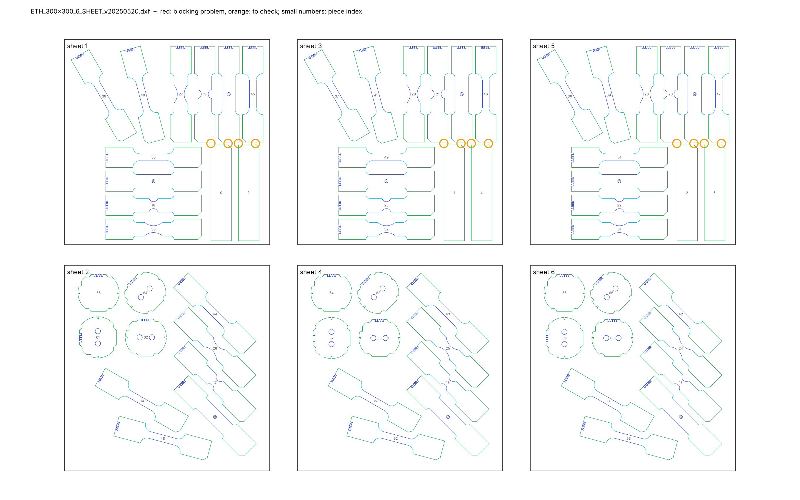

# Cutting sheet check – `ETH_300x300_6_SHEET_v20250520.dxf`

*Generated by `cutting-sheets/scripts/check_sheet.py`. Limits: gap between pieces ≥ 3.0 mm (warning below 5.0 mm), margin to the sheet edge ≥ 5.0 mm (provisional values, to be confirmed with the workshop).*

**Verdict: ready, with points to check** – 0 blocking problem(s) in 0 check(s), 1 check(s) with warnings.

## Checks

| Check | Status | Detail |
|---|---|---|
| Units | OK | $INSUNITS = 4 (millimetres) |
| Sheets | OK | 6 sheet frame(s): 300 × 300 mm, 300 × 300 mm, 300 × 300 mm, 300 × 300 mm, 300 × 300 mm, 300 × 300 mm |
| Closed contours | OK | all cutting contours are closed |
| Duplicate lines | OK | none |
| Colours = EDM quality | OK | cutting lines use only colours 3 / 4 / 5 (Q3 / Q4 / Q5): {3: 714, 4: 264, 5: 1281} |
| Overlaps | OK | none |
| Gap between pieces | WARNING | smallest gap 4.00 mm; 0 pair(s) below 3.0 mm, 12 more below 5.0 mm |
| Margin to sheet edge | OK | smallest margin 6.0 mm (limit 5.0 mm) |
| ID codes | OK | 60 of 60 specimens carry a notch code; 31 distinct codes; 11 code(s) shared only by specimens of different types (distinguishable by their shape) |
| Unreadable entities | INFO | ignored: {'LINE': 4} (zero length) |

## Specimens found

| Type (provisional name) | Orientation to rolling direction × number | Total |
|---|---|---|
| CH_D4.8_L140 | 0° × 3, 45° × 3, 90° × 3 | 9 |
| DISC_0H | × 3 | 3 |
| DISC_2H_00 | × 3 | 3 |
| DISC_2H_45 | × 3 | 3 |
| DISC_2H_90 | × 3 | 3 |
| NT_R20.00_L140 | 0° × 3, 45° × 3, 90° × 3 | 9 |
| NT_R6.67_L140 | 0° × 3, 45° × 3, 90° × 3 | 9 |
| STRIP_140x30 | 0° × 6 | 6 |
| UT_L140 | 0° × 3, 15° × 3, 30° × 3, 45° × 3, 60° × 3, 75° × 3, 90° × 3 | 21 |

*Type names are derived from the geometry: UT = uniaxial tension, NT_R = notched tension with notch radius R, CH_D = central hole of diameter D, DISC_nH = disc with n holes (2H_xx: axis of the holes at xx° to the rolling direction), STRIP / BLANK = rectangle without a gauge section (BLANK: with a notch code); L = length in mm. Orientation: angle between the specimen axis and the rolling direction (drawing +Y), folded into 0–90° (orthotropic sheet). Per-piece list: `pieces.csv`.*

| Sheet | Size | Pieces | Area used | Smallest margin |
|---|---|---|---|---|
| 1 | 300 × 300 mm | 12 | 46 % | 6.0 mm |
| 2 | 300 × 300 mm | 10 | 33 % | 10.1 mm |
| 3 | 300 × 300 mm | 12 | 46 % | 6.0 mm |
| 4 | 300 × 300 mm | 10 | 33 % | 10.1 mm |
| 5 | 300 × 300 mm | 12 | 46 % | 6.0 mm |
| 6 | 300 × 300 mm | 10 | 33 % | 10.1 mm |

> **Figure 1 – The cutting sheet and its problems.**
>
> *Plotted* – every line of the DXF in its EDM quality colour (green Q3, cyan Q4, blue Q5), sheet frames in black, piece index in small grey numbers; red circles: blocking problems; orange circles: points to check.
>
> *Source* – `ETH_300x300_6_SHEET_v20250520.dxf`.
>
> *How to read it* – each circle is listed in the table below with its coordinates (drawing millimetres).

## Problems

| # | Severity | Problem | Sheet | Position (mm) | Detail |
|---|---|---|---|---|---|
| 1 | WARNING | small gap | 1 | (214.0, 478.0) | 4.00 mm between pieces 0 (STRIP_140x30) and 19 (NT_R6.67_L140) |
| 2 | WARNING | small gap | 1 | (239.0, 478.0) | 4.00 mm between pieces 0 (STRIP_140x30) and 13 (CH_D4.8_L140) |
| 3 | WARNING | small gap | 1 | (254.0, 478.0) | 4.00 mm between pieces 3 (STRIP_140x30) and 13 (CH_D4.8_L140) |
| 4 | WARNING | small gap | 1 | (279.0, 478.0) | 4.00 mm between pieces 3 (STRIP_140x30) and 45 (UT_L140) |
| 5 | WARNING | small gap | 3 | (554.0, 478.0) | 4.00 mm between pieces 1 (STRIP_140x30) and 21 (NT_R6.67_L140) |
| 6 | WARNING | small gap | 3 | (579.0, 478.0) | 4.00 mm between pieces 1 (STRIP_140x30) and 12 (CH_D4.8_L140) |
| 7 | WARNING | small gap | 3 | (594.0, 478.0) | 4.00 mm between pieces 4 (STRIP_140x30) and 12 (CH_D4.8_L140) |
| 8 | WARNING | small gap | 3 | (619.0, 478.0) | 4.00 mm between pieces 4 (STRIP_140x30) and 46 (UT_L140) |
| 9 | WARNING | small gap | 5 | (894.0, 478.0) | 4.00 mm between pieces 2 (STRIP_140x30) and 20 (NT_R6.67_L140) |
| 10 | WARNING | small gap | 5 | (919.0, 478.0) | 4.00 mm between pieces 2 (STRIP_140x30) and 14 (CH_D4.8_L140) |
| 11 | WARNING | small gap | 5 | (934.0, 478.0) | 4.00 mm between pieces 5 (STRIP_140x30) and 14 (CH_D4.8_L140) |
| 12 | WARNING | small gap | 5 | (959.0, 478.0) | 4.00 mm between pieces 5 (STRIP_140x30) and 47 (UT_L140) |
