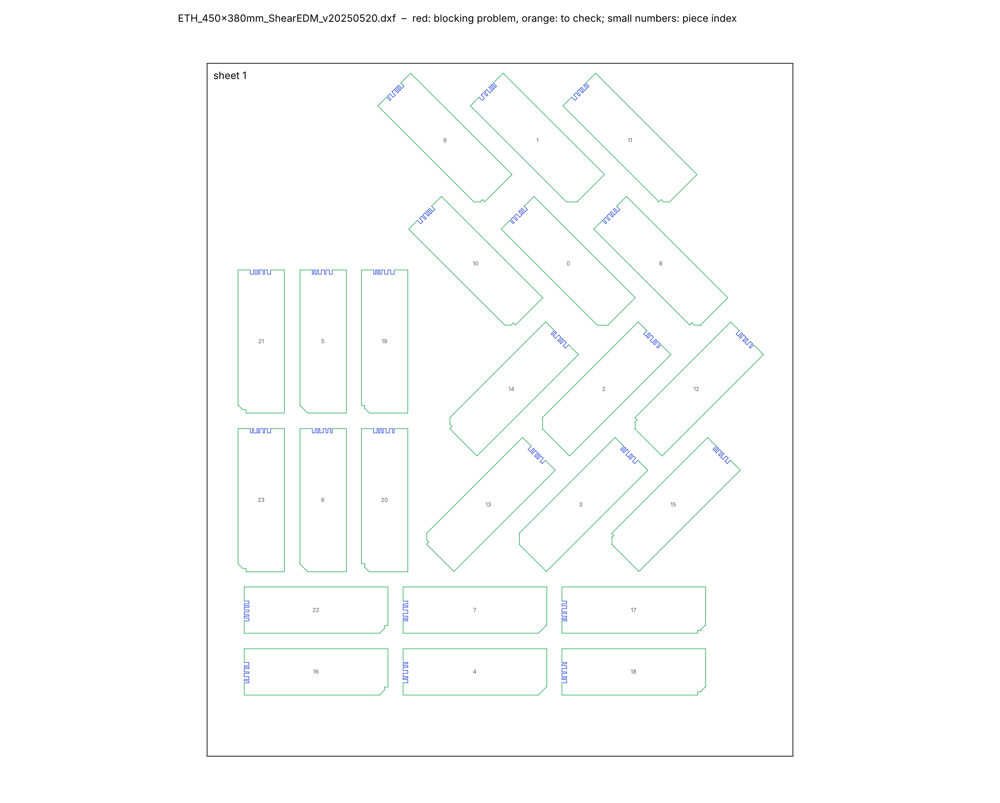

# Cutting sheet check – `ETH_450x380mm_ShearEDM_v20250520.dxf`

*Generated by `cutting-sheets/scripts/check_sheet.py`. Limits: gap between pieces ≥ 5.0 mm (warning below 5.0 mm), margin to the sheet edge ≥ 5.0 mm (gap: rule of the supervisors; margin: provisional).*

**Verdict: ready** – 0 blocking problem(s) in 0 check(s), 0 check(s) with warnings.

## Checks

| Check | Status | Detail |
|---|---|---|
| Units | OK | $INSUNITS = 4 (millimetres) |
| Sheets | OK | 1 sheet frame(s): 380 × 450 mm |
| Closed contours | OK | all cutting contours are closed |
| Duplicate lines | OK | none |
| Colours = EDM quality | OK | cutting lines use only colours 3 / 4 / 5 (Q3 / Q4 / Q5): {3: 176, 5: 456} |
| Overlaps | OK | none |
| Gap between pieces | OK | smallest gap 10.00 mm; 0 pair(s) below 5.0 mm, 0 more below 5.0 mm |
| Margin to sheet edge | OK | smallest margin 6.6 mm (limit 5.0 mm) |
| ID codes | OK | 24 of 24 specimens carry a notch code; 24 distinct codes |
| Unreadable entities | INFO | ignored: {'LINE': 2} (zero length) |

## Specimens found

| Type (provisional name) | Orientation to rolling direction × number | Total |
|---|---|---|
| BLANK_93x30 | 0° × 6, 45° × 12, 90° × 6 | 24 |

*Type names are derived from the geometry: UT = uniaxial tension, NT_R = notched tension with notch radius R, CH_D = central hole of diameter D, DISC_nH = disc with n holes (2H_xx: axis of the holes at xx° to the rolling direction), STRIP / BLANK = rectangle without a gauge section (BLANK: with a notch code); L = length in mm. Orientation: angle between the specimen axis and the rolling direction (drawing +Y), folded into 0–90° (orthotropic sheet). Per-piece list: `pieces.csv`.*

| Sheet | Size | Pieces | Area used | Smallest margin |
|---|---|---|---|---|
| 1 | 380 × 450 mm | 24 | 39 % | 6.6 mm |

> **Figure 1 – The cutting sheet and its problems.**
>
> *Plotted* – every line of the DXF in its EDM quality colour (green Q3, cyan Q4, blue Q5), sheet frames in black, piece index in small grey numbers; red circles: blocking problems; orange circles: points to check.
>
> *Source* – `ETH_450x380mm_ShearEDM_v20250520.dxf`.
>
> *How to read it* – each circle is listed in the table below with its coordinates (drawing millimetres).

## Problems

None.
