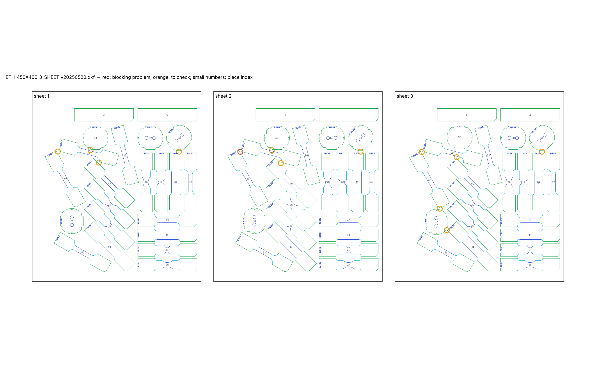
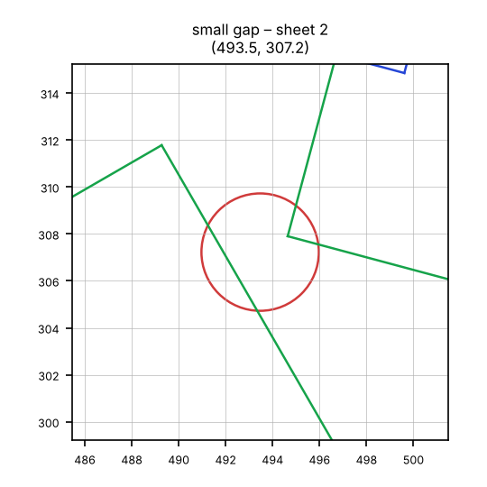

# Cutting sheet check – `ETH_450x400_3_SHEET_v20250520.dxf`

*Generated by `cutting-sheets/scripts/check_sheet.py`. Limits: gap between pieces ≥ 3.0 mm (warning below 5.0 mm), margin to the sheet edge ≥ 5.0 mm (provisional values, to be confirmed with the workshop).*

**Verdict: NOT READY for the workshop** – 1 blocking problem(s) in 1 check(s), 0 check(s) with warnings.

## Checks

| Check | Status | Detail |
|---|---|---|
| Units | OK | $INSUNITS = 4 (millimetres) |
| Sheets | OK | 3 sheet frame(s): 400 × 450 mm, 400 × 450 mm, 400 × 450 mm |
| Closed contours | OK | all cutting contours are closed |
| Duplicate lines | OK | none |
| Colours = EDM quality | OK | cutting lines use only colours 3 / 4 / 5 (Q3 / Q4 / Q5): {3: 714, 4: 264, 5: 1308} |
| Overlaps | OK | none |
| Gap between pieces | ERROR | smallest gap 2.71 mm; 1 pair(s) below 3.0 mm, 12 more below 5.0 mm |
| Margin to sheet edge | OK | smallest margin 10.0 mm (limit 5.0 mm) |
| ID codes | OK | 60 of 60 specimens carry a notch code; 31 distinct codes; 11 code(s) shared only by specimens of different types (distinguishable by their shape) |
| Unreadable entities | INFO | ignored: {'LINE': 4} (zero length) |

## Specimens found

| Type (provisional name) | Orientation to rolling direction × number | Total |
|---|---|---|
| CH_D4.8_L140 | 0° × 1, 45° × 2, 90° × 3 | 6 |
| CH_D5.0_L140 | 0° × 2, 45° × 1 | 3 |
| DISC_0H | × 3 | 3 |
| DISC_2H_00 | × 3 | 3 |
| DISC_2H_45 | × 3 | 3 |
| DISC_2H_90 | × 3 | 3 |
| NT_R20.00_L140 | 0° × 3, 45° × 3, 90° × 3 | 9 |
| NT_R6.67_L140 | 0° × 3, 45° × 3, 90° × 3 | 9 |
| STRIP_140x30 | 90° × 6 | 6 |
| UT_L140 | 0° × 3, 15° × 3, 30° × 3, 45° × 3, 60° × 3, 75° × 3, 90° × 3 | 21 |

*Type names are derived from the geometry: UT = uniaxial tension, NT_R = notched tension with notch radius R, CH_D = central hole of diameter D, DISC_nH = disc with n holes (2H_xx: axis of the holes at xx° to the rolling direction), STRIP / BLANK = rectangle without a gauge section (BLANK: with a notch code); L = length in mm. Orientation: angle between the specimen axis and the rolling direction (drawing +Y), folded into 0–90° (orthotropic sheet). Per-piece list: `pieces.csv`.*

| Sheet | Size | Pieces | Area used | Smallest margin |
|---|---|---|---|---|
| 1 | 400 × 450 mm | 22 | 40 % | 10.0 mm |
| 2 | 400 × 450 mm | 22 | 40 % | 10.0 mm |
| 3 | 400 × 450 mm | 22 | 40 % | 10.0 mm |

> **Figure 1 – The cutting sheet and its problems.**
>
> *Plotted* – every line of the DXF in its EDM quality colour (green Q3, cyan Q4, blue Q5), sheet frames in black, piece index in small grey numbers; red circles: blocking problems; orange circles: points to check.
>
> *Source* – `ETH_450x400_3_SHEET_v20250520.dxf`.
>
> *How to read it* – each circle is listed in the table below with its coordinates (drawing millimetres).

> **Figure 2 – Zoom on each blocking problem.**
>
> *Plotted* – a 16 mm window around each problem (24 mm for margins), same colours as Figure 1, red circle at the problem.
>
> *Source* – same drawing.
>
> *How to read it* – an open contour shows as two line ends that do not meet.

## Problems

| # | Severity | Problem | Sheet | Position (mm) | Detail |
|---|---|---|---|---|---|
| 1 | ERROR | small gap | 2 | (493.5, 307.2) | 2.71 mm between pieces 33 (UT_L140) and 38 (UT_L140) |
| 2 | WARNING | small gap | 1 | (60.6, 307.7) | 4.82 mm between pieces 37 (UT_L140) and 39 (UT_L140) |
| 3 | WARNING | small gap | 1 | (138.4, 311.2) | 3.67 mm between pieces 39 (UT_L140) and 54 (DISC_0H) |
| 4 | WARNING | small gap | 1 | (157.8, 281.6) | 3.94 mm between pieces 39 (UT_L140) and 47 (UT_L140) |
| 5 | WARNING | small gap | 1 | (348.2, 307.5) | 4.94 mm between pieces 7 (CH_D4.8_L140) and 63 (DISC_2H_45) |
| 6 | WARNING | small gap | 2 | (568.3, 311.0) | 4.12 mm between pieces 38 (UT_L140) and 55 (DISC_0H) |
| 7 | WARNING | small gap | 2 | (589.7, 280.5) | 4.42 mm between pieces 38 (UT_L140) and 40 (UT_L140) |
| 8 | WARNING | small gap | 2 | (778.2, 307.5) | 4.94 mm between pieces 13 (CH_D5.0_L140) and 64 (DISC_2H_45) |
| 9 | WARNING | small gap | 3 | (923.6, 306.7) | 4.43 mm between pieces 48 (UT_L140) and 49 (UT_L140) |
| 10 | WARNING | small gap | 3 | (965.9, 172.6) | 4.90 mm between pieces 48 (UT_L140) and 57 (DISC_2H_00) |
| 11 | WARNING | small gap | 3 | (982.6, 121.6) | 3.29 mm between pieces 11 (CH_D4.8_L140) and 57 (DISC_2H_00) |
| 12 | WARNING | small gap | 3 | (1005.9, 294.2) | 4.57 mm between pieces 49 (UT_L140) and 50 (UT_L140) |
| 13 | WARNING | small gap | 3 | (1208.2, 307.5) | 4.94 mm between pieces 14 (CH_D5.0_L140) and 65 (DISC_2H_45) |
