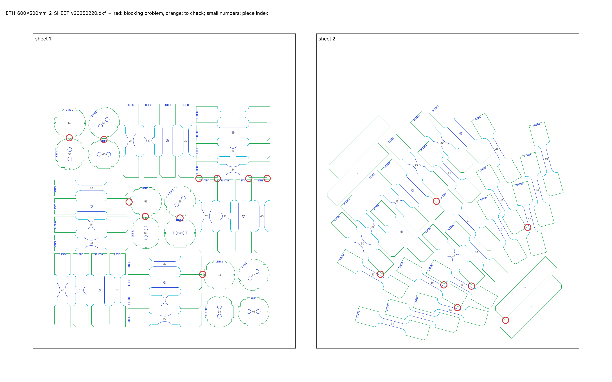
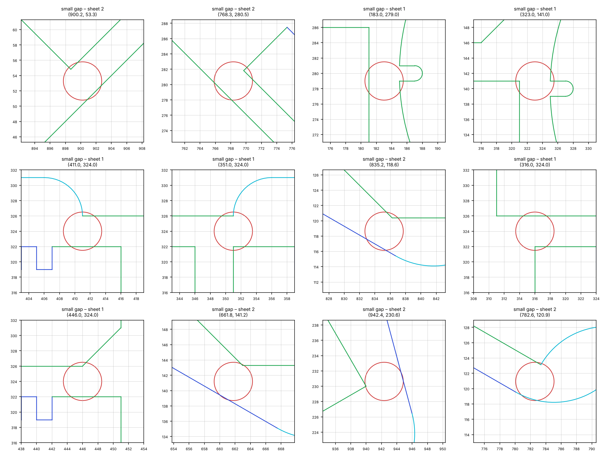

# Cutting sheet check – `ETH_600x500mm_2_SHEET_v20250220.dxf`

*Generated by `cutting-sheets/scripts/check_sheet.py`. Limits: gap between pieces ≥ 5.0 mm (warning below 5.0 mm), margin to the sheet edge ≥ 5.0 mm (gap: rule of the supervisors; margin: provisional).*

**Verdict: NOT READY for the workshop** – 17 blocking problem(s) in 1 check(s), 0 check(s) with warnings.

## Checks

| Check | Status | Detail |
|---|---|---|
| Units | OK | $INSUNITS = 4 (millimetres) |
| Sheets | OK | 2 sheet frame(s): 500 × 600 mm, 500 × 600 mm |
| Closed contours | OK | all cutting contours are closed |
| Duplicate lines | OK | none |
| Colours = EDM quality | OK | cutting lines use only colours 3 / 4 / 5 (Q3 / Q4 / Q5): {3: 704, 4: 264, 5: 1308} |
| Overlaps | OK | none |
| Gap between pieces | ERROR | smallest gap 3.00 mm; 17 pair(s) below 5.0 mm, 0 more below 5.0 mm |
| Margin to sheet edge | OK | smallest margin 15.8 mm (limit 5.0 mm) |
| ID codes | OK | 60 of 60 specimens carry a notch code; 31 distinct codes; 11 code(s) shared only by specimens of different types (distinguishable by their shape) |
| Unreadable entities | INFO | ignored: {'LINE': 4} (zero length) |

## Specimens found

| Type (provisional name) | Orientation to rolling direction × number | Total |
|---|---|---|
| CH_D4.8_L140 | 0° × 2, 45° × 3, 90° × 3 | 8 |
| CH_D5.0_L140 | 0° × 1 | 1 |
| DISC_0H | × 3 | 3 |
| DISC_2H_00 | × 3 | 3 |
| DISC_2H_45 | × 3 | 3 |
| DISC_2H_90 | × 3 | 3 |
| NT_R20.00_L140 | 0° × 3, 45° × 3, 90° × 3 | 9 |
| NT_R6.67_L140 | 0° × 3, 45° × 3, 90° × 3 | 9 |
| STRIP_140x30 | 45° × 4 | 4 |
| UT_L140 | 0° × 3, 15° × 3, 30° × 3, 45° × 3, 60° × 3, 75° × 3, 90° × 3 | 21 |

*Type names are derived from the geometry: UT = uniaxial tension, NT_R = notched tension with notch radius R, CH_D = central hole of diameter D, DISC_nH = disc with n holes (2H_xx: axis of the holes at xx° to the rolling direction), STRIP / BLANK = rectangle without a gauge section (BLANK: with a notch code); L = length in mm. Orientation: angle between the specimen axis and the rolling direction (drawing +Y), folded into 0–90° (orthotropic sheet). Per-piece list: `pieces.csv`.*

| Sheet | Size | Pieces | Area used | Smallest margin |
|---|---|---|---|---|
| 1 | 500 × 600 mm | 36 | 37 % | 40.0 mm |
| 2 | 500 × 600 mm | 28 | 31 % | 15.8 mm |

> **Figure 1 – The cutting sheet and its problems.**
>
> *Plotted* – every line of the DXF in its EDM quality colour (green Q3, cyan Q4, blue Q5), sheet frames in black, piece index in small grey numbers; red circles: blocking problems; orange circles: points to check.
>
> *Source* – `ETH_600x500mm_2_SHEET_v20250220.dxf`.
>
> *How to read it* – each circle is listed in the table below with its coordinates (drawing millimetres).

> **Figure 2 – Zoom on each blocking problem.**
>
> *Plotted* – a 16 mm window around each problem (24 mm for margins), same colours as Figure 1, red circle at the problem.
>
> *Source* – same drawing.
>
> *How to read it* – an open contour shows as two line ends that do not meet.

## Problems

| # | Severity | Problem | Sheet | Position (mm) | Detail |
|---|---|---|---|---|---|
| 1 | ERROR | small gap | 1 | (69.0, 401.5) | 3.02 mm between pieces 52 (DISC_0H) and 58 (DISC_2H_00) |
| 2 | ERROR | small gap | 1 | (135.0, 398.5) | 3.00 mm between pieces 56 (DISC_2H_45) and 60 (DISC_2H_90) |
| 3 | ERROR | small gap | 1 | (183.0, 279.0) | 4.02 mm between pieces 6 (CH_D4.8_L140) and 53 (DISC_0H) |
| 4 | ERROR | small gap | 1 | (214.0, 251.5) | 3.02 mm between pieces 53 (DISC_0H) and 63 (DISC_2H_00) |
| 5 | ERROR | small gap | 1 | (280.0, 248.5) | 3.00 mm between pieces 55 (DISC_2H_45) and 62 (DISC_2H_90) |
| 6 | ERROR | small gap | 1 | (316.0, 324.0) | 4.00 mm between pieces 24 (NT_R20.00_L140) and 28 (NT_R20.00_L140) |
| 7 | ERROR | small gap | 1 | (323.0, 141.0) | 4.02 mm between pieces 9 (CH_D4.8_L140) and 54 (DISC_0H) |
| 8 | ERROR | small gap | 1 | (351.0, 324.0) | 4.00 mm between pieces 16 (NT_R6.67_L140) and 24 (NT_R20.00_L140) |
| 9 | ERROR | small gap | 1 | (411.0, 324.0) | 4.00 mm between pieces 12 (CH_D5.0_L140) and 24 (NT_R20.00_L140) |
| 10 | ERROR | small gap | 1 | (446.0, 324.0) | 4.00 mm between pieces 24 (NT_R20.00_L140) and 40 (UT_L140) |
| 11 | ERROR | small gap | 2 | (661.8, 141.2) | 4.83 mm between pieces 30 (NT_R20.00_L140) and 33 (UT_L140) |
| 12 | ERROR | small gap | 2 | (768.3, 280.5) | 3.83 mm between pieces 5 (CH_D4.8_L140) and 46 (UT_L140) |
| 13 | ERROR | small gap | 2 | (782.6, 120.9) | 4.62 mm between pieces 36 (UT_L140) and 45 (UT_L140) |
| 14 | ERROR | small gap | 2 | (808.5, 77.6) | 4.46 mm between pieces 36 (UT_L140) and 50 (UT_L140) |
| 15 | ERROR | small gap | 2 | (835.2, 118.6) | 4.08 mm between pieces 21 (NT_R6.67_L140) and 45 (UT_L140) |
| 16 | ERROR | small gap | 2 | (900.2, 53.3) | 4.32 mm between pieces 1 (STRIP_140x30) and 2 (STRIP_140x30) |
| 17 | ERROR | small gap | 2 | (942.4, 230.6) | 4.87 mm between pieces 32 (UT_L140) and 47 (UT_L140) |
