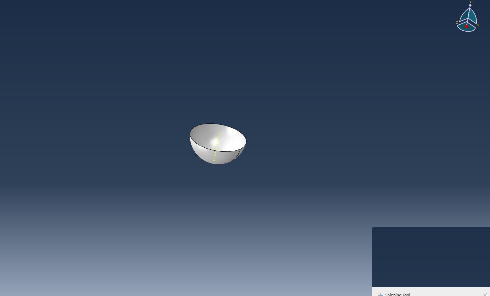
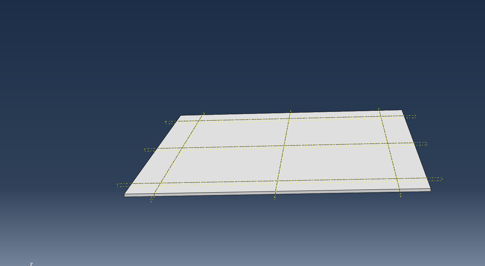
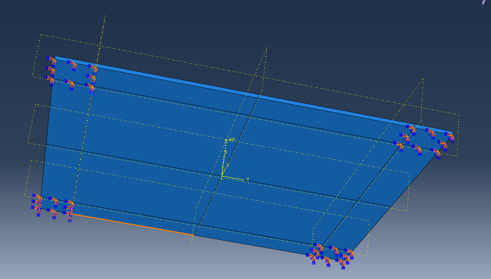
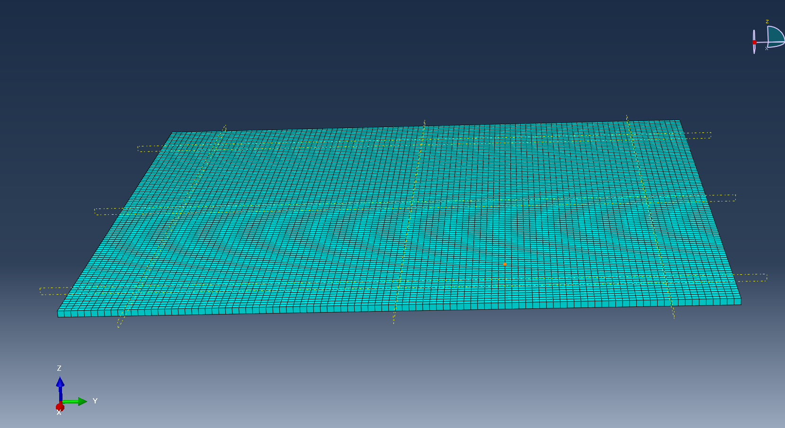
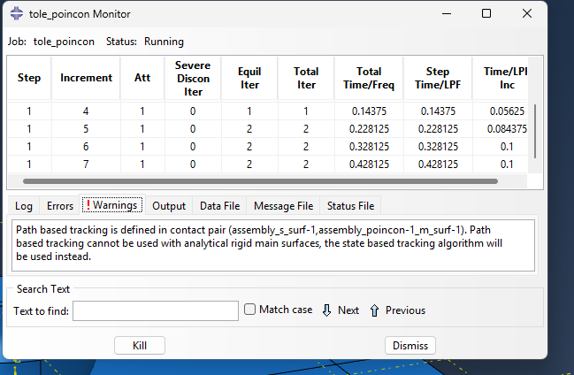
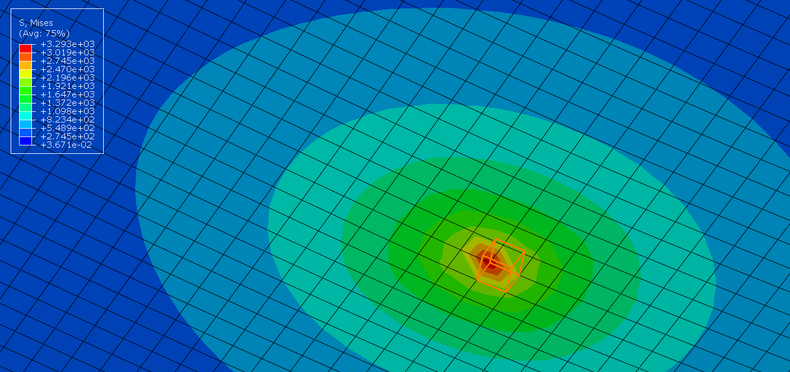

# 2026-10-07

## Objective

Starting simulations (and understand how the softwares work)

## Progress and Notes

Better understanding of the waves in the whole system and the rules at interfaces.
First steps in ABAQUS : simulation of a metal sheet being pushed and then released in its center by a poincon.

### Screenshots

Tutorial model in Abaqus/CAE: a metal sheet pushed by a rigid punch, then released (jobs `tole_poincon` and `tole-poincon-retour`).

*The punch: analytical rigid part, revolved from a sketched quarter circle.*

*The metal sheet, partitioned so that the mesh and the boundary conditions follow the lines of the partition.*

*Boundary conditions applied on the sheet.*

*Mesh of the sheet (hexahedra).*

*Job monitor during the run. Warning: path-based contact tracking cannot be used with an analytical rigid surface, so Abaqus switches to state-based tracking (no effect on the result).*

*Result: von Mises stress in the sheet under the punch.*

## Next Steps

- Continue simulations
- Waiting for the SHPB model for further simulations
- Learn how to run simulations on the cluster

## References

- Written notes labelled "07/10"