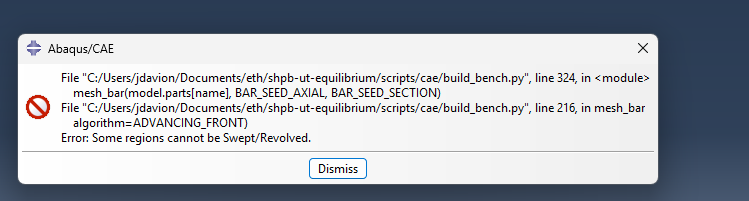
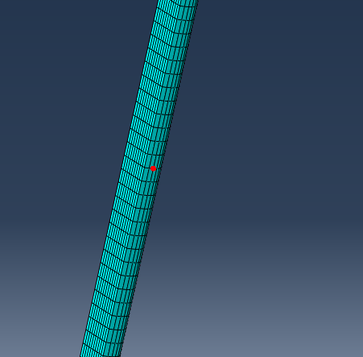
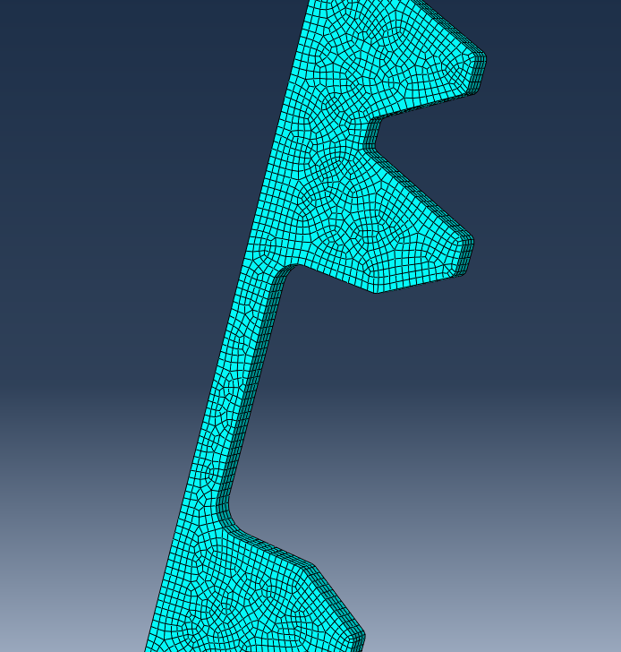
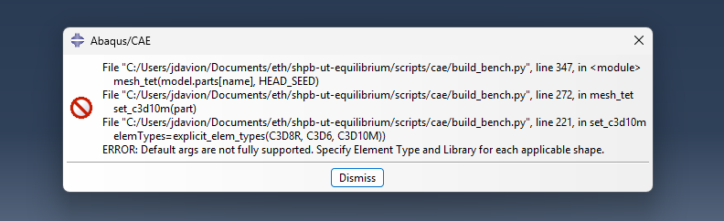
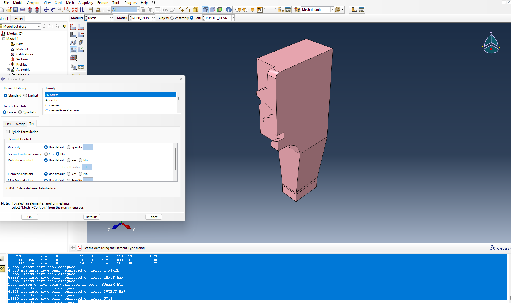
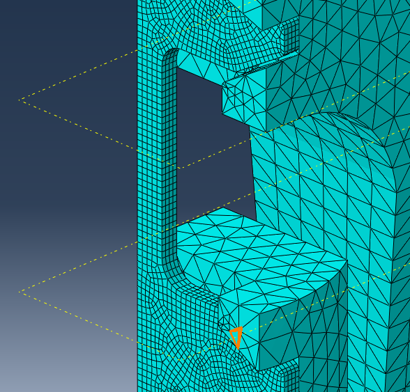

# 2026-10-09

## Objective

Finish the model of the bench: materials, mesh of the seven pieces, named sets and surfaces, export to lab-style `.geo` files, and a main input file template from which every run folder is generated.

## Progress and Notes

### 1. Materials (`scripts/pre/make_materials.py`)

The `.dat` files are generated by a script and never edited by hand: changing a parameter and re-running the script overwrites them.

| Material | Pieces | Data |
|---|---|---|
| MARAGING | input bar, output bar, pusher (rod + head), output head | elastic; E = ρc² with the measured wave speed c = 4871 m/s and ρ = 8000 kg/m³ (assumption) → E = 189 813 MPa, ν = 0.3 |
| STRIKER_STEEL | striker | elastic; c = 4720 m/s, ρ = 7850 kg/m³ (assumption) → E = 174 885 MPa, ν = 0.3 |
| DP1000 | specimen | E = 195 GPa, ν = 0.33, ρ = 7850 kg/m³; J2 plasticity, isotropic Swift–Voce hardening from Beerli 2026 table 4 (A = 1395 MPa, ε0 = 1e-6, n = 0.0892, k0 = 739 MPa, Q = 301 MPa, β = 102, α = 0.5), rate independent; checks k(0) = 573, k(0.002) = 798, k(0.1) = 1088, k(1) = 1218 MPa |

Documented in `docs/materials.md`.

### 2. Mesh (`build_bench.py`)

**Splitting the pieces.** The round and rectangular bodies can be meshed with swept hexahedra, the heads (pockets, teeth) cannot. The pusher is cut at Y = 125 into `PUSHER_ROD` (hex) and `PUSHER_HEAD` (tet), the output bar at Y = 100 into `OUTPUT_BAR` (hex) and `OUTPUT_HEAD` (tet). The halves will be glued back with ties.

**Problem: "Some regions cannot be Swept" on the output bar.** Reading the STEP file showed a tapped hole Ø8.5 × 27.5 mm at the far end of the bar. Solution (defeaturing): the round part of the output bar is replaced by a plain Ø20 × 6000 mm cylinder created in the script.

| Piece | Element | Technique | Size |
|---|---|---|---|
| STRIKER, INPUT_BAR, PUSHER_ROD, OUTPUT_BAR | C3D8R (reduced integration, hourglass control) | swept | 5 mm along the axis, 2 mm in the section |
| UT19 | C3D8R | swept, structured grid in the gauge section | 0.5 mm in plane, 4 elements through the 1.5 mm thickness |
| PUSHER_HEAD, OUTPUT_HEAD | C3D10M (modified quadratic tetrahedra, made for contact in Explicit) | free | 2 mm (Roth 2015) |

**Problems with the element type of the heads:**
- The heads were silently meshed with linear C3D4 tetrahedra (a node/element ratio of ≈ 0.2 gave it away): `setElementType` expects a **triplet** (hex, wedge, tet); one element type alone does not do what one expects.
- "Default args are not fully supported…": linear C3D8R and quadratic C3D10M cannot be mixed in the same triplet.
- Solution: set the type once by hand in the GUI and read the exact syntax in `abaqus.rpy`: `(UNKNOWN_HEX, UNKNOWN_WEDGE, C3D10M(secondOrderAccuracy=OFF, distortionControl=DEFAULT))`.
- **Method learned:** when the Python syntax of a CAE operation is unknown, do it once in the GUI and read the replay file `abaqus.rpy` of the current session.

**Specimen partition.** The specimen is cut at both ends of its straight gauge section (Y = 155.357 and 170.357 mm, length 15.000 mm, width 5 mm) so that the force through the specimen can be measured exactly there.

`docs/mesh.md` written: pieces, elements, techniques, checks, parameters.

*Problem: "Some regions cannot be Swept/Revolved" on the output bar (tapped hole at the far end).*

*After the fix: swept hexahedral mesh of a bar.*

*Mesh of the specimen head (C3D8R, 0.5 mm in plane).*

*Problem: "Default args are not fully supported. Specify Element Type and Library" when C3D8R and C3D10M were mixed in one triplet.*

*Method: set the element type once by hand (Mesh → Element Type) and read the exact Python syntax in `abaqus.rpy`.*

*Result: quadratic tetrahedra (C3D10M) in a head, around the pocket where the specimen (hexahedra) lies.*

### 3. Named sets and surfaces

Defined on the geometry, so they survive a remesh:

| Name | Type | Use |
|---|---|---|
| `<PIECE>_ALL` | element set | section assignment |
| `XSYMM` | nodes on X = 0 | symmetry condition |
| `S_TIE` | surfaces at Y = 125 (pusher) and Y = 100 (output bar) | ties |
| `S_IMPACT`, `S_PUSH` | bar end faces | contact striker → input bar → pusher |
| `S_SKIN` | outer skin of the specimen and of the two heads | contact teeth ↔ pockets |
| `SEC_IN`, `SEC_OUT` | internal faces at the ends of the gauge section | force through the specimen |
| `GAUGE_ZONE` | elements of the gauge section | stresses and strains |
| `GAUGE_IN`, `GAUGE_OUT` | ~100 elements (10 mm of bar) at 400 mm on the input and output bars | virtual strain gauges, as on the real bench (Beerli 2026) |
| `EXT_IN`, `EXT_OUT` | one node each, 12 mm apart on the specimen top face | virtual extensometer (DIC length) |

### 4. From CAE to lab-style text files (`scripts/pre/inp_to_geo.py`)

- `build_bench.py` also writes the raw input file generated by CAE (`writeInput`) into `model/geometry/_raw/`.
- `inp_to_geo.py` converts it into one flat `.geo` per piece: node coordinates moved to the global frame (rotation + translation of the instance applied), labels offset by n × 1 000 000 (STRIKER 1M, INPUT_BAR 2M, PUSHER_ROD 3M, PUSHER_HEAD 4M, UT19 5M, OUTPUT_BAR 6M, OUTPUT_HEAD 7M: the first digit of a label in an error message tells the piece), set names prefixed with the piece (`XSYMM` → `UT19_XSYMM`), plus a node set `<PIECE>_NALL`.
- Check: 7 pieces, 223 795 elements, specimen coordinates in the expected box (Y 155–202, Z 28.6–30.1).

### 5. Main input file template (`model/templates/SHPB_UT_main.inp` + `SHPB_UT_paras.inp`)

Built section by section:

| Section | Content |
|---|---|
| 0. Parameters | `*INCLUDE` of `<case_id>_paras.inp` (`*PARAMETER`: striker velocity, step time, output intervals) |
| 1. Mesh | `*INCLUDE` of the 7 `.geo` |
| 2. Materials | `*MATERIAL` + `*INCLUDE` of the 3 `.dat` |
| 3. Sections | one `*SOLID SECTION` per piece |
| 4. Ties | head (finer mesh) = secondary, rod = main; `ADJUST=YES`, `POSITION TOLERANCE=0.2` |
| 5. Contact properties | frictionless at the bar ends; friction 0.2 between teeth and pockets (Roth 2015); hard normal contact |
| 6. Boundary and initial conditions | `XSYMM` on the 7 pieces; initial velocity +Y on all striker nodes; the specimen is left free in Z, as on the real bench (nothing holds it from above) |
| 7. Force sections | `*INTEGRATED OUTPUT SECTION` on `SEC_IN` and `SEC_OUT` → section force SOF2. Equilibrium ⇔ SOF2(SEC_IN) = SOF2(SEC_OUT); half model → real force = 2 × SOF2 |
| 8. Step | `*DYNAMIC, EXPLICIT`, no mass scaling; general contact inside the step (in Explicit `*CONTACT` is history data), restricted to 4 surface pairs with `*CONTACT INCLUSIONS`; field outputs (specimen 100 frames, whole bench 20 frames), history outputs every 1 µs (gauges LE22/S22, SOF2 of both sections, U2 of the extensometer nodes, energies including the hourglass energy ALLAE) |

The templates contain tokens (`__SPEC__`, `__CASE_ID__`, `__V_STRIKER_MS__`) replaced for each run.

### 6. Run folders (`scripts/pre/make_run.py`)

For each line of `studies/taskI/cases.csv`, the script fills the templates and copies the 7 `.geo` and 3 `.dat` next to the `.inp`, so that every `runs/<case_id>/` folder is self-contained (12 files) and can be sent to the cluster as is. First estimate of the striker velocity: V ≈ strain rate × 15 mm (pusher velocity ≈ striker velocity), i.e. 1.5 / 7.5 / 15 m/s for 100 / 500 / 1000 s⁻¹, to be checked on the results. The UT40 cases are skipped until the UT40 geometry is available.

## Next Steps

- Run a `datacheck` on the first run folder and fix the input deck
- Run a first short simulation to measure the speed
- Set up the runs on the Euler cluster

## References

- `Article` **Beerli, T., Roth, C. C., Li, X., Grolleau, V. & Mohr, D.** (2026). *Rate-dependent plasticity and fracture of five DP-steels: static and dynamic high-throughput experiments and neural network modeling.* International Journal of Impact Engineering, 215, 105761. [doi:10.1016/J.IJIMPENG.2026.105761](https://doi.org/10.1016/J.IJIMPENG.2026.105761) · [PDF](../literature/papers/Rate_dependent_plasticity_and_fracture_of_five_DP_steels_static_and_dynamic_high_throughput_experiments_and_neural_network_modeling.pdf) — §2.5 (gauge positions), §3.5 (FE model), table 4 (DP1000)
- `Article` **Roth, C. C., Gary, G. & Mohr, D.** (2015). *Compact SHPB system for intermediate and high strain rate plasticity and fracture testing of sheet metal.* Experimental Mechanics, 55. [doi:10.1007/s11340-015-0061-x](https://doi.org/10.1007/s11340-015-0061-x) · [PDF](../literature/papers/Compact_SHPB_system_for_intermediate_and_high_strain_rate_plasticity_and_fracture_testing_of_sheet_metal.pdf) — mesh size of the heads, friction 0.2
- `Video` Lab tutorial on the Abaqus workflow (`abaqus_Tuto_Manos.mp4`) — `.geo` / `.dat` / `_paras.inp` conventions
- `File` *Mesh documentation.* [shpb-ut-equilibrium/docs/mesh.md](../shpb-ut-equilibrium/docs/mesh.md) · created 9 Oct 2026.
- `File` *Material documentation.* [shpb-ut-equilibrium/docs/materials.md](../shpb-ut-equilibrium/docs/materials.md) · created 9 Oct 2026.
