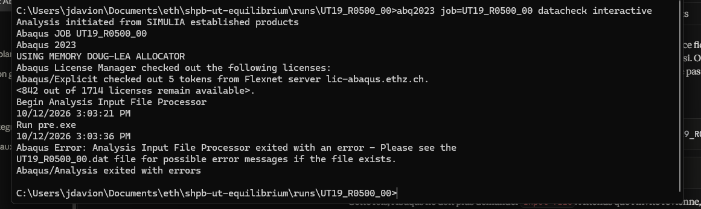
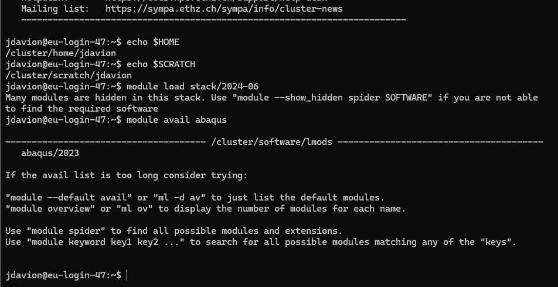
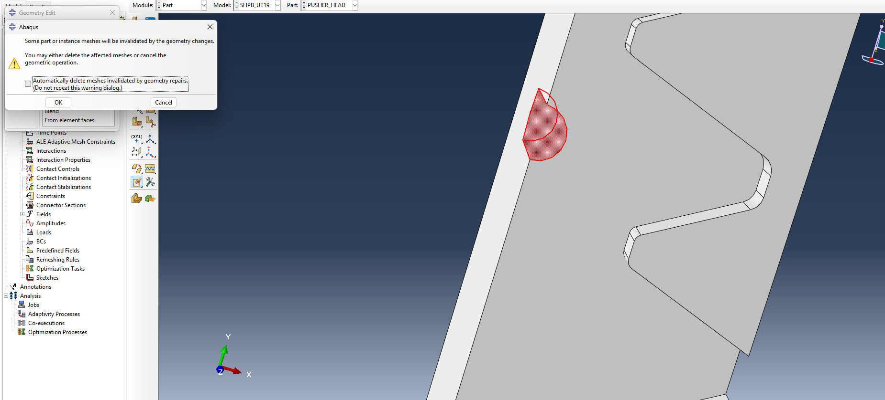
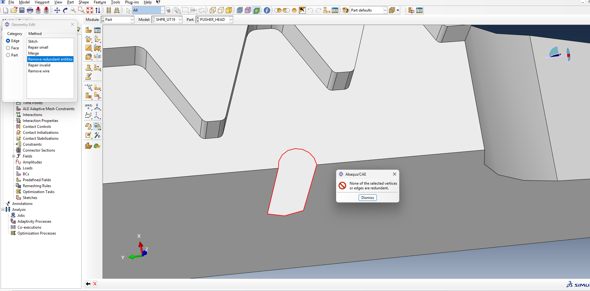
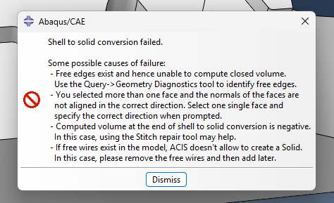
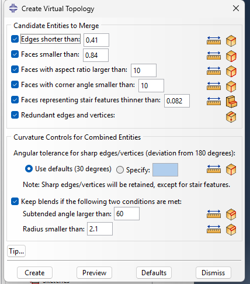
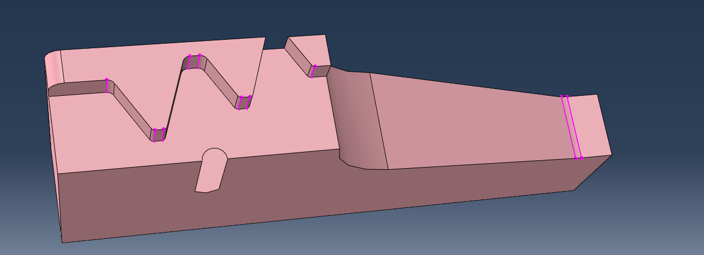
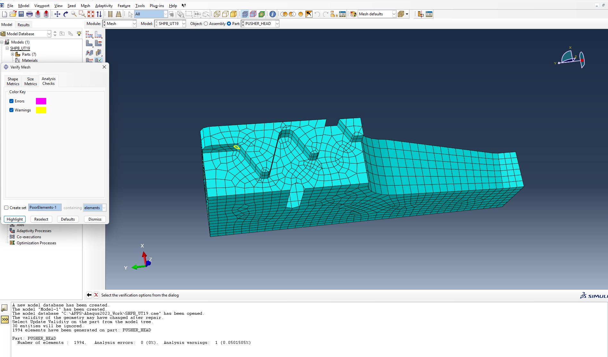

# 2026-10-12

## Objective

Get the input deck through `datacheck`, make the explicit time increment acceptable without mass scaling, and launch the first study (UT19 at 100, 500 and 1000 s⁻¹) on the Euler cluster.

## Progress and Notes

### 1. Debugging the input deck with `datacheck`

| Problem | Cause | Fix |
|---|---|---|
| "PARAMETER 'case_id' APPEARS IN A COMMENT LINE, BUT IT IS NOT DEFINED" | Abaqus substitutes `<...>` parameters **even in `**` comment lines** | no angle brackets in comments; `make_run.py` now refuses a template that contains some |
| 155 errors, starting with "UNKNOWN PARAMETER INTERNAL" | CAE marks the element sets behind surfaces as `internal`, valid only inside `*Part`/`*Assembly`; in a flat file every surface became empty, then ties, contacts and sections failed in cascade | `inp_to_geo.py` drops `internal` and renames `_S_TIE_S1` → `PIECE_I_S_TIE_S1` (no leading underscore) |
| "Failed to regularize material data for material DP1000" | Abaqus/Explicit resamples tables at a constant step equal to the smallest interval; the log-spaced plastic table (first interval 1e-6 over a range of 2) would need 2 million points | plastic table with a **constant step of 0.005** (401 points). Cost: between εp = 0 and 0.005 the hardening curve is a straight line (≤ −12 % at the very beginning of plasticity) |

After that the datacheck passed. Sanity checks:
- mass of the half model 21.5 kg (striker 6.2 + input bar 7.6 + output bar 7.5 + pusher) ✓
- initial kinetic energy 1.723e5 mJ vs ½ · 6.17 kg · (7.5 m/s)² = 1.735e5 mJ ✓
- 187 and 207 secondary nodes tied ✓
- initial contact overclosures ≤ 0.007 mm ✓

*First datacheck: the input file processor exits with errors, listed in the `.dat` file (table above).*

### 2. Euler cluster

- Login: `ssh jdavion@euler.ethz.ch` (ETH network or VPN; first login: accept the rules + code by e-mail). `$HOME = /cluster/home/jdavion` (50 GB, backed up), `$SCRATCH = /cluster/scratch/jdavion` (2.5 TB, **files deleted after 15 days**). Abaqus: `module load stack/2024-06 intel-oneapi-compilers/2023.2.0 abaqus/2023 libjpeg-turbo/3.0.0`.
- The repo is cloned on Euler (`~/eth`, after `module load eth_proxy`) so that the cluster always uses the same scripts as the PC (`git pull`).
- `scripts/hpc/run_abaqus.sh`: Slurm script for one run (8 cores, 2 GB/core, `--tmp=20G`), command `abaqus job=... cpus=8 mp_mode=threads double=both scratch=$TMPDIR ask_delete=OFF interactive`. Double precision because of the very large number of increments; `ask_delete=OFF` so that Abaqus never waits for a "y/n" answer.

*First login on Euler: `$HOME`, `$SCRATCH` and the Abaqus module (`module load stack/2024-06`, `module avail abaqus`).*

*Repository cloned on Euler (`module load eth_proxy` then `git clone`), first job submitted with `sbatch`, waiting in the queue (`squeue`).*

### 3. The stable time increment problem

**First short run (0.02 ms simulated):** 1 789 increments in 59 s (≈ 33 ms per increment), i.e. ≈ 3.3 h for 4 ms. Far too slow.

**What it is.** Explicit integration uses tiny time steps; a wave must not cross more than one element per step, so Δt ≈ (smallest element dimension) / (wave speed ≈ 6 mm/µs). One Δt is used for the whole model, so the worst element sets it for all 224 000 elements. We had Δt = **5.5e-9 s** (≈ 730 000 increments for 4 ms), whereas the specimen layers (0.375 mm) should allow ≈ 6e-8 s. The 10 most critical elements were flattened tetrahedra in the pusher head.

**Mass scaling rejected.** It would speed the run up by adding mass to the small elements, but mass (wave speed c = √(E/ρ), inertia forces) is exactly the physics studied in Task I. A colleague confirmed: no mass scaling in a dynamic study (the lab tutorial uses it because that test is quasi-static).

**How long must we simulate?** The wave needs ≈ 1.23 ms to cross the 6 m input bar before anything happens at the specimen; reaching 30 % strain then takes 0.30 / ε̇ (0.3 ms at 1000 s⁻¹, 0.6 ms at 500 s⁻¹, 3 ms at 100 s⁻¹). Idea kept in reserve: compute the step time per case (arrival + 0.30/ε̇ + margin, capped at the end of the pulse). Physical point: the striker pulse lasts 2 × 5 m / 4720 m/s ≈ 2.1 ms, **shorter than the 3 ms needed for 30 % at 100 s⁻¹**, so this striker cannot reach 30 % at 100 s⁻¹, which is itself an answer to Task I.

**Diagnosis.** I computed the smallest height (3 × volume / largest face) of each tetrahedron and located the 204 elements flagged by Abaqus:

| Cause | Flagged elements | Worst height |
|---|---|---|
| M4 hole (Ø3.3 drilled, with drill-point cone) in the pusher pocket floor, exactly on the symmetry plane X = 0 | 89 | 0.54 mm |
| M4 hole (Ø3.3, through) in the output head pocket floor, also on X = 0 | 45 | 0.68 mm |
| R0.5 / R1 / R1.5 fillets of the pocket teeth (strips 0.25–0.66 mm wide, 3.75 mm high) | 64 | **0.13 mm** |
| Thin strips (0.05–0.14 mm wide) of the cylindrical surface at the pusher rod/head junction (Y ≈ 130) | 2 | **0.10 mm** (they set Δt) |

(Median tet height ≈ 1.2 mm.)

**Fix 1: remove the M4 holes (useless during the test).**
- First attempt in CAE (Geometry Edit → Face → Remove) on the half pusher head: the hole was "filled" but the part **lost its volume** (only a closed skin remained; the mesh controls then offered Quad/Tri surface elements) and "Shell → Solid" failed. Abandoned.
- Solution: remove the holes **in the STEP files, before Abaqus**, with OpenCascade (`BRepAlgoAPI_Defeaturing`) in `scripts/pre/defeature_step.py`: it removes the faces of radius 1.65 mm and extends the neighbouring faces. Checks: still one valid solid, and the added volume equals the hole volume (pusher +101.2 mm³ = Ø3.3 × 11.5 mm + cone; output bar +62.0 mm³ = Ø3.3 × 7.25 mm). `build_bench.py` now imports `Inverter_new_noM4.step` and `Stange30mm_Step2_noM4.step`.

**Fix 2: virtual topology on the two heads.** The mesher respects every CAD edge; a 0.3 mm wide fillet strip meshed with 2 mm elements forces flattened elements. Virtual topology lets the mesher treat small faces and edges as merged with their neighbours (the real geometry is unchanged, nodes stay on the true surface; the fillets are no longer followed exactly, ~0.1–0.2 mm deviation at the tooth corners). Settings tested in CAE (Mesh → Tools → Virtual Topology → Automatic Create, checked with Preview), then scripted:
- edges shorter than 1.0 mm, faces smaller than 5.0 mm², faces with aspect ratio > 10 are merged;
- **"Keep blends" unchecked** (by default CAE protects fillets with radius < 2.1 mm, i.e. exactly ours);
- minimum tet size 1 mm (`minSizeFactor = 0.5`; 0.1 allowed 0.2 mm elements on small radii).

Smaller elements around the fillets were not an option: nicer elements, but an equally small Δt. `build_bench.py` now prints the tet quality of each head.

**Result:**

| | Before | After |
|---|---|---|
| Elements in the heads | 30 886 + 11 755 | 24 307 + 8 753 (whole model 214 214) |
| Smallest tet height | 0.102 / 0.174 mm | 0.431 / 0.388 mm |
| Initial stable Δt | 5.5e-9 s | **2.0e-8 s** (× 3.7) |
| Most critical elements | 9/10 in the pusher head | one tet of the output head **and specimen elements** |
| Max initial contact overclosure | 0.0070 mm | 0.0076 mm |
| Mass of the half model | 21.4882 kg | 21.4889 kg (+0.7 g = the two filled half-holes) |

**Second short run:** 767 increments in 26 s (≈ 34 ms per increment, ≈ 7.5 of 8 cores used), Δt ≈ 2.6e-8 s during the run → ≈ 1.4 h for 4 ms. Acceptable.

The specimen now also limits Δt (≈ 2e-8 s instead of the expected 6e-8 s): it contains some elements ~3 times smaller than expected. Not investigated yet.

*Fix 1, first attempt in CAE: Geometry Edit → Remove face on the M4 hole of the pusher pocket (red). CAE warns that the mesh will be deleted.*

*Geometry Edit: "None of the selected vertices or edges are redundant" on the hole.*

*After removing the faces the part had lost its volume; "Shell → Solid" failed. Abandoned: the holes were removed in the STEP files with OpenCascade instead.*

*Fix 2: Mesh → Tools → Virtual Topology → Automatic Create. Default settings shown here; final settings in the text ("Keep blends" unchecked).*

*Pusher head after virtual topology: the small fillet faces (pink lines) are merged with their neighbours for the mesher.*

*Mesh → Verify on the pusher head after virtual topology: no error, one warning element (yellow).*

### 4. Launching a whole study with one command

`scripts/hpc/submit_study.py taskI` (on the PC) runs `make_run.py` for all cases, gathers them in a dated folder `runs/_submit/taskI_<date>/` with a `cases.txt` list, copies it to `$SCRATCH` (`scp`) and submits a Slurm **job array** (`run_array.sh`): one job per line of `cases.txt`, run in parallel. Each launch has its own dated folder, so nothing is overwritten. `--dry-run` shows the commands without running them.

**First study launched at 18:11: `taskI_20261012-1811`**: UT19 at 100, 500 and 1000 s⁻¹ (striker 1.5 / 7.5 / 15 m/s), 4 ms simulated, job array 16911728.

*First study queued (`squeue`: job array 16911728, state PD = pending). `tail` finds no `.sta` yet because nothing has started.*

## Next Steps

- Check the 3 runs (overnight) and look at the results in Abaqus/Viewer
- Post-processing: `abaqus python` script on Euler (`.odb` → CSV) + plots on the PC
- Step time per case (in reserve)
- Why do some specimen elements limit Δt to 2e-8 s?
- Check that no wave reflection appears at the two ties (Y = 125 and Y = 100)
- UT40 geometry (STEP file needed)
- Questions for my supervisor: specimen material, densities of the bars, pusher material (A2 tool steel in the old CAD vs maraging in Beerli 2026), reference position of the output gauge

## References

- `Doc` ETH HPC documentation: [Getting started](https://docs.hpc.ethz.ch/tutorials/getting-started/), [SSH](https://docs.hpc.ethz.ch/connections/ssh/), [Storage](http://docs.hpc.ethz.ch/hardware/storage/), [Slurm](https://docs.hpc.ethz.ch/batchsystem/slurm/)
- `File` *Mesh documentation, sections 10–11 (export, tet quality, M4 holes, virtual topology).* [shpb-ut-equilibrium/docs/mesh.md](../shpb-ut-equilibrium/docs/mesh.md) · updated 12 Oct 2026.
- `File` *STEP defeaturing script.* [shpb-ut-equilibrium/scripts/pre/defeature_step.py](../shpb-ut-equilibrium/scripts/pre/defeature_step.py) · created 12 Oct 2026.
- `File` *Study submission.* [shpb-ut-equilibrium/scripts/hpc/submit_study.py](../shpb-ut-equilibrium/scripts/hpc/submit_study.py) · created 12 Oct 2026.
