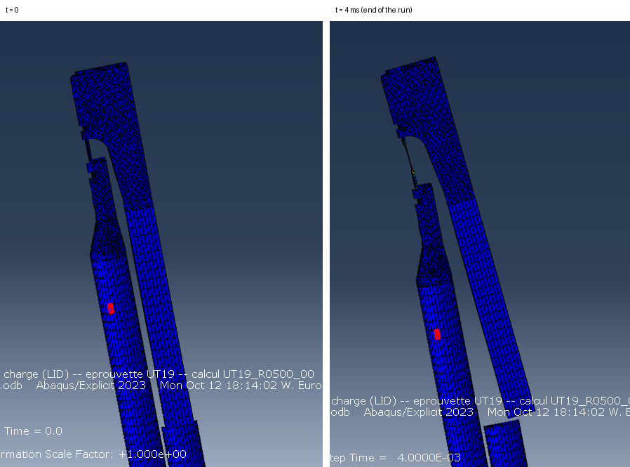
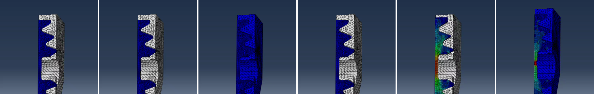
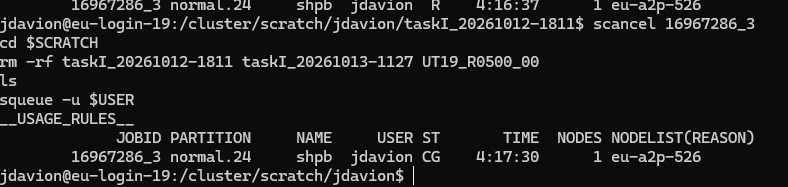

# 2026-10-13

## Objective

Check the first study, fix what the results reveal (pusher motion, animation, simulated duration, striker velocity), build the extraction pipeline from `.odb` to CSV and relaunch a clean study.

## Progress and Notes

### 1. First study `taskI_20261012-1811`

All three runs completed overnight ("THE ANALYSIS HAS COMPLETED SUCCESSFULLY"):

| Case | Wall time (8 cores) |
|---|---|
| UT19_R0100_00 | 4 182 s (1.2 h) |
| UT19_R0500_00 | 6 473 s (1.8 h) |
| UT19_R1000_00 | 11 329 s (3.1 h, close to the 4 h limit) |

The higher the rate, the more the specimen is stretched within the 4 ms, and the more Δt drops during the run. The time limit of the job array was raised to 8 h.

The `.odb` of the 500 s⁻¹ case was copied to the PC and opened in Abaqus/Viewer.

*The three runs of `taskI_20261012-1811` completed successfully, with their wall times.*

*The `.odb` of the 500 s⁻¹ run (384 MB) on the PC.*

### 2. The pusher tilts: guides added

**Observation.** Comparing the first and last frames, the pusher had moved down and **pitched**: the gap between the pusher head and the output head was wedge-shaped at the end. (I first thought it was a perspective effect, then pure translation; the relative wedge gap showed it was a rotation.)

**Cause.** The load is eccentric: the output bar axis is 21.5 mm above the input bar axis, so the specimen pulls the pusher with a lever arm. In the model nothing held the pusher vertically except contact friction. On the real bench the pusher runs in a slide that guides it in both directions, and the bars run in bearings.

**Fix.** `U3 = 0` (vertical displacement) on node sets `GUIDE`, created in `build_bench.py` and checked (error if empty):

| Set | Nodes | Count |
|---|---|---|
| `PUSHER_ROD_GUIDE` | bottom face Z = 0 of the rod (the face that slides in the guide) | 156 |
| `PUSHER_HEAD_GUIDE` | bottom face Z = 0 of the head, Y > 125 (tie plane excluded) | 1 066 |
| `STRIKER_GUIDE`, `INPUT_BAR_GUIDE` | nodes on the bar axis (X = 0, Z = 7.85) | 1 001, 1 203 |
| `OUTPUT_BAR_GUIDE` | nodes on the bar axis (X = 0, Z = 29.35) | 1 190 |

The bars stay free along their axis and in rotation about it. Documented in `docs/mesh.md` §12.

**Second study `taskI_20261013-1127`** launched with the guides (still 4 ms, same striker velocities). On the 500 s⁻¹ result the pusher keeps U3 ≈ 0 and stays on its axis.

*Abaqus/Viewer, 500 s⁻¹, side view of the pusher head and of the output head at t = 0 and at the end of the run (4 ms). At 4 ms the pusher has moved down and the gap between the two heads is wedge-shaped: the pusher rotated.*

### 3. Animation flicker

In Viewer, "Animate: Time History" flickered: the specimen was written at 100 frames and the rest of the bench at 20 frames, so on 4 frames out of 5 the heads and the pusher were displayed without results. Fix: the two heads and the pusher rod were added to the 100-frame field output (S and U), the rest of the bench stays at 20 frames.

*Six consecutive frames of the animation (0.32 to 2.00 ms). The specimen (coloured) is written at every frame, the output head (white = no result) only on one frame out of five: the head appears and disappears.*

### 4. Simulated duration per case

The idea kept in reserve on 12 October was implemented in `make_run.py`:

T_STEP = 1.234 ms (arrival of the wave at the pusher, 6010 mm / 4871 m/s) + 0.30 / ε̇ + margin, capped at the end of the pulse (+ 2 × 5000 mm / 4720 m/s = 2.119 ms). A column `t_step_ms` in `cases.csv` can force a value.

### 5. Extraction pipeline: from `.odb` to CSV

| Script | Runs on | Role |
|---|---|---|
| `scripts/post/extract_history.py` | Euler, `abaqus python` (Python 2.7, `odbAccess`) | one `.odb` → `<case>_history.csv` (time, mean LE22/S22 of both gauges, forces F_sec_in / F_sec_out, U2 of the extensometer nodes, engineering strain, energies) + `<case>_inventory.txt` (list of all history outputs) |
| `scripts/hpc/extract_study.sh` | Euler | runs the extraction on every completed case of a study; `--clean` deletes the restart/temporary files (`.res .abq .pac .sel .stt .mdl .prt .com …`), keeps the `.odb`; packs the light files into a `.tgz` |
| `scripts/hpc/fetch_study.py` | PC | `ssh` (git pull + extraction) → `scp` of the archive → unpacked on the PC; `--odb CASE` also copies one `.odb` |

Half model: forces and energies are multiplied by 2; the gauges are the average over their elements (98 and 104 elements); the extensometer length L0 is read from the node coordinates (12.000 mm).

Bugs fixed on the real `.odb`:
- `ValueError 'ElementSet'`: the history regions are named `Element PART-1-1.<label> Int Point 1`, `Node PART-1-1.<label>`, `Assembly Assembly-1` and `ElementSet  PIBATCH` → robust label reading, inventory written first so that it exists even if the rest fails.
- Forces missing: the section name is in the output key, not in the region (`SOF2  on surface SECTION_IN` in region `ElementSet  PIBATCH`).

### 6. First results (study `taskI_20261013-1127`, 100 and 500 s⁻¹)

`scripts/post/plot_case.py` (PC, Python 3): one control figure per run (bar gauges; forces; (F_in − F_out)/F_mean with ±5 % lines; extensometer strain with the 30 % line) and a summary CSV per study.

| Quantity | 500 s⁻¹ (7.5 m/s) | 100 s⁻¹ (1.5 m/s) |
|---|---|---|
| Incident strain plateau | −7.50e-4 (−142 MPa) = theory | −1.50e-4 (−28.5 MPa) |
| Mean strain rate | ≈ 485 s⁻¹ | **≈ 21 s⁻¹** |
| 30 % strain | at 1.995 ms | never (max 3.5 %) |
| Equilibrium (< 5 %) | 0.6 ms after loading start | 0.36 ms after loading start |
| Max force | 7.59 kN, then decreases (necking) | 7.40 kN |
| Hourglass energy / internal energy | < 1 % | < 1 % |

The pulse at the input gauge lasts 2.12 ms as expected.

**Why 100 s⁻¹ only gave 21 s⁻¹.** The estimate V ≈ ε̇ × 15 mm ignores the specimen. The elongation rate of the load inversion device is

v ≈ 2 v_i − 2 F / (ρcA), with v_i = K · V the particle velocity of the incident wave (K = Z_s / (Z_s + Z_b) = 0.487) and ρcA = 8000 × 4871 × 3.14e-4 ≈ 12 240 N·s/m:

the specimen force both slows the pusher down and pushes the output bar. At 1.5 m/s, 2 v_i ≈ 1.46 m/s and 2F/ρcA ≈ 1.2 m/s: almost nothing is left to stretch the specimen. At 500 s⁻¹ the correction is relatively small.

**New striker velocity** (`make_run.py`, documented in `docs/results.md` §4):

V = (ε̇ × L_eff + 2F / ρcA) / (2K), with F = 7 kN and L_eff = 12.7 mm for the UT19 (calibrated on the 500 s⁻¹ run; shorter than the 15 mm parallel section because the 12 mm extensometer sees the most strained zone).

| Target | Old V | New V | Simulated duration |
|---|---|---|---|
| 100 s⁻¹ | 1.5 m/s | 2.48 m/s | 3.65 ms (capped: end of the pulse) |
| 500 s⁻¹ | 7.5 m/s | 7.69 m/s | 2.13 ms |
| 1000 s⁻¹ | 15 m/s | 14.20 m/s | 1.83 ms |

The duration margin was raised from 0.2 to 0.3 ms (30 % was reached at 1.995 ms for 2.034 ms simulated).

### 7. Clean-up and new study

- Euler: the 1000 s⁻¹ run of `taskI_20261013-1127` was still running after 4 h 16 min (Δt down to 3.9e-9 s while the specimen was stretched far beyond 30 %); cancelled with `scancel`, then both studies and the first manual test folder were deleted from `$SCRATCH`.
- PC: old run folders deleted.
- **Third study `taskI_20261013-1554`** launched (job 16982782) with the guides, the new striker velocities and the per-case duration.

*Clean-up on Euler: `scancel` of the 1000 s⁻¹ run still running after 4 h 16 min, deletion of the old studies in `$SCRATCH`, check with `squeue` (CG = completing).*

## Next Steps

- Fetch the results of `taskI_20261013-1554` and check that the target rates are reached
- Decide what the Task I deliverables must show (figures, table, criteria)
- SSH key for Euler (avoid typing the password for each `ssh` / `scp`)

## References

- `Article` **Beerli, T., Roth, C. C., Li, X., Grolleau, V. & Mohr, D.** (2026). *Rate-dependent plasticity and fracture of five DP-steels: static and dynamic high-throughput experiments and neural network modeling.* International Journal of Impact Engineering, 215, 105761. [doi:10.1016/J.IJIMPENG.2026.105761](https://doi.org/10.1016/J.IJIMPENG.2026.105761) · [PDF](../literature/papers/Rate_dependent_plasticity_and_fracture_of_five_DP_steels_static_and_dynamic_high_throughput_experiments_and_neural_network_modeling.pdf)
- `File` *Extraction and plotting scripts.* [shpb-ut-equilibrium/scripts/post/](../shpb-ut-equilibrium/scripts/post/) · created 13 Oct 2026.
- `File` *Post-processing documentation, striker velocity formula.* [shpb-ut-equilibrium/docs/results.md](../shpb-ut-equilibrium/docs/results.md) · created 13 Oct 2026.
- `File` *Guides (U3 = 0).* [shpb-ut-equilibrium/docs/mesh.md](../shpb-ut-equilibrium/docs/mesh.md) §12 · updated 13 Oct 2026.
