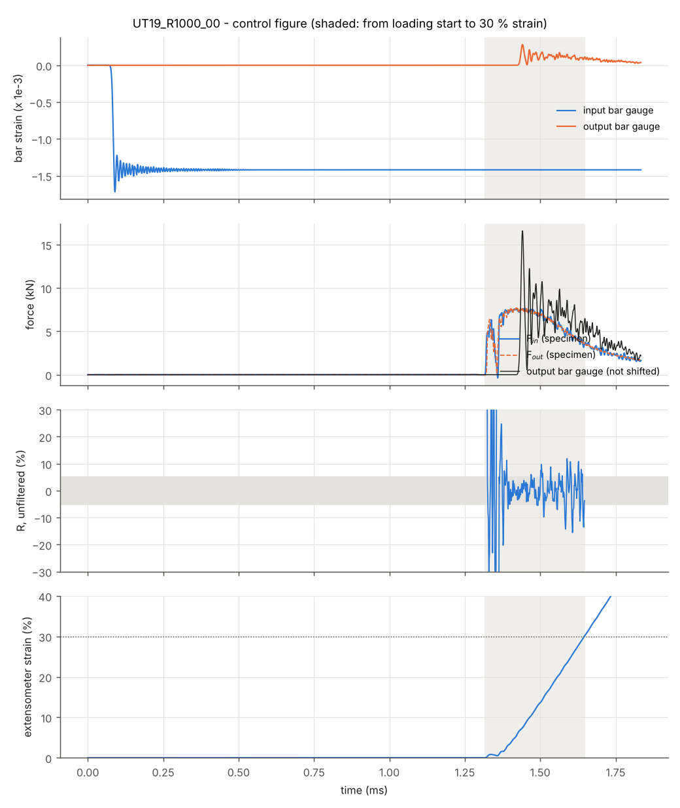

# 2026-10-14

## Objective

Retrieve and analyse the study `taskI_20261013-1554` (UT19, corrected striker velocities): check the strain rates actually reached and the force equilibrium.

## Progress and Notes

### 1. Retrieving the results

All three runs completed ("THE ANALYSIS HAS COMPLETED SUCCESSFULLY"). Fetched with:

```
py shpb-ut-equilibrium/scripts/hpc/fetch_study.py taskI_20261013-1554 --clean
```

- extraction on Euler: 3 654 / 2 135 / 1 835 time points (3.652 / 2.134 / 1.834 ms, as planned), 15 columns per CSV;
- `--clean` deleted the restart files; the study still takes 2.3 GB on Euler, mostly the three `.odb` (≈ 0.7 GB each);
- on the PC, `matplotlib`, `pandas` and `numpy` had to be installed (`py -m pip install --user ...`). The first installation was interrupted ("Operation cancelled by user") because two commands had been pasted at once: one command at a time.

### 2. First reading (`plot_case.py`)

| Case | Mean rate (0.5–25 %) | 30 % | Equilibrium (< 5 %, point by point) | F max | Hourglass |
|---|---|---|---|---|---|
| UT19_R0100_00 | 98 s⁻¹ | never (18.5 % max) | 0.285 ms after loading start | 7.52 kN | 0.4 % |
| UT19_R0500_00 | 504 s⁻¹ | at 1.974 ms | 0.276 ms after loading start | 7.61 kN | 0.5 % |
| UT19_R1000_00 | 889 s⁻¹ | at 1.647 ms | 0.327 ms after loading start | 7.63 kN | 0.2 % |

The corrected striker velocity works at 100 s⁻¹ (98 instead of 21 s⁻¹). The equilibrium time looked independent of the rate (≈ 0.3 ms), which would mean that at 1000 s⁻¹ the whole test (0.33 ms) is out of equilibrium.

### 3. Closer look: two first impressions corrected

**Strain rates.** The mean over 0.5–25 % includes the beginning of loading. Mean slope by strain window:

| Case | 0.5–5 % | 5–15 % | 15–25 % | 25–30 % |
|---|---|---|---|---|
| 100 s⁻¹ | 85 | **105** | 69 (end of pulse) | — |
| 500 s⁻¹ | 380 | **529** | 568 | 582 |
| 1000 s⁻¹ | 515 | **1050** | 1108 | 1139 |

On the steady part the targets are reached: the −11 % at 1000 s⁻¹ only came from the start of loading, the striker velocity does not need to be changed. The rate slowly increases during the test because the specimen force drops (necking), so the specimen brakes the bench less (term 2F/ρcA of the velocity formula).

**Equilibrium at 1000 s⁻¹.** In the force plot, F_in and F_out overlap well, but (F_in − F_out)/F_mean oscillates very fast (±5–15 %) during the whole test. The point-by-point criterion is broken by a single spike, which is why it gave "equilibrium at 1.646 ms", i.e. at 30 % strain. The conclusion "no equilibrium at 1000 s⁻¹" was too fast and the criterion has to be revised.

Max |F_in − F_out| / F_mean, unfiltered, from a given strain until the end of the useful window:

| Case | after 2 % | after 5 % |
|---|---|---|
| 100 s⁻¹ | 1.5 % | 1.1 % |
| 500 s⁻¹ | 11.5 % | 5.5 % |
| 1000 s⁻¹ | 15.5 % | 15.5 % |

### 4. Other observations

- **Necking:** the force is maximum around 5 % strain (≈ 7.5 kN, i.e. ≈ 1000 MPa on the 7.5 mm² section) and drops to ≈ 3.4 kN at 30 %. Beyond ≈ 5 % the extensometer mostly measures a localised strain.
- **Output bar gauge:** strongly oscillating at 500 and 1000 s⁻¹ (peak 16 kN for 7.5 kN real) and delayed by ≈ 0.1 ms (travel from the specimen to the gauge, 400 mm). This is the only force signal available in the experiments.
- **Start of loading:** between 1.32 and 1.36 ms (1000 s⁻¹) the force rises, drops back to zero, then rises again: most likely a small rebound of the specimen shoulders in the pockets, since the specimen simply lies in them.



*Control figure of the 1000 s⁻¹ run (raw signals: bar gauges, specimen forces, R, strain). This version was redrawn later by `report_taskI.py`; the signals are those read on 14 Oct (oscillating output gauge, rise–drop–rise of the force at the start).*


### 5. Opening a result in Abaqus/Viewer

```
py shpb-ut-equilibrium/scripts/hpc/fetch_study.py taskI_20261013-1554 --odb UT19_R1000_00
```

then File → Open → Output Database. Deformed shape and animation (Animate → Time History), contours of S Mises and PEEQ in the specimen, history outputs (Result → History Output). Close the `.odb` afterwards (File → Close ODB), otherwise Windows locks the file.

## Next Steps

- Find out how equilibrium and forces are evaluated in the lab's experiments, to process the simulated signals the same way
- Revise the equilibrium criterion (high-frequency oscillations)
- Decide what the Task I deliverables must show

## References

- `File` *Results of the study (CSV, control figures).* [shpb-ut-equilibrium/results/taskI_20261013-1554/](../shpb-ut-equilibrium/results/taskI_20261013-1554/) · retrieved 14 Oct 2026.
- `File` *Control figures script.* [shpb-ut-equilibrium/scripts/post/plot_case.py](../shpb-ut-equilibrium/scripts/post/plot_case.py)
