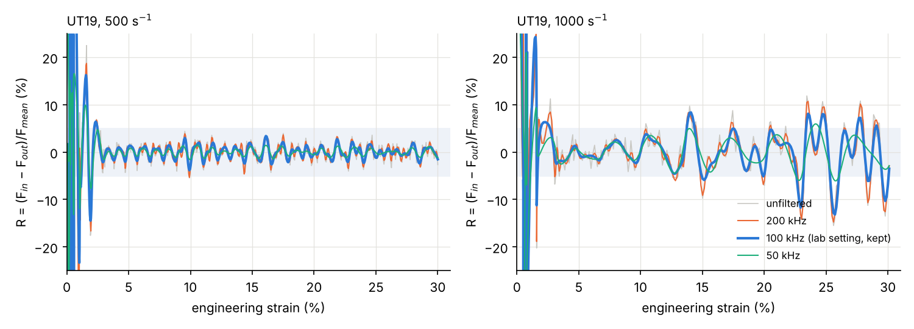

# 2026-10-15

## Objective

Define the Task I deliverables and process the simulated signals exactly as the experimental ones, using the lab papers.

## Progress and Notes

### 1. How the lab measures and evaluates its experiments

| | In the experiments | In our simulation |
|---|---|---|
| Force | strain gauge on the output bar, 400 mm from the specimen clamping, sampled at 400 kHz (Beerli 2026); signal low-pass filtered at **100 kHz** and corrected for dispersion with DAVID (Roth 2015), then "transported" to the specimen | same virtual gauge (`GAUGE_OUT`), plus two sections in the specimen (`SEC_IN`, `SEC_OUT`) |
| Strain | DIC on the specimen, high-speed camera at 100–200 kHz (Beerli 2026, table 1) | virtual extensometer, 12 mm |
| Equilibrium check | Beerli 2026 fig. 5c: force of the output gauge transported to the specimen compared with the section forces at both ends of the specimen; "all three signals coincide with minor oscillations of < 1 %" | same comparison |

Roth 2015 also notes that the reflected wave is not used with the load inversion device (the varying pusher impedance makes it hard to interpret): the specimen elongation comes from DIC. So the simulation does not need to run until the reflected wave comes back to the input gauge.

### 2. Decisions on the deliverables

- Results in **figures + English text**, to be integrated later into a PDF report.
- **Strain on the x-axis** rather than time: it allows comparing the three rates and answers the practical question "from which strain is the measurement valid?".
- 30 % at 100 s⁻¹ is impossible with the 5 m striker → written as a result.
- Planned deliverables:

| # | Deliverable | Answers |
|---|---|---|
| T1 | table of test conditions and indicators, one line per run | both questions |
| F1 | equilibrium ratio R vs strain, three rates, ±5 % band | equilibrium |
| F2 | F_in, F_out and output gauge force (shifted), one panel per rate | equilibrium + measurement quality |
| F3 | engineering stress-strain curve as measured (output gauge / A0) vs exact | curve to compare with the experiments |
| F4 | strain rate vs strain | constancy of the rate |
| F5 | chart striker velocity → strain rate, with the limit for 30 % | loading speeds |

### 3. Filtering: what it is and why

Abaqus writes one point per µs (1 MHz). The forces contain very fast vibrations (period of a few µs) that make R jump by ±10 % from one point to the next. The experiment cannot see them, since the gauge signal is filtered at 100 kHz (everything slower than ≈ 10 µs is kept, faster variations are removed).

Choice: apply **the same filter** to the simulated forces and strain (4th-order Butterworth, 100 kHz cut-off, zero phase with `filtfilt`), **before** computing R. Not an arbitrary smoothing: the lab's setting, so that simulation and experiment are compared with the same resolution.

Test of the cut-off frequency (max |R| after 2 / 5 / 10 % strain; strain from which |R| < 5 % holds until 30 %):

| Case | Unfiltered | 200 kHz | **100 kHz** | 50 kHz |
|---|---|---|---|---|
| 100 s⁻¹ | 1.5 / 1.1 / 1.1 %, from 0.9 % | 1.2 / 1.0 / 1.0 % | **0.9 / 0.9 / 0.9 %, from 0.9 %** | 0.6 / 0.4 / 0.4 % |
| 500 s⁻¹ | 11.5 / 5.5 / 4.5 %, from 10 % | 9.1 / 5.3 / 4.6 % | **8.9 / 3.8 / 3.4 %, from 2.5 %** | 6.9 / 1.6 / 1.5 % |
| 1000 s⁻¹ | 15.5 % throughout | 14.8 % | **13.2 %, not maintained** | 6.0 %, from 26 % |

*R = (F_in − F_out)/F_mean against strain for four filter settings (study `taskI_20261013-1554`). Shaded: |R| < 5 %. At 500 s⁻¹ the unfiltered R leaves the band because of fast vibrations only; at 1000 s⁻¹ a slower difference remains even at 100 kHz (section 4).*

### 4. At 1000 s⁻¹ the difference is real

Even filtered at 100 kHz, a slower difference remains at 1000 s⁻¹. By strain window:

| Strain | Max \|R\| | ΔF | F_mean |
|---|---|---|---|
| 4–12 % | < 5 % | ≤ 0.3 kN | ≈ 7.4 kN |
| 12–16 % | 8.4 % | 0.6 kN | 7.2 kN |
| 22–26 % | 11.7–13.2 % | 0.56 kN | 4.2–4.8 kN |
| 28–30 % | 10.3 % | 0.36 kN | 3.5 kN |

The absolute difference stays at 0.3–0.6 kN throughout, but the force halves during necking, so the ratio grows. Both the ratio R and the absolute difference ΔF will be reported.

## Next Steps

- Write the deliverables script (table, five figures, text)
- Install `scipy` on the PC for the filter

## References

- `Article` **Beerli, T., Roth, C. C., Li, X., Grolleau, V. & Mohr, D.** (2026). *Rate-dependent plasticity and fracture of five DP-steels: static and dynamic high-throughput experiments and neural network modeling.* International Journal of Impact Engineering, 215, 105761. [doi:10.1016/J.IJIMPENG.2026.105761](https://doi.org/10.1016/J.IJIMPENG.2026.105761) · [PDF](../literature/papers/Rate_dependent_plasticity_and_fracture_of_five_DP_steels_static_and_dynamic_high_throughput_experiments_and_neural_network_modeling.pdf) — §2.5 (setup, gauge positions), table 1 (DIC), fig. 5c (numerical equilibrium check)
- `Article` **Roth, C. C., Gary, G. & Mohr, D.** (2015). *Compact SHPB system for intermediate and high strain rate plasticity and fracture testing of sheet metal.* Experimental Mechanics, 55. [doi:10.1007/s11340-015-0061-x](https://doi.org/10.1007/s11340-015-0061-x) · [PDF](../literature/papers/Compact_SHPB_system_for_intermediate_and_high_strain_rate_plasticity_and_fracture_testing_of_sheet_metal.pdf) — signal processing (100 kHz filter, DAVID), reflected wave not used
