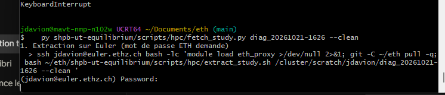
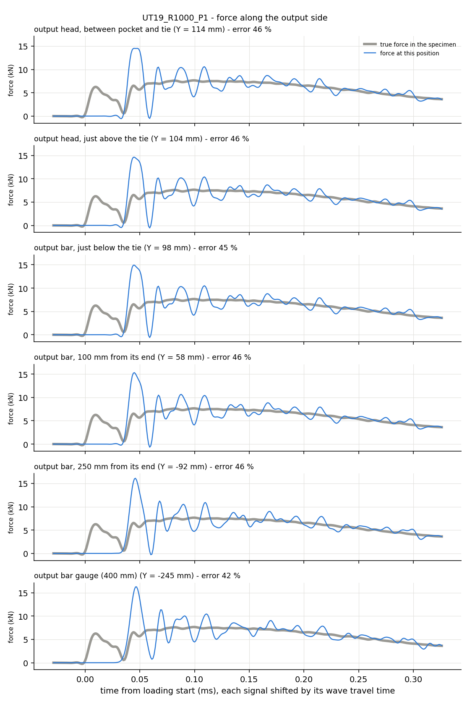

# 2026-10-22

## Objective

Find where the oscillations of the output-bar gauge come from at 1000 s⁻¹ (UT19), using the probe run
`diag_20261021-1626` (case `UT19_R1000_P1`, same model as the Task I run plus five force probes); then fix the
model after the meeting with the supervisors.

## Progress and Notes

### 1. Fetching the probe run (and the problems on the way)

Command, from Git Bash on the lab PC, in `~/Documents/eth`:

```bash
py shpb-ut-equilibrium/scripts/hpc/fetch_study.py diag_20261021-1626 --clean
```

| Problem | Cause | Fix |
|---|---|---|
| `-bash: py: command not found` | the terminal was still logged in on Euler (opened earlier to check the job); `py` only exists on the Windows PC | `exit` to leave Euler, then run the command again |
| after typing the password, nothing happens for several minutes (screenshot below) | not a freeze: `fetch_study.py` first runs `extract_study.sh` **on Euler**, which opens the `.odb` with Abaqus Python and writes the history CSV. The password prompt is the last thing printed until the extraction ends | wait. Checked from a second terminal on Euler that `UT19_R1000_P1_history.csv` was being written in `/cluster/scratch/jdavion/diag_20261021-1626/` |
| `git pull` refused on the PC (an untracked local file would be overwritten) | `UT19_R1000_00_gauge_diag.csv` had been generated locally and was also pushed from the other side | delete the local copy (`rm`), then `git pull`. Rule from now on: the screenshots and figures of the journal go in `journal/figures/<date>/`, not in `results/` |



*Figure 1 – `fetch_study.py` after the password. The cursor stays on `Password:` while Abaqus Python extracts the history on
Euler; the copy to the PC only starts afterwards.*

### 2. Force along the output side

```bash
py shpb-ut-equilibrium/scripts/post/plot_probes.py results/diag_20261021-1626/UT19_R1000_P1
```

Each probe is a slice through the output side (5 mm of tetrahedra in the head, one layer of hexahedra in the bar). Its
force is $F = 2\,\sum (S_{22}\,V)/h$ (half model). Every signal is shifted back by its wave travel time to the
specimen, filtered at 100 kHz, and compared to the true force in the specimen (section `SEC_OUT`).

| Probe | Where | Y (mm) | Max error after 5 % strain (% of max force) |
|---|---|---|---|
| `HEAD_MID` | output head, between the pocket and the tie | 114 | 46 |
| `HEAD_TIE` | output head, just above the tie | 104 | 46 |
| `BAR_TIE` | output bar, just below the tie | 98 | 45 |
| `BAR_100` | output bar, 100 mm from its end | 58 | 46 |
| `BAR_250` | output bar, 250 mm from its end | −92 | 46 |
| gauge | output bar, 400 mm from its end (top + bottom pair) | −245 | 42 |



*Figure 2 – Grey thick line: true force in the specimen (simulation only). Blue line: force through the slice at
that position. From the head to the gauge the blue curve is the same: a spike of ≈ 15 kN at 0.045 ms, then an
oscillation that decays over ≈ 0.25 ms.*

**What this shows**: the oscillation is already there in the head, 14 mm above the tie, with the same amplitude.
The tie (head glued to the bar) and the wave travel along the bar do not create it. It is created **between the
gauge section of the specimen and the head**: in the specimen shoulders, the pocket, or the contact between them.

### 3. The specimen travels before it pulls on the head

Zoom on the first 120 µs, unfiltered (filtering with `filtfilt` spreads a sharp step backwards in time and
would hide the delay):


*Figure 3 – Top: force in the specimen (grey) and in the output head (blue, moved back by its 8.5 µs of wave
travel). Bottom: displacement U2 of the output end of the specimen (extensometer node `EXT_OUT`). Shaded: the
specimen is pulled but the head does not feel anything yet.*

| Observation | Value |
|---|---|
| specimen starts to be loaded (F_sec_out > 2 % of max) | t = 1.322 ms (time 0 of figure 3) |
| head starts to be loaded, wave travel removed | 26 µs later (35 µs without removing the 8.5 µs of travel) |
| displacement of the specimen end at that moment | 0.27 mm (0.44 mm at 35 µs) |
| force in the specimen before contact | up to 6.4 kN: only its own inertia (it is accelerated by the input side) |
| force in the head just after contact | 15.8 kN raw, 14.5 kN filtered, at ≈ 0.5 % strain: twice the force the specimen can carry |
| force in the specimen at the same instant | drops to ≈ 0 (the specimen bounces back on the head) |
| ringing afterwards | period ≈ 25 µs, i.e. ≈ 40 kHz, decays over ≈ 0.25 ms |

Interpretation: the specimen is placed **centred** in the pockets, so there is a clearance of a few tenths of
a millimetre between the shoulder and the output pocket. The specimen is set in motion by the input side, crosses
this gap and **hits** the output head. That impact (not the specimen force) is the 15 kN spike, and the head rings
afterwards. This ringing is what the gauge sees.

### 4. How long the gauge stays wrong

Gauge force (top + bottom pair, filtered, shifted by 82 µs) compared with the true force, window up to 30 % strain:

| From strain | Max error (% of max force) | RMS error (% of max force) |
|---|---|---|
| 5 % | 37.9 | 11.4 |
| 10 % | 24.8 | 8.7 |
| 20 % | 15.4 | 5.5 |

So the impact is not just a start-up problem: at 1000 s⁻¹, 30 % strain is reached in 0.33 ms, i.e. before the
ringing has died out.

### 5. Conclusions

- Averaging, bending, the tie and the bar are ruled out (21/10 and today).
- The most likely source is the **clearance between the specimen shoulder and the output pocket**: impact, then
  ringing of the head.
- The model has to say what the real test does: in the lab, is the specimen pushed against the pocket (or
  preloaded) before the shot? If yes, the model should start without the gap.

### 6. Meeting with the supervisors: the initial contact is wrong in the model

Verdict of the supervisors (they were happy with the diagnosis):

- In the lab, before the shot, the pusher is pulled very slightly so that the teeth of the specimen sit against
  the teeth of the pusher pocket **and** of the output-bar pocket. Nothing is loose, but there is no preload.
- In the model, the specimen was centred in both pockets, so nothing was in contact at the start. Every part
  then bounces (the specimen in its pockets, the head...), which gives the oscillations.
- Fix: start the model with every contact closed, by translating the parts.

**Measuring the gaps.** New script `scripts/pre/pocket_gaps.py` (OpenCascade, on the STEP files, in the
same placement as `build_bench.py`). It finds the smallest translation along Y that brings two solids into
contact. While measuring, the specimen is lifted by 0.5 mm so that the contact on the pocket floor (in Z) is not
counted. The teeth are extruded along Z, so the lift does not change the gap along Y.

| Pocket | Gap in the pulling direction | Gap in the other direction | Faces in contact once the gap is closed |
|---|---|---|---|
| pusher | 0.3567 mm | 0.2818 mm | inclined flanks of the **three** teeth |
| output bar | 0.3563 mm | 0.1659 mm | inclined flanks of the **three** teeth |

The three teeth touch at the same time, so the tooth pitch is the same on the specimen and in the pockets.

**New placement** (`build_bench.py`, `CLOSE_GAPS = True`, values stored in `SPECIMENS`):

| Part | Translation along Y | Why |
|---|---|---|
| pusher | none | stays against the input bar (Y = 0) |
| specimen | −0.3567 mm | its teeth touch the pusher pocket |
| output bar | −0.7130 mm (= −0.3567 − 0.3563) | its pocket touches the specimen teeth |

Output bar end: Y = 155.000 instead of 155.713. The split between head and bar and the output gauge follow
automatically (99.287 and −245.000). `CLOSE_GAPS = False` gives the old centred placement back.


*Figure 4 – Cut at mid-thickness of the specimen, half X > 0. Left: whole pocket with the new placement. Middle:
zoom on one tooth with the old centred placement; the gap of ≈ 0.36 mm along Y is visible between the
inclined flanks. Right: same tooth with the new placement; the flanks touch. Top: pusher; bottom: output bar.*

Point to check in the next run: after meshing, the tetrahedra facets can leave gaps or overlaps of a few µm.
Abaqus/Explicit corrects them at the start without strain (general contact), which should be visible in the `.msg`.

### 7. New UT19 mesh (Abaqus/CAE)

`build_bench.py` run in CAE with `CLOSE_GAPS = True` (full output: `figures/2026-10-22/build_bench_UT19_contact.txt`).

| Check | Old (centred) | New (in contact) |
|---|---|---|
| specimen ends (Y) | 124.013 / 201.700 | 123.656 / 201.344 (moved by −0.3567) |
| output bar end / head–bar split (Y) | 155.713 / 100.000 | 155.000 / 99.287 (moved by −0.7130) |
| output gauge (Y) | −244.287 | −245.000 (still 400 mm from the bar end) |
| elements UT19 / OUTPUT_HEAD / total | 12 428 / 8 753 / 214 214 | 12 360 / 8 584 / 213 977 |
| gauge zone of the specimen | 600 elements, 15 mm | 600 elements, 15 mm |
| smallest tet height (pusher head / output head) | > 0.3 mm | 0.431 / 0.388 mm |

The element counts change slightly: the heads of the specimen and the output head are free-meshed, and the
mesher reacts to the new position (same effect as on 21/10). The gauge zone, where strain and force are measured,
keeps exactly the same regular mesh (600 elements), and the tet quality stays above the 0.3 mm limit.

## Next Steps

- ~~Variant without the gap~~ → done as the new reference placement (section 6), after the meeting.
- Rebuild the UT19 mesh in CAE with the new placement, convert it (`inp_to_geo.py UT19`), and rerun the three
  Task I cases (probes on the 1000 s⁻¹ case). Expected: no 15 kN spike, much smaller gauge error.
- Commit `results/diag_20261021-1626/` from the lab PC (generated there; not added from the other side to avoid
  pull conflicts).

## References

- Run: `results/diag_20261021-1626/UT19_R1000_P1_history.csv`, figure `UT19_R1000_P1_probes.png`
- Scripts: `scripts/pre/pocket_gaps.py`, `scripts/cae/build_bench.py` (`CLOSE_GAPS`), `scripts/post/plot_probes.py`, `scripts/post/extract_history.py` (probes), `scripts/pre/make_run.py` (`PROBES`)
- Method: `shpb-ut-equilibrium/docs/results.md`, section 6; placement: `docs/assembly.md`, "Mise en contact initiale"
