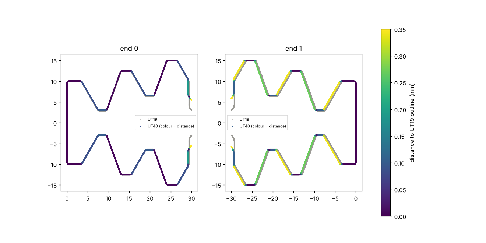
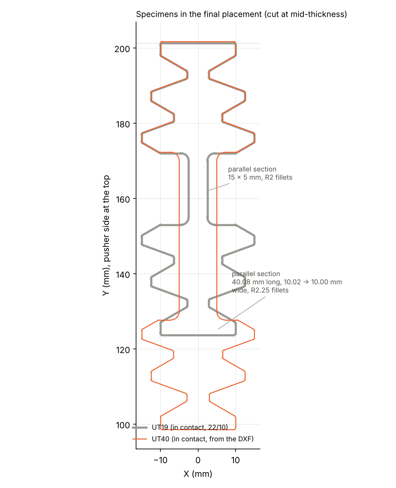
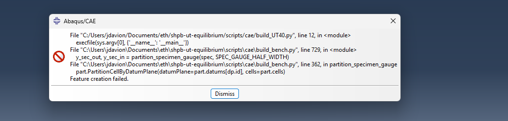
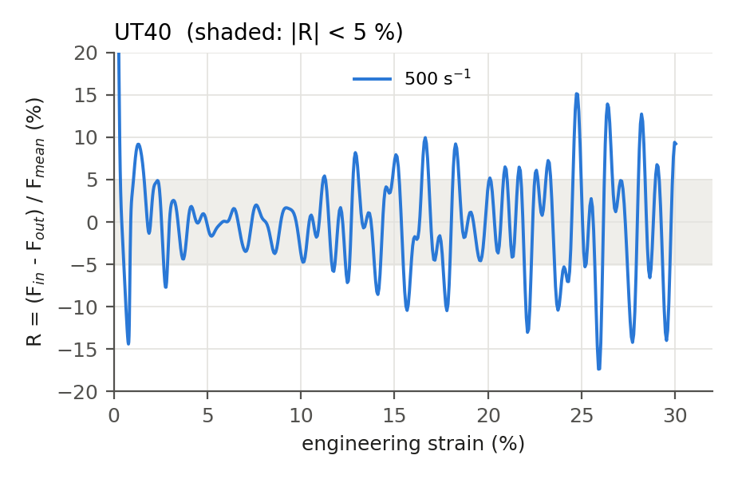
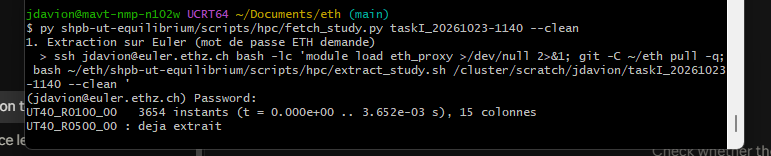
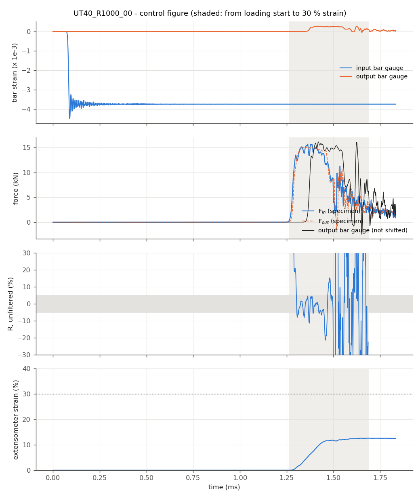
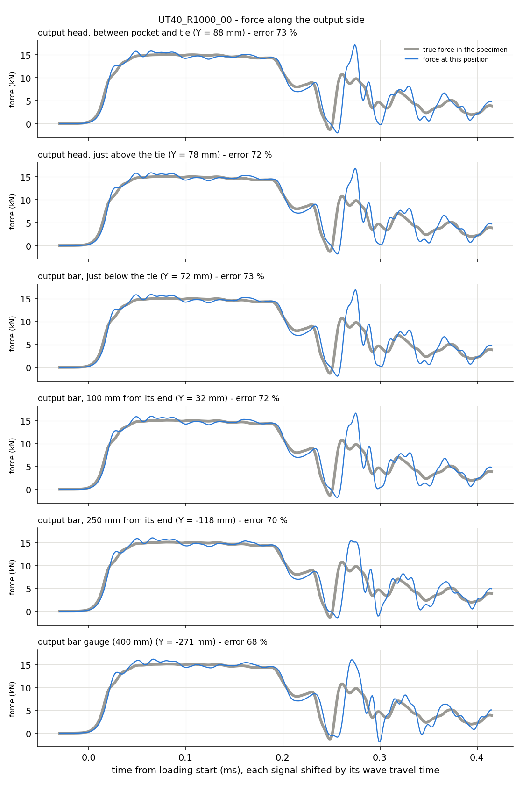

# 2026-10-23

## Objective

Turn the UT40 geometry received as a DXF file into the 1.5 mm STEP solid used by the model, check it against the
UT19, and prepare its placement in the bench (with the teeth in contact, as for the UT19).

## Progress and Notes

### 1. What a DXF file is

The UT40 geometry came as `Xmas_UT40.dxf`: a **2D drawing** (AutoCAD exchange format), i.e. the outline of the
specimen seen from above, as sent to the workshop for laser or water-jet cutting. It has no thickness. The model
needs a 3D solid in STEP (sheet of 1.5 mm), so the outline has to be extruded, as was done in SolidWorks for the
UT19.

Content of the file (read with the Python library `ezdxf`):

| Item | Value |
|---|---|
| Entities in the drawing | 92: 48 lines + 44 arcs, on three layers `Normal_Quality`, `Medium_Quality`, `High_Quality` (cutting quality: the gauge section is cut with the best quality, the tooth flanks with medium quality) |
| Loops | **one closed loop** (every vertex shared by exactly 2 entities, no open end) |
| Size | 30.000 × 103.181 mm (units not stated in the file; mm confirmed by the 30 mm width, the same as the UT19) |
| Arc radii | R0.5 (tooth corners, ×40) and R2.25 (gauge fillets, ×4) |
| Parallel (gauge) section | two straight edges, 40.077 mm long, **not exactly parallel**: 10.020 mm apart at the output-bar end, 10.001 mm at the pusher end (taper of 0.01 mm per side over 40 mm) |
| Blocks | some unused blocks from older drawings (`AutoMiniNaka_*`): not inserted in the drawing, ignored |


*Figure 1 – Outline read from the DXF (DXF coordinates). Black: normal cutting quality; blue: medium (tooth
flanks); red: high (gauge section and its fillets).*

### 2. DXF → STEP (`scripts/pre/dxf_to_step.py`)

New script: chains the lines and arcs into one closed wire, makes a face, extrudes it by 1.5 mm along +Z
(OpenCascade) and writes `cad/step/XMas_UT40_t1p5.step` in the same frame as the other specimen files (length
along X from 0 to L, width centred on Y = 0, z from 0 to 1.5). Result: one valid solid, 94 faces, volume
2334.92 mm³. The DXF is kept in `cad/dxf/`.

```bash
py -m pip install ezdxf cadquery-ocp
py shpb-ut-equilibrium/scripts/pre/dxf_to_step.py shpb-ut-equilibrium/cad/dxf/Xmas_UT40.dxf shpb-ut-equilibrium/cad/step/XMas_UT40_t1p5.step 1.5
```

### 3. Comparison with the UT19: the heads are not exactly the same

The placement rules of `build_bench.py` assume that all specimens have the same heads. Check: outline of both
specimens at mid-thickness, compared head by head (distance from each UT40 point to the UT19 outline).

| Check | Result |
|---|---|
| Length | 103.181 mm instead of 77.688 + 25 = 102.688: **+0.49 mm** |
| Heads aligned on their tip | max distance 0.11 mm (one end), 0.34 mm (other end) |
| Heads aligned at best along the length | max 0.10 mm, mean 0.045 mm at both ends |
| Tooth pitch (distance between teeth) | identical |
| Loaded flanks (the ones that pull the specimen) | **0.10 mm further from the tip** than on the UT19, at both ends: teeth 0.10 mm thicker in the pulling direction |
| Tip of the end placed at the pusher | **0.29 mm shorter** than on the UT19 |



*Figure 2 – Heads of the UT40 (colour = distance to the UT19 outline) on top of the UT19 heads (grey), aligned
on the tip. Left: the end placed at the output bar; right: the end placed at the pusher, shifted by ≈ 0.3 mm
because its tip is shorter.*

**Consequence.** `build_bench.py` places every specimen by its pusher-side tip (always at Y = 201.7005). With the
shorter tip and the thicker teeth, the UT40 placed "centred" like the UT19 **already overlaps the pusher pocket by
0.04 mm**, i.e. the two solids interpenetrate. Abaqus would have to push the parts apart at the start.

### 4. Gaps of the UT40 (`pocket_gaps.py` extended)

`pocket_gaps.py` could only measure a positive gap. Changes:
- a gap can now be **negative** (overlap at the start: the specimen is moved back until it only touches);
- the clearance on the other side of the teeth is measured once in contact (more useful than in the centred
  position);
- **interference check**: volume shared by the specimen and each head once the gaps are closed (must be ≈ 0).

Run on both specimens (UT19 again as a regression check: same values as on 22 Oct):

| Specimen, pocket | Gap in the pulling direction (centred placement) | Clearance left on the other side, once in contact | Shared volume once in contact |
|---|---|---|---|
| UT19, pusher | 0.3567 mm | 0.6385 mm | 0.0003 mm³ |
| UT19, output bar | 0.3563 mm | 0.5222 mm | 0.0003 mm³ |
| UT40, pusher | **−0.0365 mm** (overlap) | 0.5321 mm | 0.0014 mm³ |
| UT40, output bar | 0.2562 mm | 0.4222 mm | 0.0000 mm³ |

The clearance left on the UT40 is 0.10 mm smaller than on the UT19: the thicker teeth. The shared volumes are
only the rounding of the translations to 1e-4 mm. With the gaps closed, the inclined flanks of the **three teeth**
touch in both pockets, as for the UT19.


*Figure 3 – UT40 in its final placement, cut at mid-thickness (half X ≥ 0). Left: pusher pocket and zoom on one
tooth; right: output-bar pocket and zoom on one tooth. The loaded flanks touch, the other flanks keep a clearance
of ≈ 0.4–0.5 mm.*

### 5. Placement of the UT40 in the bench

Values stored in `SPECIMENS['UT40']` of `build_bench.py` (`gap_pusher = −0.0365`, `gap_output = 0.2562`):

| Item | UT19 (22/10) | UT40 |
|---|---|---|
| Specimen translation along Y (in contact) | −0.3567 mm from the centred placement | **+0.0365 mm** (moved away from the pusher pocket) |
| Specimen ends (Y) | 123.656 / 201.344 | 98.556 / 201.737 |
| Output bar end `Y_OUTPUT_BAR` | 155.000 | **130.000** (25.000 mm further back) |
| Head / bar split | 99.287 | 74.287 |
| Output gauge | −245.000 | −270.000 |

The distance between the two tooth sets is exactly 25.000 mm larger than for the UT19 (the output bar ends at
130.000 instead of 155.000): the extra 0.49 mm of length is only in the tips, which touch nothing.

**Collision check** (output bar moved back by 25 mm, its head now above the pusher body): smallest distance
between the output bar and the pusher = 3.65 mm (top of the pusher body Z = 15.7, bottom of the output bar
Z = 19.35). No collision.



*Figure 4 – UT19 (grey) and UT40 (orange) in their final placement, pusher side at the top. Same pusher-side head (UT40 gauge section 40.08 mm long, 10.02 → 10.00 mm wide);
the UT40 is 25 mm longer and its output-side head, hence the output bar, is 25 mm further down.*

### 6. First run in Abaqus/CAE: two errors, fixed

**Launching with the right specimen.** File → Run Script cannot pass an option to the script, so running
`build_bench.py` built the UT19 (its default `SPEC = 'UT19'`; harmless, same model as on 22 Oct). New launchers
`scripts/cae/build_UT19.py` and `scripts/cae/build_UT40.py`: each one runs `build_bench.py` for its specimen, so
the file never has to be edited.

**Error 1 – "Feature creation failed"** in `partition_specimen_gauge` (screenshot below). The script finds the two
ends of the parallel section as the vertices at |X| = half-width (5 mm), with a tolerance of 0.001 mm. In
section 1 I had only checked one end of the gauge edges: the UT40 parallel section is in fact 10.020 mm wide at
one end and 10.001 mm at the other. Only the two vertices of the 10.001 mm end were found, so both cutting planes
were at the same Y, and the second partition failed. Fix: tolerance 0.05 mm (still only the four gauge vertices,
for both specimens), plus a clear error if the two ends are closer than 1 mm, and the found positions printed.



*Figure 5 – Abaqus/CAE error with `build_UT40.py`: the second cutting plane of the specimen could not be created
(same position as the first one).*

**Error 2 (found before it happened) – extensometer.** The extensometer nodes were looked for exactly at ±15 mm
from the middle of the parallel section. For the UT19 the section is 15 mm long and meshed with 0.5 mm elements,
so these nodes exist. For the UT40 it is 40.077 mm long and meshed with 80 elements of 0.501 mm: no node at
exactly ±15 mm. The script now takes the nearest surface node on the symmetry plane and prints the real length
L0 (read again from the node coordinates by `extract_history.py`). For the UT19 nothing changes (exact nodes).

**Point for the supervisor.** The taper of the UT40 gauge section (10.020 → 10.001 mm, 0.2 % of the width)
makes the narrowest section the pusher end of the parallel part. In a perfect simulation necking may start there,
near the fillet and outside the 30 mm extensometer. To check on the first results; question: is this taper in the
real specimens (cutting precision ≈ 0.05 mm) or a drawing detail?

### 7. UT40 model built in Abaqus/CAE

`build_UT40.py` after the two fixes (full output: `figures/2026-10-23/build_bench_UT40.txt`):

| Check | Result |
|---|---|
| Placement (in contact) | specimen ends 98.5562 / 201.7370, output bar end 130.0000, head/bar split 74.2870 (as computed with OpenCascade) |
| Parallel section found | Y = 129.961 to 170.038 (40.077 mm), 4 vertices at \|X\| = 5 ± 0.05 mm |
| Gauge zone | 3 200 elements (80 along × 10 across the half width × 4 through the thickness) |
| Extensometer | nodes at Y = 134.970 and 165.028: L0 = 30.058 mm (target 30) |
| Mesh | UT40 15 324 elements, OUTPUT_HEAD 8 594, total 216 951 |
| Smallest tet height | 0.431 mm (pusher head) / 0.388 mm (output head), above the 0.3 mm limit |
| Output gauge | Y = −270.000, 104 elements |

Force probes added to the 1000 s⁻¹ case of the UT40 (`probes = 1` in `studies/taskI/cases.csv`), as for the UT19.

### 8. UT40 study launched

`inp_to_geo.py UT40`, then `submit_study.py taskI UT40_R0100_00 UT40_R0500_00 UT40_R1000_00` (dry run checked
first). Study **`taskI_20261023-1140`**:

| Case | Striker velocity | Simulated time | Note |
|---|---|---|---|
| UT40, 100 s⁻¹ | 6.00 m/s | 3.652 ms | capped at the end of the pulse: 30 % will not be reached (≈ 21 % expected) |
| UT40, 500 s⁻¹ | 19.95 m/s | 2.134 ms | |
| UT40, 1000 s⁻¹ | 37.39 m/s | 1.834 ms | force probes; incident stress ≈ 710 MPa in the bars (elastic for maraging), launcher limit to confirm |

The striker velocities use **estimated** values for the UT40 (L_eff = 34 mm, F = 15 kN): the achieved strain
rates are expected to differ from the targets, and the formula will be recalibrated on these runs.

### 9. First UT40 result: 500 s⁻¹

The 500 s⁻¹ run finished first (wall time 50 min) and was fetched alone (`fetch_study.py` only takes completed
runs), then processed with `report_taskI.py`.

| Indicator | UT40, 500 s⁻¹ | UT19, 500 s⁻¹ (in contact, 22/10) |
|---|---|---|
| striker velocity | 19.95 m/s (estimated formula) | 7.69 m/s |
| achieved strain rate | **590 s⁻¹** (+18 %) | 546 s⁻¹ |
| time to 30 % strain | 0.572 ms | 0.603 ms |
| max force | 15.3 kN at 3.2 % strain | 7.5 kN at 5.8 % |
| force at 30 % strain | ≈ 3 kN (20 % of the max) | ≈ 3.4 kN (45 % of the max) |
| equilibrium (\|R\| < 5 %) | **from 2.9 to 11.2 % only** | from the start to 30 % |
| max \|ΔF\| after 5 % | 1.14 kN (7.5 % of the max force) | 0.12 kN (1.6 %) |
| max gauge error after 5 % | **4.2 %** | 3.9 % |
| hourglass / internal energy | 0.5 % | 0.5 % |

Force difference between the two ends of the gauge section, by strain window:

| Strain | max \|ΔF\| | in % of F max | mean force | max \|R\| |
|---|---|---|---|---|
| 3–5 % | 0.64 kN | 4.2 % | 15.0 kN | 4.4 % |
| 5–10 % | 0.55 kN | 3.6 % | 14.9 kN | 3.7 % |
| 10–15 % | 1.14 kN | 7.4 % | 13.6 kN | 8.6 % |
| 15–20 % | 1.14 kN | 7.5 % | 10.0 kN | 10.5 % |
| 20–25 % | 0.84 kN | 5.5 % | 6.4 kN | 15.1 % |
| 25–30 % | 0.74 kN | 4.8 % | 4.1 kN | 17.4 % |


*Figure 6 – Control figure of the UT40 at 500 s⁻¹ (raw signals). Top: input and output bar gauges. Second: forces
at both ends of the gauge section and output gauge (not shifted). Third: R, unfiltered. Bottom: extensometer
strain. The force reaches 15 kN at about 3 % strain, then decreases steadily down to ≈ 3 kN at 30 %.*



*Figure 7 – R against strain (filtered at 100 kHz). Inside the ±5 % band from ≈ 3 to 11 % strain; beyond, the
oscillations grow while the force decreases.*

Reading:
- **The measurement is good** (gauge error 4.2 %): closing the gaps works for the UT40 too.
- **Equilibrium is worse than for the UT19**: up to ≈ 11 % strain it holds; beyond, the force difference
  doubles (≈ 1.1 kN) while the force itself drops (necking), so R grows up to 17 %. A longer gauge section means a
  longer wave travel time inside the specimen and 2.7 times more mass between the two sections; this is the
  expected trend, the probes of the 1000 s⁻¹ run will help to locate the oscillation.
- **Much stronger necking**: at 30 % strain over a 30 mm extensometer the neck has to elongate by ≈ 9 mm
  (≈ 3.6 mm for the UT19 over 12 mm), and the force falls to 20 % of its maximum. The model has no fracture:
  **question for the supervisor**: can a DP1000 UT40 reach 30 % engineering strain over 30 mm before fracture?
- **Striker formula to recalibrate**: 590 instead of 500 s⁻¹. With the mean force really carried in the window
  (11.7 kN instead of the assumed 15 kN), this run gives L_eff ≈ 29.7 mm instead of the estimated 34 mm. To be
  confirmed with the 100 and 1000 s⁻¹ runs (two unknowns, L_eff and F) before changing `make_run.py`.

### 10. All three UT40 runs

Fetched at 14:55. The fetch seemed stuck after `UT40_R0500_00 : deja extrait`: it was extracting the 1000 s⁻¹
run, the slowest one because of the force probes (≈ 2 000 elements read at every time point).



*Figure 8 – `fetch_study.py`: 100 s⁻¹ extracted, 500 s⁻¹ skipped (already fetched at noon), 1000 s⁻¹ being
extracted on Euler (several minutes without output).*

| Indicator | UT40, 100 s⁻¹ | UT40, 500 s⁻¹ | UT40, 1000 s⁻¹ |
|---|---|---|---|
| striker velocity (estimated formula) | 6.00 m/s | 19.95 m/s | 37.39 m/s |
| achieved strain rate | 138 s⁻¹ (+38 %) | 590 s⁻¹ (+18 %) | 770 s⁻¹ on 5–10 % (see below) |
| 30 % strain | in 2.37 ms | in 0.57 ms | **never: the extensometer stops at 12.6 %** |
| max force | 15.0 kN at 5.9 % | 15.3 kN at 3.2 % | 15.7 kN at 6.6 % |
| equilibrium (\|R\| < 5 %) | **from 0.7 % to 30 %** | 2.9 to 11.2 % only | 6.3 to 9.8 % only |
| max \|ΔF\| after 5 % | 0.11 kN | 1.14 kN | 1.58 kN before localisation (5–11 %) |
| max gauge error after 5 % | 1.9 % | 4.2 % | 4–5 % before localisation, 65 % after |
| hourglass / internal | 1.4 % | 0.5 % | 0.2 % |

**1000 s⁻¹: the strain localises outside the extensometer.** The extensometer strain rises to ≈ 11 % in
0.18 ms, then stops (12.6 % at the end) while the forces collapse and oscillate. The velocity of the
extensometer node on the pusher side (`EXT_IN`) shows what happens:

| Time | Velocity of EXT_IN | Velocity of EXT_OUT | Extensometer strain | Force |
|---|---|---|---|---|
| 1.40 ms | +26.5 m/s | +1.7 m/s | 8.1 % | 14.9 kN |
| 1.45 ms | +10.1 m/s | +1.3 m/s | 11.3 % | 13.9 kN |
| 1.50 ms | **−9.0 m/s** | +0.8 m/s | 11.7 % | 7.2 kN |
| 1.80 ms | −0.1 m/s | +0.1 m/s | 12.5 % | 1.9 kN |

The pusher-side end of the extensometer stops and even springs back: the material inside the 30 mm extensometer
is unloading, so the deformation continues **between the extensometer (Y = 165.0) and the pusher head**, i.e. in
the last 5 mm of the parallel section or in the fillet. This is where the section is narrowest (taper 10.02 →
10.00 mm, section 6), and also where a dynamic neck is expected at high rate (the end that is pulled strains
first). The two effects cannot be separated from these outputs. **To confirm in Abaqus/Viewer** (PEEQ, last frame).
After localisation the test is no longer valid (no fracture model, the neck keeps thinning down to ≈ 2 kN).

**Confirmed in Abaqus/Viewer** (15:05): PEEQ at the last frame (1.834 ms) of `UT40_R1000_00.odb`.


*Figure 8b – UT40 at 1000 s⁻¹, equivalent plastic strain at the end of the run, side view (pusher head at the
top, output head at the bottom, specimen = thin vertical strip on the left). The neck (red) is at the
**pusher-side end of the parallel section**, just below the pusher head; the rest of the parallel section stays
at low plastic strain. Together with the springback of the extensometer node `EXT_IN`, this confirms that the
strain localised above the extensometer.*



*Figure 9 – UT40, 1000 s⁻¹, raw signals. Bottom: the extensometer strain stops at ≈ 12 % at 1.45 ms; second
panel: the specimen forces drop from 15 to ≈ 8 kN, then oscillate down to ≈ 2 kN.*



*Figure 10 – Force along the output side, 1000 s⁻¹. Up to 0.19 ms (≈ 11 % strain) every probe and the gauge
follow the specimen force; the large errors (68–73 %) all come after the localisation.*

**Other observations**
- 100 s⁻¹ reaches 30 % in 2.37 ms, i.e. after the end of the 2.12 ms pulse: the inverter keeps moving on its own
  inertia. (The UT19 stopped at 23 %.)
- Even before localisation, equilibrium is only partial at 500 and 1000 s⁻¹ for the UT40 (section 9 and the
  question of 12:48: oscillation at ≈ 30 kHz relaunched when the force drops).
- **Striker formula recalibrated on 100 and 500 s⁻¹** (the 1000 s⁻¹ rate is not usable). Writing
  $2K V = \dot\varepsilon L_{eff} + 2F/\rho c A$ for both runs gives two equations for two unknowns:
  $L_{eff}$ = 30.1 mm and $F$ = 10.4 kN (instead of the estimated 34 mm and 15 kN; the effective force is low
  because the force drops strongly during necking). New striker velocities: **4.83 / 17.2 / 32.6 m/s** for
  100 / 500 / 1000 s⁻¹ (instead of 6.00 / 19.95 / 37.39).

## Next Steps

- ~~Build, mesh and run the UT40~~ → done (sections 7–10).
- Abaqus/Viewer: where does the UT40 neck at 500 and 1000 s⁻¹ (PEEQ, last frame)?
- Supervisor: taper of the UT40 gauge section; can a DP1000 UT40 reach 30 % before fracture?
- Lab PC (done): `git pull`, Abaqus/CAE `build_bench.py` with `SPEC = 'UT40'`, check the printed placement (specimen
  ends 98.556 / 201.737, output bar 130.000, split 74.287), the mesh and the tet quality.
- `inp_to_geo.py UT40`, then `submit_study.py taskI UT40_R0100_00 UT40_R0500_00 UT40_R1000_00 --dry-run`.
- After the first runs: recalibrate L_eff (34 mm) and F (15 kN) of the striker formula for the UT40.
- Supervisor: is the shorter tip / thicker tooth of the UT40 drawing real (cutting file) or a drawing detail?

## References

- `File` *UT40 cutting outline.* [shpb-ut-equilibrium/cad/dxf/Xmas_UT40.dxf](../shpb-ut-equilibrium/cad/dxf/Xmas_UT40.dxf) · received 23 Oct 2026.
- `File` *DXF → STEP converter.* [shpb-ut-equilibrium/scripts/pre/dxf_to_step.py](../shpb-ut-equilibrium/scripts/pre/dxf_to_step.py) · created 23 Oct 2026.
- `File` *Gap measurement (negative gaps, interference check).* [shpb-ut-equilibrium/scripts/pre/pocket_gaps.py](../shpb-ut-equilibrium/scripts/pre/pocket_gaps.py) · updated 23 Oct 2026.
- `File` *Placement documentation.* [shpb-ut-equilibrium/docs/assembly.md](../shpb-ut-equilibrium/docs/assembly.md) · updated 23 Oct 2026.
