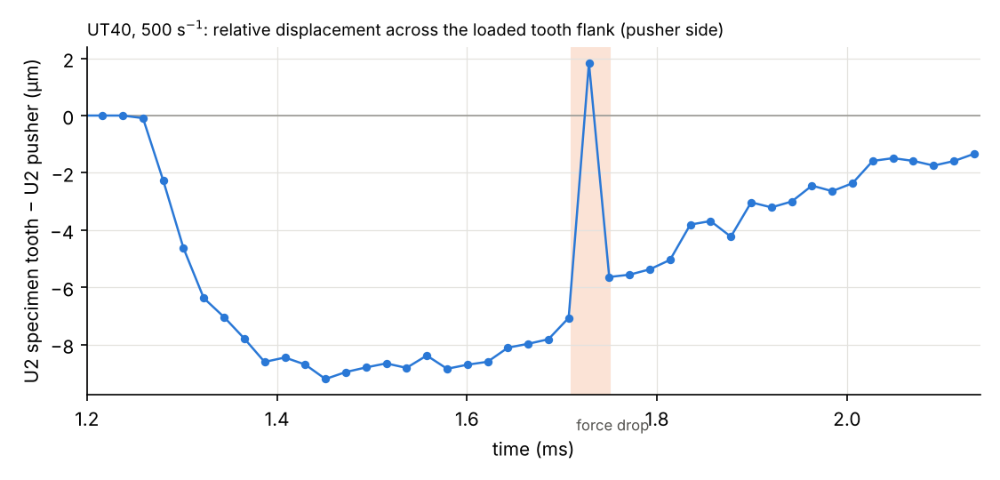
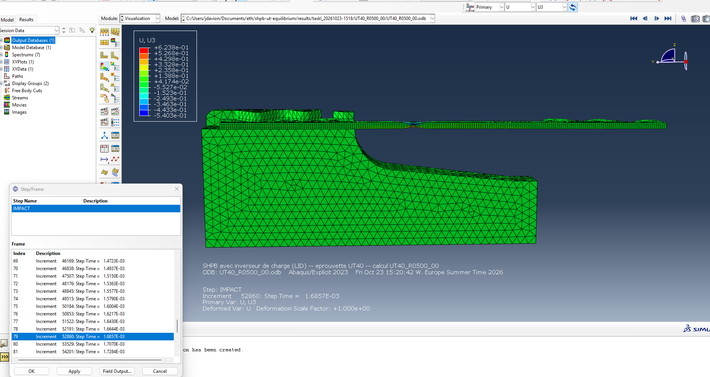
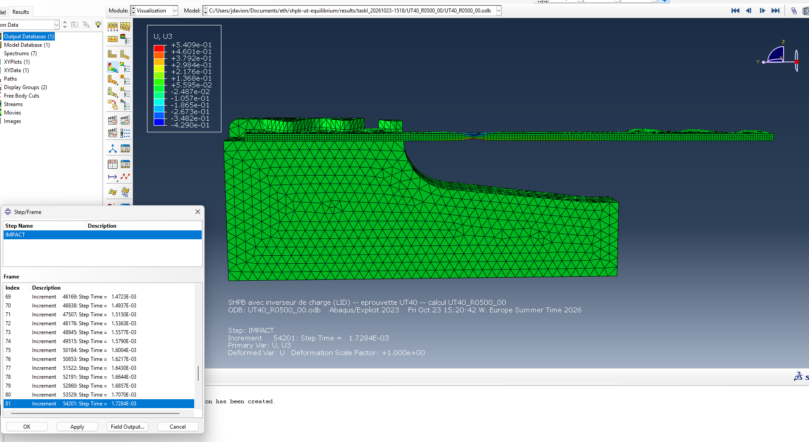
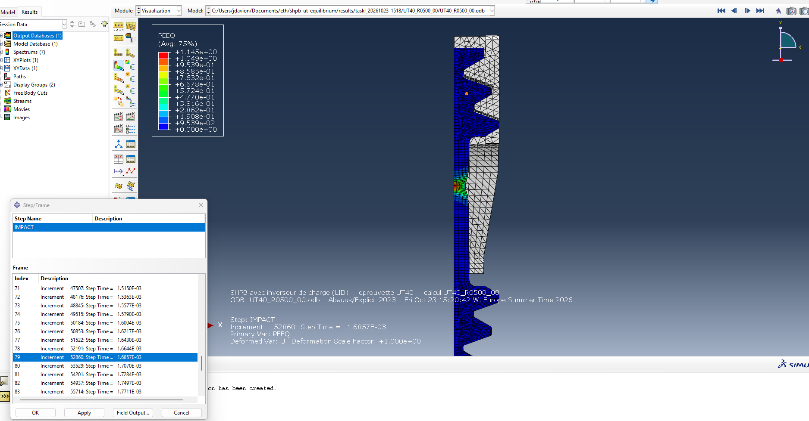
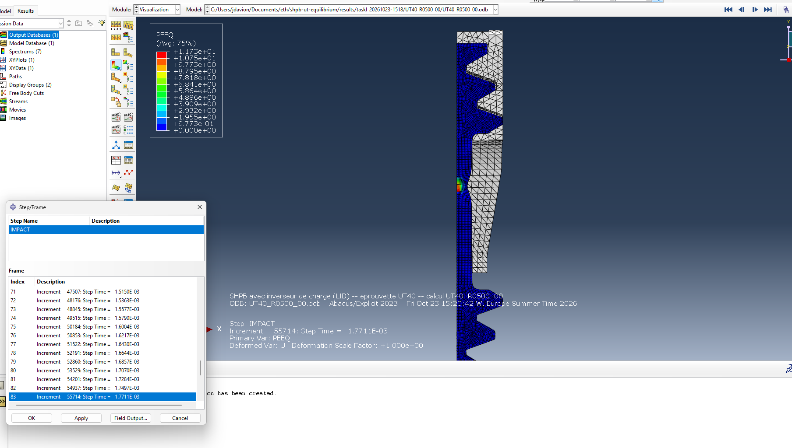
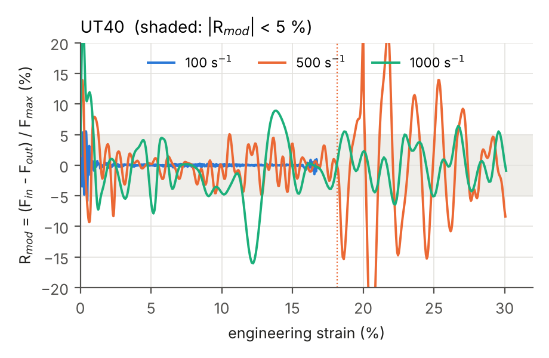
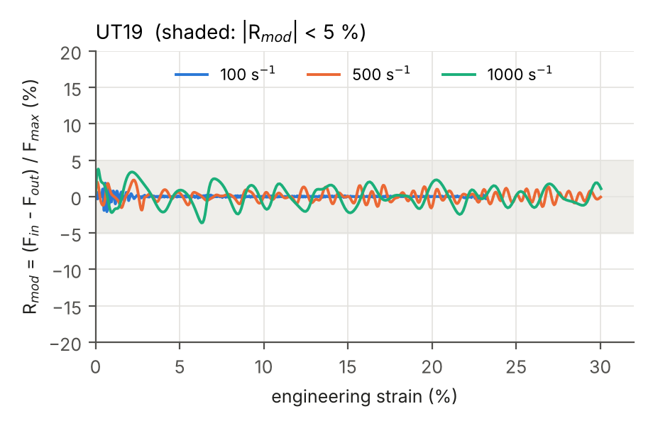

# 2026-10-27

## Objective

Find the cause of the sudden force drop at ≈ 1.72 ms (≈ 19 % strain) in the UT40 and UT40S runs at 500 s⁻¹
(study `taskI_20261023-1518`, journal of 23 Oct, section 12), by looking at the full results in Abaqus/Viewer.

## Progress and Notes

### 1. Three hypotheses, one check each

| Hypothesis | Check in Viewer |
|---|---|
| 1. the specimen teeth slip or lose contact in the pusher pocket (the drop starts on the input side) | U2 of a specimen node and of the facing pusher node across the loaded tooth flank, against time |
| 2. the specimen lifts out of the pocket in Z (nothing holds it from above) | contour of U3, frames 79 / 81 / 83 |
| 3. something sudden in the neck | contours of PEEQ and V2, frames 79 / 81 / 83 |

Frames: 100 over 2.134 ms, one every 21.3 µs (frame 80 = 1.707 ms, 81 = 1.729 ms, 82 = 1.750 ms).

### 2. Check 1: the teeth do not slip; their small motion is a consequence of the drop

Nodes picked at frame 80 on both sides of the loaded flank of a pusher-side tooth (one specimen node, hexahedral
mesh; one pusher node, tetrahedral mesh). Difference of their U2 (`figures/2026-10-27/ecart_dents_UT40_R0500.rpt`):

*Figure 1 – U2 of the specimen node minus U2 of the facing pusher node, UT40 at 500 s⁻¹ (one point per field
frame). Shaded: the force drop.*

- While the specimen is loaded, the specimen node lags the pusher node by 8–9 µm: elastic compression of the
  teeth at the contact (≈ 15 kN on three teeth).
- At 1.729 ms (frame 81, during the force drop) the difference jumps to +1.8 µm, then back to −5.6 µm. This is a
  change of ≈ 10 µm: the contact compression relaxes because the force has dropped. It is a consequence of the
  drop, not a slip: a slip or a loss of engagement would be tenths of a millimetre (the clearance on the other side
  of the teeth is 0.53 mm).
- Hypothesis 1 rejected. Next: U3 (hypothesis 2) and PEEQ / V2 (hypothesis 3).

### 3. Check 2: the specimen does not lift out of the pockets

U3 (displacement out of the sheet plane) at frames 79, 81 and 83, side view of the specimen and of the pusher head:

*Figures 2–4 – U3 at 1.686, 1.728 and 1.771 ms. The heads and the pusher stay at U3 ≈ 0 (green); the only
non-zero values (±0.5 mm) are in the neck, where the sheet thins through its thickness (top surface moving down,
bottom surface up).*

Hypothesis 2 rejected: the specimen stays in the pockets.

### 4. Check 3: a sudden localisation in the neck

PEEQ (equivalent plastic strain) at the same frames, view from the top (half model, symmetry plane on the left):

*Figures 5–7 – PEEQ at 1.686, 1.728 and 1.771 ms (the colour scale changes from one frame to the next).*

| Frame | Time | Max PEEQ | Where |
|---|---|---|---|
| 79 | 1.686 ms | 1.15 | neck, spread over a few mm of the parallel section |
| 81 | 1.728 ms | **9.19** | one spot at the centre of the neck (on the symmetry plane) |
| 83 | 1.771 ms | 11.7 | same spot |

In ≈ 40 µs the maximum plastic strain jumps from 1.1 to 9.2: the deformation concentrates in **a few elements**
at the centre of the neck, which thin out almost completely. This is the sudden drop of the force: the section
loses its load-carrying capacity at that point, the specimen unloads elastically on both sides (the input side
first, being closest to the moving end), then reloads with strong oscillations.

**Interpretation.** Hypothesis 3 is the right one, but it is not a physical event of the test: the model has **no
fracture criterion**, so instead of breaking, the material in the neck keeps stretching until the elements
collapse (PEEQ ≈ 9, i.e. a true strain of 900 %). A real DP1000 sheet fractures at a much smaller plastic strain;
the fracture model of Beerli et al. (2026) would give the value. The results after the onset of this localisation
(here ≈ 19 % engineering strain, PEEQ ≈ 1 in the neck) are therefore **not representative of a test**.

Consequences:
- for the UT40 at 500 s⁻¹, the curve and the equilibrium indicators are only meaningful up to ≈ 19 %;
- the question "can 30 % be reached?" also depends on fracture: the maximum PEEQ in the neck should be compared
  with the fracture strain of DP1000 for every run (UT19 included), and the analysis window cut at fracture;
- question for the supervisor: which fracture strain (or model) to use for DP1000 in uniaxial tension?

### 5. Fracture of DP1000 and what it means for Task I

Beerli et al. (2026, section 4.1.1, fig. 7a): in quasi-static uniaxial tension (0.001 s⁻¹) on the 40 × 10 mm UT
specimen, i.e. our UT40 geometry, **DP1000 breaks at an engineering strain of 0.11**, the lowest ductility of the
five DP steels of the paper. At high strain rates its elongation to fracture does not decrease (section 4.2.1), but
no value is given there. The fracture model of the paper (Hosford–Coulomb with a neural-network rate dependence)
has no published numerical parameters.

So, for a DP1000 UT40, the 30 % engineering strain of Task I is very likely beyond fracture, whatever the loading
speed; the sudden localisation found today happens at ≈ 18 % (500 s⁻¹, recalibrated), already beyond 11 %.

**Report updated** (`report_taskI.py`, all studies regenerated):
- summary: a new first bullet "validity limit (no fracture model)";
- new section *How far are the results valid? Necking, localisation and fracture*: what necking does, what the
  model cannot do, when a real DP1000 breaks, **Table T7** (per run: max strain, strain of the sudden
  localisation detected automatically as a drop of the mean force > 20 % of its maximum within 10 µs, max PEEQ
  at 11 % and at the end), **Figure F6** (max PEEQ against strain, when the PEEQ has been extracted), and the
  consequences for Task I;
- limitations: no fracture model.

Sudden localisations detected: UT40 and UT40S at 500 s⁻¹ (recalibrated) at 18.2 / 18.5 % strain, and the first
UT40 run at 1000 s⁻¹ (37.4 m/s) at 11.8 % (the localisation outside the extensometer of 23 Oct); none for the UT19.

New script `scripts/post/extract_peeq.py` (Abaqus Python): max PEEQ in the specimen at every field frame, run
automatically by `extract_study.sh` during `fetch_study.py`.

### 6. Decisions

- **No fracture model for now.** The report only states the limit (section *How far are the results valid?*);
  the PEEQ extraction stays available but is optional.
- **Only the UT40 is kept.** The UT40S (same specimen with a perfectly straight parallel section, 10.000 mm instead
  of 10.020 → 10.001 mm) gave the same results within 1–2 % in every indicator (journal of 23 Oct, section 12): the
  taper of the cutting file plays no role. The three UT40S runs were removed from
  `results/taskI_20261023-1518/` (still in the git history) and from `studies/taskI/cases.csv`; the report of
  the study now contains the UT40 only. The UT40S geometry (`cad/dxf/Xmas_UT40S.dxf`, `cad/step/XMas_UT40S_t1p5.step`)
  and `scripts/pre/straighten_gauge.py` are kept, so that the test can be repeated.

### 7. Report: R_mod, forces over the whole test, why the gauge fails only after a sudden localisation

Requests of 11:29, added to `report_taskI.py` (all reports regenerated):

1. **New equilibrium indicator** $R_{mod} = (F_{in} - F_{out}) / F_{max}$: same difference as $R$, divided by a
   fixed force (the maximum force of the test) instead of the current mean force, so it can be plotted over the
   whole test, including the start of loading and the end of necking. Figure F1c and Table T2b.
2. **Appendix figure** `FA_forces_full_<SPEC>`: $F_{in}$ and $F_{out}$ from the loading start to the end of the
   useful window (+ 15 %), with the 5 / 10 / 20 / 30 % strain marks and the sudden localisation.
3. **Why the gauge error is large only in some runs** (Table T5 extended): the gauge reads the wave in the output
   bar after the force has crossed the specimen head, the pocket and the output head. This works while the force
   changes slowly. Fastest force drop within 10 µs after the force maximum:

| Run | Fastest drop in 10 µs | Gauge error after 5 % | Gauge error before the localisation |
|---|---|---|---|
| UT19 100 / 500 / 1000 | 0.1 / 0.2 / 0.5 kN | 1.5 / 3.9 / 4.8 % | no localisation |
| UT40 100 / 1000 (recalibrated) | 0.2 / 1.9 kN | 1.5 / 5.8 % | no localisation |
| UT40 500 (recalibrated) | **4.9 kN** | **22.0 %** | 3.7 % |
| UT40 1000 (first run, 37.4 m/s) | **5.6 kN** | **65.4 %** | – |

   A collapsing neck is a force step, not a slope: the heads and the bar ring, and the gauge records the ringing
   (the probes of the first UT40 run at 1000 s⁻¹ show the same deviation at every position from the output head
   to the gauge after the localisation). Only the runs whose neck collapses before the end of the useful window
   are affected.

*Figure 8 – $R_{mod}$ against strain for the UT40 (study `taskI_20261023-1518`). At 100 s⁻¹ it stays within ±5 %
after 0.5 % strain; at 1000 s⁻¹ it reaches −16 % at ≈ 12 % strain (the output-side force stays at 15 kN while the
input-side force starts to drop); at 500 s⁻¹ it oscillates strongly after the sudden localisation (dotted line).*

*Figure 8b – $R_{mod}$ for the UT19 (study `taskI_20261022-1138`, in contact): within ±5 % over the whole test at
the three rates, including the start of loading (max 2.1 / 2.3 / 3.8 % at 100 / 500 / 1000 s⁻¹).*

| Run | \|R_mod\| < 5 % from | max \|R_mod\| after 5 % | max \|R_mod\|, whole test |
|---|---|---|---|
| UT19 100 / 500 / 1000 | the start (all three) | 0.3 / 1.6 / 3.6 % | 2.1 / 2.3 / 3.8 % |
| UT40 100 | 0.5 % | 1.5 % | 5.9 % |
| UT40 500 | not maintained | 31.2 % (after the localisation) | 31.2 % |
| UT40 1000 | not maintained | 16.0 % (≈ 12 % strain) | 24.1 % |

With $R_{mod}$ the UT19 is in equilibrium from the very start of loading at every rate (with $R$ the start was
not evaluated). For the UT40 the conclusions of $R$ are confirmed on a fixed scale: equilibrium at 100 s⁻¹ only.

*Figure 9 – $F_{in}$ (colour) and $F_{out}$ (black dashed) over the whole test, UT40. Red line: sudden
localisation at 500 s⁻¹.*

**Symmetry condition (question of 11:29).** The half model cut at X = 0 does have its symmetry condition: in
`model/templates/SHPB_UT_main.inp`, section 6a, `*BOUNDARY <PIECE>_XSYMM, XSYMM` on the seven pieces (U1 = 0 on
every node of the plane X = 0; for solid elements the rotations do not exist). The node sets are created by
`build_bench.py` (UT40: 1 040 nodes for the specimen, 13 090 for the output bar, … printed at every build).

## Next Steps

- Supervisor: fracture strain or model to use for DP1000; is 30 % engineering strain realistic for this material?

## References

- `File` *Run analysed.* `shpb-ut-equilibrium/results/taskI_20261023-1518/UT40_R0500_00/` (`.odb` on the lab PC only).
- `File` *Previous analysis.* [journal/2026-10-23.md](2026-10-23.md), section 12.

## 8. Report reorganised

The Task I report had grown section by section and was hard to follow. It was reorganised without changing its content:

- **Summary first:** one table with the answer for each case (equilibrium with $R$ and $R_{mod}$, striker velocity, achieved rate, 30 % strain, gauge error), then the key messages and the open questions for the supervisors.
- **One section per question:** *Answer 1 – Force equilibrium* and *Answer 2 – Loading speeds for 30 % strain*. All definitions ($R$, $R_{mod}$, sudden localisation, achieved rate) are grouped in *Definitions and signal processing*.
- **Numbering:** figures and tables are numbered in the order they appear (Figure 1, 2, …); the image file names do not change.
- **Captions:** each caption is one block (*Plotted* / *Source* / *How to read it*).
- **Small corrections:**
  - the calibration force of the UT40 is now written as 10.4 kN (it was rounded to 10 kN);
  - the sentence "the gauge follows the force closely" now says "except after a sudden localisation".

The repository report no longer mentions the UT40S.
