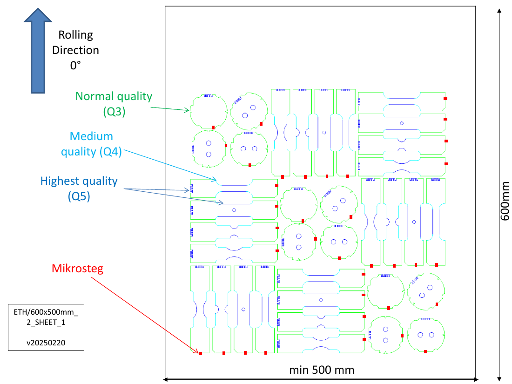
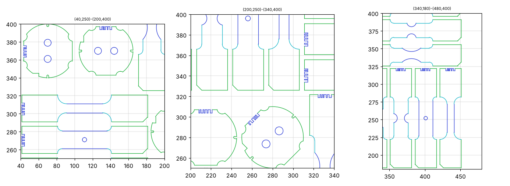
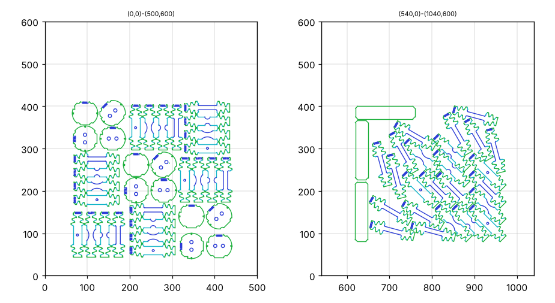
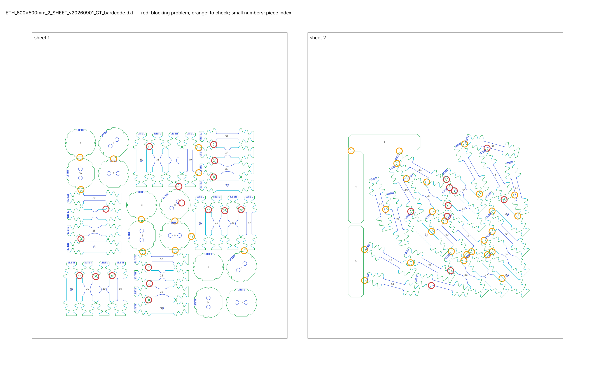
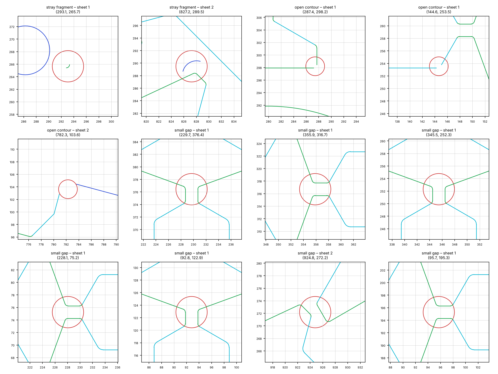
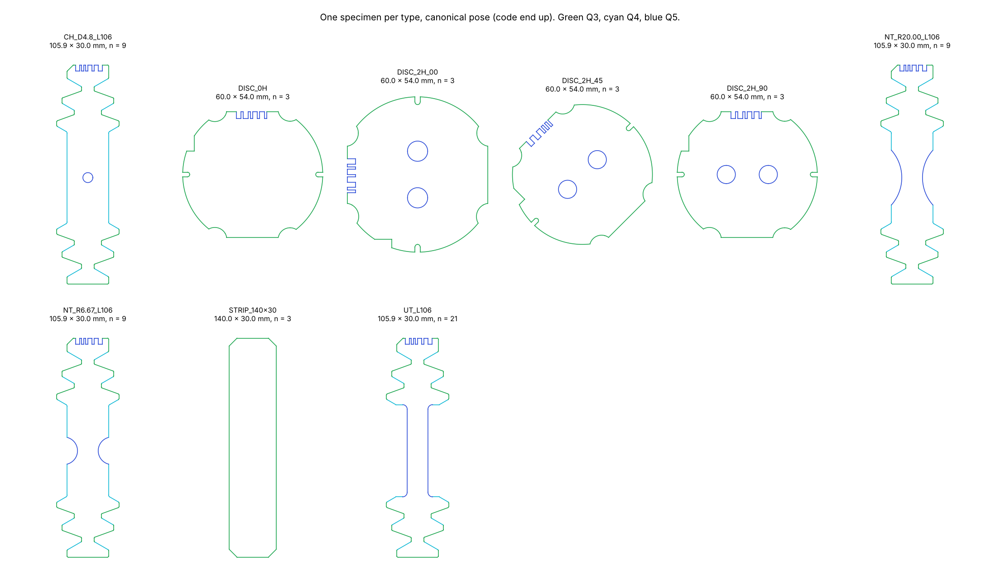
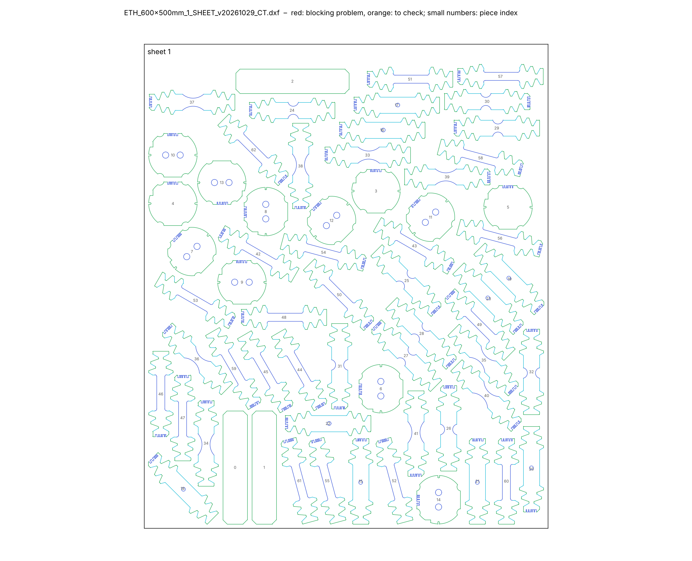

# 2026-10-29

## Objective

Start Task II (EDM cutting sheets). Understand the drawings received from the supervisors, check the working
drawing `ETH_600x500mm_2_SHEET_v20260901_CT_bardcode.dxf`, and extract a clean library of its specimens (steps 1 and 2
of the cutting-sheet tool).

## Progress and Notes

### 1. Files received and what they mean

Received: four cutting drawings from 2025 (`.dxf`, each with its workshop notice as `.pptx` and `.pdf`) and the
working drawing of 1 Sept 2026 (`…_CT_bardcode.dxf`). They are stored in `cutting-sheets/input/`.

- **The DXF** is the drawing that the wire-EDM workshop cuts.
- **The PowerPoint / PDF** is the same drawing, annotated for the workshop:
  - EDM quality per colour;
  - rolling direction;
  - position of the micro-joints (*Mikrosteg*).

*Figure 1 – Workshop notice `ETH_600x500mm_2_SHEET_v20250220.pdf`, sheet 1. Arrows: green = normal quality (Q3),
cyan = medium (Q4), blue = highest (Q5); red squares = micro-joints, to be placed exactly in the middle of an edge; big
arrow = rolling direction (drawing +Y).*

Conventions found by reading the DXF files (ezdxf):

| Item | In the DXF | Meaning |
|---|---|---|
| Units | mm (`$INSUNITS = 4`), DXF R2000 | – |
| Black frame (colour 7) | rectangle | raw sheet |
| Green / cyan / blue (colours 3 / 4 / 5) | cutting lines | EDM quality Q3 / Q4 / Q5 |
| Rolling direction | drawing +Y | angle of each specimen counted from +Y |
| Chamfered corner | one 45° corner per piece | orientation mark |
| Notch code | blue comb ≈ 13 × 3 mm in a head | identification (see section 5) |
| Micro-joints | not in the DXF | only on the notice |
| Texts | information only | "bitte nicht gravieren": not to be engraved |

The colour is what counts, not the layer: layers are called `3` / `4` / `5`, or `Normal_Quality` /
`Medium_Quality` / `High_Quality`, and many lines sit on layer `0` with a forced colour.

The three "SHEET" drawings of 2025 contain **the same test programme** distributed over different sheet sizes:

| Drawing | Sheets |
|---|---|
| `300x300_6_SHEET` | 6 × (300 × 300) |
| `450x400_3_SHEET` | 3 × (400 × 450) |
| `600x500_2_SHEET` | 2 × (500 × 600) |

The programme is 60 specimens of 140 × 30 mm or Ø ≈ 55 mm:

| Specimen | Orientations to the rolling direction | Number |
|---|---|---|
| UT (uniaxial tension) | 0, 15, 30, 45, 60, 75, 90° | 7 × 3 = 21 |
| NT, notch radius 20 mm | 0, 45, 90° | 9 |
| NT, notch radius 6.67 mm | 0, 45, 90° | 9 |
| CH (central hole Ø 4.8 mm) | 0, 45, 90° | 9 |
| Discs (no hole, or 2 holes at 0 / 45 / 90°) | – | 12 |

The fourth drawing, `ShearEDM`, holds 24 coded blanks of 93 × 30 mm for shear specimens.

*Figure 2 – Zoom on the 2025 drawing 600 × 500 mm (drawing millimetres). Left: discs with two holes and NT specimens;
middle: CH and UT; right: NT with both notch radii. Blue: gauge edges, notches, holes and notch codes (Q5); cyan:
fillets (Q4); green: the rest (Q3).*

### 2. The working drawing: same programme, dynamic specimens

`…_CT_bardcode.dxf` has the same programme on 2 sheets of 500 × 600 mm, but with **toothed heads** for the SHPB with
load inversion device ("CT": Christmas tree, like our `XMas_UT` files). The specimens are 105.9 × 30 mm instead of
140 × 30 mm, very close to the UT40 drawing used in Task I (103.2 mm).

*Figure 3 – `ETH_600x500mm_2_SHEET_v20260901_CT_bardcode.dxf`, sheets 1 (left) and 2 (right). Sheet 2 holds the
inclined UT specimens and three strips, packed in one corner.*

### 3. Step 1 – check tool (`cutting-sheets/scripts/check_sheet.py`)

New scripts:
- `sheetlib.py`: reads the DXF, explodes the blocks, resolves the colours, finds sheets, closed pieces, open ends,
  duplicates, notch codes, and the specimen type and orientation from the geometry;
- `check_sheet.py`: checks a drawing. It writes `report.md`, `preview.png`, `issues.png` and `pieces.csv` in
  `cutting-sheets/reports/<drawing>/`.

The checks:
- units;
- sheet frames;
- closed contours and stray fragments;
- duplicate lines;
- colour = quality;
- overlaps;
- gap between pieces (error below 3 mm, warning below 5 mm, **provisional limits**);
- margin to the sheet edge;
- notch codes.

Results:

| Drawing | Closed contours | Smallest gap | Codes |
|---|---|---|---|
| 300 × 300, 2025 | OK | 4.0 mm | OK |
| 450 × 400, 2025 | OK | 2.7 mm | OK |
| 600 × 500, 2025 | OK | 3.0 mm | OK |
| ShearEDM, 2025 | OK | 10.0 mm | OK, 24 distinct |
| **CT, 2026 (working drawing)** | **3 open contours + 2 stray fragments** | **1.67 mm** (22 pairs below 3 mm) | OK |

The validation on the 2025 drawings, which were already cut, shows that the tool does not raise false errors on
correct drawings.

Problems of the working drawing:
- **3 open contours**: a missing piece of line of 1.0 mm, 0.71 mm and 3.18 mm. The wire cannot follow them.
- **2 stray fragments**, connected to nothing: an arc R0.5 (Q3) inside a disc, and an arc R2.25 (Q5) on sheet 2.
- **Units not set**: `$INSUNITS = 0`.
- **Small gaps**: mostly **tooth tips facing each other** between neighbouring heads, 1.7–2.2 mm apart.

*Figure 4 – Check of the working drawing. Red circles: blocking problems (open contours, stray fragments, gaps below
3 mm); orange: gaps between 3 and 5 mm; small grey numbers: piece index used in the report.*

*Figure 5 – First twelve blocking problems, 16 mm windows.*
- First row: the open contours (two line ends that do not meet) and the two stray arcs.
- Other rows: tooth tips of neighbouring specimens about 2 mm apart.

### 4. Step 2 – specimen library (`cutting-sheets/scripts/extract_library.py`)

How it works:
- **Repair.** Each open contour is repaired from an intact **twin** (same type and shape). The twin is laid over the
  broken piece by rotation and translation, and the missing lines are copied with their exact geometry. Stray fragments
  are removed. The notch code of the broken piece is never changed.
- **Canonical pose.** Each specimen is brought to a canonical pose: centre at the origin, axis towards the coded head
  = +Y. Discs keep their orientation, because their holes define it.
- **Output.** Each specimen is written as a DXF block, with layers `Q3_NORMAL` / `Q4_MEDIUM` / `Q5_HIGH`.

Repairs made on the working drawing:

| Where | Specimen | Repair |
|---|---|---|
| sheet 1, (144.6, 253.5) | NT R6.67 at 90° | 1 line copied from a twin |
| sheet 1, (287.4, 298.2) | NT R6.67 at 0° | 1 line copied from a twin |
| sheet 2, (782.3, 103.6) | UT at 75° | 1 line copied from a twin |
| sheet 1, (293.1, 265.7) | stray arc R0.5 inside a disc | removed |
| sheet 2, (827.2, 289.5) | stray arc R2.25 (Q5) | removed |

After the repair, the redrawn sheet (`repaired_source.dxf`) has all contours closed.

Library `CT_600x500_v20260901`: **63 specimens, 9 types**:

| Type | Number |
|---|---|
| UT | 21 |
| NT R20 | 9 |
| NT R6.67 | 9 |
| CH Ø 4.8 | 9 |
| Discs, 4 variants | 4 × 3 |
| Strips 140 × 30 | 3 |

Shape check: all specimens of a type are identical outside the notch code. The residual is 0.05–0.13 mm², which is
discretisation noise.

*Figure 6 – One specimen per type of the library, canonical pose (code end up), with its size and number.*

### 5. The notch code identifies the orientation and the repetition, not the specimen

The codes were compared after bringing every specimen to the same pose. In the 2025 drawing and in the working
drawing, **one code = one orientation and one repetition** (for example "45°, no. 2").

- **Shared across families.** The same code is carried by the UT, NT20, NT6.67 and CH specimens of that orientation
  and repetition. They are told apart by their shape.
- **Same codes in both drawings.** The working drawing uses exactly the same codes as the 2025 drawing.
- **Count.** In each drawing: 30–31 distinct codes for 57–60 coded specimens.

### 6. Rules from the supervisors

Answers of 12:04:
- minimum gap between pieces: **5 mm**;
- **no micro-joints** in the DXF;
- **no mirror image** of a specimen.

The margin to the sheet edge was not given; 5 mm is used provisionally.

Consequences:
- the check tool now flags any gap below 5 mm as an error;
- the placement engine keeps, for every specimen, its angle in the source drawing, or that angle + 180°.

With the 5 mm rule, the working drawing has **59 pairs of pieces below 5 mm**.

### 7. Step 4 – automatic placement (`cutting-sheets/scripts/nest.py`)

**Engine.**
- Each specimen is rasterised on a 0.5 mm grid, conservatively: a cell belongs to the piece as soon as the piece
  touches it.
- Every placed piece blocks all cells closer than 5 mm. The real gap is therefore always ≥ 5 mm; the cost is at most
  half a cell diagonal (0.35 mm) of extra spacing.
- All free positions of a piece are found at once by an FFT correlation.
- Each piece goes to the lowest, then left-most, free position, on the first sheet where it fits (both 180° turns are
  tried).
- Four initial orders are tried (by area, height, width, type), then simulated annealing on the order.
- The result is written as a DXF (library blocks, exact geometry, mm) and checked by `check_sheet.py`, without the
  grid.
- A last check compares, for every specimen, its type and angle to the rolling direction with the library.

**Result on the CT programme** (63 specimens, sheet 500 × 600 mm, gap 5 mm, margin 5 mm):

| | Manual drawing (1 Sept 2026) | Automatic placement |
|---|---|---|
| Sheets | 2 | **1** |
| Smallest gap | 1.67 mm (59 pairs below 5 mm) | **5.25 mm** |
| Smallest margin | 40.3 mm | 5.1 mm |
| Open contours / stray fragments | 3 / 2 | 0 / 0 |
| Units | not set | mm |
| Specimens at the right angle to RD | – | 63 / 63 |

How the result was found:
- With a pure bottom-left placement, the best initial order (tallest pieces first) already gives one sheet, used up to
  588.5 mm.
- Simulated annealing (120 iterations, about 10 s each) lowers the occupied height to 575.0 mm.
- The area used is 43 % of the sheet.
- Output: `cutting-sheets/output/ETH_600x500mm_1_SHEET_v20261029_CT/`.

The 5 mm rule is stricter than the 2025 drawings, which have 12 to 17 pairs below 5 mm (minimum 2.7 mm).

*Figure 7 – Automatic placement of the 63 CT specimens on one 500 × 600 mm sheet, checked by `check_sheet.py`. No red
or orange circle: every gap is ≥ 5 mm and every margin ≥ 5 mm. Each specimen keeps its angle to the rolling direction
(drawing +Y), or that angle + 180°.*

## Next Steps

- Ask the supervisors what the discs and the 140 × 30 mm strips are for.
- Show the one-sheet drawing to the supervisors. Questions: is one 500 × 600 mm sheet available; which margin to the
  sheet edge.
- Step 5: workshop notice (PDF: qualities, rolling direction, micro-joints in red, title and version).

## References

- `File` *Drawings received.* [cutting-sheets/input/](../cutting-sheets/input/) · received 29 Oct 2026.
- `File` *Check reports.* [cutting-sheets/reports/](../cutting-sheets/reports/) · created 29 Oct 2026.
- `File` *Specimen library of the working drawing.* [cutting-sheets/library/CT_600x500_v20260901/](../cutting-sheets/library/CT_600x500_v20260901/) · created 29 Oct 2026.
- `File` *Tool documentation.* [cutting-sheets/README.md](../cutting-sheets/README.md) · created 29 Oct 2026.
