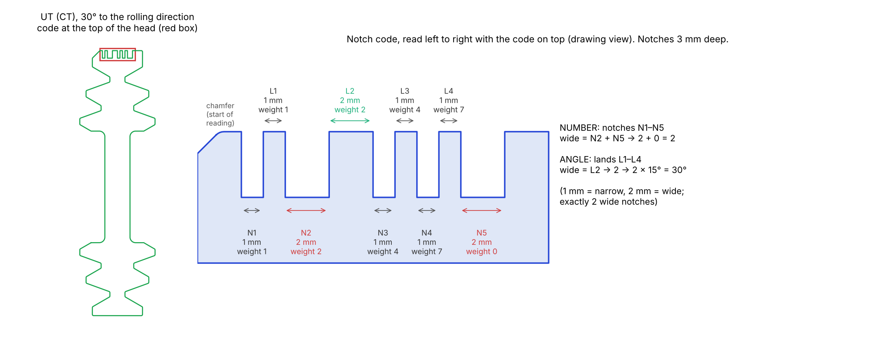
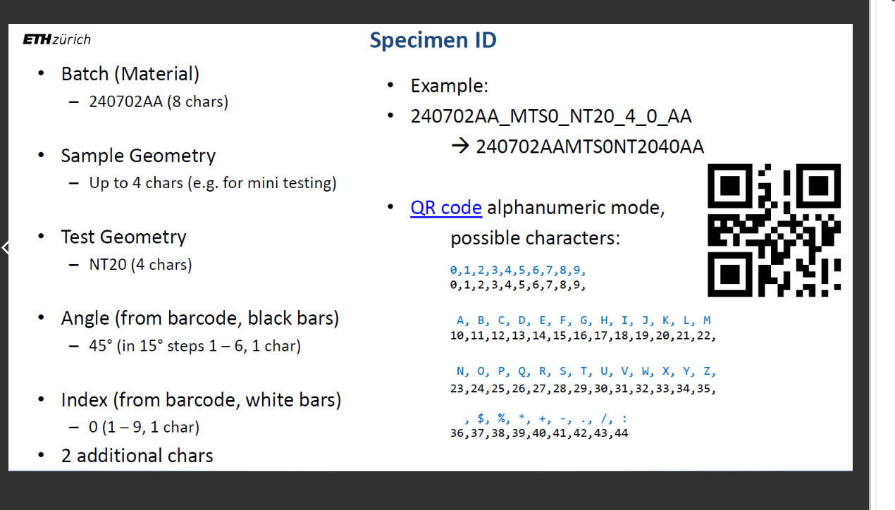
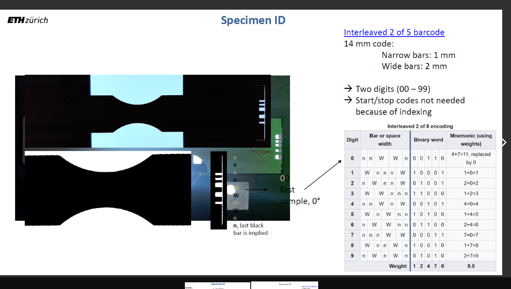
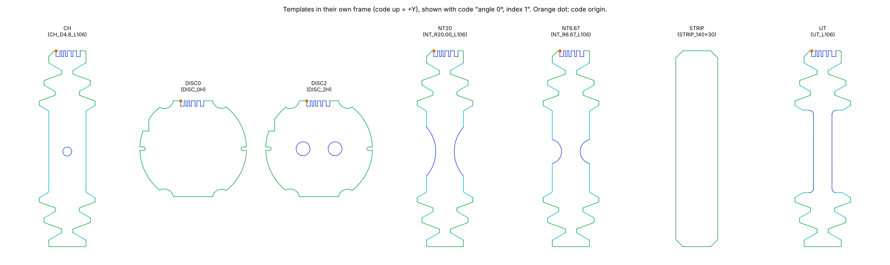
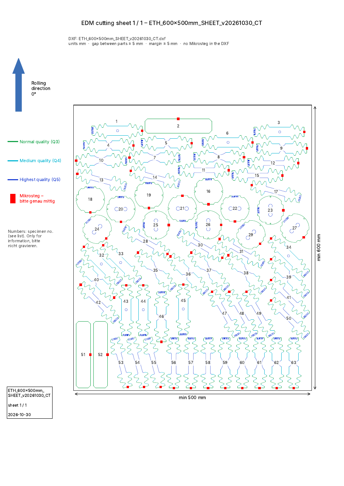
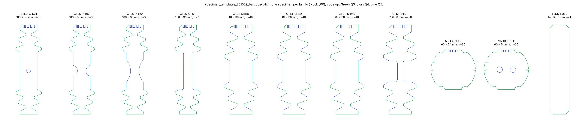
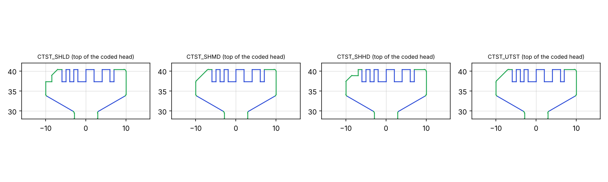

# 2026-10-30

## Objective

Understand how the notch code (the "barcode" cut into the specimen heads) works, from the drawings received on
29 Oct, before the document of the lab arrives.

## Progress and Notes

### 1. Decoding method

Each notch code was measured on the real piece outline, in the canonical pose of the specimen:
- the axis points towards the coded head (= +Y);
- the drawing is seen from the top;
- the code is read left to right.

The material profile along the head edge gives a sequence of notch / land widths.

The labelled shear drawing (`ETH_450x380mm_ShearEDM`, texts `SH45-MD2` etc.) was used as ground truth.

### 2. The code is a "2 of 5" barcode

- **Structure**: 5 notches N1–N5, 3 mm deep, separated by 4 lands L1–L4. Every element is 1 mm (narrow) or 2 mm
  (wide). The code is 12 or 13 mm long.
- **Notches = number.** They form a standard 2-of-5 digit:
  - weights 1-2-4-7-0, exactly 2 wide notches;
  - the digit is the sum of the weights of the wide notches;
  - "0" is written 4 + 7.
- **Lands = angle.** They form the same digit without its last element: weights 1-2-4-7, 0 written 4 + 7. The angle
  is the digit × 15°, measured from the rolling direction, counter-clockwise, modulo 180°.

*Figure 1 – Notch code of a CT UT specimen at 30°, number 2, from the working drawing (canonical pose, code on top).
Wide notches N2 + N5 → 2 + 0 = number 2. Wide land L2 → 2 → 2 × 15° = 30°. The chamfered corner is on the left.*

### 3. Check on all drawings

The decoding was checked on every coded specimen of the five drawings:
- the 2025 drawings 300 × 300, 450 × 400 and 600 × 500;
- the ShearEDM drawing;
- the CT working drawing.

| Check | Result |
|---|---|
| 5 notches + 4 lands, exactly 2 wide notches | every code |
| Angle of the code = measured angle of the specimen (mod 180°) | every bar specimen, including −45° = 135° (shear "SH31") |
| Number, programme drawings (UT, NT, CH, discs) | 1, 2, 3 = repetition at that angle; shared by the UT, NT20, NT6.67 and CH specimens of the same angle |
| Number, shear drawing | LD1 = 1, LD2 = 2, MD1 = 4, MD2 = 5, HD1 = 7, HD2 = 8 (three groups of three numbers: variant + repetition) |
| Discs | code angle = 90° for holes along the rolling direction (`DISC_2H_00`), 0° for holes across it (`DISC_2H_90`) and for the disc without holes, 45° for `DISC_2H_45` |

**Face of the sheet.** On every bar specimen the chamfered corner is on the **left** when the code is on top:
- in the CT drawing, on the coded head;
- in the 2025 drawings, on the other head.

The chamfer therefore tells which face is up. Read from the other face, the code would be mirrored and give another
angle.

### 4. Consequences for the cutting-sheet tool

- Codes can be **generated** for any angle that is a multiple of 15° between 0° and 135°, and any number 0–9.
- **150° and 165° (i.e. −30° and −15°) cannot be coded.** Angles must be given counter-clockwise from the rolling
  direction, 0 to 90° (or 105–135°).
- "5 UT at 30°" is possible: numbers 1 to 5. The CT programme only uses 1–3, and the shear drawing groups numbers by
  three.

### 5. Lab document: the decoding is confirmed

The lab document (two slides "Specimen ID") arrived at 11:00.

*Figure 2 – Lab slide "Specimen ID" (1/2): fields of the specimen identifier and its QR code.*

*Figure 3 – Lab slide "Specimen ID" (2/2): interleaved 2-of-5 barcode on an NT20 specimen, backlit (material
black, notches white), and the encoding table.*

| Point | My decoding (section 2) | Lab document |
|---|---|---|
| Code | 2-of-5, weights 1-2-4-7-0, 0 = 4 + 7 | **Interleaved 2 of 5**, same weights, 0 = 4 + 7 |
| Element widths | 1 mm / 2 mm | narrow 1 mm, wide 2 mm |
| Angle | lands (material between notches), digit × 15° | **black bars** (material) = angle, 15° steps 1–6 (0 = 0°) |
| Number | notches | **white bars** (notches) = index, 1 char |
| Missing 5th land | the angle digit has only 4 visible elements | "last black bar is implied" |
| Length | measured 12 or 13 mm | **14 mm** = 9 visible elements + the implied black bar (1 or 2 mm) |
| Start / stop | none found | not needed, "because of indexing" (the code is at a known place on the specimen) |

What the document adds:
- **The full specimen ID is not cut into the specimen.** It is 20 characters:

| Field | Size | Example |
|---|---|---|
| batch (material) | 8 characters | `240702AA` |
| sample geometry | up to 4 characters | `MTS0` |
| test geometry | 4 characters | `NT20` |
| angle (from the barcode) | 1 character | – |
| index (from the barcode) | 1 character | – |
| additional | 2 characters | `AA` |

  The example on the slide is `240702AA_MTS0_NT20_4_0_AA` → `240702AAMTS0NT2040AA`. It is stored as a QR code in
  alphanumeric mode.
- Only the angle and the index are cut into the specimen. The rest is known from the batch and from the shape.

Not in the document: the shear numbering in groups (1-2, 4-5, 7-8), angles 105–135° (shear −45° = 9), discs, and the
chamfer on the left. These remain findings from the drawings.

Note: in the slide example the angle character is `4`, which is 60° with the 15° rule, while the text next to it
gives 45° as an example of angle.

### 6. Tool completed: order file → coded specimens → plan

Chain of four scripts in `cutting-sheets/scripts/`:

| Script | Role |
|---|---|
| `notchcode.py` | writes and reads the notch code (angle digit + index) |
| `make_templates.py` | one template per specimen type, without code, taken from the CT library |
| `make_plan.py` | order file (YAML) → coded specimens → placement (`nest.py`) → DXF, checks, registry, notice |
| `check_sheet.py` | unchanged; runs on every generated plan |

What the geometry showed:
- **The code is anchored on its left end.** In the template frame (code up), the first notch always starts at
  x = −6.000 mm on bars, on the head edge (y = 52.944 mm). The code is 12 or 13 mm long (1 or 2 wide lands), so the
  Q3 line after the code ends at a fixed point (x = 9.5 mm) but starts at x = 6 or 7 mm. The generator redraws that
  line for each code.
- **Discs.** The code sits on a flat of the disc. The angle in the code is the direction of the code from the centre;
  the two holes of `DISC_2H` are perpendicular to it (code 90° = holes along the rolling direction). One `DISC_2H`
  template rotated gives the three disc variants.
- **Angle convention.** All CT specimens have their code end at +θ counter-clockwise from +Y (e.g. UT 30°: axis at
  +30°). The tool uses the same convention; θ + 180° is also allowed (code at the other end), never a mirror.

*Figure 4 – The 7 templates in their own frame, drawn with the code "angle 0°, index 1". Orange dot: start of the code.*

Validation:

| Test | Result |
|---|---|
| Each of the 63 CT specimens rebuilt from its template + the code read on it | code lines within 0.010 mm, outline within 0.016 mm (rounding of the source drawing at 45°) |
| Order `orders/CT_v20260901.yaml` (same programme) | 63 specimens on **1 sheet** 500 × 600 mm (571 mm used, no annealing); all checks OK |
| Codes of that plan vs the lab drawing | the 60 codes are **identical** (type, angle digit, index) |
| Codes read back in the final DXF | 63 / 63 = code and direction ordered |
| Wrong orders (angle 150° or 20°, 10 specimens at one angle, same code twice, unknown type) | refused with a message, no file written |

*Figure 5 – Notice page for the workshop of the CT plan: specimen numbers, proposed Mikrosteg (red, since removed – section 10),
qualities, rolling direction. Numbers are for information only; they are not in the DXF.*

### 7. Faster placement engine

Profile of one full placement (63 specimens, 500 × 600 mm, 6.9 s):

| Part | Time |
|---|---|
| FFT correlations over the whole sheet | 3.8 s |
| finding the lowest free cell in the full 1200 × 1000 map | 1.5 s |
| forbidden zone around each placed piece (buffer + point-in-polygon) | ~1.2 s |

Changes, none of which changes the result:
- **Search only the useful rows.** Cells only become forbidden, never free, so the lowest free position of a shape
  can only move up: the search restarts from the last one found. Above the highest forbidden row there is only the
  margin, so if the shape is not free just above it, it is free nowhere higher. A shape that no longer fits on a
  sheet is not tried there again.
- **Forbidden zone stamped.** Pieces sit on grid cells, so the zone (piece + gap) is the same pattern for a given
  shape and angle; it is computed once and copied.
- **Parallel runs.** The 4 starting orders, and several annealing chains with different seeds, run on separate cores;
  the best chain is kept.

| Test | Result |
|---|---|
| Old vs new engine, same 20 placement orders (4 starting + 6 random, on 500 × 600 and 300 × 300 sheets) | **identical placements** (difference 0 mm) |
| One full placement, 500 × 600 | 6.9 s → **2.1 s** |
| One full placement, 300 × 300 (5 sheets) | 3.9 s → 2.2 s |
| CT order without annealing (2 cores) | placement step 37 s → 9 s |
| CT order, 2 chains × 15 iterations | 26 s; best chain 567 mm instead of 571 mm (1 sheet, all checks OK) |

### 8. Lab catalogue `specimen_templates_261029_barcoded.dxf`

Received in the afternoon. The file has 411 blocks, each inserted once, in mm. Every contour is closed and no line is
drawn twice. The blocks are named `<sample>_<test>_<nn>`.

| Family | Size (mm) | Blocks | Angles | Same as the CT template |
|---|---|---|---|---|
| `CTLG_UTUT` | 105.9 × 30 | 70 | 0–90° by 15° | UT (0.10 mm²) |
| `CTLG_NT20`, `CTLG_NT06` | 105.9 × 30 | 30 each | 0, 45, 90° | NT20, NT6.67 (0.10 mm²) |
| `CTLG_CHCH` | 105.9 × 30 | 30 | 0, 45, 90° | CH (0.10 mm²) |
| `MNAK_FULL`, `MNAK_HOLE` | 60 × 54 | 30 each | 0, 45, 90° | DISC0, DISC2 (≤ 0.19 mm²) |
| `TENS_FULL` | 140 × 30 | 1 | – (no code) | STRIP (0 mm²) |
| **`CTST_UTST`** (new) | 80.8 × 30 | 70 | 0–90° by 15° | – short UT, gauge 5 mm wide |
| **`CTST_SHLD`, `CTST_SHMD`, `CTST_SHHD`** (new) | 80.8 × 30 | 40 each | 0, 45, 90, −45° | – short specimen, centre 20 mm wide |

*Figure 6 – One block per family (number 00), code up. Green Q3, cyan Q4, blue Q5.*

Findings:
- **Block number = notch code.** For all 410 coded blocks, the code read by `notchcode.py` equals the block number
  (angle digit, index), and the code direction equals the block rotation (within 0.01°). This confirms the decoder
  and the angle convention on 410 more specimens, including angle digit 9 (−45° = 135°) and index 0.
- **Index 0–9.** The catalogue has 10 specimens per angle, indices 0 to 9; the CT drawing used only 1–3.
- **Within a family the shape is identical** apart from the code (≤ 1.3 mm², drawing rounding).
- **SHLD / SHMD / SHHD have the same outline** (centre 20 mm wide, no shear slot). They differ only by the corner next
  to the code: plain chamfer (SHMD), chamfer with a step low (SHLD) or high (SHHD). The shear zone is probably
  machined later; the corner tells the variants apart.

*Figure 7 – Coded head of the three shear families and of the short UT. Only the left corner differs.*

- The block names look like the fields of the specimen ID of the lab document: sample geometry (4 characters:
  `CTLG`, `CTST`, `MNAK`, `TENS`) + test geometry (4 characters: `UTUT`, `NT20`, `SHLD`…). Hypothesis, to confirm.
- `make_templates.py` groups specimens by geometry; that does not work here: the short UT is classified as a notched
  specimen (its R2 fillets are near the middle) and the three shear families fall into one class. The catalogue must
  be grouped by block name.

### 9. Templates from the lab catalogue

The tool now takes its templates from the lab catalogue (`templates/CTLG_261029`, the new default). The type of a
specimen is the family name of its block (`CTLG_UTUT`, `CTST_SHLD`…), read from the file. The model of each type is its
block `_00`.

*Figure 8 – The 11 templates from the catalogue, drawn with the code "angle 0°, index 1". Orange dot: start of the
code.*

| Test | Result |
|---|---|
| 410 coded blocks rebuilt from their template + the code read on them | code = block number 410 / 410; code lines within 0.012 mm, outline within 0.017 mm |
| Example order (5 UTUT 30°, 3 NT20 45°, 2 UTST 0°, 2 SHLD 135°, 2 MNAK_HOLE 90°) | 1 sheet 300 × 300 mm, all checks OK; every specimen equals the lab block with the same code within 0.013 mm |
| CT order (old templates, indices 1–3) | the 60 codes are still identical to the CT drawing |

Changes in the order file:
- names of the lab (`UTUT`, `UTST`, `NT20`, `NT06`, `CHCH`, `SHLD`, `SHMD`, `SHHD`, `MNAK_FULL`, `MNAK_HOLE`,
  `TENS_FULL`), with the old short names kept (`UT`, `CH`, `DISC2`…);
- index from 0 by default, as in the catalogue (10 specimens per type and angle);
- every codable angle is allowed for every type, also angles not in the catalogue (e.g. NT20 at 30°): the template
  is rotated. No warning.

The final check of a plan no longer relies on type names. Each specimen of the DXF must have the outline of its
template with its code, rotated by its placement angle (≤ 0.02 mm), plus the code and direction ordered.

### 10. Mikrosteg removed from the tool

Decision: the Mikrosteg are handled by the workshop. The tool no longer proposes a position. Removed from the
templates, the notice and the README; the DXF never had them.

### 11. Repository cleaned

Only what is needed to run the tool is kept in `cutting-sheets/`:
- the scripts;
- the catalogue templates `templates/CTLG_261029/`;
- the lab input files;
- two orders: `orders/exemple.yaml` and `orders/feuille_CT.yaml`.

`feuille_CT.yaml` is the real sheet: the CT programme of the lab drawing, written with the catalogue names and
indices 1–3. Its 60 codes are identical to those of the lab drawing; 63 specimens fit on 1 sheet of 500 × 600 mm,
with all checks OK.

Removed (generated, or replaced by the catalogue): `output/`, `reports/`, `library/`, `templates/CT_v20260901/`,
`extract_library.py`, the stand-alone mode of `nest.py`. All results are now produced by running the two orders. The
links above to those folders point to files that are only in the git history (commit `8daa9d1` and earlier).

## Next Steps

- Ask the supervisors:
  - whether the block names give the specimen ID fields (sample geometry `CTLG` / `CTST` / `MNAK`, test geometry
    `UTUT` / `SHLD`…), and the meaning of the 2 "additional" characters;
  - what LD / MD / HD mean for the shear specimens, and whether the shear zone is machined after EDM;
  - the margin to the sheet edge (5 mm assumed).
- Send a generated plan (DXF + notice) to the workshop for a first test cut.

## References

- `File` *Drawings analysed.* [cutting-sheets/input/](../cutting-sheets/input/) · received 29 Oct 2026.
- `File` *Lab specimen catalogue.* [cutting-sheets/input/specimen_templates_261029_barcoded.dxf](../cutting-sheets/input/specimen_templates_261029_barcoded.dxf) · received 30 Oct 2026.
- `File` *Tool.* [cutting-sheets/](../cutting-sheets/) · scripts, `templates/CTLG_261029/`, `orders/`.
- `File` *Library used for the figure.* [cutting-sheets/library/CT_600x500_v20260901/](../cutting-sheets/library/CT_600x500_v20260901/) · created 29 Oct 2026.
