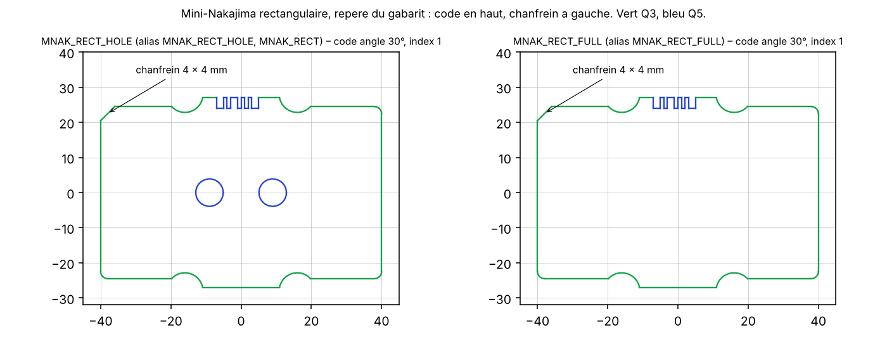

# 2026-11-02

## Objective

Take into account the supervisor's feedback on the cutting plans: limited cutting area of the EDM and a margin to
clamp the sheet.

## Progress and Notes

### 1. Feedback (Christian, 02/11)

- The cutting area of the EDM is limited, about 350 × 250 mm (to check with the workshop).
- The sheet must be clamped on the outside. Example from the waterjet company: an L-shaped margin of 40 mm (two
  adjacent sides kept free for the clamps).

### 2. Margins per side in the tool

- Order file: `marges: {gauche: 40, bas: 40, droite: 5, haut: 5}` (mm, per side; bottom = start of the rolling
  direction). `marge: 5` is kept as a shortcut for the same margin on all sides.
- Placement (sparrow): the strip lies between x = left − gap and x = W − right + gap and starts at y = bottom − gap;
  since sparrow keeps the separation (gap + 0.05 mm) to the strip borders, every specimen is at least margin + 0.05 mm
  from the edge. At the top, a specimen stays on the sheet only if it is at least `haut` from the edge.
- Final check (`check_sheet.py`): smallest distance to each of the four edges, checked against its own limit
  (`--margins G B D H` on the command line).
- Notice: margins hatched with their width, dashed frame of the usable area, legend "Clamping area / margin".

### 3. Results with a 350 × 250 mm sheet and a 40 mm L-shaped clamping margin (provisional values)

| Order | Sheets | Specimens per sheet | Checks |
|---|---|---|---|
| `exemple.yaml` (14 specimens) | 1 | 14 | all OK (margins: left 40.1, bottom 40.1, right 5.2 mm) |
| `feuille_CT.yaml` (68 specimens, 30 s per sheet) | 6 | 12, 12, 13, 13, 13, 5 | all OK; 68/68 codes read back (improved in section 4) |

Sheet 1 of the CT plan uses 215 mm of the 245 mm available in height: the split (specimens fully inside the sheet are
kept, the rest is placed again) leaves some space at the top of each sheet.

### 4. Better split over several sheets

The split of section 3 was poor: sparrow packed all 68 specimens on one strip 958 mm long, which was then cut into
sheets; every specimen crossing a cut was removed and placed again, leaving holes on each sheet.

Area bound: specimens + half the gap = 2063 cm², usable area of one sheet = 651 cm², so at least 3.2, i.e. 4 sheets.

| Method (real sheet, 350 × 250, L-shaped 40 mm) | Sheets | Remark |
|---|---|---|
| One strip cut into sheets (section 3) | 6 | holes on each sheet |
| PackingSolver, bin packing, 60 s or 180 s | 5 | valid (gaps, angles), but loose |
| Split into 4 groups of equal area, then sparrow per sheet (60 s) | – | every sheet too high by 17–22 mm |
| **Split into 5 groups of equal area, then sparrow per sheet (40 s)** | **5** | compact, 13–14 specimens per sheet, 215–236 mm used of 245 |

Four sheets would need about 79 % fill of the usable area; sparrow reaches about 70 % with these toothed shapes.

Adopted in `sparrow_place.place`:
1. start from the area bound;
2. split the specimens into groups of equal area (largest specimen to the least loaded group);
3. sparrow packs each group on its sheet;
4. as soon as one group does not fit, start again with one sheet more.

Result for `feuille_CT.yaml` (`temps: 40`): the 4-sheet attempt fails on sheet 1 (24.6 mm too high), then 5 sheets of
14, 13, 13, 14, 14 specimens, 215–230 mm used. All checks OK, 68/68 codes read back. Duration 4 min 27 s.

### 5. Machine margins on the preview

`check/preview.png` now shows the margins of each sheet (clamping area and other margins) with red hatching, so a
specimen inside them would be seen at once. The figure height follows the drawing (no empty band above and below).

### 6. Filling each sheet with specimens of the next sheets

After the group of a sheet is packed, specimens of the following groups are tried one by one (largest shape first,
each shape at most once per sheet): sparrow packs the sheet again with one specimen more, which stays if everything
fits. The groups of the next sheets are then computed again from the specimens left. The filling stops after 3
failures in a row, 8 tries, or when the sheet would exceed 85 % of the usable area.

Real sheet (`temps: 40`, 6 tries per sheet, before the 3-failure stop):

| | Without filling | With filling |
|---|---|---|
| Sheets | 5 | 5 |
| Specimens per sheet | 14, 13, 13, 14, 14 | 14, 14, 15, 15, 10 |
| Height used (of 245 mm) | 215–230 mm | 230–239 mm on sheets 1–4, 176 mm on sheet 5 |
| Duration | 4 min 27 s | 13 min 22 s |

The first four sheets are fuller and the last one has a free band of about 70 mm, but the number of sheets does not
change: four sheets are not reachable with these margins (section 4). Most tries with the large shapes (TENS_FULL
strips, discs) fail. Order field `ajouts` (0 = no filling).

### 7. Rectangular Mini-Nakajima specimen (proposal of Erik)

Erik proposes a rectangular Mini-Nakajima specimen that fits directly in the bays of the test set-up (no plastic
support, faster testing); the upper clamp keeps its circular clamping area, so the corners outside it are free and
leave room for the notch code.

Geometry (SolidWorks export `input/RoundSample_Dual_Hole_rectange.dxf`, mm): 80 × 54 mm, ends 49 mm wide with R2
corners, two holes R3.9 at ±9 mm, four side notches R5.15. Compared with the disc `MNAK_HOLE` of the lab catalogue,
turned by 90°, the holes, the notches and the flat at 27 mm from the centre (where the disc carries its code, flat
ending at x = 10.948 mm) are identical: the rectangle is the disc extended to 80 mm.

Added as a complementary catalogue (`build_mnak_rect.py` → `input/specimen_templates_extra_MNAK_RECT.dxf`, 30 blocks
`MNAK_RECT_HOLE_<angle digit><index>`, angles 0, 45, 90°, index 0–9):
- code on the flat, starting at x = −7.0 mm as on the disc;
- outline Q3, holes Q5, code Q5;
- angle = direction of the code, holes at angle + 90° (same convention as the disc).

Templates `CTLG_261102` = lab catalogue + this file: 30/30 rectangular blocks rebuilt with code = block number,
outline within 0.013 mm. Name in orders: `MNAK_RECT` (or `MNAK_RECT_HOLE`).

Material (350 × 250 sheet, L-shaped 40 mm, 15 specimens at 0/45/90°):

| | Area per specimen | Sheets for 15 |
|---|---|---|
| Disc `MNAK_HOLE` | 2534 mm² | 1 (235 mm used) |
| Rectangle `MNAK_RECT` | 3901 mm² (+54 %) | 2 (8 + 7) |

Points raised, and decisions (02/11):
- End width: the drawing screenshot showed 48 mm, the DXF 49 mm (±24.5). **49 mm is correct.**
- The rectangle was fully symmetric, with no feature telling the face (needed to read the notch code in the right
  direction). **A 45° chamfer of 4 × 4 mm replaces the R2 corner at the top left (code on top)**, like the chamfered
  corner of the other specimens (2.7 × 2.7 mm on the bars; larger here so that it is not lost in the R2 corners).
- **Variant without holes added: `MNAK_RECT_FULL`** (30 blocks, same file).

*Figure 1 – The two rectangular templates in their own frame (code on the top end, chamfer on its left), drawn with
the code "angle 30°, index 1" (version of section 8). Green Q3, blue Q5.*

Templates `CTLG_261102` rebuilt: 60/60 rectangular blocks with code = block number, outline within 0.013 mm.

### 8. Code moved to the end of the rectangle

Correction (02/11): the notch code goes on an end of the rectangle (short side, 49 mm), not on the long side. The
chamfer moves with it, to the left of the coded end. This is the orientation of Erik's file, so the piece is no longer
turned: code on the end y = +40, starting at x = −6 mm (as on the bars), chamfer 4 × 4 mm at the corner (−24.5, 40).
The holes now lie along the coded end, whereas on the disc `MNAK_HOLE` they are perpendicular to the code direction
(angle convention: section 9).

Templates rebuilt: 60/60 rectangular blocks with code = block number, outline within 0.014 mm. Figure 1 updated.

### 9. Angle convention of the rectangle: same holes as the disc

Decision (02/11): the angle of a `MNAK_RECT` means the same hole orientation as the disc `MNAK_HOLE` with the same
angle (90° = holes along the rolling direction). On the rectangle the holes lie along the coded end, on the disc they
are perpendicular to it, so the rectangle is placed with its coded end at angle − 90°; the code still carries the
ordered angle. Implemented as a per-type offset (`make_templates.ANGLE_OFFSET`, column `angle_offset` of
`templates.csv`): placement and final check use the placement angle, code and registry use the ordered angle.

Check in a generated DXF (one disc and one rectangle at 0, 45 and 90°): hole axis at 90°, 45° and 0° from the rolling
direction for both shapes; codes read 00, 30, 60; all checks OK.

### 10. Software in English

The lab wants to use the tool, so it is now entirely in English: code comments and docstrings, terminal messages,
order files and README.
- Order files: English keys (`name`, `sheet`, `gap`, `margins: {left, bottom, right, top}`, `time`, `fill_tries`,
  `specimens`, `count`, `first_index`, `specimen_id`…); the French keys of the first version are still accepted.
- Orders renamed: `orders/example.yaml`, `orders/CT_sheet.yaml` (content unchanged); command-line option `--time`.

Tests: example order, the real sheet, an order with the old French keys, and a wrong order (rejected with an English
message): all as before. With `--time 10`, the real sheet (now with rectangular Mini-Nakajima) took 6 sheets: the
5-sheet attempt failed by 1.0 mm on its first sheet, and the 6th sheet holds only 2 specimens.

### 11. Faster placement: PackingSolver + sparrow

Problem: on the real sheet the placement took 5 to 13 min. sparrow always used its whole time budget, even when the
specimens already fitted, and each failed multi-sheet attempt started again from scratch.

New method (`scripts/placement.py`, replaces `sparrow_place.py`):
1. Assignment: PackingSolver (bin packing, open source, `pip install packingsolver`) puts all the specimens on sheets
   (30 s) and gives a valid layout of each sheet.
2. Reduction: the specimens of the least filled sheet are moved, largest first, to the sheets with the most room.
   sparrow now runs in its own process (`scripts/sparrow_worker.py`), so it is stopped as soon as the specimens fit
   (often 1-3 s instead of the whole budget). Receiving sheets are ordered by their real free room (lowest top after
   compaction). A specimen that misses a sheet by < 10 mm triggers a rebalance (that sheet gives its smallest
   specimen to a third sheet). Only failed tries are counted (`fill_tries`).
3. Compaction of each sheet by sparrow, stopped when it no longer improves.

Problems met while tuning, on `CT_sheet.yaml`:
- With a budget of 8 tries in total, the reduction ran out of tries after 6 moves: now only failures count.
- Ordering the receiving sheets by specimen area chose nearly full sheets: now ordered by lowest top after compaction.
- Many failed tries were only 0.05-2 mm too long: such a try now gets as much time again, and each try uses a new
  sparrow seed. This was the change that brought the 5th sheet.
- PackingSolver alone is not reliable for the number of sheets: 6 sheets with 30, 45, 60 and 75 s (5 once with 90 s
  in an earlier test).

| Run on `CT_sheet.yaml` (68 specimens, 350 × 250, L 40 mm) | Sheets | Duration |
|---|---|---|
| Old method, `time 10` | 6 (last with 2 specimens) | 5 min 12 s |
| New method, first version | 6 (last with 5) | 5 min 07 s |
| New method, final (`fill_time 10`, `time 10`) | **5** (14, 14, 14, 13, 13) | **6 min 22 s** |

All final checks OK. Example order: 1 sheet in 16 s (was 27 s).

## Next Steps

- Run the new placement on the lab PC (`py -m pip install packingsolver` first).
- Ask the workshop: exact cutting area of the EDM, clamped sides and clamping width, whether 5 mm is needed on the
  free sides.

## References

- `File` *Rectangular Mini-Nakajima, SolidWorks export (Erik).* [cutting-sheets/input/RoundSample_Dual_Hole_rectange.dxf](../cutting-sheets/input/RoundSample_Dual_Hole_rectange.dxf) · received 2 Nov 2026.
- `File` *Tool.* [cutting-sheets/](../cutting-sheets/) · `orders/example.yaml`, `orders/CT_sheet.yaml`, `scripts/placement.py`.
