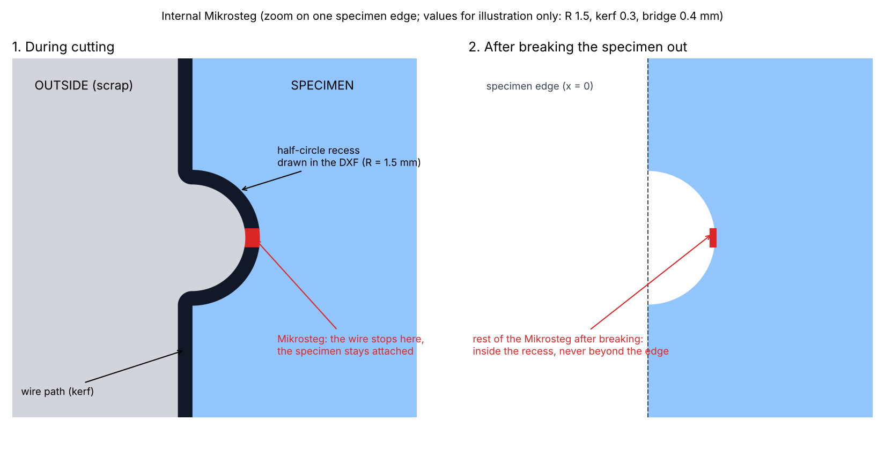
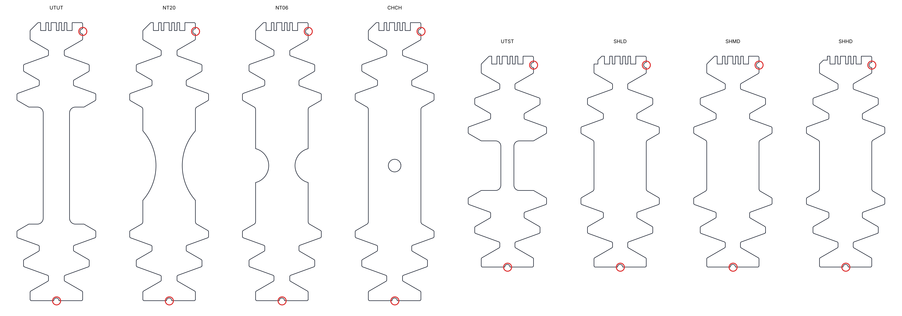
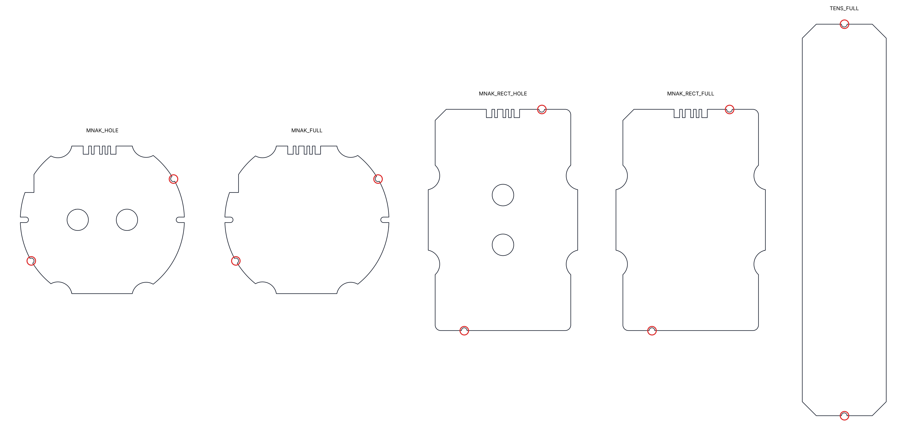
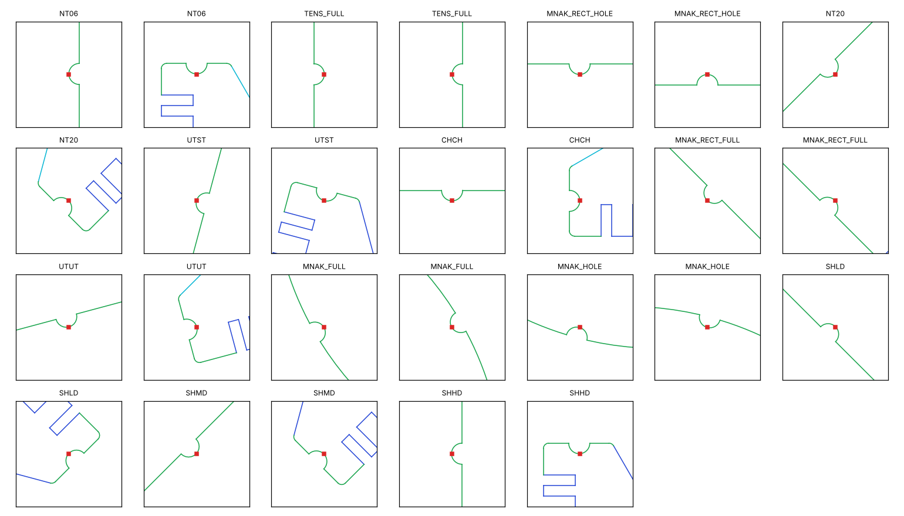
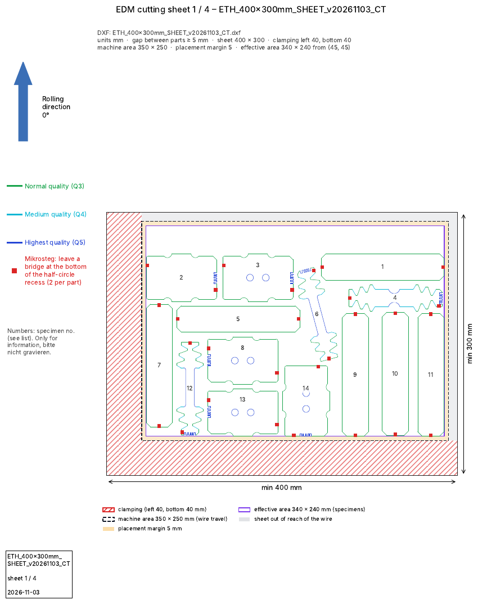

# 2026-11-03

## Objective

Keep only the useful outputs of a cutting-plan run; describe the sheet on the EDM machine (clamping, machine area,
placement margin).

## Progress and Notes

### 1. Outputs of a run

A run used to write 9 files (plan, notice, registry, `placement.csv`, `specimens.dxf`, `README.md`, and `check/` with
`report.md`, `pieces.csv`, `preview.png`). Decision (user, 03/11): only 4 are useful, so `make_plan.py` now writes
only:

| File | Use |
|---|---|
| `<name>.dxf` | plan for the workshop |
| `notice.pdf` | one page per sheet + specimen list |
| `registry.csv` | one line per specimen (code, position, ID) |
| `preview.png` | plan with the machine margins hatched in red |

The intermediate files (coded specimens, check report) go to a temporary folder that is always deleted, also after an
error. Files of the older version left in an output folder are removed at the next run. The check results are still
printed in the terminal.

Also: on the lab PC the alias `py314` does not exist; plain `py` already runs Python 3.14 there.

Test: example order, all checks OK, output folder holds exactly the 4 files.

### 2. Sheet zones on the EDM machine

Machine (lab and workshop): AgieCharmilles CUT E 350, L-shaped clamping. Maker's data: X × Y × Z travel 350 × 250 ×
250 mm, max. workpiece 820 × 680 × 250 mm (agiecharmilles.com, CUT E specifications). So the wire reaches only a
350 × 250 mm area, but the sheet can be larger: the clamping can lie outside that area. Table and clamping dimensions
of the CUT E 350 were not found (predecessor CUT 20 P: worktable 700 × 480 mm, clamping frame 45 mm thick).

Decision (user, 03/11): the sheet parameters must be adjustable in the order, with a placement margin because the
workshop does not position the sheet to the mm. New order fields (`scripts/zones.py`):

| Field | Meaning |
|---|---|
| `sheet` | complete sheet |
| `clamping` | clamped bands per side, e.g. `{left: 40, bottom: 40}` (L) |
| `machine_area` | wire travel, `350x250` |
| `machine_position` | where the machine area starts on the sheet (default: inner corner of the clamping) |
| `placement_margin` | tolerance inside the machine area (default 5 mm) |
| `edge_margin` | distance to a free edge of the sheet (default 5 mm) |

Effective area = machine area minus the placement margin, inside the sheet, outside the clamping. It is turned into
margins per side, so the placement engine and the checks are unchanged.

Decision (user, 03/11): only one order format. `margins` / `margin` and the French keys of the first version are
removed; `sheet` and `machine_area` are required, and any unknown field is rejected with the list of allowed fields
(so a typo or an old field is never silently ignored). The preview and the notice draw the four zones (clamping, machine area, placement margin,
effective area) and the part of the sheet the wire cannot reach.

Both orders now use a 400 × 300 sheet: effective area 340 × 240 mm instead of 305 × 205 (+30 %).

| `CT_sheet.yaml` (68 specimens) | Sheets | Duration |
|---|---|---|
| 350 × 250 sheet, L 40 inside the sheet (02/11) | 5 | 6 min 22 s |
| 400 × 300 sheet, L 40 outside the machine area, placement margin 5 | **4** (14, 16, 19, 19) | 1 min 28 s |

All checks OK. Tests of the order reading: sheet smaller than the machine area (limited by the free edges), old
`margins` field, French key, missing `machine_area`, unknown side, no effective area (all rejected with a message).

### 3. User guide (PDF)

`cutting-sheets/docs/user_guide.pdf` (5 pages, English like the tool): what the tool does, installation, running an
order (`--final`, `--time`), writing an order (every field with its default, types), the 4 results with the preview
and the first notice page of the example order, the checks, the error messages and what to do, tips. Rebuilt by
`docs/make_user_guide.py` (reportlab) after a run of the example order, so it stays in step with the tool.

### 4. Micro-joints (Mikrosteg)

Check first: the lab catalogue `specimen_templates_261029_barcoded.dxf` has no Mikrosteg at all (no layer, no text, no
block name, and all 411 blocks have closed contours); no DXF of `input/` has one. The only Mikrostegs are red squares
drawn by hand on the 2025 notices (`.pptx` / `.pdf`), on the outer contour (e.g. ShearEDM: "Mikrosteg – bitte genau
mittig").

Idea (user's sketch, 03/11): an **internal** Mikrosteg. The cut makes a small half-circle recess into the specimen and
the wire stops at the bottom of the recess; after breaking, the rest of the joint stays inside the recess, never beyond
the specimen edge.

Decisions (user, 03/11):
- The DXF only gets the half-circle recesses (part of the closed contour, so it is really cut); the Mikrosteg itself
  goes on the notice. A gap in the cutting line was rejected: an open contour breaks the wire offset of the machine
  CAM and the closed-contour check.
- 2 Mikrostegs per specimen, at opposite places if possible, in the clamping zones, as far as possible from the test
  zone. Proposed type by type (one PNG each), validated by the user one at a time.
- Recess radius 1.0 mm (2 mm wide: fits the short straight edges of the 106 mm specimens).

| Type | Mikrosteg 1 | Mikrosteg 2 | Distance to the test zone | Status |
|---|---|---|---|---|
| UTUT | end face of the bottom grip, centred (19 mm free edge) | right side of the top grip (5.7 mm free edge; top end face = code, left = chamfer) | 31 mm | validated |
| NT20 | same as UTUT (same grips) | same as UTUT | 30 mm | validated |
| NT06 | same as UTUT (same grips) | same as UTUT | 30 mm | validated |
| CHCH | same as UTUT (same grips) | same as UTUT | 30 mm | validated; no Mikrosteg on the 4.8 mm hole slug (scrap, in the test zone) |
| UTST (81 mm) | same place as UTUT (same end geometry) | same as UTUT (top right side, 5.7 mm free edge) | 30 mm | validated |
| SHLD / SHMD / SHHD (81 mm) | same as UTST | same as UTST (only the top-left corner differs between the three) | 29 mm | validated |
| MNAK_HOLE / MNAK_FULL (disc) | rim at 30° (right, above the side notch) | rim at 210°, diametrically opposite | 10 mm (test zone assumed r < 20 mm) | validated (real test / clamping diameter still unknown) |
| MNAK_RECT_HOLE / MNAK_RECT_FULL | bottom end, x = −14 mm | coded end, x = +14 mm, right of the code (point-symmetric) | 22 mm (test zone assumed r < 20 mm) | validated |
| TENS_FULL (strip, no code) | bottom end face, centred | top end face, centred | – (not a test specimen) | validated |

All 13 types validated (user, 03/11). At the user's request the figures show only the outline (with its recesses)
and a red circle around each Mikrosteg; the test and clamping zones used to choose the positions are in the table
above.

Implementation (`cutting-sheets/scripts/mikrosteg.py`):
- positions per type in the template frame; each point is projected onto the nearest outline element (line or arc,
  including the code tail line of `MNAK_RECT`), which is split by a circle of radius 1 mm, and the half-circle inside
  the specimen is added (same colour as the element). An error is raised if a point is not on the outline or too close
  to the end of its element;
- `make_plan.py` writes the specimens with their recesses, and the final check compares every specimen of the DXF with
  its template **including the recesses** (outline ≤ 0.02 mm, code read back, direction);
- the notice shows a red square at the bottom of each recess, with the legend "Mikrosteg: leave a bridge at the bottom
  of the half-circle recess (2 per part)";
- the placement still uses the outline without recesses (slightly larger), so the gaps are unchanged or larger.

Tests: every type once (13 specimens, one order, all angles different): all checks OK, code read back on all coded
types, including `MNAK_RECT` whose recess is 8 mm from the code. Each recess removes 3.05–3.31 mm² (π R²/2 = 3.14,
difference = flattening of the arcs). Example order and CT sheet: all checks OK, still 4 sheets for the CT sheet
(1 min 35 s).

Figures made by `figures/2026-11-03/mikrosteg_concept.py` and `mikrosteg_proposals.py` (the values of the concept
figure, R 1.5 / kerf 0.3 / bridge 0.4 mm, are only for illustration).

## Next Steps

- Ask the workshop: whether the recess (R 1 mm) suits the bridge width they leave; real clamping width, sheet sizes they have, position of the machine area relative to the clamps,
  placement tolerance; then adjust `sheet`, `clamping`, `placement_margin` in the orders.

## References

- `File` *Tool.* [cutting-sheets/scripts/make_plan.py](../cutting-sheets/scripts/make_plan.py) · outputs of a run.
- `Web` *AGIE CHARMILLES CUT E, specifications.* [agiecharmilles.com](https://www.agiecharmilles.com/en/wire-cutting-edm/cut-e-350-600-800) · travel 350 × 250 × 250 mm, max. workpiece 820 × 680 × 250 mm.
