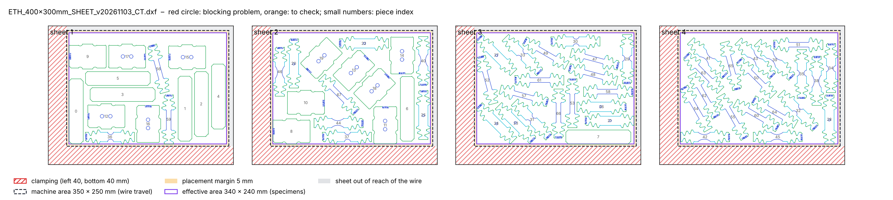

# 2026-11-03

## Objective

Keep only the useful outputs of a cutting-plan run; describe the sheet on the EDM machine (clamping, machine area,
placement margin).

## Progress and Notes

### 1. Outputs of a run

A run used to write 9 files (plan, notice, registry, `placement.csv`, `specimens.dxf`, `README.md`, and `check/` with
`report.md`, `pieces.csv`, `preview.png`). Decision (user, 03/11): only 4 are useful, so `make_plan.py` now writes
only:

| File | Use |
|---|---|
| `<name>.dxf` | plan for the workshop |
| `notice.pdf` | one page per sheet + specimen list |
| `registry.csv` | one line per specimen (code, position, ID) |
| `preview.png` | plan with the machine margins hatched in red |

The intermediate files (coded specimens, check report) go to a temporary folder that is always deleted, also after an
error. Files of the older version left in an output folder are removed at the next run. The check results are still
printed in the terminal.

Also: on the lab PC the alias `py314` does not exist; plain `py` already runs Python 3.14 there.

Test: example order, all checks OK, output folder holds exactly the 4 files.

### 2. Sheet zones on the EDM machine

Machine (lab and workshop): AgieCharmilles CUT E 350, L-shaped clamping. Maker's data: X × Y × Z travel 350 × 250 ×
250 mm, max. workpiece 820 × 680 × 250 mm (agiecharmilles.com, CUT E specifications). So the wire reaches only a
350 × 250 mm area, but the sheet can be larger: the clamping can lie outside that area. Table and clamping dimensions
of the CUT E 350 were not found (predecessor CUT 20 P: worktable 700 × 480 mm, clamping frame 45 mm thick).

Decision (user, 03/11): the sheet parameters must be adjustable in the order, with a placement margin because the
workshop does not position the sheet to the mm. New order fields (`scripts/zones.py`):

| Field | Meaning |
|---|---|
| `sheet` | complete sheet |
| `clamping` | clamped bands per side, e.g. `{left: 40, bottom: 40}` (L) |
| `machine_area` | wire travel, `350x250` |
| `machine_position` | where the machine area starts on the sheet (default: inner corner of the clamping) |
| `placement_margin` | tolerance inside the machine area (default 5 mm) |
| `edge_margin` | distance to a free edge of the sheet (default 5 mm) |

Effective area = machine area minus the placement margin, inside the sheet, outside the clamping. It is turned into
margins per side, so the placement engine and the checks are unchanged.

Decision (user, 03/11): only one order format. `margins` / `margin` and the French keys of the first version are
removed; `sheet` and `machine_area` are required, and any unknown field is rejected with the list of allowed fields
(so a typo or an old field is never silently ignored). The preview and the notice draw the four zones (clamping, machine area, placement margin,
effective area) and the part of the sheet the wire cannot reach.

Both orders now use a 400 × 300 sheet: effective area 340 × 240 mm instead of 305 × 205 (+30 %).

| `CT_sheet.yaml` (68 specimens) | Sheets | Duration |
|---|---|---|
| 350 × 250 sheet, L 40 inside the sheet (02/11) | 5 | 6 min 22 s |
| 400 × 300 sheet, L 40 outside the machine area, placement margin 5 | **4** (14, 16, 19, 19) | 1 min 28 s |

All checks OK. Tests of the order reading: sheet smaller than the machine area (limited by the free edges), old
`margins` field, French key, missing `machine_area`, unknown side, no effective area (all rejected with a message).

## Next Steps

- Ask the workshop: real clamping width, sheet sizes they have, position of the machine area relative to the clamps,
  placement tolerance; then adjust `sheet`, `clamping`, `placement_margin` in the orders.

## References

- `File` *Tool.* [cutting-sheets/scripts/make_plan.py](../cutting-sheets/scripts/make_plan.py) · outputs of a run.
- `Web` *AGIE CHARMILLES CUT E, specifications.* [agiecharmilles.com](https://www.agiecharmilles.com/en/wire-cutting-edm/cut-e-350-600-800) · travel 350 × 250 × 250 mm, max. workpiece 820 × 680 × 250 mm.
