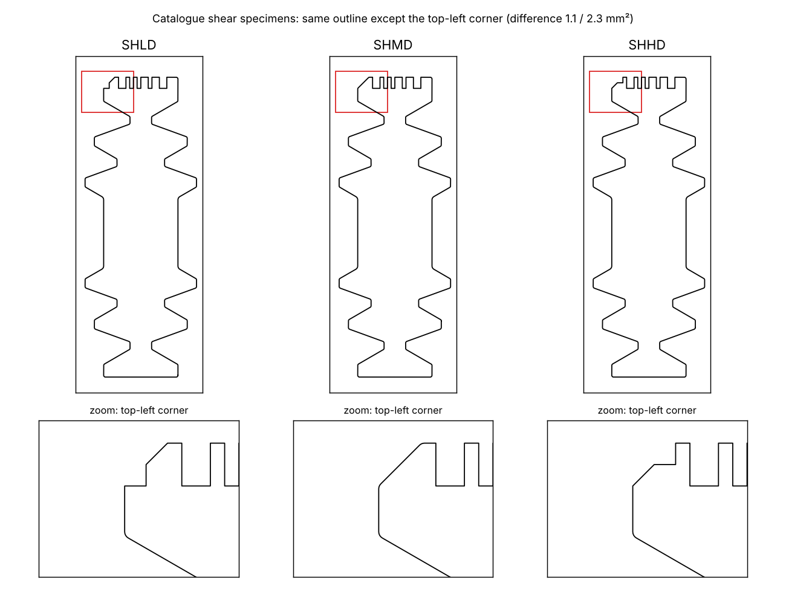
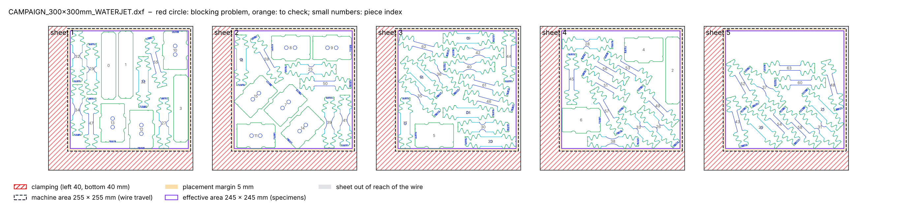
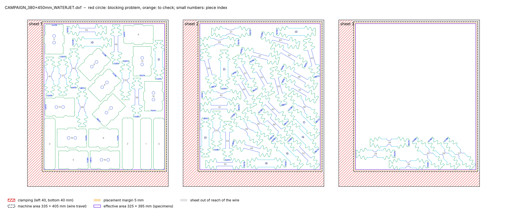
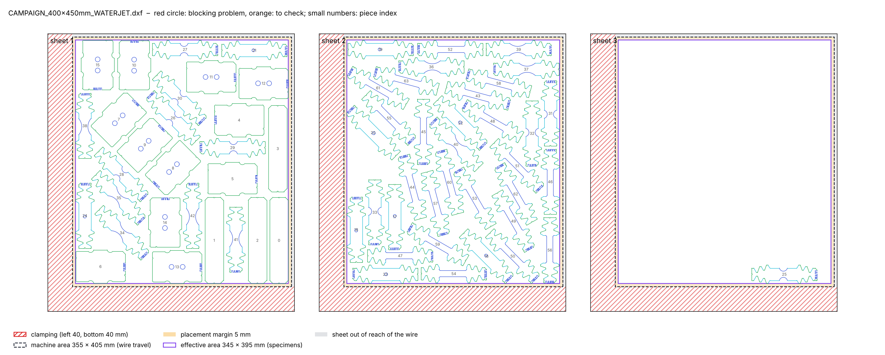
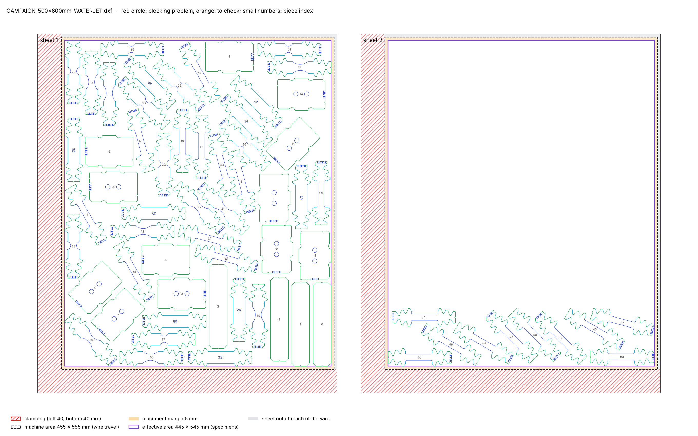

# 2026-11-09

## Objective

Understand the specimen plans given by the supervisors as a material testing campaign: what each specimen is for,
what LD / MD / HD are, and how many specimens a complete campaign needs; campaign orders for waterjet, one per sheet
size; Mikrosteg diameter 1.5 mm; final run of all the orders.

## Progress and Notes

### 1. What the plans are

Each plan of the supervisors (2025 plans, 2026 CT drawing) is one complete testing campaign for one material sheet.
The same programme is described in the lab's DP steel paper (Beerli et al., 2026, section 4.1): "UT specimens are
tested in seven orientations (0°, 15°, 30°, …, 90°), while the NT6, NT20, CH5/8 and SH are tested in 0°, 45° and 90°
from the rolling direction. All experiments are carried out with three repeats, except for the shear experiments,
which are only repeated twice (as these specimens needed to be extracted using wire EDM)." Miniature punch and
dihedral mini-Nakazima experiments are added "in three orientations to characterize the fracture response for
equi-biaxial and plane-strain tension stress states". In that paper all specimens except SH were waterjet cut, and the
central hole was reamed; SH was cut by wire EDM. This explains why the 2025 shear plan was a separate "ShearEDM" plan.

The notch code carries this structure: angle digit = orientation, index 1, 2, 3 = repeat.

### 2. LD / MD / HD (shear specimens)

The shear gauge geometry is **not** in our files:
- 2025 shear plan: all 24 pieces labelled `SHxx-LD1/2`, `-MD1/2`, `-HD1/2` are the same blank 93 × 30 mm (area
  2754.5 mm², the MD blanks 2756.5 mm²), no gauge section;
- lab catalogue: `CTST_SHLD`, `CTST_SHMD`, `CTST_SHHD` have the same outline (Christmas-tree grips + plain 20 mm wide
  central section) except the **top-left corner**, which is a marker: SHLD has a step on the side, SHMD a plain
  chamfer, SHHD a step on the top (differences 1.1 and 2.3 mm²).

So LD / MD / HD are three variants told apart by the corner, and their real shear zone must be made in another step
or come from another drawing. Their meaning is still to ask (hypothesis only: variants for different material
ductility or strength, as the paper chooses CH5 or CH8 depending on the steel).

### 3. Strips without code (TENS_FULL)

User, 09/11: the 140 × 30 mm strips are used for **contrast tests of the speckle pattern** (DIC), not for mechanical
tests.

### 4. Complete campaign (one material)

| Specimen (catalogue type) | Test | Orientations to the rolling direction | Repeats | Number |
|---|---|---|---|---|
| UTUT | uniaxial tension (plasticity, anisotropy: stress and Lankford ratio per direction) | 0, 15, 30, 45, 60, 75, 90° | 3 | 21 |
| NT20 | notched tension, notch radius 20 mm (fracture) | 0, 45, 90° | 3 | 9 |
| NT06 | notched tension, notch radius 6.67 mm (fracture, closer to plane strain) | 0, 45, 90° | 3 | 9 |
| CHCH | central hole tension (fracture at the hole edge) | 0, 45, 90° | 3 | 9 |
| SHLD, SHMD, SHHD | shear (fracture) | 0, 45, 90, 135° | 2 per variant in the plans (3 with the 3-repeat rule) | 24 (36) |
| MNAK_RECT_FULL | Mini-Nakajima without holes (equi-biaxial) | – | 3 | 3 |
| MNAK_RECT_HOLE | Mini-Nakajima with 2 holes (strain path set by the holes) | holes at 0, 45, 90° | 3 | 9 |
| **Mechanical tests** | | | | **84 (96)** |
| TENS_FULL | speckle contrast tests (no code) | one per plan | – | 4–6 in the plans |

Not in the plans: UTST (short uniaxial tension, 81 mm) exists in the catalogue but is not used by the supervisors'
campaigns.

### 5. Campaign orders for waterjet, one per sheet size of the supervisors

Sheet sizes measured on the frames of the supervisors' DXFs (width × height, height = rolling direction):
300 × 300 (2025, 6 sheets), 380 × 450 (2025 shear plan, named "450x380"), 400 × 450 (2025, 3 sheets, named
"450x400"), 500 × 600 (2025 and the 2026 CT drawing, named "600x500").

Waterjet rules (user, 09/11): L-shaped margin of 40 mm (left and bottom), 5 mm on the other edges, and 5 mm between the
really usable area and the area used for the specimens. In the order format: `clamping: {left: 40, bottom: 40}`,
`machine_area` = really usable area = (W − 45) × (H − 45) from (40, 40), `placement_margin: 5` → effective area
(W − 55) × (H − 55) from (45, 45).

Content: the complete campaign of section 4 without the shear specimens (cut by wire EDM, separate order), plus 4
speckle-contrast strips: 64 specimens.

| Order | Effective area | Sheets | Specimens per sheet | Duration | Checks |
|---|---|---|---|---|---|
| CAMPAIGN_300x300mm_WATERJET | 245 × 245 | 5 | 13, 12, 15, 13, 11 (last sheet 231 of 290 mm used) | 3 min 52 s | all OK |
| CAMPAIGN_380x450mm_WATERJET | 325 × 395 | 3 | 26, 32, 6 (last sheet 134 of 440 mm) | 3 min 16 s | all OK |
| CAMPAIGN_400x450mm_WATERJET | 345 × 395 | 3, then **2** (see below) | 28, 35, 1 (last sheet 75 of 440 mm), then 28, 35 | 4 min 06 s, then 5 min 13 s | all OK |
| CAMPAIGN_500x600mm_WATERJET | 445 × 545 | 2 | 54, 10 (last sheet 142 of 590 mm) | 1 min 54 s | all OK |

For 400 × 450 one NT06 does not fit on the first two sheets, even with twice the reduction effort (`fill_tries` 16,
`fill_time` 20: same result, 5 min 36 s). The last sheet is then nearly empty for 380 × 450, 400 × 450 and
500 × 600; estimate of the strips that would fill it (density 0.70 of the usable area): about 2 (300 × 300),
14 (380 × 450), 17 (400 × 450), 28 (500 × 600). Not added: to decide with the user.

400 × 450 on 2 sheets (user, 09/11: one strip less, check that everything fits on 2 sheets): with 3 strips (63
specimens) and the default settings the same NT06 90° stays alone on a 3rd sheet (seeds 1, 2, 3). A direct test
showed that it fits on sheet 1 with a longer sparrow try (60 s: top 439.7 mm for a limit of 440). With `seed: 3` and
`fill_time: 40` in the order, the plan has **2 sheets** (28 and 35 specimens, both 440 mm used of 440), all checks OK,
5 min 13 s.

### 6. Mikrostegs of diameter 1.5 mm, all plans with `--final`

User, 09/11: the Mikrosteg recesses must have a diameter of 1.5 mm, not 1 mm. `R` in `mikrosteg.py` changed from
1.0 (diameter 2 mm) to 0.75 mm; every type still builds a valid outline, each recess removes 0.88 mm²
(π R²/2) and is 0.75 mm deep. While checking this I found a wrong sentence in the note of 03/11 ("each recess removes
3.05–3.31 mm²": it was the two recesses together); corrected there.

Templates rebuilt (`catalogue/CTLG_261102/templates.png` with the new recesses), README, guide and catalogue README
updated. All 9 orders run with `--final` (results in `cutting-sheets/output/`, kept by git):

| Order | Sheets | Duration | Checks |
|---|---|---|---|
| CAMPAIGN_300x300mm_WATERJET | 5 | 2 min 28 s | all OK |
| CAMPAIGN_380x450mm_WATERJET | 3 | 3 min 11 s | all OK |
| CAMPAIGN_400x450mm_WATERJET | 2 | 6 min 08 s | all OK |
| CAMPAIGN_500x600mm_WATERJET | 2 | 1 min 58 s | all OK |
| ETH_300x300_6_SHEET_v20250520 (EDM) | 4 | 1 min 16 s | all OK |
| ETH_450x380mm_ShearEDM_v20250520 (EDM) | 1 | 1 min 10 s | all OK |
| ETH_450x400_3_SHEET_v20250520 (EDM) | 4 | 4 min 07 s | all OK |
| ETH_600x500mm_2_SHEET_v20250220 (EDM) | 4 | 1 min 21 s | all OK |
| ETH_600x500mm_2_SHEET_v20260901_CT_bardcode (EDM) | 4 | 1 min 17 s | all OK |

## Next Steps

- Ask the supervisors: real geometry and meaning of LD / MD / HD; shear with 2 or 3 repeats now that all specimens
  are cut by EDM; how many speckle contrast strips are needed.
- Decide: fill the last sheet of the campaigns with strips, or leave it (part of a sheet unused).

## References

- `Paper` *Beerli et al. (2026), Rate dependent plasticity and fracture of five DP steels: static and dynamic high
  throughput experiments and neural network modeling, International Journal of Impact Engineering 215, 105761.*
  [literature/papers/](../literature/papers/Rate_dependent_plasticity_and_fracture_of_five_DP_steels_static_and_dynamic_high_throughput_experiments_and_neural_network_modeling.pdf)
  · section 4.1 (test programme), section 2 (cutting of the specimens).
- `File` *Lab catalogue.* [cutting-sheets/catalogue/specimen_templates_261029_barcoded.dxf](../cutting-sheets/catalogue/specimen_templates_261029_barcoded.dxf) · blocks `CTST_SHLD/SHMD/SHHD`.
