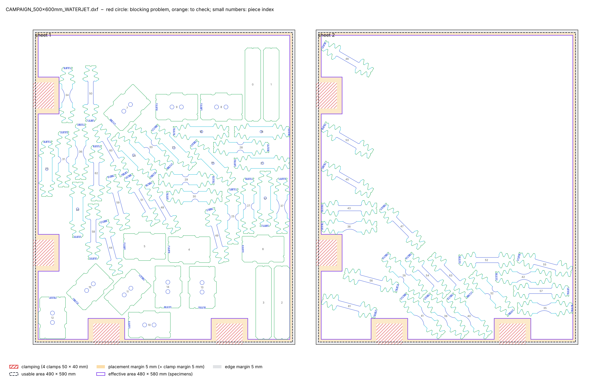

# 2026-11-10

## Objective

Go through the supervisors' remarks on the plans, and start with the clamping: single clamps instead of an L band.

## Progress and Notes

### 1. Remarks of the supervisors (user, 10/11)

| Remark | Status |
|---|---|
| Something wrong with "shear" | Probably: the shear specimens are pre-cut as blanks (with the rest, or on another sheet) and the shear zone is made by EDM afterwards; our waterjet campaigns had no shear at all, and the only shear order treated the shear sheet as an EDM cutting plan. E-mail sent to ask: pre-cut blanks?, 2 or 3 per variant and orientation?, on the 600 × 500 sheet or on another sheet? |
| L clamping zone too large: only 2 clamps on each side of the L | Done (section 2) |
| Only the 600 × 500 sheet, everything on one sheet, if needed without one or two TENS_FULL | Next |
| 600 is the rolling direction and is always written first | Next |
| Specimen names to follow the convention | Waiting for the official list |
| Specimens of the same type and orientation not next to each other | Later (loss on several layouts) |

Also found while looking at the supervisors' plans: in the 300 × 300 and 450 × 400 plans each repeat (index 1, 2, 3)
is on its own sheet(s) (one complete set per sheet); in the 600 × 500 plans the repeats are mixed.

### 2. Single clamps

Geometry (user, 10/11): 2 clamps on each side of the L, 50 mm along the edge × 40 mm into the sheet, 5 mm around each
clamp for the nozzle, 5 mm on the edges, and the 5 mm placement margin kept. Positions as on the sketch proposed:
left edge at 175 and 475 mm, bottom edge at 140 and 375 mm from the bottom-left corner (centres).

Implementation:
- order fields `clamps` (list of `{side, at, width, depth}`) and `clamp_margin`; `machine_area` is now optional (left
  out for the waterjet: usable area = sheet minus `edge_margin`);
- `zones.py`: keep-out zone = clamp + clamp_margin + placement_margin (70 × 50 mm here), removed from the effective
  area (480 × 580 mm from (10, 10) for the 500 × 600 sheet);
- PackingSolver gets the keep-out zones as defects of the sheet. sparrow knows no forbidden zones: after each sparrow
  run, the specimens touching a zone are taken out and PackingSolver puts them back in the free space of the same
  sheet, with the other specimens as obstacles (`repair` in `placement.py`); a fit try aims lower by the area of the
  zones / usable width so that there is room for them;
- new final check "Clamps (keep-out zones)"; preview and notice draw the clamps and their margins.

Test, `CAMPAIGN_500x600mm_WATERJET` (64 specimens): 2 sheets (44 + 20), all checks OK including the clamps, 2 min 01 s.

Area of the specimens (with half the gap around each) / usable area without the clamp zones: 0.751 with 4 strips,
0.714 with 2, 0.678 without strips; full sheets so far reached about 0.70. One sheet will need at least 2 strips
less and a strong optimisation.

## Next Steps

- Point 3: everything on one 600 × 500 sheet (remove TENS_FULL as needed), with the rolling direction written first.
- Answer of the supervisors on the shear specimens; official specimen names.

## References

- `File` *Order.* [cutting-sheets/orders/CAMPAIGN_500x600mm_WATERJET.yaml](../cutting-sheets/orders/CAMPAIGN_500x600mm_WATERJET.yaml) · `clamps`.
