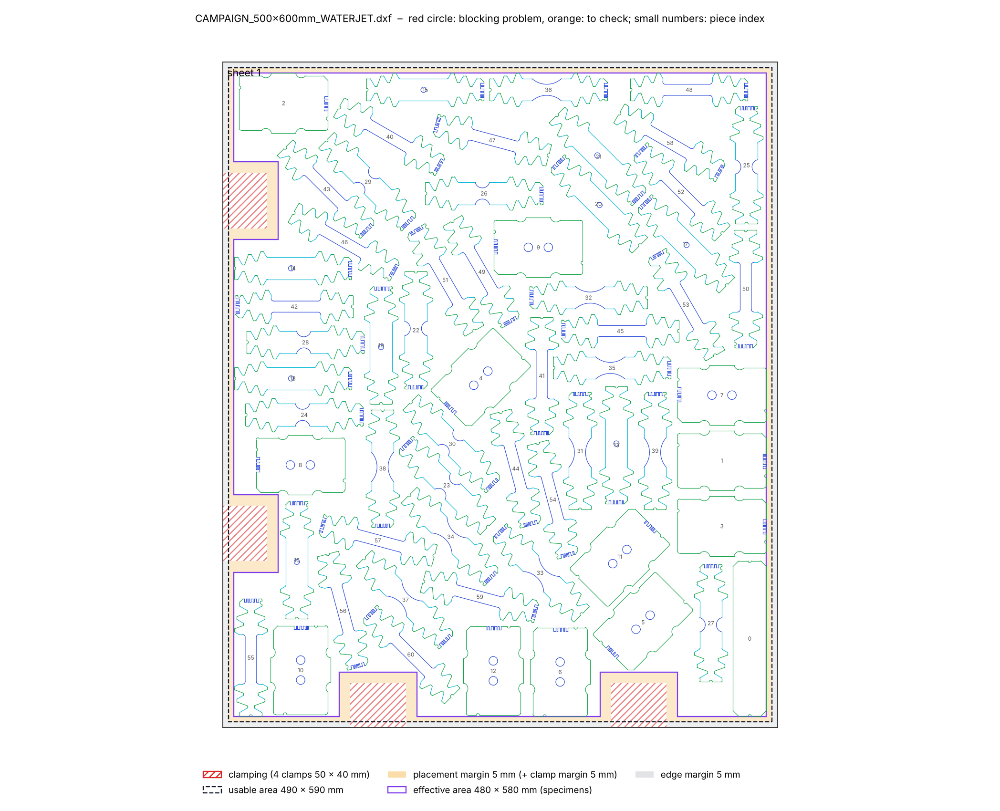
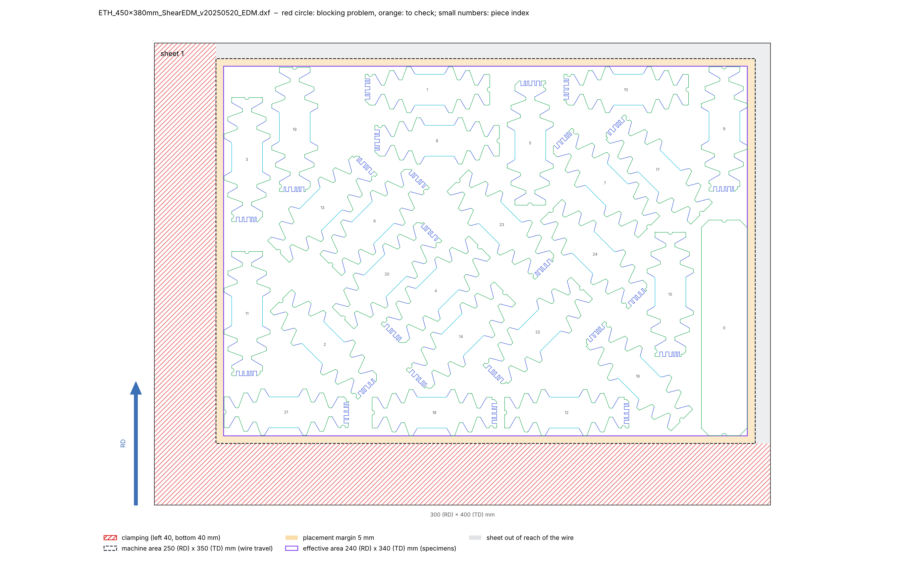

# 2026-11-10

## Objective

Go through the supervisors' remarks on the plans, and start with the clamping: single clamps instead of an L band.

## Progress and Notes

### 1. Remarks of the supervisors (user, 10/11)

| Remark | Status |
|---|---|
| Something wrong with "shear" | Probably: the shear specimens are pre-cut as blanks (with the rest, or on another sheet) and the shear zone is made by EDM afterwards; our waterjet campaigns had no shear at all, and the only shear order treated the shear sheet as an EDM cutting plan. E-mail sent to ask: pre-cut blanks?, 2 or 3 per variant and orientation?, on the 600 × 500 sheet or on another sheet? |
| L clamping zone too large: only 2 clamps on each side of the L | Done (section 2) |
| Only the 600 × 500 sheet, everything on one sheet, if needed without one or two TENS_FULL | Done with 3 strips less (section 3) |
| 600 is the rolling direction and is always written first | Done (section 4) |
| Specimen names to follow the convention | Waiting for the official list |
| Specimens of the same type and orientation not next to each other | Later (loss on several layouts) |

Also found while looking at the supervisors' plans: in the 300 × 300 and 450 × 400 plans each repeat (index 1, 2, 3)
is on its own sheet(s) (one complete set per sheet); in the 600 × 500 plans the repeats are mixed.

### 2. Single clamps

Geometry (user, 10/11): 2 clamps on each side of the L, 50 mm along the edge × 40 mm into the sheet, 5 mm around each
clamp for the nozzle, 5 mm on the edges, and the 5 mm placement margin kept. Positions as on the sketch proposed:
left edge at 175 and 475 mm, bottom edge at 140 and 375 mm from the bottom-left corner (centres).

Implementation:
- order fields `clamps` (list of `{side, at, width, depth}`) and `clamp_margin`; `machine_area` is now optional (left
  out for the waterjet: usable area = sheet minus `edge_margin`);
- `zones.py`: keep-out zone = clamp + clamp_margin + placement_margin (70 × 50 mm here), removed from the effective
  area (480 × 580 mm from (10, 10) for the 500 × 600 sheet);
- PackingSolver gets the keep-out zones as defects of the sheet. sparrow knows no forbidden zones: after each sparrow
  run, the specimens touching a zone are taken out and PackingSolver puts them back in the free space of the same
  sheet, with the other specimens as obstacles (`repair` in `placement.py`); a fit try aims lower by the area of the
  zones / usable width so that there is room for them;
- new final check "Clamps (keep-out zones)"; preview and notice draw the clamps and their margins.

Test, `CAMPAIGN_500x600mm_WATERJET` (64 specimens): 2 sheets (44 + 20), all checks OK including the clamps, 2 min 01 s.

Area of the specimens (with half the gap around each) / usable area without the clamp zones: 0.751 with 4 strips,
0.714 with 2, 0.678 without strips; full sheets so far reached about 0.70. One sheet will need at least 2 strips
less and a strong optimisation.

### 3. The first clamp layout was not optimised: a wall item for sparrow

User, 10/11: the result of section 2 was obviously bad (holes on sheet 1, specimens scattered on sheet 2). Cause:
sparrow knows no forbidden zones, packs from the bottom right over the clamps, and `repair` then put the displaced
specimens back with PackingSolver wherever there was room. PackingSolver alone (it knows the zones) was worse: 29 + 33
specimens on 2 sheets in 60 s.

Fix: the clamp zones are given to sparrow as one fixed item, a "wall": a comb made of a 1 mm bar along the left edge
(from the bottom up to the top limit of the sheet) and along the bottom edge, lying in the edge margin (the strip is
widened by bar + separation, so nothing is lost), with one tooth on each clamp zone, allowed only at 0°. Because the
wall reaches the top limit, a layout that fits can only have it at the strip start; layouts where it is elsewhere are
refused. The teeth are inset by separation/√2 (not the full separation), otherwise the rounded clearance of sparrow let
a specimen enter a zone corner (found in a test: 0.3 and 1.0 mm²). The wall ends 0.05 mm below the limit (otherwise
the top came out 0.015 mm too high). `repair` stays only for clamps on the right or top edges.

Direct one-sheet tests, 600 × 500 campaign (seed 1 unless written):

| Specimens | Result |
|---|---|
| 62 (2 strips), 60 s / 120 s / 300 s (seed 2) | 597.0 / 597.0 / 592.1 mm for a limit of 590: does not fit |
| 62, strips turned 90° | 598.2 and 600.5 mm: worse |
| 61 (1 strip) | 589.97 mm: fits (74 s) |
| 60 (0 strip) | fits |

New step in `place`: when PackingSolver gives several sheets but the area could fit on one, a direct sparrow try on one
sheet (at least 60 s). Order `CAMPAIGN_500x600mm_WATERJET`: 1 TENS_FULL instead of 4 → **61 specimens on one sheet**,
all checks OK including the clamps, 2 min 10 s.

### 4. Rolling direction written first

Remark 4 (user, 10/11): in 600 × 500, 600 is the rolling direction (RD) and is always written first. Until now the
order field `sheet` was `width x height` (height = RD), so the 600 × 500 sheet was written `500x600`.

Now every size is written **RD × TD** (TD = transverse direction):

| Where | Before | Now |
|---|---|---|
| order `sheet` | `500x600` (width × height) | `600x500` (RD × TD) |
| order `machine_area` (CUT E 350) | `350x250` (X × Y travel) | `250x350` (RD × TD = Y × X) |
| EDM sheet of the lab orders | `400x300` | `300x400` |
| waterjet campaigns (file and plan names) | `CAMPAIGN_380x450`, `400x450`, `500x600` | `CAMPAIGN_450x380`, `450x400`, `600x500` (now like the supervisors' plan names `ETH_450x380`, `ETH_450x400`, `ETH_600x500`) |
| terminal, notice, preview legend, error messages | `sheet 500 x 600` | `sheet 600 (RD) x 500 (TD)`, positions as `x .., y ..` |

The drawing itself does not change: RD stays +Y (vertical), TD is X. The preview now has a blue "RD" arrow next to each
sheet and the size under it; the notice writes "RD (rolling direction)" and "TD" on its two dimension lines. The
parser reads the first number as RD (`_size` in `make_plan.py` returns (TD, RD) = (x, y)), so the layouts are the same
as before. README, user guide and the comments of the 9 orders updated. All 9 orders run again with `--final`
(table below).

| Plan (`output/`, `--final`) | Specimens | Sheets (specimens per sheet) | Time | Checks |
|---|---|---|---|---|
| CAMPAIGN_300x300mm_WATERJET | 64 | 5 (13, 12, 14, 15, 10) | 4 min 59 s | all OK |
| CAMPAIGN_450x380mm_WATERJET | 64 | 3 (26, 32, 6) | 3 min 39 s | all OK |
| CAMPAIGN_450x400mm_WATERJET | 63 | 2 (28, 35) | 5 min 58 s | all OK |
| CAMPAIGN_600x500mm_WATERJET (single clamps) | 61 | **1** | 2 min 08 s | all OK |
| ETH_300x300_6_SHEET_v20250520_EDM | 71 | 4 (17, 17, 19, 18) | 1 min 17 s | all OK |
| ETH_450x380mm_ShearEDM_v20250520_EDM | 25 | 1 | 58 s | all OK |
| ETH_450x400_3_SHEET_v20250520_EDM | 71 | 4 (15, 16, 20, 20) | 3 min 59 s | all OK |
| ETH_600x500mm_2_SHEET_v20250220_EDM | 68 | 4 (15, 16, 19, 18) | 1 min 23 s | all OK |
| ETH_600x500mm_2_SHEET_v20260901_CT_bardcode_EDM | 68 | 4 (15, 16, 19, 18) | 1 min 18 s | all OK |

Same numbers of sheets as before the change. The old output folders `CAMPAIGN_380x450`, `400x450` and `500x600`
(banded 2-sheet version) are removed.

## Next Steps

- Answer of the supervisors on the shear specimens; official specimen names.

## References

- `File` *Order.* [cutting-sheets/orders/CAMPAIGN_600x500mm_WATERJET.yaml](../cutting-sheets/orders/CAMPAIGN_600x500mm_WATERJET.yaml) · `clamps`, `sheet: 600x500` (RD × TD); named `CAMPAIGN_500x600mm_WATERJET` before section 4.
- `File` *Parser.* [cutting-sheets/scripts/make_plan.py](../cutting-sheets/scripts/make_plan.py) · `_size` (RD first).
