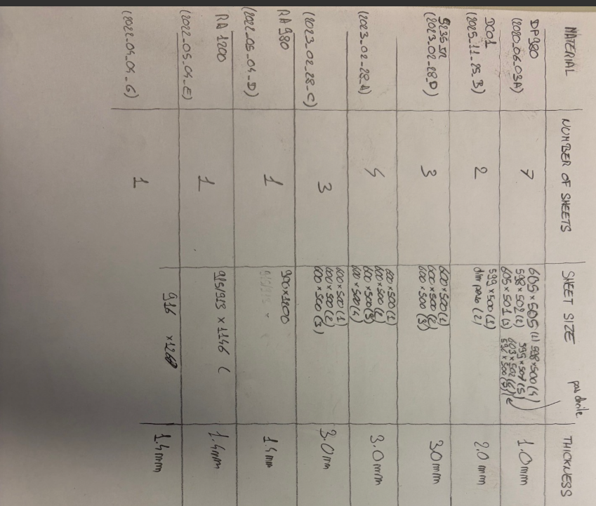
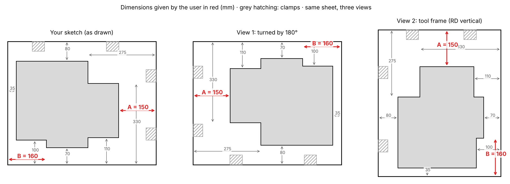
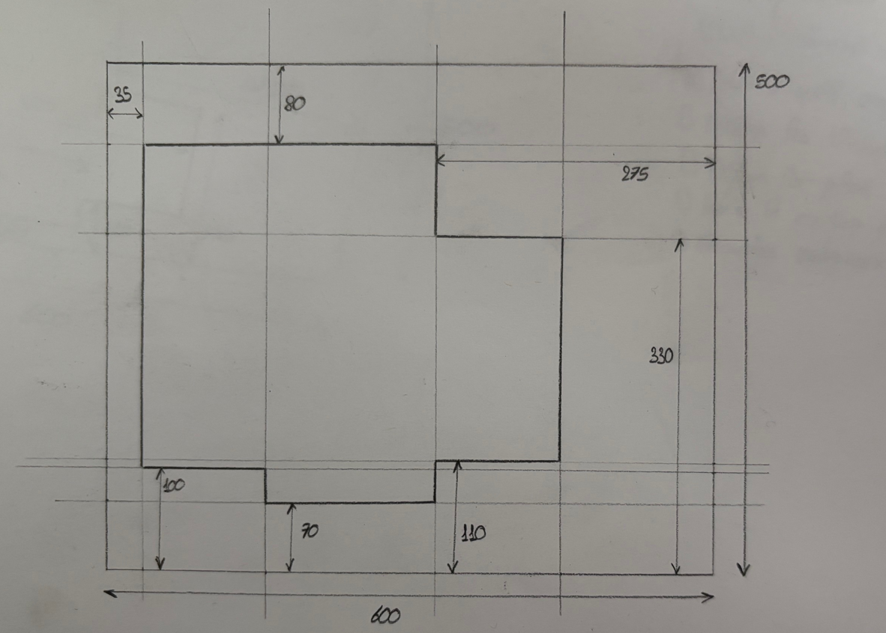
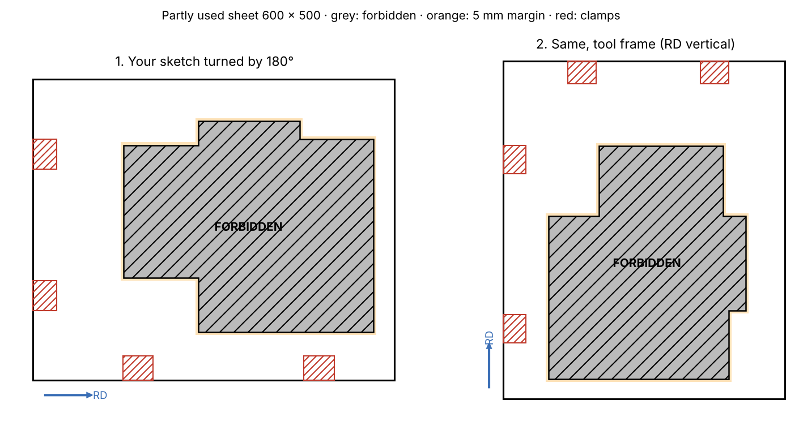

# 2026-11-11

## Objective

List every test campaign (slow, medium, high rate; shear) of one DP steel sheet: specimen, orientation, number, in a
clean Excel workbook, from the lab's DP steel paper (Beerli et al., 2026).

## Progress and Notes

### 1. Test campaigns from Beerli et al. (2026)

Source: section 2.2 (specimens), 2.3-2.5 (machines), 4.1 (slow programme), 4.2 (elevated rates). "Thomas" = Thomas
Beerli, first author; "Thomas et al. [53]" in the paper is only cited for the fir-tree clamp. No other document of
Thomas in the repository (`literature/theses/` is empty).

Per material:

| Campaign | Loading | Specimens (lab name, orientation x repeats) | Number |
|---|---|---|---|
| Slow rate | UT 0.001 /s, others 6.6e-6 m/s | UT40 7 x 3; NT20, NT06, CHD48 0/45/90° x 3; punch (MNAK_RECT_FULL) and mini-Nakazima (MNAK_RECT_HOLE) 0/45/90° x 3 | 66 |
| Medium rate | UT 1 /s, others 6.6e-3 m/s | UT40, NT20, NT06, CHD48 at 0° x 3 | 12 |
| High rate | UT 100 /s, others about 1.4 m/s | UT19 (small UT), NT20, NT06, CHD48 at 0° x 3 | 12 |
| Shear slow | 6.6e-6 m/s | SHMD 0/45/90° x 2 | 6 |
| Shear medium | 6.6e-3 m/s | SHMD 0° x 3 | 3 |
| Shear high | about 1.4 m/s | SHMD 0° x 3 | 3 |
| **Total** | | | **102** |

Stated in the paper: orientations (slow: UT 7, others 0/45/90°; elevated: 0° only), 3 repeats at slow rate, 2 for
shear (EDM), waterjet except shear (wire EDM), reamed hole, sUT at high rate, CH5 / CH8 by grade, shear geometry "for
medium ductility materials" of Roth & Mohr (2018).

Inferred (orange in the workbook):
- repeats at elevated rates: 3 for all, because 150 tests = 5 materials x 2 rates x 5 types x 3;
- punch and mini-Nakazima: "in three orientations" → 0/45/90° x 3 assumed;
- lab names: sUT → UT19, SH → SHMD (LD / MD / HD = low / medium / high ductility), PU → MNAK_RECT_FULL,
  BE → MNAK_RECT_HOLE: to confirm;
- slow total: the paper gives 378 tests for 5 materials, the stated matrix gives 360 (72 per material): 18 not
  explained.

Differences with what we have: the current 600 x 500 order has MNAK_RECT_FULL at 0° only (3, paper: 9); the 2025
shear plan had SHLD / SHMD / SHHD at 0/45/90/135° x 2 (24, paper: 6 at slow rate); no CH8 type in the catalogue
(DP1180, DP1470); the paper uses a different clamping end per rate (Fig. 2f-h), the catalogue has fir-tree ends only.

Workbook: [cutting-sheets/campaigns/DP_test_campaigns_Beerli2026.xlsx](../cutting-sheets/campaigns/DP_test_campaigns_Beerli2026.xlsx)
(first version with 8 sheets, simplified in section 2), made by `cutting-sheets/scripts/make_campaigns_xlsx.py`.

### 2. Simplified workbook and questions for the supervisors

User: workbook not clear → rebuilt with **one sheet per rate only** (Slow rate, Medium rate, High rate). Each sheet:
tension-type block (waterjet), shear block (wire EDM), columns specimen / orientations / number of orientations /
repeats / number (formula), subtotals and total; * = to confirm. Slow 72, medium 15, high 15 per material.

Questions prepared for the supervisors:

1. Material: which grade (and thickness) is this campaign for? (CH5 or CH8, shear geometry.)
2. Sheets: are the medium and high rate specimens (24 + 6 shear) cut from the same 600 × 500 sheet, or from another
   sheet? The 600 × 500 sheet is full with the slow campaign (61).
3. Repeats at medium and high rate: 3 per specimen (inferred from the 150 tests of the paper)?
4. Orientations at medium and high rate: 0° only, as in the paper?
5. High-rate uniaxial tension: is UT19 the small UT of the paper (sUT, gauge 15 × 5 mm)?
6. Shear: SHMD only (paper: "medium ductility" geometry), or SHLD / SHMD / SHHD? 0/45/90° (paper) or also 135°
   (2025 plan)? 2 repeats (paper) or 3? (with the e-mail of 10/11 on pre-cut blanks)
7. Punch and mini-Nakazima: MNAK_RECT_FULL = punch (equi-biaxial) and MNAK_RECT_HOLE = mini-Nakazima (plane
   strain)? Orientations 0/45/90° × 3 for both? (the current order has MNAK_RECT_FULL at 0° only)
8. Central hole: cut at 4.8 mm and reamed to 5 mm (CH5)? CH8 needed (DP1180 / DP1470)?
9. Clamping ends: the paper uses a different end per rate (Fig. 2f-h); same fir-tree ends for all rates here?

### 3. PDF for the supervisors

Same three tables and the nine questions in a sober PDF (black, greys, bold, capitals; yellow only on the cells that
are not sure, with the question number in the last column): 2 pages,
[cutting-sheets/campaigns/DP_test_campaigns_Beerli2026.pdf](../cutting-sheets/campaigns/DP_test_campaigns_Beerli2026.pdf),
made by `cutting-sheets/scripts/make_campaigns_pdf.py`. Yellow: CHD48 (Q1, Q8), punch and mini-Nakazima names,
orientations and repeats (Q7), SHMD, its orientations and repeats (Q6), all repeats at medium and high rate (Q3),
UT19 (Q5).

### 4. Questions revised (user, 11/11)

- Removed: sheets for medium / high rate (old Q2), small UT = UT19 (old Q5).
- Shear: **2 repeats at every rate** (user). Medium and high rate shear now 2 (was 3, inferred); totals per material:
  slow 72, medium 14, high 14 = 100. PDF and Excel updated.
- Central hole and clamping ends rewritten in plain words (now Q6 and Q7). 7 questions left.
- Thickness and the choice of CH / shear (user's question): in the paper CH8 is used for DP1180 / DP1470 "due to
  limits in maximum force of the clamping". The force of a CH specimen is roughly σUTS × t × (20 − d) (net section,
  rough estimate, not from the paper): DP1000, 1.5 mm, CH5 ≈ 23 kN; DP1470, 1.5 mm, CH5 ≈ 33 kN, CH8 ≈ 26 kN; DP1000 at
  2.0 mm, CH5 ≈ 30 kN. So thickness acts like strength for the CH choice. The shear geometry is chosen by ductility in
  the paper, not by thickness: Q1 reworded.

### 5. CH and shear: what the papers say (user's questions)

- CH in Beerli: CH5 for DP590 / DP780 / DP1000, CH8 (8 mm hole) for DP1180 / DP1470 "to reduce the maximum force and
  prevent slipping during clamping" (Sec. 2.2). Chosen by **grade**, not thickness (the five steels have "comparable
  thickness"); my link to thickness was my own reasoning, removed. Roth & Mohr (2016): the required hole-to-ligament
  ratio decreases with the ductility and increases with the hardening exponent.
- Shear: Roth & Mohr (2018) recommend **three geometries per material** (ductility not known before testing; the
  highest fracture strain is kept) → LD / MD / HD are the three geometries to test on one material, as in the 2025
  shear plan. Beerli used only the medium-ductility one.

### 6. New PDF: one matrix per campaign

User: less text, only the number of specimens per geometry and orientation for each campaign. One page: slow-rate
matrix (geometries × 0-90°), medium and high side by side (0°), total, 7 one-line questions. Shear now SHLD + SHMD +
SHHD, 2 repeats: slow 84 (66 + 18), medium 18, high 18 = **120 per material**. Q1 = grade only. Excel updated the same
way. Then Q7 (fir-tree ends at slow and medium rate) removed (user): 6 questions.

### 7. Answers of the supervisors (user, 11/11)

- CHD48: the 4.8 mm hole is re-drilled to 5 mm → CH5 everywhere, no CH8.
- MNAK_RECT_FULL (punch) and MNAK_RECT_HOLE (mini-Nakazima) are the right specimens; MNAK_RECT_FULL at **0° only, 3**.
- Medium and high rate: UT at **all 7 orientations**, 3 each.
- PDF: no yellow, no questions, no rate values; the three campaigns now share the same columns (0-90°) and are
  stacked on one page. Excel updated the same way.

| Campaign | Tension-type | Shear (LD + MD + HD, 2 each) | Total |
|---|---|---|---|
| Slow | 60 (UT40 21, NT20 9, NT06 9, CHD48 9, MNAK_RECT_FULL 3, MNAK_RECT_HOLE 9) | 18 | **78** |
| Medium | 30 (UT40 21, NT20, NT06, CHD48 3 each at 0°) | 6 | **36** |
| High | 30 (UT19 21, NT20, NT06, CHD48 3 each at 0°) | 6 | **36** |
| **Total per material** | | | **150** |

In the PDF and the Excel the central-hole specimen is written CH4.8 (catalogue name CHD48), and shear is cut by
waterjet + wire EDM (user).

The slow tension-type part (60) is exactly the content of the 600 × 500 order (60 + 1 LASER strip = 61).

### 8a. Campaigns A, B and C (user, 11/11)

- **A, full**: the campaign of section 7, plus NT20, NT06, CH4.8 (3 each) and the three shear geometries (2 each) at
  45° and 90° at medium and high rate.
- **B, space a little short**: A without SHLD and SHHD at 45° and 90° (all rates).
- **C, space really short**: slow rate as B; medium and high rate at 0° only.

| Campaign | Slow | Medium | High | Total |
|---|---|---|---|---|
| A | 78 | 66 | 66 | **210** |
| B | 70 | 58 | 58 | **186** |
| C | 70 | 18 | 18 | **106** |

PDF: one page per campaign (three matrices geometry × orientation), built from one function (`rates()` in
`make_campaigns_pdf.py`) so that B and C are derived from A. LASER strips (speckle contrast) added to every campaign without a number
(they fill the free space). The Excel still has the previous single campaign.

### 8b. Materials and sheets inventory

From the user's handwritten list (photo): 8 materials (IDs = date + letter), 22 sheets. PDF with one line per
material (name, ID, number of sheets, notes) and its sheets as indented bullets (sheet ID = material ID + number, size
as written, thickness): [cutting-sheets/materials/materials_and_sheets.pdf](../cutting-sheets/materials/materials_and_sheets.pdf),
made by `cutting-sheets/scripts/make_materials_pdf.py`. Yellow = hard to read, to check: DP980 sheets 5 (595 × 507?)
and 7 (596 × 500?); DC01 sheet 2 ("dim perso"); S235JR D thickness ("30 mm" read 3.0); names of 2023_02_28_A and _C
(S235JR?) and of 2022_0?_04_G (RA1200?); RA980 thickness (1.4?); G ID (04 or 05 for the month) and size (916 × 1260
or 1268). DP980 sheets 4-7 noted "pas droite" (edges not straight). Rolling direction of the sizes not given.

### 8. Partly used sheet: forbidden zone in the middle (study, no code)

User request: cut on a 600 × 500 sheet already partly used; the used middle part (union of rectangles) is forbidden.
Feasibility: the order reading, PackingSolver (defects), the clamp check, preview and notice already handle keep-out
zones (clamps); only sparrow has no obstacles (spyrrow 0.9.0 = latest, API `StripPackingInstance(name, strip_height,
items)`). Options: (A) link the zone to the clamp "wall" by a thin bridge so it becomes part of the fixed wall item
(any corner reachable by rotating the problem by 90° steps, since allowed orientations can be rotated too);
(B) split the free area into rectangles packed separately; (C) PackingSolver alone. Proposed: A, with C as fallback.
Order format proposed: `forbidden: - {rd: [from, to], td: [from, to]}`, `forbidden_margin`.

User's sketch (photo, mm), 5 mm margin, same clamps; sketch to be turned by 180° (clamps top right on the sketch).
First drawing wrong (user): placing the zone by its distances to the two clamped edges gave a MIRROR image of the
sketch, not a rotation. Redone with pure rotations only: view 1 = sketch turned by 180° (clamps on the bottom long
edge and the left short edge); view 2 = view 1 turned by 90° clockwise into the tool frame (RD vertical): zone bounds
TD 80-430, RD 35-449; clamps on the LEFT (long edge) and the TOP (short edge), not left + bottom as in the 600 × 500
campaign. The two positions missing on the sketch, given by the user: A = 600 − 450 = 150 mm (right edge of the sheet to the
zone), B = 160 mm (left edge to the 70 mm step). Zone 125 250 mm². In the tool frame (RD from the bottom edge, TD from
the left edge): `{rd: [35, 325], td: [80, 400]}`, `{rd: [325, 450], td: [170, 390]}`, `{rd: [160, 325], td: [400, 430]}`.

## Next Steps

- Remaining open points: shear at 135°? 3 shear geometries also at medium and high rate? Orders for the medium
  and high rate specimens (72) and the shear specimens.
- Answer on the shear specimens (e-mail of 10/11).
- Later (user, 11/11): code the forbidden zone for the partly used sheet (section 8): order fields `forbidden`
  (union of rectangles, RD first) and `forbidden_margin` (5 mm), zone added to the keep-outs, sparrow handled by a
  bridge to the clamp wall (option A, PackingSolver alone as fallback), hatched on the preview and the notice. Before
  coding: confirm that the short-edge clamps are at the TOP in the tool frame for this sheet, and which specimens go
  on it.

## References

- `Paper` *Beerli et al. (2026).* T. Beerli, C. C. Roth, X. Li, V. Grolleau, D. Mohr, Rate-dependent plasticity and fracture of five DP-steels, Int. J. Impact Eng. 215, 105761 · [literature/papers/](../literature/papers/Rate_dependent_plasticity_and_fracture_of_five_DP_steels_static_and_dynamic_high_throughput_experiments_and_neural_network_modeling.pdf) · Sec. 2.2, 4.1, 4.2.
- `File` *Workbook.* [cutting-sheets/campaigns/DP_test_campaigns_Beerli2026.xlsx](../cutting-sheets/campaigns/DP_test_campaigns_Beerli2026.xlsx).
- `File` *Generator.* [cutting-sheets/scripts/make_campaigns_xlsx.py](../cutting-sheets/scripts/make_campaigns_xlsx.py).
- `File` *PDF for the supervisors.* [cutting-sheets/campaigns/DP_test_campaigns_Beerli2026.pdf](../cutting-sheets/campaigns/DP_test_campaigns_Beerli2026.pdf) · generator [make_campaigns_pdf.py](../cutting-sheets/scripts/make_campaigns_pdf.py).
