# 2026-11-12

## Objective

Cut campaigns A, B and C on 600 (RD) × 500 (TD) sheets with the new rules of the user, sharing as many sheets as
possible between the three campaigns.

## Progress and Notes

### 1. New rules (user)

- The shear specimens no longer have to be alone, or on one sheet only: they can be mixed with the tension-type ones.
- The campaigns are nested (C inside B inside A, same notch codes), so their first sheets can be common.
- Campaign C gets its own sheet 2 (instead of trying to share it with A and B).
- 4 LASER per campaign.

### 2. Nested scheme

`scripts/make_nested_orders.py` builds the specimen lists of A, B and C (from `make_campaign_orders.py`, campaign C
added there; the sources in `orders/campaign_sources/` are unchanged, checked by diff), checks the nesting, takes
sheet 1 = the existing order `CAMPAIGN_600x500mm_WATERJET` (60 slow-rate tension-type + 1 LASER, in all three
campaigns) and writes the other orders:

| Sheet | Campaigns | Order | Content | Result |
|---|---|---|---|---|
| 1 | A, B, C | `CAMPAIGN_600x500mm_WATERJET` (unchanged) | 60 slow tension + 1 LASER | 1 sheet, kept from 10/11 |
| 2 and 3 | A, B | `AB_SHEETS23_600x500mm_WATERJET` | rest of B: 126 (tension-type and shear) + 3 LASER | 2 sheets (61 + 68 pieces), 8 min 26 s, `spread_tries: 3` |
| 4 | A | `A_SHEET4_600x500mm_WATERJET` | A − B: 24 shear (SHLD, SHHD at 45 and 90°) | 1 sheet (top 265 mm) |
| 2 of C | C | `C_SHEET2_600x500mm_WATERJET` | rest of C: 46 + 3 LASER | 1 sheet (top 470 mm) |

So **A = 4 sheets, B = 3 sheets, C = 2 sheets**, 4 LASER each (1 on sheet 1 + 3). Every sheet passes all blocking
checks (gap ≥ 5 mm, clamps, margins, contours, overlaps).

Warnings (not blocking):

- Repeats side by side: 1 pair on sheets 2-3 (UT19 0°, sheet 3) and 1 pair on sheet 4 (SHHD 45°); 0 on C's sheet 2.
- ID codes on C's sheet 2: specimens of the same type share a notch code. Expected: the index of the code is the
  strain rate (slow 1-3, medium 4-6, high 7-9), so the repeats of one rate have the same code.

The old A/B orders of 11/11 (`COMMON_AB`, `A_SHEET3`, `B_SHEET3`) were removed (in the git history).

Sheet 1 (A, B, C):

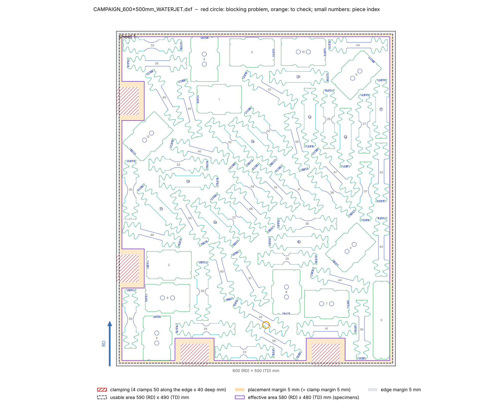

Sheets 2 and 3 (A, B):

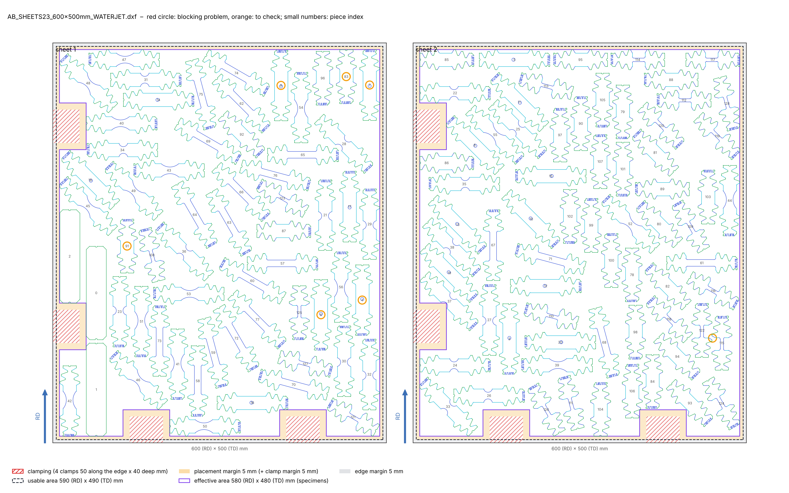

Sheet 4 (A only):

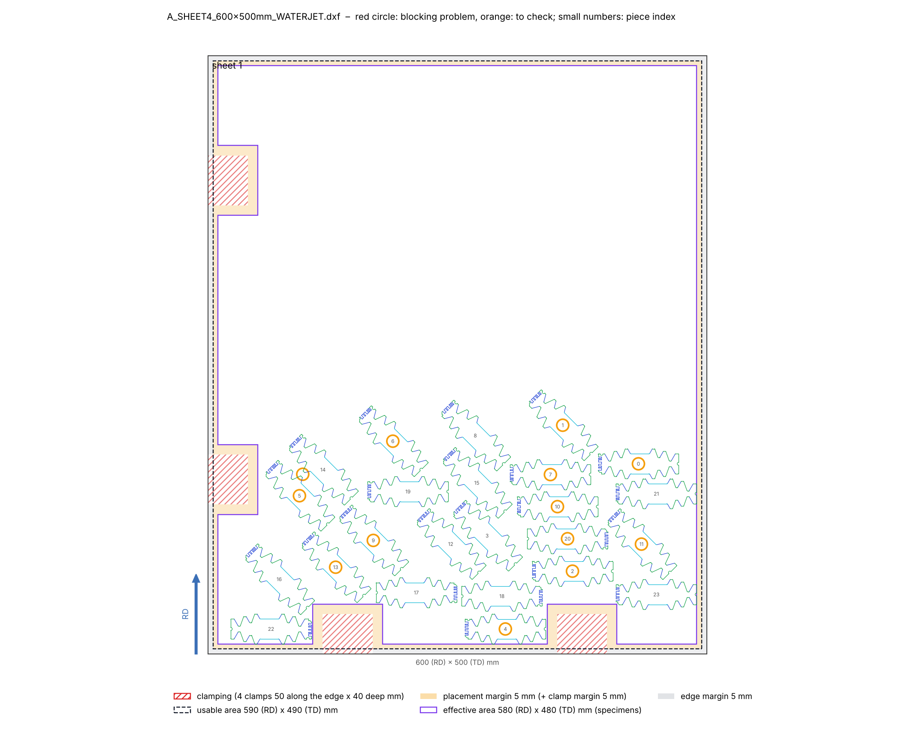

Sheet 2 of C (C only):

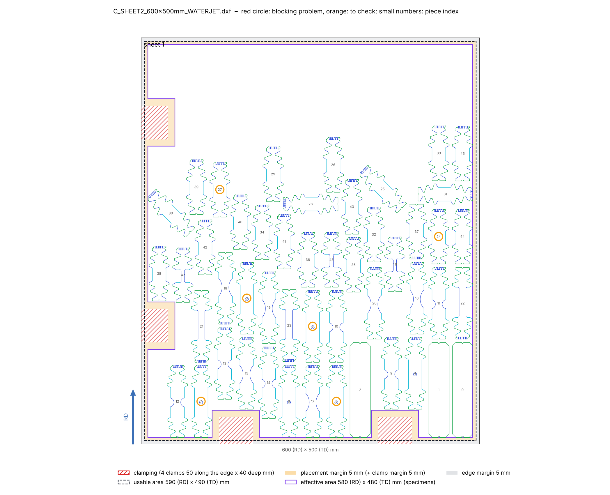

### 3. PDF of the campaign sheets

`campaigns/campaigns_A_B_sheets.pdf` renamed `campaigns/campaigns_A_B_C_sheets.pdf` and redone (5 pages): page 1 =
diagram, one row per campaign (A, B, C) with its sheets in order, outlines only (dashed = common sheet, thick = sheet
of one campaign only); then the 4 previews. Generator: `scripts/make_campaign_sheets_pdf.py`.

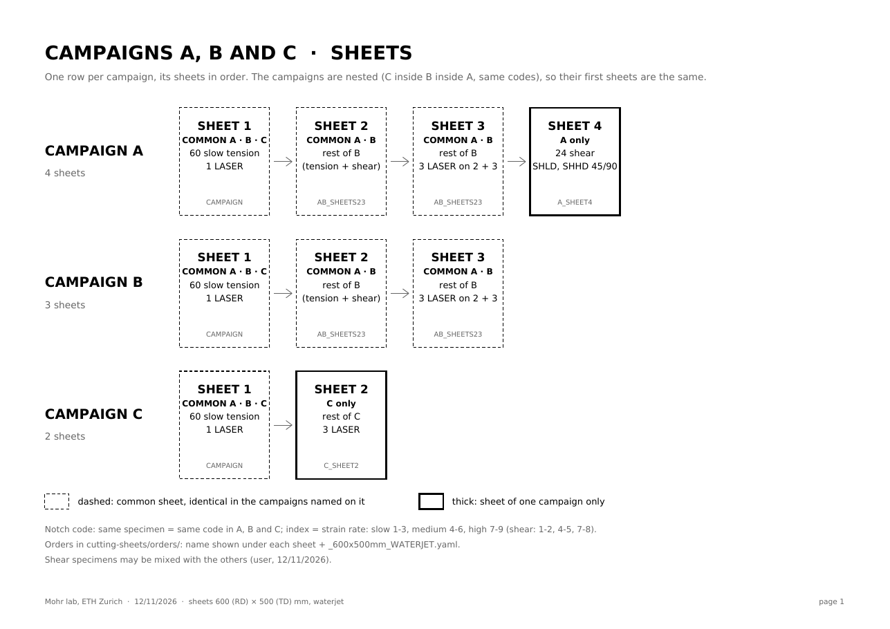

### 4. Materials: names and campaigns

Given by the user: `2023_02_28_A` = AW5754-H22 (aluminium; the user first wrote "20230328A", then confirmed
2023_02_28_A), `2023_02_28_C` = S355MC, `2022_04_04_G` = CR1200Y1500T-MS-UNCOATED. Campaigns in
the order of the table: A, C, B, A, B, B, B, B (DC01 = C, its cutting is for later). The data moved to
`scripts/materials_data.py` (shared by both PDFs). `materials/materials_and_sheets.pdf` updated: names, campaign of
each material, and for each sheet the cutting sheet it carries (or spare).

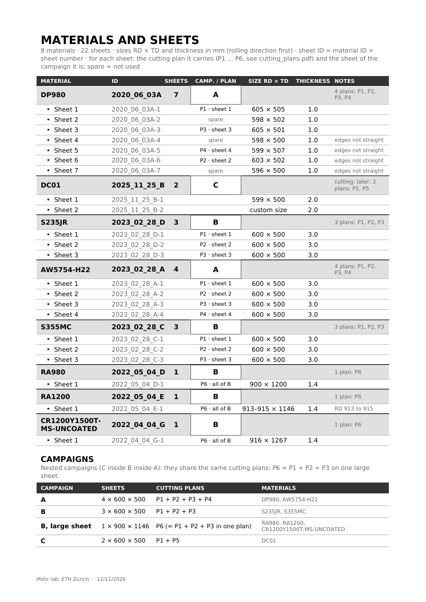

### 5. Cutting sheets drawn on the real sheets

`materials/material_cuts.pdf` (`scripts/make_material_cuts_pdf.py`, 8 pages, scale 1:7): page 1 = summary, then one
page per material with its sheets and the 600 × 500 cutting sheets of its campaign drawn on them (cut lines from the
DXF, clamps hatched), and the smallest margin from the pieces to the real edges.

Rules: best sheets first (most room around a 600 × 500 plan = largest min(RD / 600, TD / 500), then the largest
area); the fullest plans on the best sheets (the half-empty A sheet 4 goes on the last one); the RD of the plan
stays along the RD of the sheet (no 90° turn); plan in the bottom-left corner (clamp corner of the L).

| Material | Campaign | Sheets used | Status |
|---|---|---|---|
| DP980 2020_06_03A | A | -1 (605 × 505) sheet 1, -6 (603 × 502) sheet 2, -3 (605 × 501) sheet 3, -5 (599 × 507) sheet 4; spare -2, -4, -7 | complete, every margin ≥ 10 mm |
| DC01 2025_11_25_B | C | – | later |
| S235JR, AW5754-H22, S355MC | B, A, B | their 600 × 500 sheets, one plan each | complete |
| RA980, RA1200, CR1200Y1500T | B | the one large sheet: plan B_LARGE (section 6) | complete |

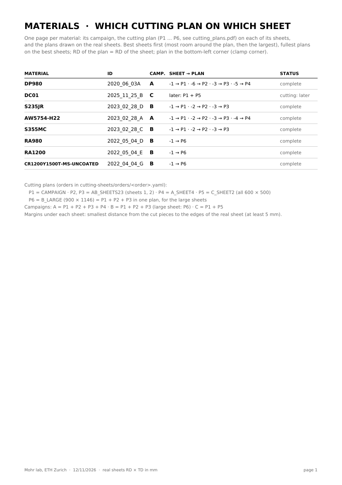

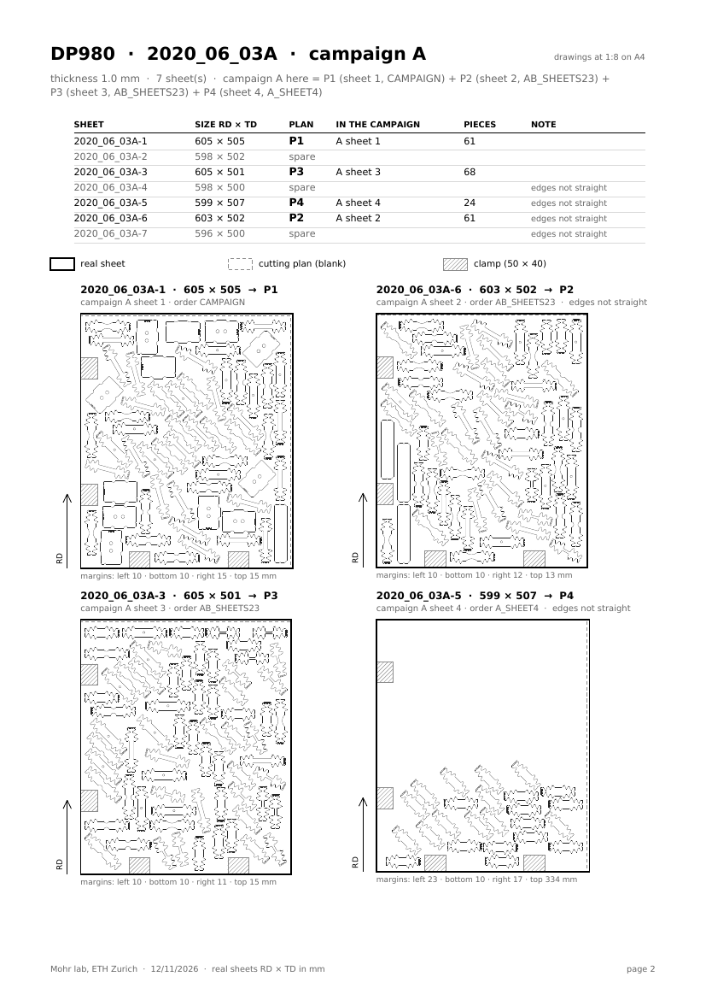

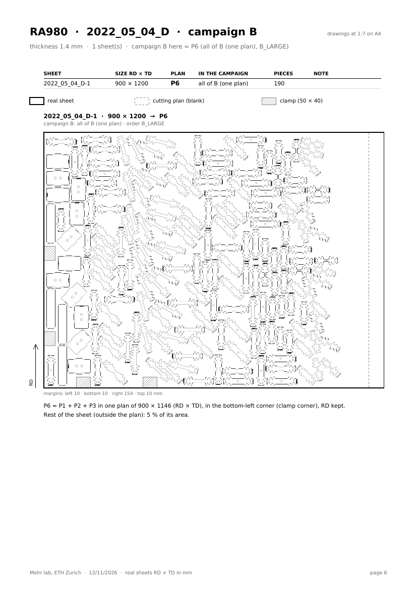

### 6. Campaign B on the large sheets: one plan

First try: with the RD kept, a large sheet (900 × 1200, 913 × 1146, 916 × 1267) holds only 1 (RD) × 2 (TD) blanks of
600 × 500, so sheet 3 of B did not fit. Then a variant of sheet 3 on the strip of 300 × 1146 left above the two
blanks (1 strip, all checks OK); the user did not like the small plan. Final choice (user): **one plan for the
large sheets that replaces the 3 sheets of B**; the 600 × 500 plans stay for the 600 × 500 sheets.

Order `B_LARGE_900x1146mm_WATERJET` (`orders_from_registry.py`: sheet 1 of the CAMPAIGN plan + the AB_SHEETS23 order,
codes kept): 186 specimens + 4 LASER on **900 (RD) × 1146 (TD)** = the part common to the three large sheets
(smallest RD 900, smallest TD 1146); 4 clamps of the L (left 175 and 475, bottom 140 and 375).

Result: 1 sheet, 190 pieces, 10 min 34 s; all blocking checks OK (smallest gap 5.04 mm, margins ≥ 10 mm, clamps
free); 99.7 mm free on the right. Warnings: 12 pairs of repeats side by side (mostly UT40 at 0, 15, 30°), shared
notch codes (expected). Sparrow's compaction did not finish on this large sheet ("compaction does not fit"), so the
layout of the previous step was kept; the 3 seeds then give the same layout.

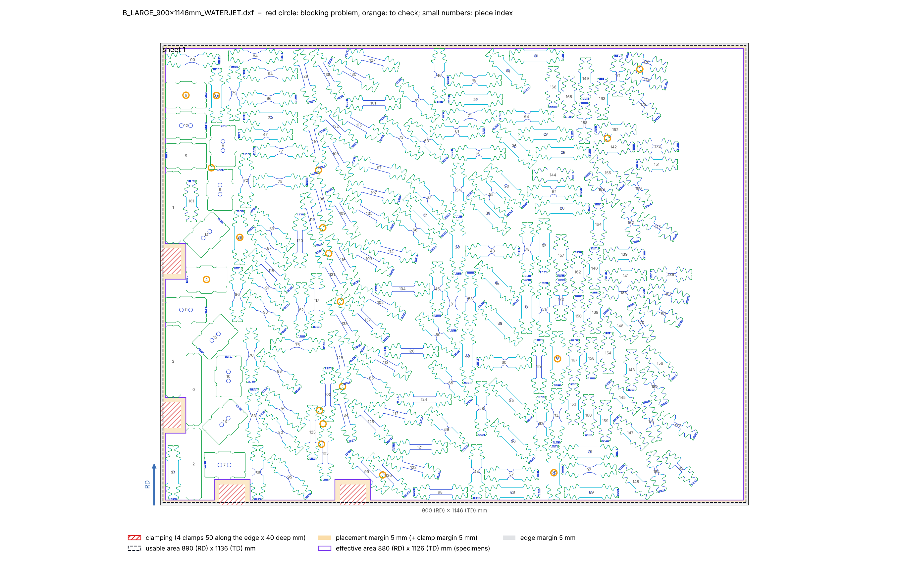

`spread.py`: the swaps were too slow on 190 pieces on one sheet (exact distance to every piece for every candidate
swap). A bounding-box test now skips the pairs that are far apart before the exact distance; same result (registry of
C_SHEET2 identical, 44 s → 16 s).

`materials_data.py`: plans carry their size; a material with a sheet of RD ≥ 900 uses the plans of `PLANS_LARGE`
(campaign B: B_LARGE). Both PDFs regenerated; rest of each large sheet outside the plan: 0-11 %.

### 7. The three PDFs for the supervisors

The plans get short names used in all the PDFs (`materials_data.PLAN_IDS`): **P1** = CAMPAIGN, **P2**, **P3** =
AB_SHEETS23 sheets 1 and 2, **P4** = A_SHEET4, **P5** = C_SHEET2 (all 600 × 500), **P6** = B_LARGE (900 × 1146 =
P1 + P2 + P3). Campaigns: A = P1 + P2 + P3 + P4, B = P1 + P2 + P3 (large sheet: P6), C = P1 + P5.

| PDF | Content | Generator |
|---|---|---|
| `materials/materials_and_sheets.pdf` | inventory: per material its campaign and plans, per sheet the plan it carries (e.g. "P2 · sheet 2") or spare; table of the campaigns (plans, materials) | `make_materials_pdf.py` |
| `campaigns/cutting_plans.pdf` | page 1: matrix plans × campaigns (circle = plan used, number = sheet of the campaign) and, per plan, the materials and sheets it is cut for (P1 × 4 + DC01 later, P2 × 4, P3 × 4, P4 × 2, P5 for DC01 later, P6 × 3): the same plan is reused; then one page per plan with its colour preview, campaigns, materials and content | `make_cutting_plans_pdf.py` (new) |
| `materials/material_cuts.pdf` | page 1: per material, sheet → plan; then one page per material: table sheet / size / plan / sheet of the campaign / pieces / note, and the plans drawn on the real sheets (1:8 for 600 × 500, 1:7 for the large sheets) | `make_material_cuts_pdf.py` |

`campaigns/campaigns_A_B_C_sheets.pdf` and its script `make_campaign_sheets_pdf.py` were removed: replaced by
`cutting_plans.pdf` (in the git history).

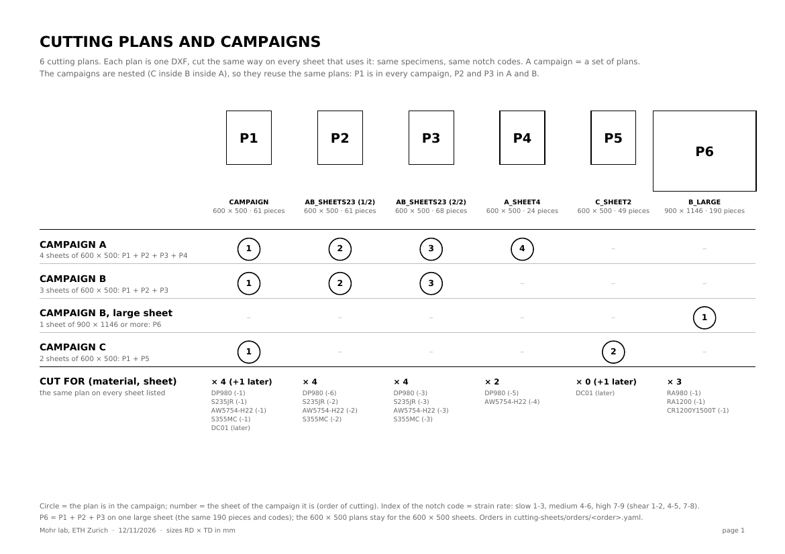

## Next Steps

- Final runs (`--final`) of the 4 orders once the campaigns are validated.
- Answer on the shear specimens (e-mail of 10/11).
- Partly used sheet: confirm the clamps and the specimens to put on it.
- Large sheets: confirm that the waterjet takes a sheet of 900 × 1146 (or more) with the 4 clamps of the L.
- B_LARGE: fewer repeats side by side (12 pairs) if wanted.
- DC01: cutting of campaign C.

## References

- `Paper` *Beerli et al. (2026).* T. Beerli, C. C. Roth, X. Li, V. Grolleau, D. Mohr, Rate-dependent plasticity and fracture of five DP-steels, Int. J. Impact Eng. 215, 105761 · [literature/papers/](../literature/papers/Rate_dependent_plasticity_and_fracture_of_five_DP_steels_static_and_dynamic_high_throughput_experiments_and_neural_network_modeling.pdf) · Sec. 4.1, 4.2.
- `File` *Orders generator.* [cutting-sheets/scripts/make_nested_orders.py](../cutting-sheets/scripts/make_nested_orders.py).
- `File` *Materials.* [cutting-sheets/materials/materials_and_sheets.pdf](../cutting-sheets/materials/materials_and_sheets.pdf) · [material_cuts.pdf](../cutting-sheets/materials/material_cuts.pdf).
- `File` *Cutting plans.* [cutting-sheets/campaigns/cutting_plans.pdf](../cutting-sheets/campaigns/cutting_plans.pdf).
