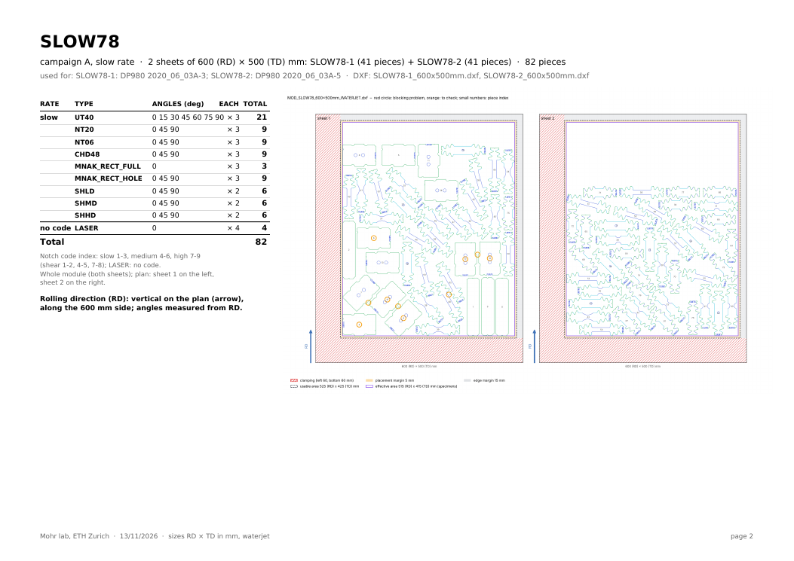
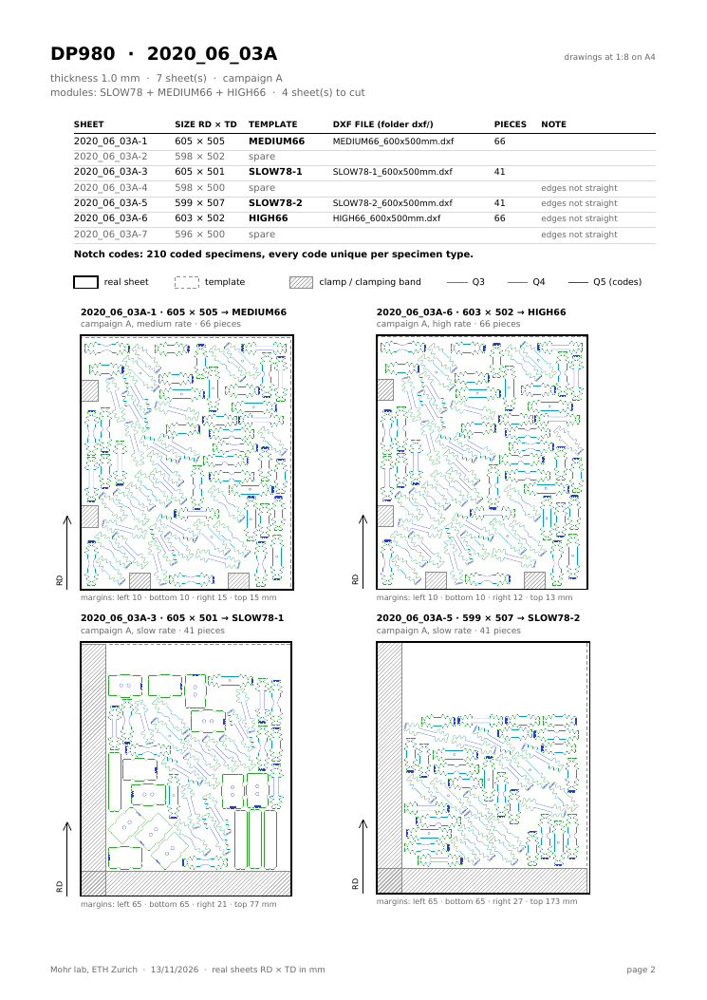
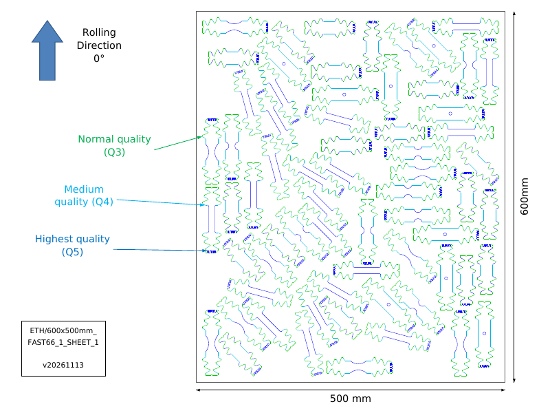
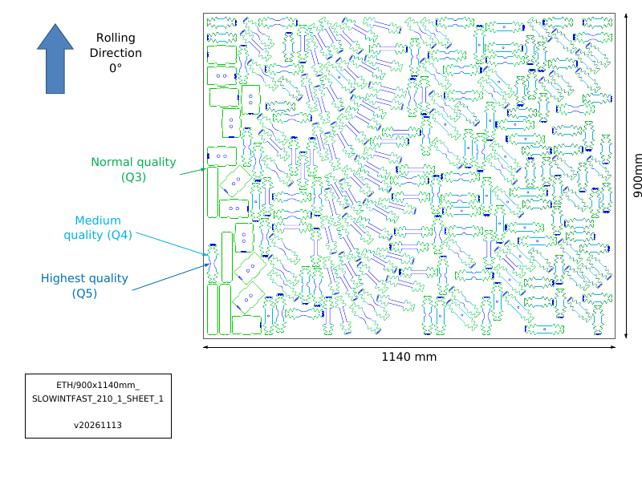

# 2026-11-13

## Objective

Hand over the templates: one folder with the PDF of the templates, one DXF per template and the PDF of instructions
(which template on which sheet of each material).

## Progress and Notes

### 1. Delivery folder

`cutting-sheets/delivery/templates_2026-11-13/`, built by `scripts/make_delivery.py`:

| File | Content |
|---|---|
| `templates.pdf` | the 6 templates (SLOW78 on one page with its 2 sheets, MEDIUM66, HIGH66, MH18, A_LARGE): name, content (rate, type, angles, number), specimens drawn in colour, rolling direction (vertical on the plans, along the 600 / 900 mm side), DXF file name |
| `instructions.pdf` | per material: table sheet / size / template / DXF file / pieces / note, notch codes checked unique per type, templates drawn on the real sheets; last page: the 6 templates in use and where they are cut |
| `dxf/<TEMPLATE>_<RD>x<TD>mm.dxf` | one DXF per template (6 files): SLOW78-1, SLOW78-2, MEDIUM66, HIGH66, MH18 (600 × 500), A_LARGE (900 × 1140) |
| `README.txt` | contents, how to lay a template (RD along RD, bottom-left corner), DXF → material sheets |

DXF: the sheet of the plan (runs/MOD_*) moved to the origin; the 2 sheets of SLOW78 split into 2 files (entities kept
by their bounding box inside the frame of the sheet). Checked after writing: one frame of the right size, same number
of pieces as the registry, and `check_sheet.py` on each file: contours closed, no overlap, smallest gap 5.04-5.07 mm.

| DXF | Pieces | Cut on |
|---|---|---|
| SLOW78-1_600x500mm | 41 | 2020_06_03A-3 |
| SLOW78-2_600x500mm | 41 | 2020_06_03A-5 |
| MEDIUM66_600x500mm | 66 | 2020_06_03A-1, 2023_02_28_D-1, 2023_02_28_A-1, 2023_02_28_C-1 |
| HIGH66_600x500mm | 66 | 2020_06_03A-6, 2023_02_28_D-2, 2023_02_28_A-2, 2023_02_28_C-2 |
| MH18_600x500mm | 36 | 2025_11_25_B-1 |
| A_LARGE_900x1140mm | 214 | 2022_05_04_D-1, 2022_05_04_E-1, 2022_05_04_G-1 |

### 2. MEDIUM54 and HIGH54 removed

User: MEDIUM54 and HIGH54 (campaign B) are not needed. Removed from `make_module_orders.py` and `materials_data.py`,
orders and DXF deleted; folder and PDFs regenerated: **6 templates, all used** (SLOW78-1, SLOW78-2, MEDIUM66, HIGH66,
MH18, A_LARGE), 6 DXF.

### 3. Lab naming convention and one PDF per DXF

The user renamed the DXF with the lab convention `ETH_<RD>x<TD>mm_<NAME>_<sheets of the module>_SHEET_<sheet>_<version>`
(same files: only timestamps differ from ours; the uploaded files are kept as they are in the folder):

| Template | DXF (and PDF) name |
|---|---|
| SLOW78-1, SLOW78-2 | `ETH_600x500mm_SLOW78_2_SHEET_1_v20261113`, `ETH_600x500mm_SLOW78_2_SHEET_2_v20261113` |
| MEDIUM66 | `ETH_600x500mm_INT66_1_SHEET_1_v20261113` (INT = intermediate rate) |
| HIGH66 | `ETH_600x500mm_FAST66_1_SHEET_1_v20261113` |
| MH18 | `ETH_600x500mm_INTFAST36_1_SHEET_1_v20261113` |
| A_LARGE | `ETH_900x1140mm_SLOWINTFAST_210_1_SHEET_1_v20261113` |

`materials_data.dxf_name()` follows this convention (`FILE_NAMES`, `VERSION`), so `make_delivery.py`, the templates PDF and
the instructions PDF use the new names. New script `scripts/make_dxf_sheet_pdf.py`: one PDF per DXF with exactly the
same name, in the layout of the lab's drawing `ETH_600x500mm_2_SHEET_v20250220.pdf` (page 720 × 540 pt): blue
rolling-direction arrow "Rolling Direction 0°", labels Normal quality (Q3), Medium quality (Q4), Highest quality (Q5)
with an arrow to a line of that colour, name box (`ETH/600x500mm_` / `FAST66_1_SHEET_1` / `v20261113`), the sheet with
its cut lines, dimensions "500 mm" and "600mm" (without "min", user). No "Mikrosteg" label: our DXF have no
micro-joints (no red entity; the label is drawn only if a DXF has some). `make_delivery.py` now writes the PDF next to
each DXF.

## Next Steps

- Send the folder to the supervisor / the workshop; confirm the clamps of A_LARGE on the large sheets.
- Micro-joints (Mikrosteg): to add in the DXF if the workshop wants them drawn.

## References

- `File` *Delivery folder.* [cutting-sheets/delivery/templates_2026-11-13/](../cutting-sheets/delivery/templates_2026-11-13/).
- `File` *Generator.* [cutting-sheets/scripts/make_delivery.py](../cutting-sheets/scripts/make_delivery.py).
