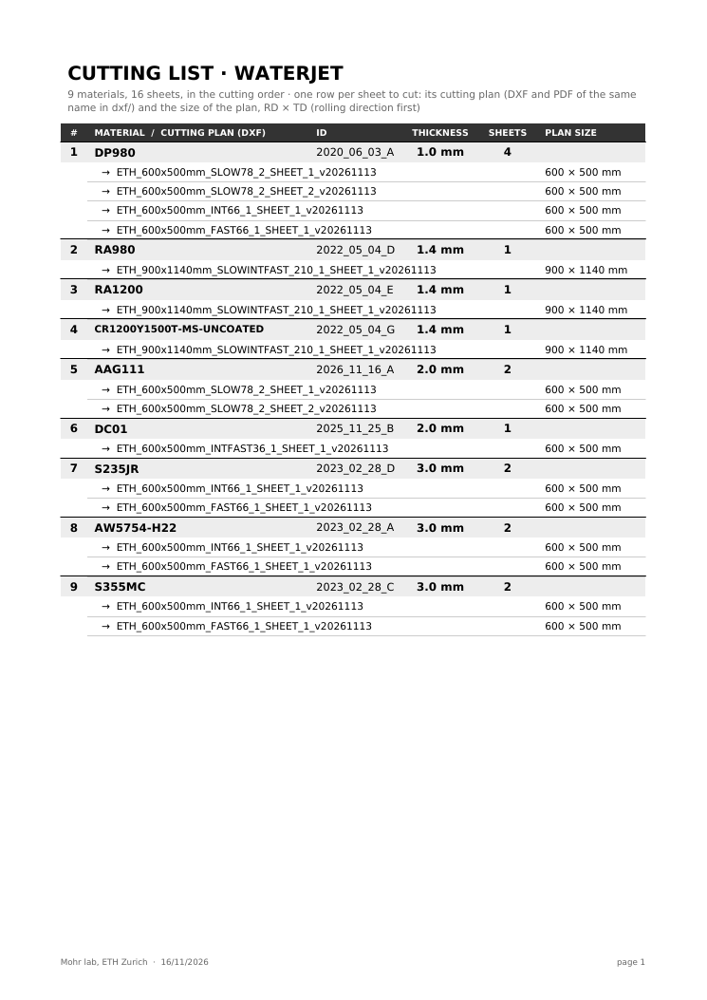

# 2026-11-16

## Objective

Make the cutting list sent to the waterjet workshop: materials in the cutting order, thickness, and the cutting plan
of every sheet to cut.

## Progress and Notes

### 1. Material data

`scripts/materials_data.py` (user):

- new material **AAG111**, ID `2026_11_16_A`, 2.0 mm: 2 sheets of 600 × 500 with the two sheets of SLOW78
  (`ETH_600x500mm_SLOW78_2_SHEET_1` and `_SHEET_2`);
- IDs with an underscore between the date and the letter: `2020_06_03A` → `2020_06_03_A` (the others already had it);
- materials in the cutting order: DP980, RA980, RA1200, CR1200Y1500T-MS-UNCOATED (the 3 large sheets), AAG111, DC01,
  S235JR, AW5754-H22, S355MC.

Notch codes still unique per type for every material (AAG111: 78 coded specimens).

### 2. Cutting list

New script `scripts/make_cutting_list_pdf.py` → `delivery/templates_2026-11-13/cutting_list.pdf` (copy in
`materials/cutting_list.pdf`): simple and sober, one row per material (#, name, ID, thickness, number of sheets) and,
under it, one row per sheet to cut with the cutting plan (DXF name, lab convention) and the plan size; no campaign, no
notes, no modules, no sheet numbers. 9 materials, 16 sheets.

| # | Material | Thickness | Plans |
|---|---|---|---|
| 1 | DP980 2020_06_03_A | 1.0 mm | SLOW78 sheet 1, SLOW78 sheet 2, INT66, FAST66 (600 × 500) |
| 2-4 | RA980, RA1200, CR1200Y1500T (2022_05_04_D, E, G) | 1.4 mm | SLOWINTFAST_210 (900 × 1140) |
| 5 | AAG111 2026_11_16_A | 2.0 mm | SLOW78 sheet 1, SLOW78 sheet 2 |
| 6 | DC01 2025_11_25_B | 2.0 mm | INTFAST36 |
| 7-9 | S235JR, AW5754-H22, S355MC (2023_02_28_D, A, C) | 3.0 mm | INT66, FAST66 |

`make_delivery.py`: option `--pdf-only` (rewrites the PDFs and the README of the folder, keeps the DXF as they are)
and the cutting list added to the folder. All the PDFs regenerated with the new data (templates, instructions,
materials and sheets, material templates).

## Next Steps

- Send the folder to the workshop with the cutting list.
- Tiles (piste C): test one or two tiles if the supervisors agree.

## References

- `File` *Cutting list.* [cutting-sheets/delivery/templates_2026-11-13/cutting_list.pdf](../cutting-sheets/delivery/templates_2026-11-13/cutting_list.pdf).
- `File` *Generator.* [cutting-sheets/scripts/make_cutting_list_pdf.py](../cutting-sheets/scripts/make_cutting_list_pdf.py).
