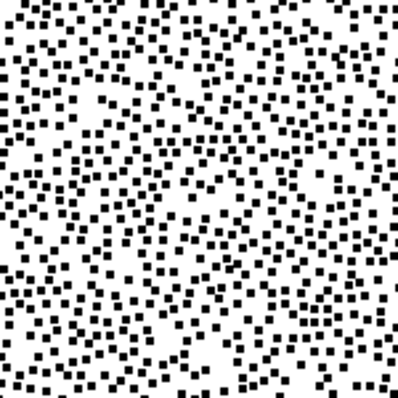

# 2026-11-17

## Objective

Add the speckle generator of Inspire (Ruben Zwicker) to the repository and understand what it does (speckles engraved
on the specimens for DIC).

## Progress and Notes

### 1. Speckle generator

New folder `speckle/` with `speckle_generator.py` (as received, 16/11/2026) and a README. The pattern is made by
`speckle_raster()`: square speckles whose centres are Poisson-disk samples (blue noise: random but evenly spaced, no
clusters, no holes), thinned at random to the target number, clipped to a mask (the area to fill). Output: a bool
array (True = engrave), saved as an image or converted to DXF for the engraver. Parameters: pitch 33 µm (pixel size,
minimum of the engraver), speckle 99 µm (3 px), density 0.25.

Test run (21 × 21 mm, seed 1): 636 × 636 px, measured density 0.249 for 0.25 asked. Zoom on 5 × 5 mm:

`speckle/show_speckle.py` (user): opens a pattern in the image viewer without saving it,
`py show_speckle.py [width_mm] [height_mm] [speckle_um] [density]`.

Lab PC: Python 3.7 (32 bit) with scipy 1.7.3, where `qmc.PoissonDisk` does not exist (scipy ≥ 1.10; the `rng=`
argument needs ≥ 1.15, which needs Python ≥ 3.10). `speckle/_poisson_compat.py`: a small PoissonDisk (Bridson's
algorithm, same call as in `speckle_raster`), put into scipy only when scipy's is missing or too old; used by
`show_speckle.py`. Test with the fallback forced: 21 × 21 mm in 1.7 s, density 0.249, minimum distance between
centres = the radius. Ruben's file unchanged.

## Next Steps

- Decide with Ruben / the supervisors what to work on (masks of the specimen shapes, DXF export, speckle shapes).

## References

- `File` *Speckle generator.* [speckle/speckle_generator.py](../speckle/speckle_generator.py).
