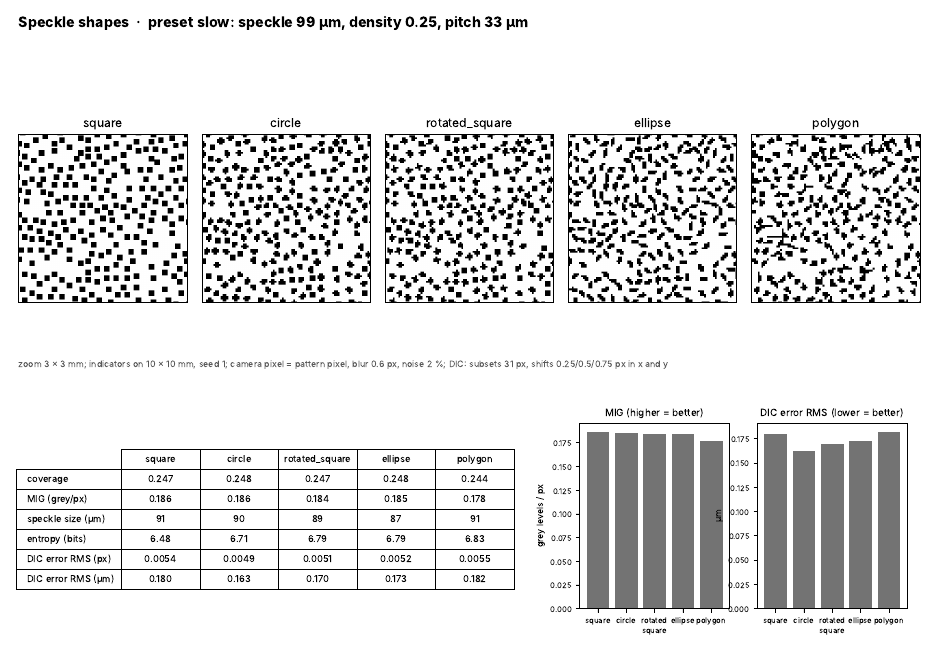
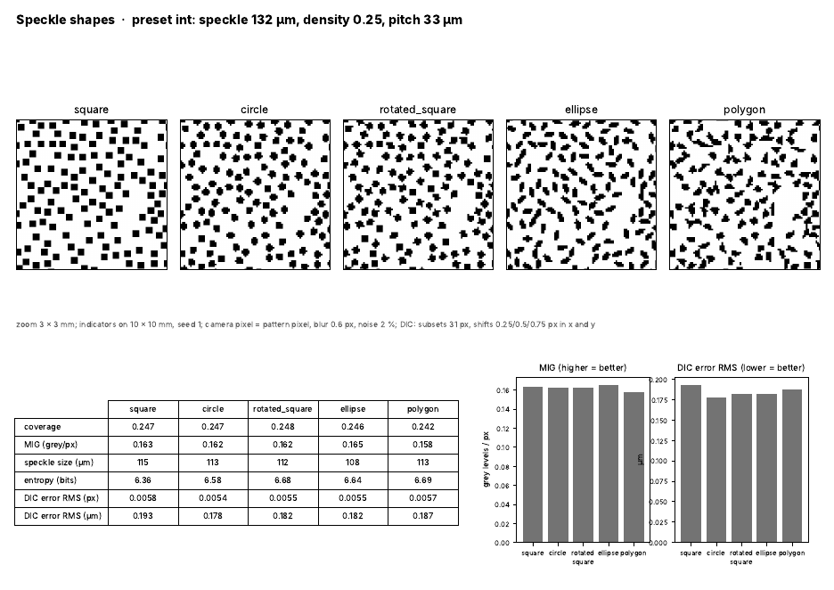
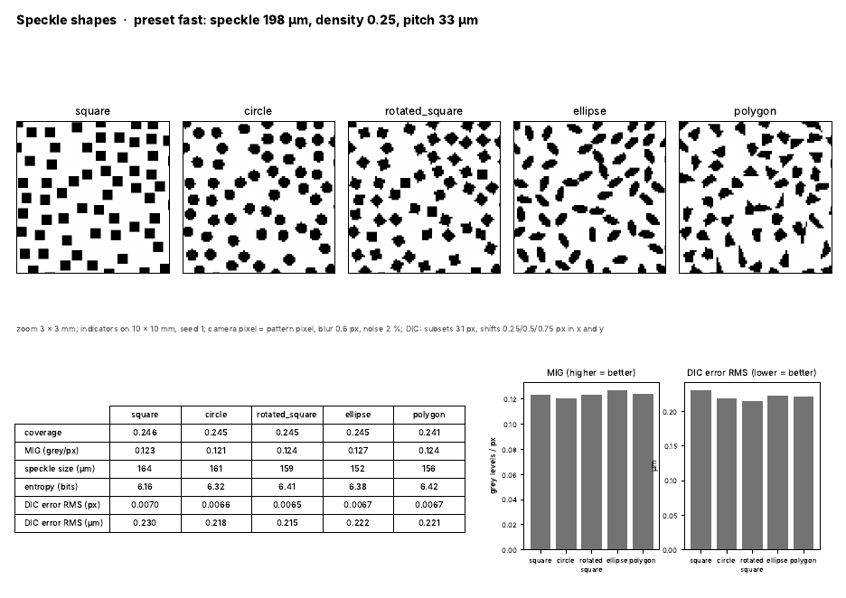

# 2026-11-24

## Objective

Speckle generator: presets per strain rate, quality indicators, several speckle shapes compared, code cleaned.

## Progress and Notes

### 1. Cleaning and shapes

`speckle/speckle_generator.py` cleaned (unused `multiscale_blue_speckle`, `_blue_noise_samples`,
`_poisson_radius_for_target_n` and the prints removed). New argument `shape` of `speckle_raster` /
`generate_speckle_pattern`: `square` (Ruben's; checked: same raster as the original for the same seed), `circle`,
`rotated_square`, `ellipse` (aspect 2, random orientation), `polygon` (irregular, 5-8 vertices). Every speckle has the
area of the square of side `size_um`, so the densities stay comparable (measured 0.242-0.249 for 0.25).

### 2. Presets slow / int / fast

`speckle/speckle_settings.yaml` (no camera setting, user): pitch 33 µm; slow 99 µm, int 132 µm, fast 198 µm, density
0.25 each. Starting values to confirm: slow = Ruben's pattern, int and fast bigger (high-speed cameras usually have
fewer pixels on the same field of view).

### 3. Quality indicators

`speckle/speckle_quality.py`: the pattern seen as a camera image (dark 0.1, light 0.9, blur 0.6 px, noise 2 %;
camera pixel = pattern pixel), then coverage, MIG (mean intensity gradient), speckle size (half-height width of the
autocorrelation), entropy, and a virtual DIC test: shifts 0.25 / 0.5 / 0.75 px in x and y imposed by Fourier shift,
measured back on 40 subsets of 31 px with a translation Gauss-Newton DIC; bias and RMS error. Sanity check
(99 µm): density 0.05 → MIG 0.056, RMS 0.010 px; 0.25 → 0.186, 0.0056 px; 0.5 → 0.231, 0.0052 px; speckle 330 µm →
0.084, 0.0091 px: the indicators react as expected (sparse or too big speckles are worse).

### 4. Shape comparison

`speckle/compare_shapes.py` → `speckle/results/compare_shapes.pdf` (one page per preset; 10 × 10 mm, seed 1):

| Preset | Shape | MIG | Speckle size (µm) | DIC RMS (µm) |
|---|---|---|---|---|
| slow | square / circle / rotated / ellipse / polygon | 0.186 / 0.186 / 0.184 / 0.185 / 0.178 | 91 / 90 / 89 / 87 / 91 | 0.180 / 0.163 / 0.170 / 0.173 / 0.182 |
| int | idem | 0.163 / 0.162 / 0.162 / 0.165 / 0.158 | 115 / 113 / 112 / 108 / 113 | 0.193 / 0.178 / 0.182 / 0.182 / 0.187 |
| fast | idem | 0.123 / 0.121 / 0.124 / 0.127 / 0.124 | 164 / 161 / 159 / 152 / 156 | 0.230 / 0.218 / 0.215 / 0.222 / 0.221 |

The shapes differ little (DIC error within about 10 %); square is a bit worse than circle and rotated square at every
preset, polygon has the lowest MIG at slow. At 3 px (slow) the shapes are barely different on the raster. Bigger
speckles (fast) give a lower MIG and a higher error per pixel. To check: the spread between seeds (are the 10 %
significant?).

`show_speckle.py`: `py show_speckle.py [preset] [width_mm] [height_mm] [shape]`.

## Next Steps

- Repeat the comparison over several seeds (significance of the differences).
- Confirm the presets (sizes, densities) with Ruben / the supervisors.

## References

- `File` *Speckle folder.* [speckle/](../speckle/).
