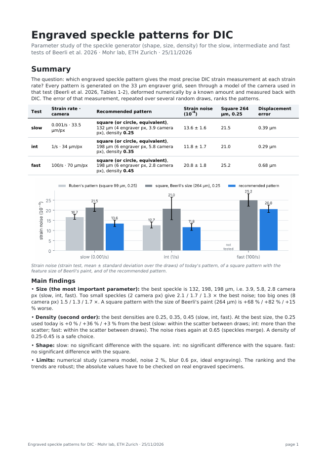
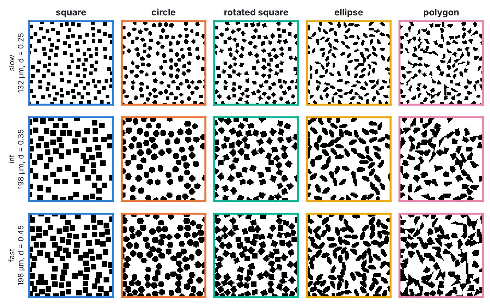
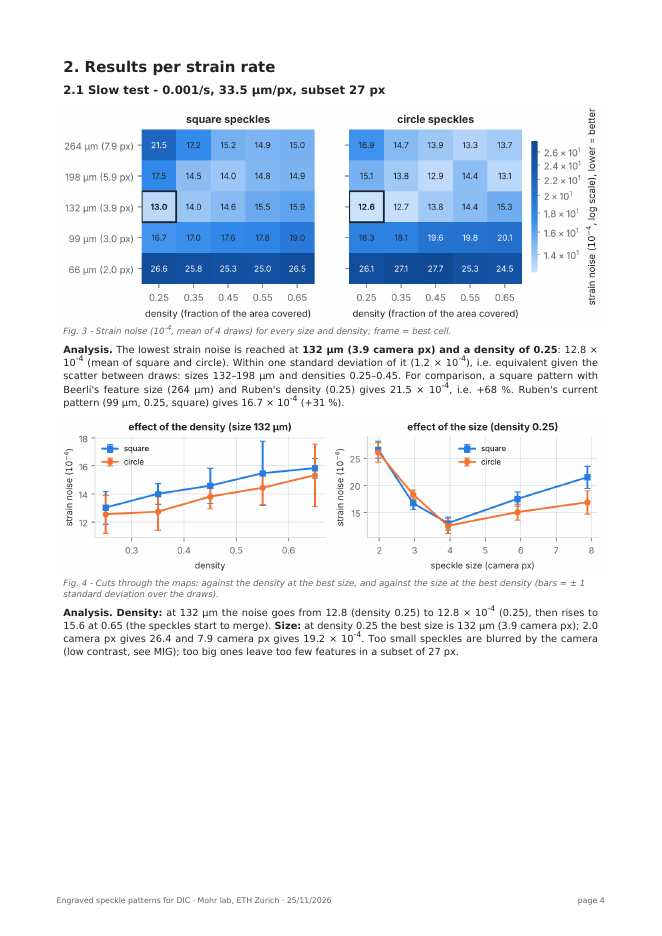
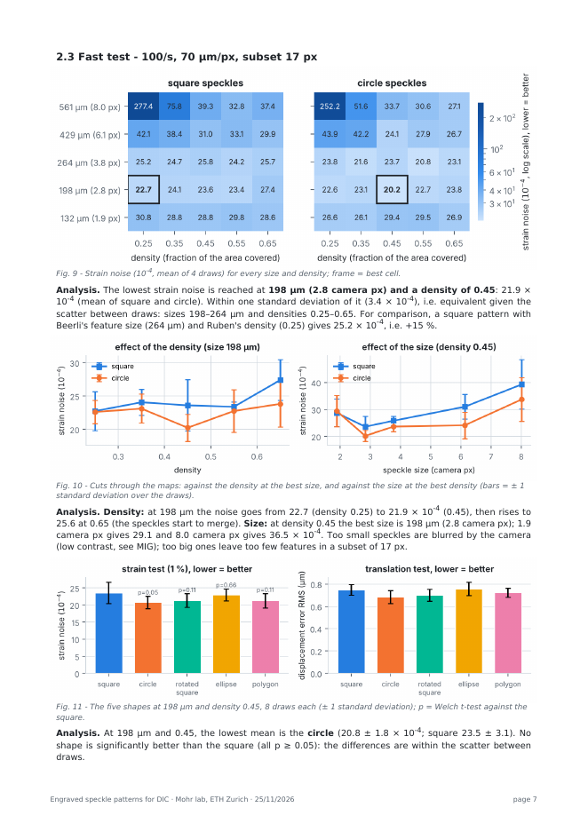

# 2026-11-25

## Objective

Speckle study, second version (user): A4 report, nicer and better organised, colours on the curves, the method
explained (virtual deformations, indicators), the speckle sizes taken from the tests of Beerli et al. 2026, an analysis
under every figure, PNG of every speckle type.

## Progress and Notes

### 1. The three tests from Beerli et al. 2026

The first version used speckle sizes chosen by hand (99, 132, 198 µm) and one camera pixel = one engraver pixel. They
are now taken from Beerli et al. 2026, Tables 1-2 (NT, CH, UT specimens):

| Test | Strain rate | Camera, lens, frame rate | Image scale | Subset | Beerli pattern |
|---|---|---|---|---|---|
| slow | 0.001/s | FLIR Blackfly S, 28 mm, 2 Hz | 33.5 µm/px | 27 px | spray paint, ~8 px (≈ 270 µm) |
| int | 1/s | Optronis Cyclone-5-700, 180 mm, 1 kHz | 34 µm/px | 27 px | spray paint, ~8 px (≈ 270 µm) |
| fast | 100/s | Photron SA-Z, 180 mm, 100 kHz | 70 µm/px | 17 px | thermographic paint, ~4 px (≈ 280 µm) |

(Other setups of Table 1: SH slow 7 µm/px, SH int 10 µm/px, UT and SH fast 50 µm/px.) Stored in
`speckle_settings.yaml` (`camera_um_per_px`, `subset_px`, `beerli_feature_px`), used only to evaluate a pattern.

### 2. New quality model (`speckle_quality.py`)

- Camera: each camera pixel averages the engraved pixels under it (33 µm grid → 33.5, 34 or 70 µm), blur 0.6 px,
  noise 2 % (new noise on every image).
- DIC as VIC-2D: square subsets (27 / 27 / 17 px), first-order (affine) shape function, Gauss-Newton, bicubic
  interpolation, 36 subsets on a grid.
- Virtual tests: translation (0.25 px in x, 0.5 px in y) → displacement error (µm); **strain test** ("fake
  elongation"): uniform stretch εxx = 1 %, εyy = -0.5 %, each subset measures ∂u/∂x → **strain noise** = standard
  deviation of the measured strain (criterion of the study), and bias. Unfiltered, so higher than Beerli's filtered
  floor noise (4-8 × 10⁻⁴), same order of magnitude (1-2 × 10⁻³).
- Indicators: strain noise, displacement error, MIG, coverage, seen size (autocorrelation), entropy.

### 3. Study (`parameter_study.py`, 720 patterns, about 35 min on 2 cores)

Stage 1: sizes of 2, 3, 4, 6, 8 camera px (rounded to 33 µm: 66-264 µm slow and int, 132-561 µm fast) × densities
0.25-0.65 × square and circle × 4 draws. Stage 2: the five shapes at the best cell, 8 draws, Welch t-test against the
square.

| Test | Best cell | Strain noise (10⁻⁴) | Square 264 µm, 0.25 | Ruben 99 µm, 0.25 | Shape |
|---|---|---|---|---|---|
| slow | 132 µm (3.9 px), 0.25 | 13.6 ± 1.6 | 21.5 | 16.7 | no shape better than the square; polygon worse |
| int | 198 µm (5.8 px), 0.35 | 11.8 ± 1.7 | 21.0 | 12.7 | no significant difference |
| fast | 198 µm (2.8 px), 0.45 | 20.8 ± 1.8 | 25.2 | not tested | no significant difference |

- **Size is the main parameter**: 2 camera px gives 1.7-2.1 × the best noise at slow and int, 8 px 1.3-1.7 ×;
  Beerli's paint size (264 µm) as an engraved square is 15-82 % worse than the best.
- **Density is second order**: 0.25 is the best at slow, within the scatter at fast, 36 % worse at int; 0.65 is
  worse everywhere (speckles merge). 0.25-0.45 is safe.
- **Shape**: no shape significantly better than the square (8 draws); the first study (1 camera px = 1 engraver px,
  translation only) had suggested round / elliptic speckles at int and fast: not confirmed with the affine DIC and the
  real image scales.

`speckle_settings.yaml` presets updated: slow 132 µm / 0.25, int 198 µm / 0.35, fast 198 µm / 0.45.

### 4. Report (`make_report.py` → `speckle/results/speckle_report.pdf`, A4, 8 pages)

Summary (recommendations, chart today / Beerli size / recommended, main findings), method (patterns with the gallery,
the three tests, camera model, virtual tests, indicators table, design of the study), one page per test (log-scale
maps of the strain noise for size × density, cuts against density and size, shape comparison with p-values, an
analysis under each figure written from the numbers), conclusions and limits. Colours: categorical palette checked
with the dataviz validator (all checks pass); maps in a single blue ramp. PNG of every shape for every test (at its
recommended size and density): `speckle/results/shapes/` (15 files). `compare_shapes.py` and the first PDFs removed
(superseded).

## Next Steps

- Show the report to Ruben / the supervisors; engrave the recommended patterns and check on real images.
- Shear specimens (other image scales: 7, 10, 50 µm/px).

## References

- `Paper` *Beerli et al. (2026).* Rate-dependent plasticity and fracture of five DP-steels, Int. J. Impact Eng. 215, 105761 · [literature/papers/](../literature/papers/Rate_dependent_plasticity_and_fracture_of_five_DP_steels_static_and_dynamic_high_throughput_experiments_and_neural_network_modeling.pdf) · Tables 1-2, Sec. 2.6.
- `File` *Report.* [speckle/results/speckle_report.pdf](../speckle/results/speckle_report.pdf).
