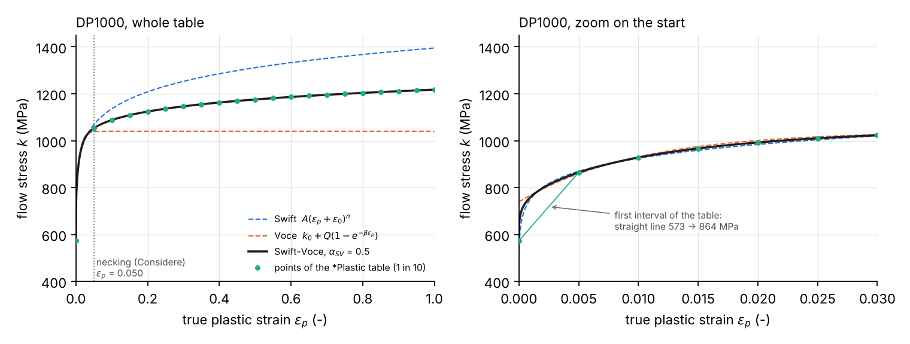

# Matériaux

Tous les fichiers `model/materials/*.dat` sont **générés** par `scripts/pre/make_materials.py` : on ne les modifie
jamais à la main, on change les paramètres en tête du script et on le relance.

```
python shpb-ut-equilibrium/scripts/pre/make_materials.py
```

Le script écrit les trois `.dat` et trace la courbe d'écrouissage de l'éprouvette dans
`docs/figures/DP1000_hardening.png`.

Convention du labo : un `.dat` ne contient que les mots-clés du matériau ; il est inclus dans le `.inp` principal.

```
*MATERIAL, NAME=DP1000
*INCLUDE, INPUT=DP1000.dat
*SOLID SECTION, ELSET=UT19_ALL, MATERIAL=DP1000
```

Unités : mm, N, s, MPa, t/mm³ (1 kg/m³ = 1e-12 t/mm³).

---

## 1. Qui est en quoi

| Pièce | Matériau | Fichier | Comportement |
|---|---|---|---|
| barre d'entrée, barre de sortie, pusher | acier maraging | `MARAGING.dat` | élastique linéaire |
| striker | acier | `STRIKER_STEEL.dat` | élastique linéaire |
| éprouvette (UT19, UT40) | DP1000 | `DP1000.dat` | élastoplastique, écrouissage isotrope |

---

## 2. Barres, pusher et striker : élastiques

Le module de Young est déduit de la vitesse des ondes **mesurée sur le banc** (Beerli et al. 2026, §2.5) :

$$
c = \sqrt{E/\rho} \quad\Longrightarrow\quad E = \rho\,c^2
$$

| Matériau | $c$ (m/s) | $\rho$ (kg/m³) | $E$ (MPa) | $\nu$ |
|---|---|---|---|---|
| MARAGING | 4871 (mesurée) | 8000 (**hypothèse**) | 189 813 | 0,3 |
| STRIKER_STEEL | 4720 (mesurée) | 7850 (**hypothèse**) | 174 885 | 0,3 |

Ce qui compte pour les ondes, c'est $c$ (mesurée) et l'impédance $Z = \rho c A$ : une erreur sur $\rho$ change $E$
mais pas $c$, et décale $Z$ dans la même proportion.

- Le pusher est en maraging traité (Beerli 2026) ; l'ancien fichier CAO indique de l'acier à outils A2 : **à confirmer**.
- La barre de sortie est « en même maraging » que la barre d'entrée (Beerli 2026), sans vitesse mesurée propre.

---

## 3. Éprouvette : DP1000

### 3.1 Ce qu'il faut à Abaqus

Pour un métal en plasticité de von Mises (J2) avec écrouissage isotrope, Abaqus a besoin de :

1. l'élasticité : $E$ et $\nu$ ;
2. la **courbe d'écrouissage** : la contrainte d'écoulement $k$ (contrainte vraie à laquelle le métal plastifie en
   traction) en fonction de la déformation plastique équivalente $\varepsilon_p$ (déformation vraie). C'est le
   mot-clé `*Plastic`, sous forme de tableau de points $(k, \varepsilon_p)$.

Le critère de plasticité est $\sigma_{eq} = k(\varepsilon_p)$, avec $\sigma_{eq}$ la contrainte équivalente de von Mises.

### 3.2 La loi d'écrouissage Swift-Voce (Beerli et al. 2026, éq. 10)

La courbe vient de Beerli et al. (2026). Ils l'écrivent comme un mélange de deux lois classiques :

$$
k_{SV}(\varepsilon_p) \;=\; \alpha_{SV}\,\underbrace{A\,(\varepsilon_p+\varepsilon_0)^{n}}_{\text{Swift}}
\;+\;(1-\alpha_{SV})\,\underbrace{\Big[k_0 + Q\,\big(1-e^{-\beta\,\varepsilon_p}\big)\Big]}_{\text{Voce}}
$$

| Loi | Forme | Comportement | Paramètres DP1000 (tableau 4) |
|---|---|---|---|
| **Swift** (loi puissance) | $A(\varepsilon_p+\varepsilon_0)^n$ | durcit sans fin ; $\varepsilon_0$ décale l'origine, $n$ règle la courbure | $A$ = 1395 MPa, $\varepsilon_0$ = 1e-6, $n$ = 0,0892 |
| **Voce** (exponentielle) | $k_0 + Q(1-e^{-\beta\varepsilon_p})$ | part de $k_0$ et **sature** à $k_0 + Q$ = 1040 MPa ; $\beta$ règle la vitesse de saturation | $k_0$ = 739 MPa, $Q$ = 301 MPa, $\beta$ = 102 |
| **Mélange** | $\alpha_{SV}$ × Swift + $(1-\alpha_{SV})$ × Voce | entre les deux | $\alpha_{SV}$ = 0,5 |

Pourquoi un mélange : un essai de traction ne donne la courbe que jusqu'à la striction ($\varepsilon_p \approx 0{,}05$
pour le DP1000). Au-delà, il faut extrapoler, et Swift (durcit toujours) et Voce (sature) encadrent les
extrapolations possibles. Le poids $\alpha_{SV}$ choisit l'extrapolation.

**Comment Beerli a obtenu ces valeurs** (§3.4) :

- $E$ et $\nu$ : ajustés sur la partie élastique des essais de traction (UT) ;
- paramètres de Swift et de Voce : ajustés **chacun séparément** (moindres carrés) sur la courbe contrainte vraie –
  déformation plastique des essais de traction **quasi statiques** ($\dot\varepsilon$ = 0,001 /s), **jusqu'à la striction** ;
- $\alpha_{SV}$ : identifié par analyse inverse (simulation contre essai) d'essais NT20 à faible vitesse, qui
  déforment le métal bien plus loin que la striction d'un essai de traction.

Valeurs de contrôle :

| $\varepsilon_p$ | 0 | 0,002 | 0,01 | 0,05 | 0,1 | 0,2 | 0,5 | 1 |
|---|---|---|---|---|---|---|---|---|
| Swift (MPa) | 407 | 801 | 925 | 1068 | 1136 | 1208 | 1311 | 1395 |
| Voce (MPa) | 739 | 795 | 931 | 1038 | 1040 | 1040 | 1040 | 1040 |
| **$k_{SV}$ (MPa)** | **573** | **798** | **928** | **1053** | **1088** | **1124** | **1176** | **1218** |



*Figure : loi de Swift (bleu pointillé), loi de Voce (orange pointillé), mélange utilisé (noir) et points du tableau
`*Plastic` donnés à Abaqus (vert). À droite : zoom sur le début, où le premier intervalle du tableau est une droite.*

### 3.3 Ce qu'on a pris dans Beerli, et ce qu'on a laissé

Le modèle complet de Beerli est $k(\varepsilon_p, \dot\varepsilon_p, T) = k_{SV}(\varepsilon_p)\cdot k_{NN}(\varepsilon_p, \dot\varepsilon_p, T)$
(éq. 9) : la courbe $k_{SV}$ ci-dessus, multipliée par un réseau de neurones $k_{NN}$ qui ajoute l'effet de la vitesse
de déformation et de la température.

On garde exactement ce que Beerli utilise pour **sa propre simulation du banc** (§2.5.1 : « a strain-rate independent
1.5 mm thick material with von Mises yield surface and isotropic hardening similar to the DP1000 (Table 4) »).

| Élément du modèle de Beerli | Dans nos simulations |
|---|---|
| $E$ = 195 GPa, $\nu$ = 0,33, $\rho$ = 7850 kg/m³ | **oui** |
| courbe $k_{SV}$ (Swift-Voce) | **oui** |
| facteur $k_{NN}$ (vitesse de déformation, température) | **non** : même courbe à toutes les vitesses |
| surface de charge anisotrope (paramètres $P_{ij}$, $G_{ij}$) | **non** : von Mises (isotrope) |
| échauffement ($C_p$ = 420 J/kgK, $\kappa$ = 49 W/mK) | **non** |
| rupture (Hosford-Coulomb + réseau de neurones) | **non** |

Conséquence : les trois vitesses de déformation ont **exactement la même loi**. Les différences entre 100, 500 et
1 000 /s viennent uniquement des ondes et de l'inertie, ce qui est le sujet de la Task I. En essai, le DP1000 est
plus résistant à grande vitesse : la force sera plus élevée, donc la vitesse du striker nécessaire un peu plus grande
(terme $2F/\rho c A$ de la formule, voir `docs/results.md`).

### 3.4 Contrôle : où commence la striction ?

En traction, la striction commence quand l'écrouissage ne compense plus la diminution de section (critère de
Considère) :

$$
\frac{dk}{d\varepsilon_p} = k
$$

Pour notre loi : $\varepsilon_p$ = 0,050, soit une **déformation nominale de 5,1 %** et une **contrainte nominale de
1 002 MPa**. Les simulations donnent bien leur force maximale vers 5 % de déformation, à 7,5 kN, soit
7 500 N / 7,5 mm² = **1 000 MPa** : la loi est correctement prise en compte par Abaqus.

### 3.5 Le tableau `*Plastic` donné à Abaqus

- De $\varepsilon_p$ = 0 à 2, **pas constant de 0,005** (401 points). Au-delà de 2, Abaqus garde la dernière valeur.
- Pourquoi un pas constant : Abaqus/Explicit « régularise » les tableaux, c'est-à-dire qu'il les ré-échantillonne à
  pas constant, égal au plus petit intervalle donné. Une première version en échelle logarithmique (plus petit
  intervalle 1e-6 sur une plage de 2) demandait 2 millions de points : erreur `Failed to regularize material data`
  au premier datacheck (12/10/2026).
- Conséquence : entre $\varepsilon_p$ = 0 et 0,005, la courbe est remplacée par une droite (573 → 864 MPa), alors que
  la loi monte très vite (761 MPa dès $\varepsilon_p$ = 0,001, à cause de $\varepsilon_0$ = 1e-6). Écart maximal
  ≈ −12 % sur ce tout début de plasticité seulement (zoom de la figure), sans effet au-delà.

---

## 4. À confirmer avec le maître de stage

- le matériau d'éprouvette à utiliser pour la Task I (DP1000 ?) ;
- les densités réelles des barres et du striker ;
- le matériau réel du pusher (maraging ou acier A2).
