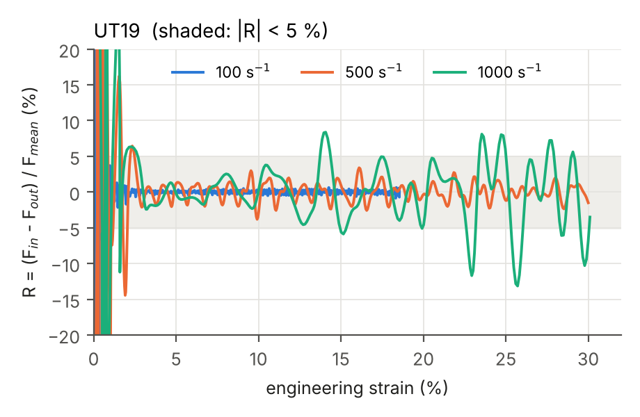
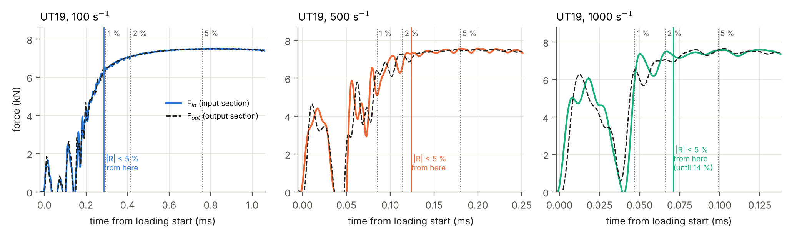
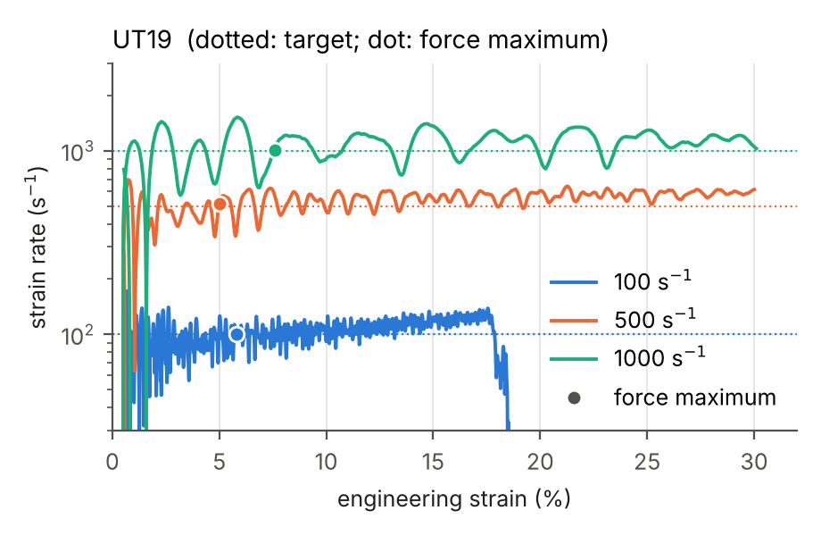
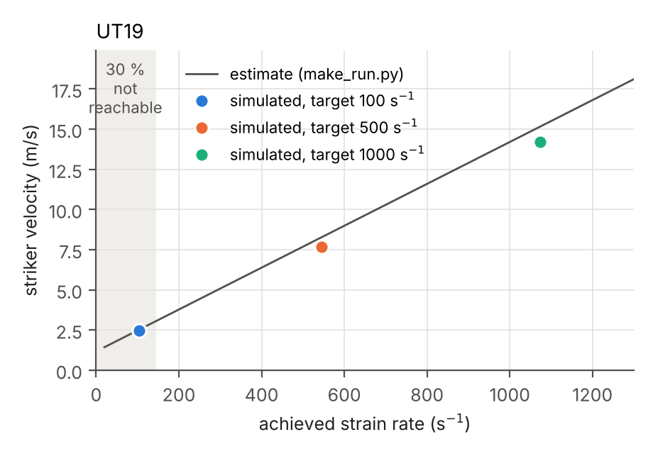
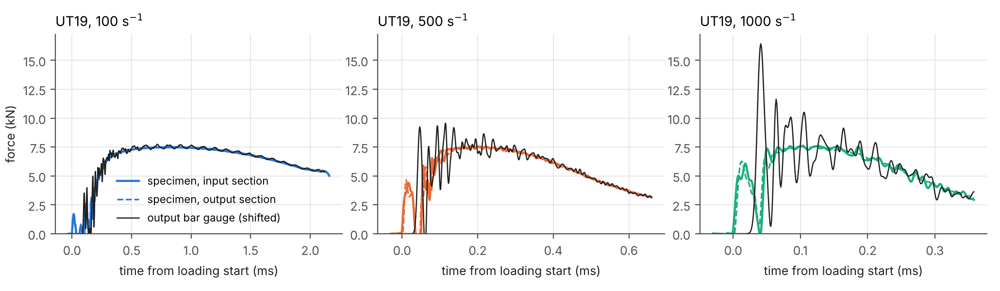
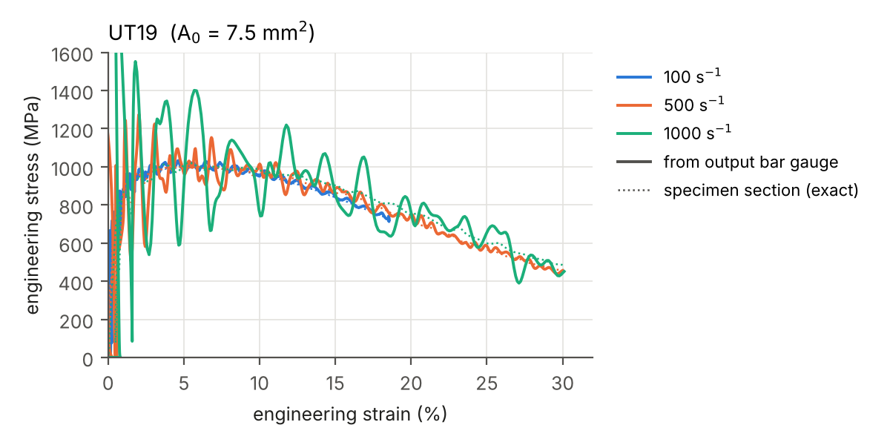
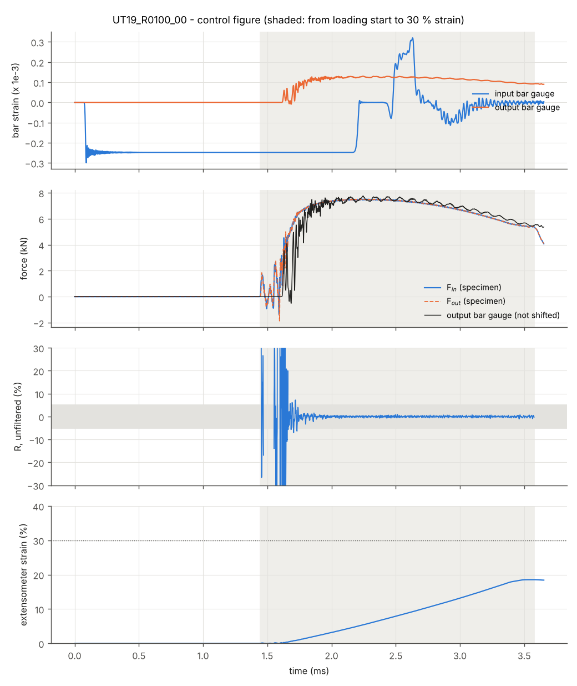
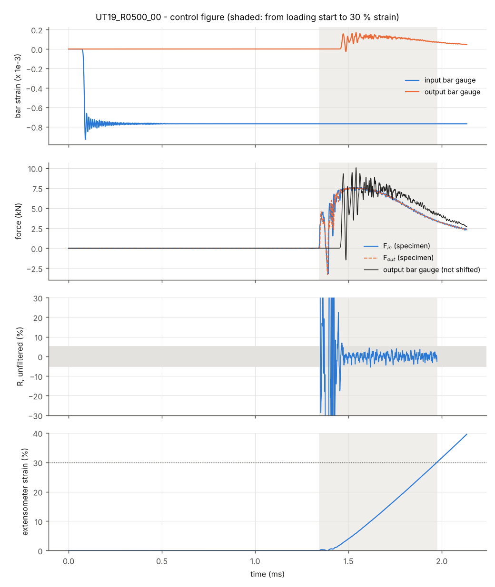

# Task I – Force equilibrium and loading speeds in the SHPB with load inversion device

*Study `taskI_20261013-1554` – specimens: UT19. Generated by `scripts/post/report_taskI.py`: every number in this report is computed from the simulation outputs.*

**Questions of Task I.**

1. Can quasi-static force equilibrium be achieved in the specimen at nominal strain rates of 100, 500 and 1000 s⁻¹?
2. Which loading speeds are required to reach an engineering strain of 30 %?

## Summary

| Case | Equilibrium ($\lvert R\rvert$ < 5 %) | Striker velocity | 30 % strain | Gauge error |
|---|---|---|---|---|
| UT19, 100 s⁻¹ | yes, from 0.9 % | 2.48 m/s | no (18.5 % max) | 3 % |
| UT19, 500 s⁻¹ | yes, from 2.5 % | 7.69 m/s | in 0.63 ms | 15 % |
| UT19, 1000 s⁻¹ | partial, 2.7 % to 13.7 % | 14.20 m/s | in 0.33 ms | 39 % |

- Equilibrium is reached early and maintained at the lower rates. At the highest rate it is only partly reached; the largest differences occur late in the test, when the force decreases (necking).
- The striker velocity must account for the specimen force (see *Loading speeds*). With the 5 m striker, 30 % strain cannot be reached below about 142 s⁻¹.
- Even when the specimen is in equilibrium, the force read on the output bar gauge oscillates around the true specimen force: this must be considered when assessing the measured curves.

*Gauge error*: largest difference between the force read on the output bar gauge and the exact specimen force after 5 % strain, relative to the maximum force.

## Model and assumptions

- **Bench**: Ø20 mm steel striker (5 m), maraging input bar (6.01 m), load inversion device, specimen, maraging output bar (≈ 6 m); virtual strain gauges 400 mm from the bar ends (Beerli et al. 2026).
- **Symmetry**: half model, cut by the vertical plane through the bar axes.
- **Mesh**: bars: swept C3D8R (5 mm axially, 2 mm in the section); clamping heads: C3D10M tetrahedra (2 mm); specimen: C3D8R, 0.5 mm in plane, 4 elements through the 1.5 mm thickness; ≈ 214 000 elements.
- **Solver**: Abaqus/Explicit, double precision, **no mass scaling** (inertia is the studied effect).
- **Bars**: linear elastic, $E = \rho c^2$ with the measured wave speeds (4871 m/s bars, 4720 m/s striker) and assumed densities (8000 and 7850 kg/m³).
- **Specimen**: DP1000, von Mises, isotropic Swift–Voce hardening (below), **rate independent**.
- **Contacts**: bar ends: hard, frictionless; specimen shoulders in the pockets: hard, friction 0.2; the specimen lies in the pockets without pre-load.
- **Guides**: vertical displacement blocked on the sliding face of the inverter and on the bar axes (without them the inverter pitches under the eccentric load).
- **Loading**: initial velocity of the striker (Table T1).

**Specimen material.** The flow stress $k$ (true stress) is a function of the equivalent plastic strain $\varepsilon_p$, as identified by Beerli et al. (2026, eq. 10 and table 4) on quasi-static tensile tests:

$$
k(\varepsilon_p) = \alpha_{SV}\,A\,(\varepsilon_p+\varepsilon_0)^{n} + (1-\alpha_{SV})\left[k_0 + Q\left(1-e^{-\beta\varepsilon_p}\right)\right]
$$

with $A$ = 1395 MPa, $\varepsilon_0$ = 10⁻⁶, $n$ = 0.0892 (Swift power law), $k_0$ = 739 MPa, $Q$ = 301 MPa, $\beta$ = 102 (Voce exponential law) and $\alpha_{SV}$ = 0.5; $E$ = 195 GPa, $\nu$ = 0.33. The strain-rate and temperature factor of the full model of Beerli et al. is not used, as in their own simulation of the bench: the three strain rates have exactly the same material law. The Considère criterion $dk/d\varepsilon_p = k$ predicts necking at 5.1 % engineering strain and 1002 MPa, which the simulations reproduce (maximum force ≈ 7.5 kN on 7.5 mm² at about 5 % strain). Details: `docs/materials.md`.

## Signal processing and definitions

**Filter.** Forces and strain are low-pass filtered (4th-order Butterworth, 100 kHz cut-off, zero phase), the cut-off used for the output bar gauge signal in the laboratory. The simulation writes one point per microsecond and contains vibrations of a few microseconds that the experiment cannot resolve. The effect of the filter is shown in Table T3.

**Forces.** $F_{in}$ and $F_{out}$ are the exact axial forces in two cross-sections at both ends of the parallel section of the specimen ($F_{in}$ on the inverter side, $F_{out}$ on the output bar side). They answer the equilibrium question. The experiment only has the strain gauge of the output bar:

$$
F_{gauge}(t) = A_{bar}\,E_{bar}\,\varepsilon_{gauge}\!\left(t + \Delta t\right), \qquad \Delta t = \frac{400\ \text{mm}}{4871\ \text{m/s}} = 82\ \mu\text{s}
$$

i.e. the gauge signal shifted by the travel time of the wave from the specimen to the gauge (no dispersion correction). It is only used in the section *What the experiment will measure*.

**Strain.** Engineering strain of a virtual extensometer on the parallel section (12 mm for the UT19), equivalent to the DIC extensometer.

**Equilibrium.**

$$
R = \frac{F_{in} - F_{out}}{F_{mean}}, \qquad F_{mean} = \frac{F_{in} + F_{out}}{2}
$$

The specimen is considered in equilibrium when $\lvert R\rvert$ < 5 %. The *equilibrium strain* is the strain from which $\lvert R\rvert$ stays below this limit until 30 % strain (or until the end of loading). The *loading start* is the first instant where $F_{in}$ exceeds 2 % of its maximum.

**Achieved strain rate.**

$$
\dot\varepsilon = \frac{\varepsilon_2 - \varepsilon_1}{t_2 - t_1}, \qquad \varepsilon_1 = 5\ \%, \quad \varepsilon_2 = \min(25\ \%,\ 0.8\,\varepsilon_{max})
$$

i.e. the strain gained in this interval divided by the time taken. The interval excludes the start-up (rise of the incident pulse, settling of the specimen shoulders in the pockets, build-up of the force up to its maximum at about 5 % strain) and the end of the loading, so that it covers the established regime described by the striker velocity estimate. The full history is shown in F4 and other definitions in T4.

## Task I answers

**Table T1 – Test conditions.**

| Case | Striker (m/s) | Incident strain | Achieved rate (s⁻¹) | 30 % strain | Max strain |
|---|---|---|---|---|---|
| UT19, 100 s⁻¹ | 2.48 | $-2.48 \times 10^{-4}$ | 105 | not reached | 18.5 % |
| UT19, 500 s⁻¹ | 7.69 | $-7.69 \times 10^{-4}$ | 546 | in 0.63 ms | 30.0 % |
| UT19, 1000 s⁻¹ | 14.20 | $-1.42 \times 10^{-3}$ | 1073 | in 0.33 ms | 30.1 % |

*Incident strain*: plateau of the strain on the input bar gauge. *30 % strain*: time from the loading start. *Max strain*: at 30 % or at the end of the pulse. The complete table, with all indicators, is `T1_conditions.csv`.

### Force equilibrium

**Figure F1 – Force equilibrium in the specimen.** *Plotted:* the equilibrium ratio $R$ (vertical axis) against the engineering strain (horizontal axis), one curve per target rate. *Source:* exact forces $F_{in}$ and $F_{out}$ in the two cross-sections of the simulated specimen, filtered at 100 kHz (not a strain gauge); strain of the virtual extensometer. *How to read it:* inside the shaded band ($\lvert R\rvert$ < 5 %) both ends of the specimen carry the same force: the specimen is in equilibrium. The large values below about 2 % strain come from the start of loading (specimen shoulders settling in the pockets) and are cut at ±20 %.

**Figure F1b (UT19) – Onset of equilibrium.** *Plotted:* the exact forces $F_{in}$ (coloured solid line) and $F_{out}$ (black dashed line) against the time from the loading start, one panel per target rate, until shortly after equilibrium is reached (and at least 5 % strain). Dotted vertical lines: instants at which the strain reaches 1, 2 and 5 %; coloured vertical line: instant from which $\lvert R\rvert$ < 5 % (for a partial equilibrium: start of the longest interval). *Source:* same filtered forces as F1. *How to read it:* before equilibrium the two forces differ (the first pulse is the specimen shoulders settling in the pockets); from the coloured line onwards they overlap.

**Table T2 – Equilibrium indicators.**

| Case | Equilibrium from | Max $\lvert R\rvert$ after 5 % | Max $\lvert\Delta F\rvert$ after 5 % | Max force |
|---|---|---|---|---|
| UT19, 100 s⁻¹ | 0.9 % (0.29 ms) | 0.9 % | 0.05 kN | 7.50 kN at 5.8 % |
| UT19, 500 s⁻¹ | 2.5 % (0.12 ms) | 3.8 % | 0.28 kN | 7.56 kN at 5.0 % |
| UT19, 1000 s⁻¹ | 2.7 % to 13.7 % only | 13.2 % | 0.60 kN | 7.58 kN at 7.6 % |

*Equilibrium from*: strain (and time after the loading start) from which $\lvert R\rvert$ < 5 % holds until the end of loading. $\Delta F = F_{in} - F_{out}$.

- **UT19, 100 s⁻¹** (striker 2.48 m/s): equilibrium is established at 0.9 % strain, 0.29 ms after the loading start, and holds until the end of the loading (max $\lvert R\rvert$ after 5 % strain: 0.9 %).
- **UT19, 500 s⁻¹** (striker 7.69 m/s): equilibrium is established at 2.5 % strain, 0.12 ms after the loading start, and holds until the end of the loading (max $\lvert R\rvert$ after 5 % strain: 3.8 %).
- **UT19, 1000 s⁻¹** (striker 14.20 m/s): equilibrium is **only partly reached**: $\lvert R\rvert$ < 5 % from 2.7 % to 13.7 % strain, but it reaches 13.2 % at other instants after 5 % strain ($\lvert F_{in} - F_{out}\rvert$ up to 0.60 kN, i.e. 8.0 % of the maximum force).

In all cases the first few tens of microseconds show a short force pulse followed by a drop to zero before continuous loading starts (F1b). This is most likely the impact of the specimen shoulders in the pockets, the specimen being inserted without pre-load.

The force is maximum at about 5 to 8 % strain and then decreases (necking). The same force difference therefore gives a larger ratio $R$ late in the test, which is why the absolute difference $\Delta F$ is given as well.

**Table T3 – Effect of the 100 kHz filter** (exact section forces).

| Case | Equilibrium from (raw) | Equilibrium from (filtered) | Max $\lvert R\rvert$ (raw) | Max $\lvert R\rvert$ (filtered) |
|---|---|---|---|---|
| UT19, 100 s⁻¹ | 0.9 % | 0.9 % | 1.1 % | 0.9 % |
| UT19, 500 s⁻¹ | 10.0 % | 2.5 % | 5.5 % | 3.8 % |
| UT19, 1000 s⁻¹ | n/a | n/a | 15.5 % | 13.2 % |

*Raw*: forces as written by Abaqus (one point per µs). Max $\lvert R\rvert$ after 5 % strain.

### Loading speeds

**Figure F4 – Strain rate in the specimen.** *Plotted:* the strain rate (vertical axis, logarithmic scale) against the engineering strain, one curve per target rate; dotted lines: target rates; dots: force maximum (onset of necking). *Source:* time derivative of the extensometer strain (filtered at 100 kHz before derivation): a kinematic quantity, equivalent to DIC; not a force, not the output bar gauge. *How to read it:* the curve should stay close to its target. Being a derivative, it amplifies small vibrations of the specimen (±10 to 30 % around the mean, period 10 to 20 µs at 1000 s⁻¹); on the logarithmic scale the 100 s⁻¹ curve looks noisier than it is. A curve that drops before 30 % strain (100 s⁻¹, at about 18 %) shows the end of the loading pulse.

**Table T4 – Strain rate with different definitions** (s⁻¹).

| Case | Achieved (5–25 %) | At max force | Nominal | Before max force | After max force |
|---|---|---|---|---|---|
| UT19, 100 s⁻¹ | 105 | 100 | 87 | 51 to 120 | 63 to 124 |
| UT19, 500 s⁻¹ | 546 | 516 | 475 | -147 to 531 | 481 to 606 |
| UT19, 1000 s⁻¹ | 1073 | 1010 | 915 | -114 to 1201 | 880 to 1282 |

*Achieved*: definition above (used in T1 and F5). *At max force*: value of F4 at the dot. *Nominal*: final strain divided by the whole loading time, start-up included. *Before / after max force*: range of the F4 curve before and after the dot (10th to 90th percentile).

After the force maximum the strain rate is established close to the target and increases slowly, because the force decreases (necking) and brakes the bench less. Before the force maximum, during the uniform hardening phase, the strain rate is not yet stable at the higher rates (negative values: rebound of the specimen in the pockets).

**Striker velocity.** The elongation rate of the inverter is approximately

$$
v \approx 2\,v_i - \frac{2F}{\rho c A}, \qquad v_i = K\,V_{striker}, \qquad K = \frac{Z_{striker}}{Z_{striker} + Z_{bar}} = 0.487
$$

where $v_i$ is the particle velocity of the incident wave and $F$ the specimen force: the specimen force both slows the inverter down and pushes the output bar ($\rho c A$ = 12242 N·s/m). Writing $v = \dot\varepsilon\,L_{eff}$ gives

$$
V_{striker} = \frac{\dot\varepsilon\,L_{eff} + 2F/(\rho c A)}{2K}
$$

- UT19: $L_{eff}$ = 12.7 mm, $F$ = 7 kN (calibrated on a first simulation at 500 s⁻¹).

$L_{eff}$ is an effective length relating the elongation rate to the extensometer strain rate. For the UT19, a first estimate without the force term ($V = \dot\varepsilon \times$ 15 mm) gave 21 s⁻¹ instead of 100 s⁻¹, because the specimen force is then almost as large as the force carried by the incident wave.

**Figure F5 – Striker velocity required for a given strain rate.** *Plotted:* the striker velocity (vertical axis), i.e. the setting of the test, against the strain rate in the specimen (horizontal axis), one panel per specimen. Line: the formula above. Dots: the simulations, at the imposed striker velocity and the achieved strain rate (T1). Shaded: 30 % not reachable. *Source:* formula of `make_run.py` and simulation results. *How to read it:* choose a strain rate on the horizontal axis and read the striker velocity on the line; dots on the line confirm the formula.

**Limit for 30 % strain.** The 5 m striker gives a 2.12 ms loading pulse, so 30 % strain requires at least 0.30 / 2.12 ms ≈ 142 s⁻¹; the output bar (5.99 m) also limits the measurement window to 2.33 ms (Beerli et al. 2026). At 100 s⁻¹ (UT19) the strain stops at 18.5 %; 30 % would need about 3.1 ms of loading (0.30 / 105 s⁻¹ + 0.28 ms start-up), i.e. a striker of about 7.4 m: almost the length of the 7.5 m launch tube, and longer than the measurement window.

## What the experiment will measure

In the experiment the force is only known from the output bar gauge. F2 and F3 compare this signal, as it would be recorded, with the exact force in the specimen.

**Figure F2 (UT19) – Specimen forces and output bar gauge.** *Plotted:* axial force against the time from the loading start, one panel per target rate. Coloured solid line: $F_{in}$; coloured dashed line: $F_{out}$; black line: force read on the output bar gauge. *Source:* the gauge force is $A_{bar} E_{bar} \varepsilon_{gauge}$ shifted by 82 µs (wave travel over the 400 mm between specimen and gauge); all signals filtered at 100 kHz. *How to read it:* overlapping coloured lines mean equilibrium; the distance between the black line and the coloured lines is the measurement error of the gauge.

**Figure F3 – Engineering stress–strain curves.** *Plotted:* engineering stress $F / A_0$ (7.5 mm² for the UT19) against the engineering strain of the extensometer, one colour per target rate. Solid line: force from the output bar gauge, i.e. the curve the experiment will give. Dotted line: exact force in the output section of the specimen. *Source:* filtered signals, gauge shifted as in F2. *How to read it:* the gap between the solid and the dotted line of the same colour is the error of the measured curve. As the material is rate independent, the dotted curves coincide. Axis cut at 1600 MPa (spike of the gauge signal below 2 % strain).

**Table T5 – Error of the output bar gauge.**

| Case | Max force | Max gauge error after 5 % |
|---|---|---|
| UT19, 100 s⁻¹ | 7.50 kN | 3.1 % of the max force |
| UT19, 500 s⁻¹ | 7.56 kN | 15.0 % of the max force |
| UT19, 1000 s⁻¹ | 7.58 kN | 38.9 % of the max force |

The force in the specimen is smooth, whereas the gauge signal oscillates around it, with an amplitude that grows with the loading speed. An oscillating measured curve therefore does not mean that the specimen is out of equilibrium. The origin of these oscillations is not identified yet: they appear between the specimen and the gauge and may come from the clamping head of the output bar or from its modelling (tetrahedral mesh tied to the bar). This must be checked before comparing with the experiments.

## Numerical quality

**Table T6 – Numerical checks.**

| Case | Incident strain / theory | Kinetic energy / ½mV² | Energy drift | Hourglass / internal energy |
|---|---|---|---|---|
| UT19, 100 s⁻¹ | 1.000 | 0.994 | 0.00 % | 0.4 % |
| UT19, 500 s⁻¹ | 1.000 | 0.994 | 0.00 % | 0.5 % |
| UT19, 1000 s⁻¹ | 1.000 | 0.994 | 0.00 % | 0.2 % |

Theory: incident strain $= K\,V_{striker}/c$; initial kinetic energy $\tfrac12 m V^2$ with the nominal striker mass (the small difference comes from the faceted mesh of the cylinder). The hourglass energy stays well below the usual 5 % limit.

## Limitations

- Rate-independent specimen material: in the experiments the force, and hence the required striker velocity (term $2F/\rho c A$), will increase with the strain rate.
- The striker velocity formula relies on $L_{eff}$ calibrated on one simulation and on a constant force $F$.
- The gauge signal is shifted, not corrected for dispersion; the reference of the 400 mm gauge distance is to be confirmed (about 6 µs uncertainty).
- The origin of the oscillations of the output bar gauge is not identified yet.
- Assumed values: densities of the bars and of the striker, material of the inverter (maraging).
- The long-gauge specimen (UT40) is not simulated yet (geometry not available).

## Appendix – Control figures

One figure per simulation, unfiltered signals over the whole simulated time: bar gauges, specimen forces and gauge force (not shifted), $R$ and extensometer strain. Shaded: from the loading start to 30 % strain.

*Control figure – UT19, 100 s⁻¹.*

*Control figure – UT19, 500 s⁻¹.*

*Control figure – UT19, 1000 s⁻¹.*
