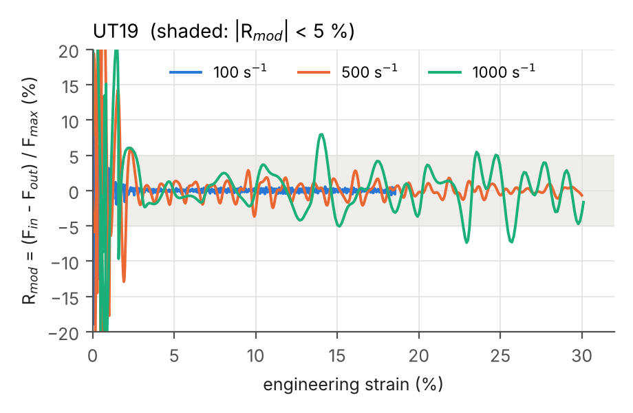
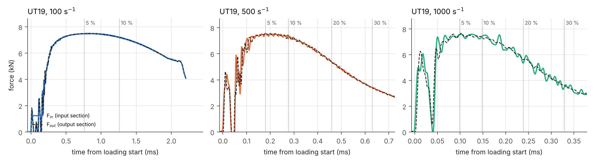

# Task I – Force equilibrium and loading speeds in the SHPB with load inversion device

*Study `taskI_20261013-1554` – specimens: UT19. Generated by `scripts/post/report_taskI.py`: every number in this report is computed from the simulation outputs.*

**Contents.** Summary · Model · Definitions and signal processing · Answer 1: force equilibrium · Answer 2: loading speeds for 30 % strain · What the experiment will measure · How far the results are valid · Numerical quality · Limitations · Appendices.

**Questions of Task I.**

1. Can quasi-static force equilibrium be achieved in the specimen at nominal strain rates of 100, 500 and 1000 s⁻¹?
2. Which loading speeds are required to reach an engineering strain of 30 %?

## Summary

**Table 1 – Answers at a glance.**

| Specimen / target rate (s⁻¹) | Equilibrium, $R$ | Equilibrium, $R_{mod}$ | Striker velocity | Achieved rate | 30 % strain | Gauge error |
|---|---|---|---|---|---|---|
| UT19 / 100 | yes, from 0.9 % | yes, from 0.4 % | 2.48 m/s | 105 s⁻¹ | no (18.5 % max) | 3 % |
| UT19 / 500 | yes, from 2.5 % | yes, from 2.5 % | 7.69 m/s | 546 s⁻¹ | in 0.63 ms | 15 % |
| UT19 / 1000 | partial, 2.7 % to 13.7 % | yes, from 25.9 % | 14.20 m/s | 1073 s⁻¹ | in 0.33 ms | 39 % |

*Equilibrium*: from which strain the force difference between the two ends of the specimen stays below 5 %, relative to the current mean force ($R$) or to the maximum force ($R_{mod}$). *Gauge error*: largest difference between the force read on the output bar gauge and the true specimen force after 5 % strain, relative to the maximum force.

**Key messages.**

- **Equilibrium** is maintained until the end for UT19 / 100, UT19 / 500; only partly reached for UT19 / 1000 (2.7 % to 13.7 %). The largest differences occur late in the test, when the force decreases (necking).
- **Loading speed.** The striker velocity must account for the specimen force (formula in *Answer 2*). With the 5 m striker, 30 % strain cannot be reached below about 142 s⁻¹.
- **Measurement.** The force read on the output bar gauge follows the true specimen force within 39 % of the maximum force.
- **Validity limit (no fracture model).** DP1000 breaks at about 11 % engineering strain in a quasi-static test on the 40 × 10 mm UT specimen (Beerli et al. 2026). The model cannot fracture. Results beyond fracture are not representative of a test, and 30 % strain may not be reachable with DP1000.

**Open questions for the supervisors.**

- Specimen material: DP1000 (assumed here)? With DP1000, is 30 % engineering strain a meaningful target?
- Maximum striker velocity of the launcher (needed: up to 14.2 m/s).
- Reference position of the 400 mm output gauge distance; densities of the bars and striker; material of the inverter.
- In the lab, is the specimen in contact with both pockets without pre-load, as modelled?

## Model

- **Bench**: Ø20 mm steel striker (5 m), maraging input bar (6.01 m), load inversion device, specimen, maraging output bar (≈ 6 m); virtual strain gauges 400 mm from the bar ends (Beerli et al. 2026).
- **Symmetry**: half model, cut by the vertical plane through the bar axes.
- **Mesh**: bars: swept C3D8R (5 mm axially, 2 mm in the section); clamping heads: C3D10M tetrahedra (2 mm); specimen: C3D8R, 0.5 mm in plane, 4 elements through the 1.5 mm thickness.
- **Solver**: Abaqus/Explicit, double precision, **no mass scaling** (inertia is the studied effect).
- **Bars**: linear elastic, $E = \rho c^2$ with the measured wave speeds (4871 m/s bars, 4720 m/s striker) and assumed densities (8000 and 7850 kg/m³).
- **Specimen**: DP1000, von Mises, isotropic Swift–Voce hardening (below), **rate independent**.
- **Contacts**: bar ends: hard, frictionless; specimen teeth in the pockets: hard, friction 0.2. The specimen is centred in the pockets, with a clearance of 0.36 mm on each side (placement used until 21 Oct 2026).
- **Guides**: vertical displacement blocked on the sliding face of the inverter and on the bar axes (without them the inverter pitches under the eccentric load).
- **Loading**: initial velocity of the striker (Table 5).

**Specimen material.** The flow stress $k$ (true stress) is a function of the equivalent plastic strain $\varepsilon_p$, as identified by Beerli et al. (2026, eq. 10 and table 4) on quasi-static tensile tests:

$$
k(\varepsilon_p) = \alpha_{SV}\,A\,(\varepsilon_p+\varepsilon_0)^{n} + (1-\alpha_{SV})\left[k_0 + Q\left(1-e^{-\beta\varepsilon_p}\right)\right]
$$

with $A$ = 1395 MPa, $\varepsilon_0$ = 10⁻⁶, $n$ = 0.0892 (Swift power law), $k_0$ = 739 MPa, $Q$ = 301 MPa, $\beta$ = 102 (Voce exponential law) and $\alpha_{SV}$ = 0.5; $E$ = 195 GPa, $\nu$ = 0.33. The strain-rate and temperature factor of the full model of Beerli et al. is not used, as in their own simulation of the bench: the three strain rates have exactly the same material law. The Considère criterion $dk/d\varepsilon_p = k$ predicts necking at 5.1 % engineering strain and 1002 MPa, which the simulations reproduce (maximum engineering stress ≈ 1000 MPa at about 5–6 % strain). Details: `docs/materials.md`.

## Definitions and signal processing

**Filter.** Forces and strain are low-pass filtered (4th-order Butterworth, 100 kHz cut-off, zero phase), the cut-off used for the output bar gauge signal in the laboratory. The simulation writes one point per microsecond and contains vibrations of a few microseconds that the experiment cannot resolve. The effect of the filter is shown in Table 4.

**Forces.** $F_{in}$ and $F_{out}$ are the exact axial forces in two cross-sections at both ends of the parallel section of the specimen ($F_{in}$ on the inverter side, $F_{out}$ on the output bar side). They answer the equilibrium question. The experiment only has the strain gauge of the output bar:

$$
F_{gauge}(t) = A_{bar}\,E_{bar}\,\varepsilon_{gauge}\!\left(t + \Delta t\right), \qquad \Delta t = \frac{400\ \text{mm}}{4871\ \text{m/s}} = 82\ \mu\text{s}
$$

i.e. the gauge signal shifted by the travel time of the wave from the specimen to the gauge (no dispersion correction). It is only used in the section *What the experiment will measure*.

**Strain.** Engineering strain of a virtual extensometer on the parallel section (12 mm for the UT19), equivalent to the DIC extensometer.

**Equilibrium: two indicators.** The same force difference is divided either by the current mean force ($R$, the usual definition) or by the maximum force of the test ($R_{mod}$):

$$
R = \frac{F_{in} - F_{out}}{F_{mean}}, \quad F_{mean} = \frac{F_{in} + F_{out}}{2}\qquad\qquad R_{mod} = \frac{F_{in} - F_{out}}{F_{max}}, \quad F_{max} = \max(F_{in})
$$

The specimen is considered in equilibrium when $\lvert R\rvert$ < 5 %. The *equilibrium strain* is the strain from which $\lvert R\rvert$ stays below this limit until 30 % strain (or until the end of loading). The *loading start* is the first instant where $F_{in}$ exceeds 2 % of its maximum.

$R$ divides the force difference by the current mean force: at the start of loading and late in the test (necking) this force is small, so $R$ becomes large for small differences, and it is not evaluated at all below 0.2 % strain. $R_{mod}$ uses the same difference but always divides by the same value, the maximum force of the test: it is defined over the **whole test** and measures the force difference on a fixed scale (5 % of $F_{max}$: ≈ 0.38 kN for the UT19). Used for complementary stability analyses.

**Sudden localisation.** First drop of the mean specimen force (unfiltered) by more than 20 % of the maximum force within 10 µs, after the force maximum: the signature of a few elements collapsing in the neck (section *How far are the results valid?*).

**Achieved strain rate.** The strain rate varies during the test (Figure 4). To give one value per simulation, it is measured on the part of the test where the loading is established: the strain gained between two instants divided by the time between them,

$$
\dot\varepsilon = \frac{\varepsilon_2 - \varepsilon_1}{t_2 - t_1}, \qquad \varepsilon_1 = 5\ \%, \qquad \varepsilon_2 = 0.8\,\varepsilon_{max}
$$

where $t_1$ and $t_2$ are the instants at which the extensometer reaches $\varepsilon_1$ and $\varepsilon_2$, and $\varepsilon_{max}$ is the maximum strain of the test (30 %, or less if the loading pulse ends before).

- $\varepsilon_1$ = 5 %: before, the loading is not established (rise of the incident pulse, specimen shoulders settling in the pockets, force rising to its maximum, reached at about 5 % strain).
- $\varepsilon_2$ = 80 % of the maximum strain: the end of the test is excluded, where the strain rate drops when the pulse ends. This gives 24 % when 30 % is reached, and less otherwise (Table 6).

Example (UT19 at 500 s⁻¹): the strain reaches 5 % at $t_1$ = 1.523 ms and 24.0 % at $t_2$ = 1.872 ms, so $\dot\varepsilon$ = (0.240 − 0.05) / (0.349 × 10⁻³ s) ≈ 546 s⁻¹. The full history is shown in Figure 4 and other definitions in Table 6.

## Answer 1 – Force equilibrium

> **Figure 1 – Force equilibrium in the specimen.**
>
> *Plotted* – the equilibrium ratio $R$ (vertical axis) against the engineering strain (horizontal axis), one curve per target rate.
>
> *Source* – exact forces $F_{in}$ and $F_{out}$ in the two cross-sections of the simulated specimen, filtered at 100 kHz (not a strain gauge); strain of the virtual extensometer.
>
> *How to read it* – inside the shaded band ($\lvert R\rvert$ < 5 %) both ends of the specimen carry the same force: the specimen is in equilibrium. The large values below about 2 % strain come from the start of loading (specimen shoulders settling in the pockets) and are cut at ±20 %.

> **Figure 2 (UT19) – Onset of equilibrium.**
>
> *Plotted* – the exact forces $F_{in}$ (coloured solid line) and $F_{out}$ (black dashed line) against the time from the loading start, one panel per target rate, until shortly after equilibrium is reached (and at least 5 % strain). Dotted vertical lines: instants at which the strain reaches 1, 2 and 5 %; coloured vertical line: instant from which $\lvert R\rvert$ < 5 % (for a partial equilibrium: start of the longest interval); no line when equilibrium holds from the first point checked. Grey band: start of loading where $R$ is not evaluated (strain below 0.2 % or mean force below 10 % of its maximum: the ratio of two near-zero forces is meaningless).
>
> *Source* – same filtered forces as Figure 1.
>
> *How to read it* – before equilibrium the two forces differ (the first pulse is the specimen shoulders settling in the pockets); from the coloured line onwards they overlap.

**Table 2 – Equilibrium indicators.**

| Specimen / target rate (s⁻¹) | Equilibrium from | Max $\lvert R\rvert$ after 5 % | Max $\lvert\Delta F\rvert$ after 5 % | Max force |
|---|---|---|---|---|
| UT19 / 100 | 0.9 % (0.29 ms) | 0.9 % | 0.05 kN | 7.50 kN at 5.8 % |
| UT19 / 500 | 2.5 % (0.12 ms) | 3.8 % | 0.28 kN | 7.56 kN at 5.0 % |
| UT19 / 1000 | 2.7 % to 13.7 % only | 13.2 % | 0.60 kN | 7.58 kN at 7.6 % |

*Equilibrium from*: strain (and time after the loading start) from which $\lvert R\rvert$ < 5 % holds until the end of loading; 0.2 % is the lowest strain considered, so this value means "from the start". $\Delta F = F_{in} - F_{out}$.

- **UT19 at 100 s⁻¹** (striker 2.48 m/s): equilibrium is established at 0.9 % strain, 0.29 ms after the loading start, and holds until the end of the loading (max $\lvert R\rvert$ after 5 % strain: 0.9 %).
- **UT19 at 500 s⁻¹** (striker 7.69 m/s): equilibrium is established at 2.5 % strain, 0.12 ms after the loading start, and holds until the end of the loading (max $\lvert R\rvert$ after 5 % strain: 3.8 %).
- **UT19 at 1000 s⁻¹** (striker 14.20 m/s): equilibrium is **only partly reached**: $\lvert R\rvert$ < 5 % from 2.7 % to 13.7 % strain, but it reaches 13.2 % at other instants after 5 % strain ($\lvert F_{in} - F_{out}\rvert$ up to 0.60 kN, i.e. 8.0 % of the maximum force).

In all cases the first few tens of microseconds show a short force pulse followed by a drop to zero before continuous loading starts (Figure 2): the inverter and the specimen cross the clearances of the pockets, then the specimen hits the output pocket.

The force is maximum at about 5 to 8 % strain and then decreases (necking). The same force difference therefore gives a larger ratio $R$ late in the test, which is why the absolute difference $\Delta F$ is given as well.

> **Figure 3 – Force equilibrium relative to the maximum force.**
>
> *Plotted* – $R_{mod} = (F_{in} - F_{out}) / F_{max}$ against the engineering strain, over the whole useful window (from the loading start to 30 % strain or to the maximum strain), one curve per target rate; dotted vertical line: sudden localisation in the neck (Table 11), if any.
>
> *Source* – same filtered section forces as Figure 1.
>
> *How to read it* – inside the shaded band the force difference is below 5 % of the maximum force. Compared with Figure 1, the curves are not amplified at the start and at the end of the test, where the force is small.

**Table 3 – Equilibrium with $R_{mod}$.**

| Specimen / target rate (s⁻¹) | $\lvert R_{mod}\rvert$ < 5 % from | Max $\lvert R_{mod}\rvert$ after 5 % | Max $\lvert R_{mod}\rvert$, whole test |
|---|---|---|---|
| UT19 / 100 | 0.4 % (0.21 ms) | 0.6 % | 24.5 % |
| UT19 / 500 | 2.5 % (0.12 ms) | 3.7 % | 43.9 % |
| UT19 / 1000 | 25.9 % (0.29 ms) | 8.0 % | 35.2 % |

*From*: strain (and time after the loading start) from which $\lvert R_{mod}\rvert$ < 5 % holds until the end of the useful window, the search starting at the loading start. *Whole test*: from the loading start to the end of the window, start of loading included.

**Effect of the filter.** All indicators above use filtered forces. Table 4 shows that the filter does not create the equilibrium: it only removes the vibrations of a few microseconds.

**Table 4 – Effect of the 100 kHz filter** (exact section forces).

| Specimen / target rate (s⁻¹) | Equilibrium from (raw) | Equilibrium from (filtered) | Max $\lvert R\rvert$ (raw) | Max $\lvert R\rvert$ (filtered) |
|---|---|---|---|---|
| UT19 / 100 | 0.9 % | 0.9 % | 1.1 % | 0.9 % |
| UT19 / 500 | 10.0 % | 2.5 % | 5.5 % | 3.8 % |
| UT19 / 1000 | n/a | n/a | 15.5 % | 13.2 % |

*Raw*: forces as written by Abaqus (one point per µs). Max $\lvert R\rvert$ after 5 % strain.

## Answer 2 – Loading speeds for 30 % strain

**Table 5 – Test conditions.**

| Specimen / target rate (s⁻¹) | Striker velocity (m/s) | Achieved rate (s⁻¹) | Time to 30 % strain | Max strain |
|---|---|---|---|---|
| UT19 / 100 | 2.48 | 105 | not reached | 18.5 % |
| UT19 / 500 | 7.69 | 546 | 0.63 ms | 30.0 % |
| UT19 / 1000 | 14.20 | 1073 | 0.33 ms | 30.1 % |

*Striker velocity*: setting of the test. *Achieved rate*: see above. *Time to 30 % strain*: from the loading start. *Max strain*: 30 %, or less if the loading pulse ends before. The complete table, with all indicators, is `T1_conditions.csv`.

> **Figure 4 – Strain rate in the specimen.**
>
> *Plotted* – the strain rate (vertical axis, logarithmic scale) against the engineering strain, one curve per target rate; dotted lines: target rates; dots: force maximum (onset of necking).
>
> *Source* – time derivative of the extensometer strain (filtered at 100 kHz before derivation): a kinematic quantity, equivalent to DIC; not a force, not the output bar gauge.
>
> *How to read it* – the curve should stay close to its target. Being a derivative, it amplifies small vibrations of the specimen (±10 to 30 % around the mean, period 10 to 20 µs at 1000 s⁻¹); on the logarithmic scale the 100 s⁻¹ curve looks noisier than it is. A curve that drops before 30 % strain shows the end of the loading pulse (UT19 / 100: 18.5 %).

**Table 6 – Strain rate with different definitions** (s⁻¹).

| Specimen / target rate (s⁻¹) | Achieved ($\varepsilon_1 \to \varepsilon_2$) | At max force | Nominal | Before max force | After max force |
|---|---|---|---|---|---|
| UT19 / 100 | 105 (5 → 14.8 %) | 100 | 87 | 51 to 120 | 63 to 124 |
| UT19 / 500 | 546 (5 → 24.0 %) | 516 | 475 | -147 to 531 | 481 to 606 |
| UT19 / 1000 | 1073 (5 → 24.1 %) | 1010 | 915 | -114 to 1201 | 880 to 1282 |

*Achieved*: definition above (used in Table 5 and Figure 5). *At max force*: value of Figure 4 at the dot. *Nominal*: final strain divided by the whole loading time, start-up included. *Before / after max force*: range of the Figure 4 curve before and after the dot (10th to 90th percentile).

After the force maximum the strain rate is established close to the target and increases slowly, because the force decreases (necking) and brakes the bench less. Before the force maximum, during the uniform hardening phase, the strain rate is not yet stable at the higher rates (negative values: rebound of the specimen in the pockets).

**How the striker velocity is chosen.** The only setting of a test is the striker velocity $V$. The velocity needed for a target strain rate $\dot\varepsilon$ is estimated with one-dimensional wave theory, in five steps:

| Step | What happens | Equation |
|---|---|---|
| 1 | the striker hits the input bar; the bar material starts moving at the particle velocity $v_i$, smaller than $V$ (impedances $Z = \rho c A$ of striker and bar) | $v_i = K\,V$, $K = Z_{striker}/(Z_{striker}+Z_{bar})$ = 0.487 |
| 2 | at the end of the input bar the wave reflects: the pusher moves about twice as fast | $\approx 2\,v_i$ |
| 3 | the specimen pulls back with its force $F$: it brakes the pusher and pulls the output bar towards it; both reduce the elongation rate | $-\,2F/(\rho c A)$, $\rho c A$ = 12242 N·s/m |
| 4 | elongation rate of the specimen | $v = 2KV - 2F/(\rho c A)$ |
| 5 | the elongation rate is related to the strain rate of the extensometer by an effective length | $v = \dot\varepsilon\,L_{eff}$ |

Solving for $V$:

$$
V = \frac{\dot\varepsilon\,L_{eff} + 2F/(\rho c A)}{2K}
$$

Two quantities of this formula are **not known before the simulation**: $L_{eff}$, the length that effectively elongates as seen by the extensometer (not exactly the parallel section: fillets and heads also deform a little, and the extensometer is shorter than the parallel section), and $F$, the effective specimen force during the test (it rises to its maximum, then decreases during necking). Both are obtained by **calibration**: they are adjusted so that the formula matches simulations already run, and the adjusted formula is used to choose the velocities of the next simulations. The successive versions are:

**Table 7 – Successive versions of the striker velocity formula.**

| Specimen | Version | $L_{eff}$ / $F$ | How the constants were obtained | Used in study | Achieved rates (target 100 / 500 / 1000 s⁻¹) |
|---|---|---|---|---|---|
| UT19 | first attempt | no force term | striker velocity proportional to the strain rate, $V = \dot\varepsilon \times 15$ mm, without the force term | `taskI_20261013-1127` | 100 s⁻¹ targeted, only 21 s⁻¹ achieved: the specimen force brakes the pusher |
| UT19 | calibrated | 12.7 mm / 7.0 kN | force term added; $L_{eff}$ and $F$ calibrated on a first UT19 simulation at 500 s⁻¹ (485 s⁻¹ achieved, mean specimen force 6.4–6.8 kN) | `taskI_20261013-1554`, `taskI_20261022-1138` | 110 / 546 / 1066 s⁻¹ (in contact) |

**Table 8 – Striker velocities of this report and the formula version they come from.**

| Specimen / target rate (s⁻¹) | Striker velocity | Formula version | Achieved rate | Deviation from target |
|---|---|---|---|---|
| UT19 / 100 | 2.48 m/s | calibrated | 105 s⁻¹ | +5 % |
| UT19 / 500 | 7.69 m/s | calibrated | 546 s⁻¹ | +9 % |
| UT19 / 1000 | 14.20 m/s | calibrated | 1073 s⁻¹ | +7 % |

*Achieved rate*: see *Definitions and signal processing*; same values as in Table 5.

**Why the achieved rate differs from the target.** (1) $L_{eff}$ and $F$ are effective constants: a first estimate can be far off (UT40 first estimate: $F$ = 15 kN, whereas the force of the UT40 drops strongly during necking and the effective value is ≈ 10.4 kN; with $F$ too large the formula over-compensates the braking and the strain rate is too high). (2) The formula assumes a constant force and a constant strain rate, which is not the case: the force rises, then decreases during necking, and its average depends on how far the test goes. Probable consequence: a test that stops early (100 s⁻¹, end of the pulse) keeps a higher mean force than the one used for calibration, is braked more and runs slower than the target. (3) At low rate the braking term is of the same order as the useful term, so a small error on $F$ gives a large error on the rate:

**Table 9 – Sensitivity of the strain rate to the force constant $F$.**

| Specimen | Useful term $\dot\varepsilon L_{eff}$ at 100 s⁻¹ | Braking term $2F/\rho c A$ | Rate change for 1 kN error on $F$ | Same, relative at 100 / 500 / 1000 s⁻¹ |
|---|---|---|---|---|
| UT19 | 1.27 m/s | 1.14 m/s | 12.9 s⁻¹ | 13 % / 3 % / 1 % |

*Rate change for 1 kN*: $\Delta\dot\varepsilon = 2\,\Delta F / (\rho c A\,L_{eff})$ at a given striker velocity, with the current constants.

> **Figure 5 – Striker velocity required for a given strain rate.**
>
> *Plotted* – the striker velocity (vertical axis), i.e. the setting of the test, against the strain rate in the specimen (horizontal axis), one panel per specimen. Line: the formula above. Dots: the simulations, at the imposed striker velocity and the achieved strain rate (Table 5). Shaded: 30 % not reachable.
>
> *Source* – formula of `make_run.py` and simulation results.
>
> *How to read it* – choose a strain rate on the horizontal axis and read the striker velocity on the line; dots on the line confirm the formula.

**Limit for 30 % strain.** The 5 m striker gives a 2.12 ms loading pulse, so 30 % strain requires at least 0.30 / 2.12 ms ≈ 142 s⁻¹; the output bar (5.99 m) also limits the measurement window to 2.33 ms (Beerli et al. 2026). At 100 s⁻¹ (UT19) the strain stops at 18.5 %; 30 % would need about 3.1 ms of loading (0.30 / 105 s⁻¹ + 0.28 ms start-up), i.e. a striker of about 7.4 m: almost the length of the 7.5 m launch tube, and longer than the measurement window.

## What the experiment will measure

In the experiment the force is only known from the output bar gauge. Figure 6 and Figure 7 compare this signal, as it would be recorded, with the exact force in the specimen.

> **Figure 6 (UT19) – Specimen forces and output bar gauge.**
>
> *Plotted* – axial force against the time from the loading start, one panel per target rate. Coloured solid line: $F_{in}$; coloured dashed line: $F_{out}$; black line: force read on the output bar gauge.
>
> *Source* – the gauge force is $A_{bar} E_{bar} \varepsilon_{gauge}$ shifted by 82 µs (wave travel over the 400 mm between specimen and gauge); all signals filtered at 100 kHz.
>
> *How to read it* – overlapping coloured lines mean equilibrium; the distance between the black line and the coloured lines is the measurement error of the gauge.

> **Figure 7 – Engineering stress–strain curves: true and measured.**
>
> *Plotted* – one panel per target rate: engineering stress $F / A_0$ (7.5 mm² for the UT19) against the engineering strain of the extensometer. **Both curves come from the same simulation**; they differ by *where* the force is taken. Thick grey line: the true force in the specimen, summed over a cross-section of the specimen (impossible in a real test). Coloured line: the force read by the virtual strain gauge on the output bar, 400 mm away from the specimen, exactly where the real gauge is: this is the curve the experiment will give.
>
> *Source* – filtered signals; gauge signal shifted by the travel time of the wave as in Figure 6. The error in the panel title is the largest gap after 5 % strain, relative to the maximum force.
>
> *How to read it* – where the coloured line follows the grey one, the gauge measures the specimen correctly; where it oscillates around it, the measurement distorts the true response. The grey curves are identical at the three rates because the simulated material is rate independent. Axis cut at 1600 MPa (spike of the gauge signal below 2 % strain).

**Table 10 – Error of the output bar gauge.**

| Specimen / target rate (s⁻¹) | Max force | Max gauge error after 5 % | Before the sudden localisation | Fastest force drop (in 10 µs) |
|---|---|---|---|---|
| UT19 / 100 | 7.50 kN | 3.1 % | no localisation | 0.1 kN |
| UT19 / 500 | 7.56 kN | 15.0 % | no localisation | 0.3 kN |
| UT19 / 1000 | 7.58 kN | 38.9 % | no localisation | 0.7 kN |

*Gauge error*: largest difference between the gauge force and the true specimen force, relative to the maximum force. *Fastest force drop*: largest decrease of the mean specimen force (unfiltered) within 10 µs after the force maximum.

The force in the specimen is smooth, whereas the gauge signal oscillates around it, with an amplitude that grows with the loading speed. An oscillating measured curve therefore does not mean that the specimen is out of equilibrium. Origin (identified on 22 Oct 2026 with force probes along the output side): the specimen crosses the clearance of the output pocket and hits the output head (force spike of about twice the specimen force), which then rings at about 40 kHz.

## How far are the results valid? Necking, localisation and fracture

**What happens in the specimen.** After the force maximum (at about 5–6 % strain) the specimen necks: the deformation concentrates in a short zone of the parallel section, which thins in width and thickness while the rest of the specimen stops deforming. The force decreases. To reach 30 % strain over the extensometer, the neck alone has to provide almost all the elongation (≈ 3.6 mm over the 12 mm extensometer of the UT19).

**What the model cannot do: fracture.** The specimen material (DP1000, Swift–Voce hardening, von Mises) has **no fracture criterion**. A real sheet breaks in the neck; the simulated one keeps stretching. When the neck becomes very thin, the deformation concentrates in a few elements at its centre, which collapse within a few tens of microseconds (equivalent plastic strain jumping from about 1 to about 9 in the UT40 at 500 s⁻¹, seen in Abaqus/Viewer). At that moment the section suddenly loses its strength: both specimen forces drop within ≈ 10 µs, then the specimen reloads and oscillates. This produces large force differences between the two ends of the specimen and a large gauge error, **but it is a numerical consequence of the missing fracture model, not an effect of the test**.

**When does a real DP1000 specimen break?** Beerli et al. (2026, section 4.1.1, fig. 7a) report an engineering strain to fracture of **11 %** for DP1000 in quasi-static uniaxial tension (0.001 s⁻¹) on the 40 × 10 mm UT specimen, i.e. the UT40 geometry. At high strain rates, the same paper reports that the elongation to fracture of DP1000 does not decrease with the strain rate (section 4.2.1), but gives no value here. For the short specimen (UT19, 15 mm) the engineering strain to fracture is larger, since the neck is a larger part of a shorter gauge length; no value is available.

**Table 11 – Validity of each simulation.**

| Specimen / target rate (s⁻¹) | Max strain | Sudden localisation (force drop) | Max PEEQ at 11 % strain | Max PEEQ at max strain |
|---|---|---|---|---|
| UT19 / 100 | 18.5 % | none | n/a | n/a |
| UT19 / 500 | 30.0 % | none | n/a | n/a |
| UT19 / 1000 | 30.1 % | none | n/a | n/a |

*Sudden localisation*: first drop of the mean specimen force (unfiltered) by more than 20 % of the maximum force within 10 µs, after the force maximum. *Max PEEQ*: largest equivalent plastic strain in the specimen (Abaqus field output, one value every ≈ 20 µs; "n/a" if not extracted yet).

**Consequences for Task I.**

- The equilibrium and gauge-error indicators are meaningful only before fracture. After a sudden localisation they describe a numerical artefact.
- For DP1000 the question "which loading speed reaches 30 % strain?" has to be put together with fracture: with a quasi-static elongation to fracture of 11 %, 30 % engineering strain is very likely not reachable with the UT40, whatever the loading speed.
- To be decided with the supervisors: the material of the Task I specimens (DP1000 assumed here), and the fracture strain (or the Hosford–Coulomb fracture model of Beerli et al. 2026) to use to cut the results.

## Numerical quality

These checks do not answer the Task I questions: they verify that the simulation can be trusted. Each column compares the simulation with a value known in advance, or measures a purely numerical error.

**Table 12 – Numerical checks.**

| Specimen / target rate (s⁻¹) | Incident strain / theory | Kinetic energy / ½mV² | Energy drift | Hourglass / internal energy |
|---|---|---|---|---|
| UT19 / 100 | 1.000 | 0.994 | 0.00 % | 0.4 % |
| UT19 / 500 | 1.000 | 0.994 | 0.00 % | 0.5 % |
| UT19 / 1000 | 1.000 | 0.994 | 0.00 % | 0.2 % |

- **Incident strain / theory** – is the loading right? When the striker hits the input bar, one-dimensional wave theory gives the strain of the incident wave: $\varepsilon_{inc} = K\,V_{striker}/c$, with $c$ = 4871 m/s the wave speed in the bar and $K$ = 0.487 the share of the striker velocity transmitted to the bar ($K = Z_{striker}/(Z_{striker}+Z_{bar})$, $Z = \rho c A$). Example (UT19 at 100 s⁻¹): 0.487 × 2.48 / 4871 = $2.48 \times 10^{-4}$ (a compression: negative in `T1_conditions.csv`). The simulated value is the plateau of the virtual gauge on the input bar. A ratio of 1.000 means that the impact, the bar materials and the gauge reading are correct.

- **Kinetic energy / ½mV²** – is the striker mass right? At $t$ = 0 only the striker moves; its kinetic energy is compared with $\tfrac12 m V^2$ for the nominal striker (Ø20 × 5000 mm, 7850 kg/m³, $m$ = 12.3 kg). The ratio (0.994) is slightly below 1 because the mesh replaces the circular cross-section by a polygon with a slightly smaller area: the meshed striker is a little lighter. This does not change the incident wave, which depends on the striker velocity, not on its mass.

- **Energy drift** – does the calculation create or lose energy? Without losses the total energy must stay constant. Abaqus keeps an energy balance (kinetic + internal + friction − external work, `ETOTAL`); the column gives its largest variation during the whole run, relative to the initial kinetic energy (0.00 % to 0.00 % here). Below about 1 %, contacts, ties and time integration are considered free of artificial energy.

- **Hourglass / internal energy** – does the mesh deform in a non-physical way? The hexahedra (C3D8R) are evaluated at a single point at their centre: fast, but some zigzag ("hourglass") deformations are not seen by that point and would meet no resistance. Abaqus adds a small artificial stiffness against them; the energy absorbed by it (`ALLAE`) is not physical. The column gives it at the end of the run relative to the real deformation energy (`ALLIE`): 0.2 % to 0.5 % here, well below the usual 5 % limit.

## Limitations

- Rate-independent specimen material: in the experiments the force, and hence the required striker velocity (term $2F/\rho c A$), will increase with the strain rate.
- The striker velocity formula relies on $L_{eff}$ calibrated on one simulation and on a constant force $F$.
- The gauge signal is shifted, not corrected for dispersion; the reference of the 400 mm gauge distance is to be confirmed (about 6 µs uncertainty).
- Specimen centred in the pockets with clearances: the impact in the output pocket makes the gauge oscillate; the lab closes these clearances before a test (later studies).
- Assumed values: densities of the bars and of the striker, material of the inverter (maraging).
- No fracture model for the specimen: results after fracture (DP1000: ≈ 11 % engineering strain in a quasi-static test on the UT40 geometry) are not representative (section *How far are the results valid?*).
- The long-gauge specimen (UT40) is not simulated yet (geometry not available).

## Appendix A – Specimen forces over the whole test

$F_{in}$ and $F_{out}$ (exact section forces, filtered at 100 kHz) from the loading start to the end of the useful window (+ 15 %), one panel per target rate. Dotted lines: 5, 10, 20 and 30 % strain; red line: sudden localisation in the neck (Table 11), if any. Equilibrium means that the two curves overlap.

> **Figure A (UT19) – Input and output specimen forces over the whole test.**

## Appendix B – Control figures

One figure per simulation, unfiltered signals over the whole simulated time: bar gauges, specimen forces and gauge force (not shifted), $R$ and extensometer strain. Shaded: from the loading start to 30 % strain.

> **Control figure – UT19 at 100 s⁻¹.**

> **Control figure – UT19 at 500 s⁻¹.**

> **Control figure – UT19 at 1000 s⁻¹.**
