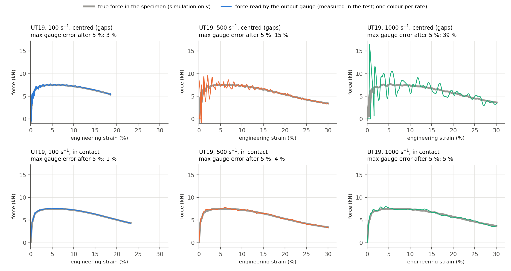
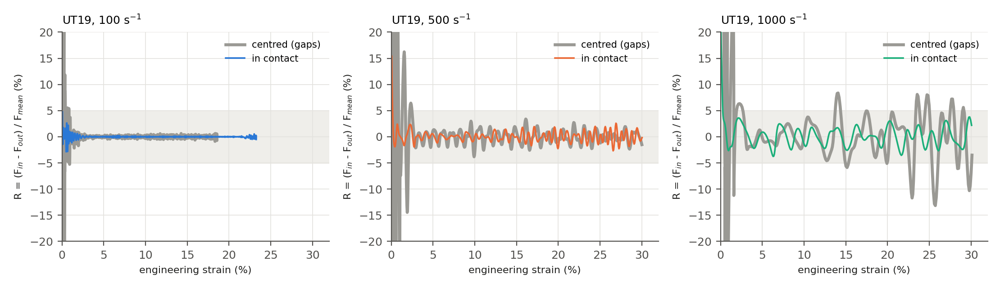
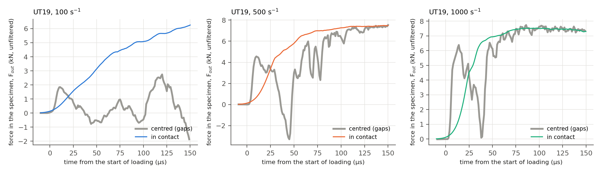

# Comparison: taskI_20261013-1554 vs taskI_20261022-1138

- **centred (gaps)**: study `taskI_20261013-1554`
- **in contact**: study `taskI_20261022-1138`

Runs are paired by specimen and target strain rate. Both are processed exactly like the Task I report (100 kHz low-pass filter, output gauge shifted by 82 µs, equilibrium criterion |R| < 5 %; see `docs/results.md`).

## UT19 at 100 s⁻¹

| Indicator | centred (gaps) | in contact |
|---|---|---|
| equilibrium from strain | 0.9 % | 0.2 % |
| max \|R\| after 5 % strain | 0.9 % | 0.5 % |
| max \|ΔF\| after 5 % strain | 0.05 kN | 0.02 kN |
| max gauge error after 5 % strain | 3.1 % | 1.5 % |
| achieved strain rate | 105 s⁻¹ | 110 s⁻¹ |
| max force | 7.50 kN | 7.49 kN |
| time to 30 % strain | – | – |
| max strain | 18.5 % | 23.3 % |

## UT19 at 500 s⁻¹

| Indicator | centred (gaps) | in contact |
|---|---|---|
| equilibrium from strain | 2.5 % | 0.2 % |
| max \|R\| after 5 % strain | 3.8 % | 2.7 % |
| max \|ΔF\| after 5 % strain | 0.28 kN | 0.12 kN |
| max gauge error after 5 % strain | 15.0 % | 3.9 % |
| achieved strain rate | 546 s⁻¹ | 546 s⁻¹ |
| max force | 7.56 kN | 7.54 kN |
| time to 30 % strain | 0.631 ms | 0.603 ms |
| max strain | 30.0 % | 30.0 % |

## UT19 at 1000 s⁻¹

| Indicator | centred (gaps) | in contact |
|---|---|---|
| equilibrium from strain | – | 0.3 % |
| max \|R\| after 5 % strain | 13.2 % | 3.8 % |
| max \|ΔF\| after 5 % strain | 0.60 kN | 0.28 kN |
| max gauge error after 5 % strain | 38.9 % | 4.8 % |
| achieved strain rate | 1073 s⁻¹ | 1066 s⁻¹ |
| max force | 7.58 kN | 7.64 kN |
| time to 30 % strain | 0.329 ms | 0.324 ms |
| max strain | 30.1 % | 30.1 % |

## Figures

*C1 – Force against strain. Grey thick line: true force in the specimen (cross-section of the gauge section, available only in the simulation). Coloured line: force read on the output-bar gauge, i.e. what the test measures. Top row: centred (gaps); bottom row: in contact. The closer the two lines, the more reliable the measured curve.*

*C2 – Force equilibrium of the specimen: R = (F_in − F_out) / F_mean against strain. Shaded band: |R| < 5 %. Grey thick line: centred (gaps); coloured line: in contact.*

*C3 – First 150 µs of loading, unfiltered: force in the specimen at the output side. Grey thick line: centred (gaps); coloured line: in contact. Time 0 = the input-side force F_in reaches 2 % of its maximum, in each run.*
