# Task I – Force equilibrium and loading speeds in the SHPB with load inversion device: final report

*Specimens UT19 (15 mm parallel section) and UT40 (40 mm parallel section), DP1000, target strain rates 100, 500 and 1000 s⁻¹. Reference studies: `taskI_20261022-1138` (UT19) and `taskI_20261023-1518` (UT40). Generated by `scripts/post/report_taskI_final.py`: every number in this report is computed from the simulation outputs, except the observations made in Abaqus/Viewer and Abaqus/CAE, which are marked as such and come from the lab journal.*

**Questions of Task I.**

1. Can quasi-static force equilibrium be achieved in the specimen at nominal strain rates of 100, 500 and 1000 s⁻¹?
2. Which loading speeds are required to reach an engineering strain of 30 %?

**Contents.** Summary · Background: the bench and the questions · Numerical model · Definitions and signal processing · Simulation campaign · Answer 1: force equilibrium · Answer 2: loading speeds · UT19 and UT40 compared · What the experiment will measure · Necking, localisation and fracture: how far the results are valid · Numerical quality and computing cost · Limitations · Conclusions and recommendations · Appendices A and B.

## Summary

The two questions were answered with an Abaqus/Explicit model of the complete bench (striker, input bar, load inversion device, specimen, output bar), for the two specimen geometries and the three target rates: six reference simulations. The tables below give the answer for each case; the sections that follow give the evidence.

**Table 1 – Answer 1 at a glance: force equilibrium.**

| Specimen / target rate (s⁻¹) | Equilibrium, $R$ | Equilibrium, $R_{mod}$ | Max $\lvert\Delta F\rvert$ after 5 % |
|---|---|---|---|
| UT19 / 100 | yes, from 0.2 % | yes, from the loading start | 0.02 kN (0.3 % of $F_{max}$) |
| UT19 / 500 | yes, from 0.2 % | yes, from the loading start | 0.12 kN (1.6 % of $F_{max}$) |
| UT19 / 1000 | yes, from 0.3 % | yes, from the loading start | 0.28 kN (3.6 % of $F_{max}$) |
| UT40 / 100 | yes, from 0.5 % | yes, from 0.5 % | 0.22 kN (1.5 % of $F_{max}$) |
| UT40 / 500 | partial, 2.4 % to 10.5 % | no (max 31 %) | 4.74 kN (31.2 % of $F_{max}$) |
| UT40 / 1000 | partial, 5.4 % to 8.9 % | no (max 16 %) | 2.51 kN (16.0 % of $F_{max}$) |

*Equilibrium*: from which engineering strain the force difference between the two ends of the parallel section stays below 5 % until the end of the test, relative to the current mean force ($R$) or to the maximum force ($R_{mod}$); "partial": longest interval where it holds. $\Delta F = F_{in} - F_{out}$.

**Table 2 – Answer 2 at a glance: loading speed and 30 % strain.**

| Specimen / target rate (s⁻¹) | Striker velocity | Achieved rate | 30 % strain | Gauge error |
|---|---|---|---|---|
| UT19 / 100 | 2.48 m/s | 110 s⁻¹ | no (max 23.3 %) | 1.5 % |
| UT19 / 500 | 7.69 m/s | 546 s⁻¹ | in 0.60 ms | 3.9 % |
| UT19 / 1000 | 14.20 m/s | 1066 s⁻¹ | in 0.32 ms | 4.8 % |
| UT40 / 100 | 4.83 m/s | 82 s⁻¹ | no (max 16.9 %) | 1.5 % |
| UT40 / 500 | 17.18 m/s | 498 s⁻¹ | in 0.67 ms | 22.0 % (3.7 % before localisation) |
| UT40 / 1000 | 32.62 m/s | 940 s⁻¹ | in 0.36 ms | 5.8 % |

*Striker velocity*: the setting of the test (5 m striker). *Achieved rate*: mean strain rate of the extensometer between 5 % and 80 % of the maximum strain. *Gauge error*: largest difference between the force that the output bar gauge will measure and the true specimen force, after 5 % strain, relative to the maximum force.

**Key findings.**

1. **UT19: equilibrium at every rate.** With the specimen in contact with both pockets, as in the lab, $\lvert R\rvert$ stays below 5 % from the very start of loading to 30 % strain (or to the end of the pulse at 100 s⁻¹); the largest force difference after 5 % strain is 0.28 kN at 1000 s⁻¹ (3.6 % of the maximum force).
2. **UT40: equilibrium only at 100 s⁻¹.** At 500 and 1000 s⁻¹ the two ends of the longer parallel section carry the same force only between about 2.4 % and 10.5 % strain (500 s⁻¹) and 5.4 % and 8.9 % (1000 s⁻¹). Likely reason: the 40 mm parallel section is too long for the plastic waves to even out the force before the maximum force is reached (interpretation, section *UT19 and UT40 compared*).
3. **Loading speed.** The striker velocity must include the force of the specimen, which brakes the inverter and pushes the output bar: $V = (\dot\varepsilon\,L_{eff} + 2F/\rho c A)/(2K)$. With the calibrated constants the achieved rates are within 10 % of the targets (UT19) and within 18 % (UT40). 30 % strain is reached at 500 and 1000 s⁻¹ with both specimens; it cannot be reached below ≈ 142 s⁻¹ with the 5 m striker, so not at 100 s⁻¹.
4. **Measurement.** Once the specimen sits against both pockets at the start, the output bar gauge measures the specimen force within 6 % of the maximum force, except after a sudden localisation of the neck. With the specimen centred in the pockets (clearances of 0.36 mm) the error was up to 39 % at 1000 s⁻¹: the initial contact is essential.
5. **Validity limit.** The model has no fracture criterion. DP1000 breaks at about 11 % engineering strain on the UT40 geometry in a quasi-static test (Beerli et al. 2026). The UT40 simulations reach 30 % only because the simulated material cannot break; at 500 s⁻¹ the neck finally collapses numerically at 18.2 % strain. For DP1000, 30 % engineering strain is very probably not reachable with the UT40.

## Background: the bench and the questions

**The bench.** The split Hopkinson pressure bar (SHPB) of the lab is used here in tension through a load inversion device (LID; Beerli et al. 2026). The striker hits the input bar and creates a compression wave. At the end of the input bar this wave pushes the *pusher* (inverter), whose head holds one end of the specimen in a toothed pocket; the other end of the specimen sits in the toothed pocket of the head of the output bar, which lies above the pusher and points the other way. Pushing the pusher therefore **pulls** the specimen. The force transmitted by the specimen travels into the output bar and is measured by a strain gauge 400 mm from the bar end; the strain of the specimen is measured optically (DIC), here by a virtual extensometer.

**Why equilibrium matters.** The stress–strain curve of a test is computed from the force measured on the output side only. It represents the material only if the force is the same at both ends of the parallel section (quasi-static force equilibrium); otherwise the specimen is not uniformly loaded and the measured curve depends on the inertia of the specimen. Equilibrium requires the stress waves to travel back and forth several times along the specimen before the stress changes much, which becomes harder at higher strain rates and for longer specimens.

**Why the loading speed matters.** The strain rate in the specimen is set by the striker velocity, but not proportionally: the specimen force brakes the pusher. The strain the test can reach is limited by the duration of the loading pulse (twice the travel time of the wave in the striker: 2.12 ms for the 5 m striker) and by the length of the output bar (measurement window ≈ 2.33 ms before the reflected wave comes back to the gauge; Beerli et al. 2026).

**Interpretation of the questions.** "Loading speed" is interpreted as the **striker velocity**, the only setting of the test; the velocity of the pusher follows from it and can be extracted from the same simulations. "Quasi-static force equilibrium" is judged on the exact forces at both ends of the parallel section, with the 5 % criterion usual in Hopkinson bar testing (definitions below). "30 %" is the engineering strain over the extensometer.

## Numerical model

### Bench, mesh and solver

**Table 3 – Parts of the model.**

| Part | Geometry | Material | Mesh |
|---|---|---|---|
| Striker | cylinder Ø20 × 5000 mm (created by the script) | steel, elastic | swept C3D8R, 5 mm axially, 2 mm in the section |
| Input bar | cylinder Ø20 × 6010 mm | maraging, elastic | swept C3D8R, 5 / 2 mm |
| Pusher (inverter) | lab CAD file `Inverter_new.step`; rod + toothed head | maraging, elastic | rod: swept C3D8R; head: C3D10M tetrahedra, 2 mm |
| Specimen | see Table 4 | DP1000, elastic–plastic | C3D8R, 0.5 mm in plane, 4 elements through the 1.5 mm thickness; regular grid in the parallel section |
| Output bar | cylinder Ø20, ≈ 6 m, + toothed head (`Stange30mm_Step2.step`) | maraging, elastic | bar: swept C3D8R, 5 / 2 mm; head: C3D10M, 2 mm |

Element sizes as in Roth et al. (2015) and Beerli et al. (2026). Heads and bars are joined by ties; details in `docs/mesh.md`.

- **Solver**: Abaqus/Explicit 2023, double precision, **no mass scaling** (inertia is the studied effect); Euler cluster (ETH), 8 cores per simulation.
- **Half model**: only the half X ≥ 0 is modelled (vertical plane of symmetry through the bar axes). Every piece has the symmetry condition `XSYMM` (U1 = 0 on its nodes of the plane X = 0; `model/templates/SHPB_UT_main.inp`, section 6a); forces and energies of the half model are multiplied by 2 when they are extracted.
- **Guides**: the vertical displacement U3 is blocked on the sliding face of the pusher and on the bar axes. Without them the pusher pitched under the eccentric load (the input bar pushes on its axis, the specimen pulls 21 mm higher; first study `taskI_20261012-1811`). Guides are frictionless and without clearance.
- **Contacts**: bar ends hard and frictionless; specimen teeth in the pockets hard with a friction coefficient of 0.2 (general contact).
- **Loading**: initial velocity of the striker, in contact with the input bar at $t = 0$.
- **Simulated time**: arrival of the wave at the pusher (1.234 ms) + time to 30 % strain at the target rate + 0.3 ms, capped at the end of the pulse: 3.65 / 2.13 / 1.83 ms at 100 / 500 / 1000 s⁻¹.

### Specimens and placement in the pockets

**Table 4 – Specimen geometries.**

|  | UT19 | UT40 |
|---|---|---|
| Geometry file | STEP file of the lab (`cad/step/XMas_UT_t1p5.step`) | cutting drawing `cad/dxf/Xmas_UT40.dxf`, extruded to 1.5 mm (`scripts/pre/dxf_to_step.py`) |
| Overall length × width × thickness (mm) | 77.688 × 30 × 1.5 | 103.181 × 30 × 1.5 |
| Parallel section, length × width (mm) | 15.0 × 5.0 | 40.077 × (10.020 → 10.001) |
| Initial section $A_0$ | 7.5 mm² | 15.0 mm² |
| Extensometer length $L_0$ | 12.000 mm | 30.058 mm |
| Elements: specimen / parallel section | 12 360 / 600 (30 × 5 × 4) | 15 324 / 3 200 (80 × 10 × 4) |
| Elements, whole model | 213 977 | 216 951 |

Both specimens have the same toothed heads (three teeth on each side). On the UT40 drawing the loaded tooth flanks are 0.10 mm further from the tip and the pusher-side tip is 0.29 mm shorter than on the UT19; its parallel section is very slightly tapered (10.020 mm at the output end, 10.001 mm at the pusher end). The extensometer nodes are the surface nodes on the symmetry plane closest to ±15 mm (UT40) or ±6 mm (UT19) from the middle of the parallel section.

> **Figure 1 – UT19 and UT40 in their final placement.**
>
> *Shown* – outline of the UT19 (grey) and of the UT40 (orange) in the bench, pusher side at the top. The pusher-side heads coincide; the UT40 is 25 mm longer, so its output-side head, and with it the whole output bar, is placed 25 mm further down.
>
> *Source* – geometry files, placement of `build_bench.py`; lab journal, 23 Oct 2026.

**Initial contact.** In the lab, the pusher is pulled very slightly before the shot so that the teeth of the specimen sit against the teeth of both pockets, without pre-load (confirmed by the supervisors on 22 Oct 2026). The model reproduces this: the clearances between the specimen teeth and the pockets were measured on the CAD files (OpenCascade, `scripts/pre/pocket_gaps.py`) and closed by translating the specimen and the output bar along the bar axis (`build_bench.py`, `CLOSE_GAPS = True`).

**Table 5 – Clearances closed at the start.**

| Specimen | Pusher pocket | Output pocket | Clearance left behind the teeth | Output bar end (Y) |
|---|---|---|---|---|
| UT19 | 0.3567 mm | 0.3563 mm | 0.64 / 0.52 mm | 155.000 mm |
| UT40 | −0.0365 mm | 0.2562 mm | 0.53 / 0.42 mm | 130.000 mm |

*Pusher / output pocket*: translation along the bar axis needed to bring the loaded tooth flanks into contact, starting from the specimen centred in the pockets (negative: the centred UT40 already overlaps the pusher pocket by 0.04 mm and is moved back). *Clearance left behind the teeth*: free space on the unloaded side of the teeth, pusher / output pocket. In both pockets the inclined flanks of the **three** teeth touch at the same time; the overlap volume once in contact is below 0.002 mm³.

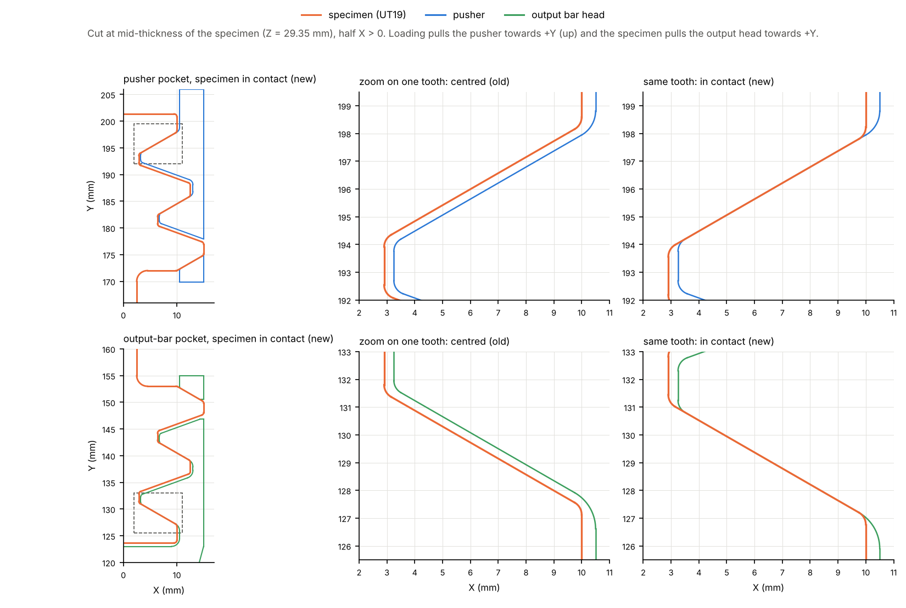

> **Figure 2 – UT19 teeth in the pockets, centred and in contact.**
>
> *Shown* – cut at mid-thickness of the specimen (half X > 0). Left: whole pocket with the final placement. Middle: one tooth with the old centred placement, a 0.36 mm gap between the inclined flanks. Right: the same tooth in the final placement, flanks in contact. Top: pusher; bottom: output bar.
>
> *Source* – CAD files and `pocket_gaps.py` (OpenCascade); lab journal, 22 Oct 2026.

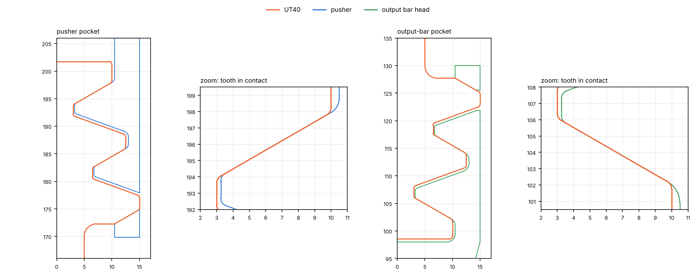

> **Figure 3 – UT40 teeth in contact in both pockets.**
>
> *Shown* – UT40 in its final placement, cut at mid-thickness. Left: pusher pocket and zoom on one tooth; right: output pocket and zoom. The loaded flanks touch; the other flanks keep a clearance of 0.4–0.5 mm.
>
> *Source* – `pocket_gaps.py`; lab journal, 23 Oct 2026.

### Materials

**Table 6 – Elastic parts.**

| Material | Wave speed $c$ | Density $\rho$ | $E = \rho c^2$ | Used for |
|---|---|---|---|---|
| Maraging steel | 4871 m/s (measured) | 8000 kg/m³ (assumed) | 189.8 GPa | bars, pusher |
| Striker steel | 4720 m/s (measured) | 7850 kg/m³ (assumed) | 174.9 GPa | striker |

Wave speeds measured on the bench (Beerli et al. 2026, section 2.5); Poisson ratio 0.3. What matters for the waves is $c$ and the impedance $Z = \rho c A$: an error on the assumed density changes $Z$ in the same proportion.

**Specimen: DP1000.** Von Mises yield surface, isotropic hardening, rate independent. The flow stress $k$ (true stress) is a function of the equivalent plastic strain $\varepsilon_p$, as identified by Beerli et al. (2026, eq. 10 and table 4) on quasi-static tensile tests:

$$
k(\varepsilon_p) = \alpha_{SV}\,A\,(\varepsilon_p+\varepsilon_0)^{n} + (1-\alpha_{SV})\left[k_0 + Q\left(1-e^{-\beta\varepsilon_p}\right)\right]
$$

with $A$ = 1395 MPa, $\varepsilon_0$ = 10⁻⁶, $n$ = 0.0892 (Swift power law), $k_0$ = 739 MPa, $Q$ = 301 MPa, $\beta$ = 102 (Voce exponential law) and $\alpha_{SV}$ = 0.5; $E$ = 195 GPa, $\nu$ = 0.33, $\rho$ = 7850 kg/m³. Not used from the paper: the anisotropic yield surface, the strain-rate and temperature dependence, the thermal properties and the fracture model, as in the authors' own simulation of the bench. The three strain rates therefore have exactly the same material law. The Considère criterion $dk/d\varepsilon_p = k$ predicts necking at 5.1 % engineering strain and 1002 MPa (`docs/materials.md`).

### Outputs

- **Specimen forces** $F_{in}$, $F_{out}$: exact axial forces through two cross-sections at both ends of the parallel section (pusher side, output side). They are only available in a simulation.
- **Virtual extensometer**: displacement of two surface nodes of the parallel section (equivalent to the DIC extensometer of the tests).
- **Virtual strain gauges** 400 mm from the end of each bar, read as in the lab: mean of a gauge on top and one at the bottom of the bar, which cancels the bending of the output bar.
- **Force probes** (1000 s⁻¹ runs only): force through five slices along the output side, from the output head to the bar, to see where a measurement error comes from.
- **Energies** of the whole model; field outputs (stress, strain, PEEQ) every ≈ 21 µs for Abaqus/Viewer.

## Definitions and signal processing

**Filter.** Forces and strain are low-pass filtered (4th-order Butterworth, 100 kHz cut-off, zero phase), the cut-off used for the output bar gauge in the lab. The simulation writes one point per microsecond and contains vibrations of a few microseconds that the experiment cannot resolve. The effect of the filter on the conclusions is shown in Table 10.

**Force measured by the experiment.** The experiment only has the output bar gauge:

$$
F_{gauge}(t) = A_{bar}\,E_{bar}\,\varepsilon_{gauge}\!\left(t + \Delta t\right), \qquad \Delta t = \frac{400\ \text{mm}}{4871\ \text{m/s}} = 82\ \mu\text{s}
$$

i.e. the gauge signal moved back by the travel time of the wave from the bar end to the gauge (no dispersion correction), as in Beerli et al. (2026, fig. 5c). It is used only in the section *What the experiment will measure*; the equilibrium question is answered with the exact forces.

**Engineering strain** $\varepsilon$: elongation of the virtual extensometer divided by its initial length $L_0$ (12.000 mm for the UT19, 30.058 mm for the UT40).

**Equilibrium: two indicators.** The same force difference is divided either by the current mean force ($R$, the usual definition) or by the maximum force of the test ($R_{mod}$):

$$
R = \frac{F_{in} - F_{out}}{F_{mean}}, \quad F_{mean} = \frac{F_{in} + F_{out}}{2}\qquad\qquad R_{mod} = \frac{F_{in} - F_{out}}{F_{max}}, \quad F_{max} = \max(F_{in})
$$

- The specimen is considered in equilibrium when $\lvert R\rvert$ < 5 %.
- *Loading start*: first instant where $F_{in}$ exceeds 2 % of its maximum. *Useful window*: from the loading start to 30 % strain, or to the maximum strain if 30 % is not reached.
- *Equilibrium strain*: strain from which $\lvert R\rvert$ stays below 5 % until the end of the useful window. $R$ is not evaluated below 0.2 % strain or while the mean force is below 10 % of its maximum (the ratio of two near-zero forces is meaningless): "from 0.2 %" means "from the start".
- *Partial equilibrium*: when there is no such strain, the longest strain interval with $\lvert R\rvert$ < 5 % is given.
- $R_{mod}$ always divides by the same force, so it is defined over the **whole** useful window, including the start of loading and the end of necking, where the force is small and $R$ is large or not evaluated. Its 5 % threshold is a fixed force: ≈ 0.38 kN for the UT19 and ≈ 0.76 kN for the UT40.

**Achieved strain rate.** The strain rate varies during a test. To give one value per simulation, it is measured where the loading is established:

$$
\dot\varepsilon = \frac{\varepsilon_2 - \varepsilon_1}{t_2 - t_1}, \qquad \varepsilon_1 = 5\ \%, \qquad \varepsilon_2 = 0.8\,\varepsilon_{max}
$$

where $t_1$, $t_2$ are the instants at which the extensometer reaches $\varepsilon_1$ and $\varepsilon_2$. Below 5 % the loading is not established (rise of the pulse, force rising to its maximum); above 80 % of the maximum strain the rate drops at the end of the pulse. Other definitions are compared in Table 12.

**Sudden localisation.** First drop of the mean specimen force (unfiltered) by more than 20 % of the maximum force within 10 µs, after the force maximum. It marks the moment when a few elements at the centre of the neck collapse (section *Necking, localisation and fracture*).

## Simulation campaign

Seven studies were run during Task I. Each changed one thing with respect to the previous one; the two reference studies used for the answers are in bold.

**Table 7 – Studies of Task I.**

| Study | What changed | What it showed |
|---|---|---|
| `taskI_20261012-1811` | first UT19 runs, 4 ms simulated | the pusher pitches under the eccentric load → vertical guides added |
| `taskI_20261013-1127` | guides; striker velocity $V = \dot\varepsilon \times 15$ mm | 100 s⁻¹ gives only 21 s⁻¹ → striker formula with the specimen force |
| `taskI_20261013-1554` | new formula; simulated time per case; specimen centred in the pockets | 105 / 546 / 1073 s⁻¹; gauge error 3 % / 15 % / 39 % (section *The initial contact is essential*) |
| `diag_20261021-1626` | UT19 at 1000 s⁻¹ with force probes | the gauge error comes from the specimen hitting the output pocket after crossing the clearance |
| **`taskI_20261022-1138`** | **initial contact** of the teeth in both pockets | UT19 reference: equilibrium from the start at all rates; gauge error ≤ 5 % |
| `taskI_20261023-1140` | UT40 (geometry from the cutting drawing), estimated striker velocities | 138 / 590 / 770 s⁻¹; at 1000 s⁻¹ the strain localises outside the extensometer; formula recalibrated (Appendix B) |
| **`taskI_20261023-1518`** | UT40 with the recalibrated striker formula | UT40 reference: 82 / 498 / 940 s⁻¹; sudden localisation at 500 s⁻¹ |

Every study is in `results/<study>/` with its own report (`report/report.md`).

## Answer 1 – Force equilibrium

### Overview

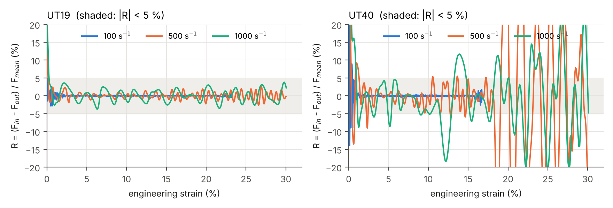

> **Figure 4 – Force equilibrium in the specimen, $R$.**
>
> *Plotted* – the equilibrium ratio $R$ against the engineering strain, one panel per specimen, one curve per target rate.
>
> *Source* – exact forces $F_{in}$, $F_{out}$ in the two cross-sections of the specimen, filtered at 100 kHz; strain of the virtual extensometer.
>
> *How to read it* – inside the shaded band ($\lvert R\rvert$ < 5 %) both ends of the specimen carry the same force. Values are cut at ±20 %. $R$ is not plotted where it is not evaluated (very start of loading).

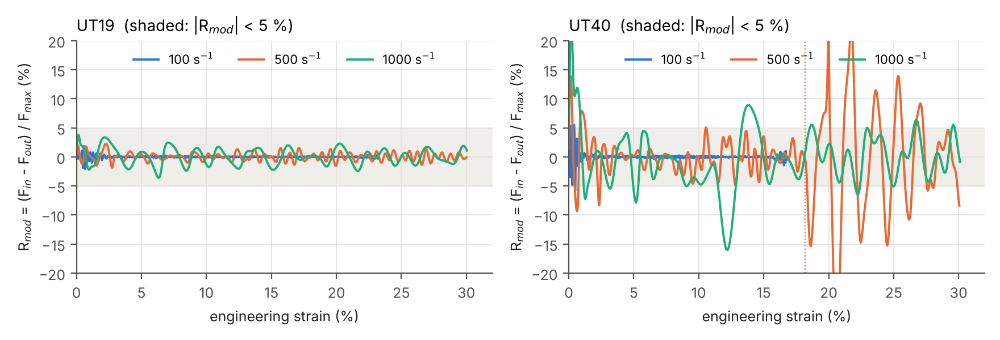

> **Figure 5 – Force equilibrium relative to the maximum force, $R_{mod}$.**
>
> *Plotted* – $R_{mod} = (F_{in} - F_{out}) / F_{max}$ against the engineering strain over the whole useful window, one panel per specimen; dotted vertical line: sudden localisation, if any.
>
> *Source* – same filtered section forces.
>
> *How to read it* – inside the shaded band the force difference is below 5 % of the maximum force. Unlike $R$, the curve is not amplified at the start and at the end of the test, where the force is small.

**Table 8 – Equilibrium indicators.**

| Specimen / target rate (s⁻¹) | Equilibrium from | Max $\lvert R\rvert$ after 5 % | Max $\lvert\Delta F\rvert$ after 5 % | Max force |
|---|---|---|---|---|
| UT19 / 100 | 0.2 % (0.05 ms) | 0.5 % | 0.02 kN | 7.49 kN at 6.1 % |
| UT19 / 500 | 0.2 % (0.02 ms) | 2.7 % | 0.12 kN | 7.54 kN at 5.8 % |
| UT19 / 1000 | 0.3 % (0.02 ms) | 3.8 % | 0.28 kN | 7.64 kN at 7.1 % |
| UT40 / 100 | 0.5 % (0.11 ms) | 2.6 % | 0.22 kN | 15.00 kN at 5.3 % |
| UT40 / 500 | 2.4 % to 10.5 % only | 83.4 % | 4.74 kN | 15.21 kN at 6.2 % |
| UT40 / 1000 | 5.4 % to 8.9 % only | 24.7 % | 2.51 kN | 15.64 kN at 5.7 % |

*Equilibrium from*: strain (and time after the loading start) from which $\lvert R\rvert$ < 5 % holds until the end of the useful window; 0.2 % is the lowest strain considered.

**Table 9 – Equilibrium with $R_{mod}$.**

| Specimen / target rate (s⁻¹) | $\lvert R_{mod}\rvert$ < 5 % from | Max $\lvert R_{mod}\rvert$ after 5 % | Max $\lvert R_{mod}\rvert$, whole window |
|---|---|---|---|
| UT19 / 100 | from the loading start | 0.3 % | 2.1 % |
| UT19 / 500 | from the loading start | 1.6 % | 2.3 % |
| UT19 / 1000 | from the loading start | 3.6 % | 3.8 % |
| UT40 / 100 | from 0.5 % (0.10 ms) | 1.5 % | 5.9 % |
| UT40 / 500 | not maintained | 31.2 % | 31.2 % |
| UT40 / 1000 | not maintained | 16.0 % | 24.1 % |

*From*: strain (and time) from which $\lvert R_{mod}\rvert$ < 5 % holds until the end of the useful window, the search starting at the loading start.

### UT19

- **UT19 at 100 s⁻¹** (striker 2.48 m/s): equilibrium is established at 0.2 % strain, 0.05 ms after the loading start, and holds until the end of the loading (max $\lvert R\rvert$ after 5 % strain: 0.5 %).
- **UT19 at 500 s⁻¹** (striker 7.69 m/s): equilibrium is established at 0.2 % strain, 0.02 ms after the loading start, and holds until the end of the loading (max $\lvert R\rvert$ after 5 % strain: 2.7 %).
- **UT19 at 1000 s⁻¹** (striker 14.20 m/s): equilibrium is established at 0.3 % strain, 0.02 ms after the loading start, and holds until the end of the loading (max $\lvert R\rvert$ after 5 % strain: 3.8 %).

With $R_{mod}$ the conclusion is the same, and it extends to the start of loading, where $R$ is not evaluated: $\lvert R_{mod}\rvert$ stays below 3.8 % over the whole useful window at the three rates. The force rises smoothly from zero at both ends (Figure 6): there is no transient to wait for.

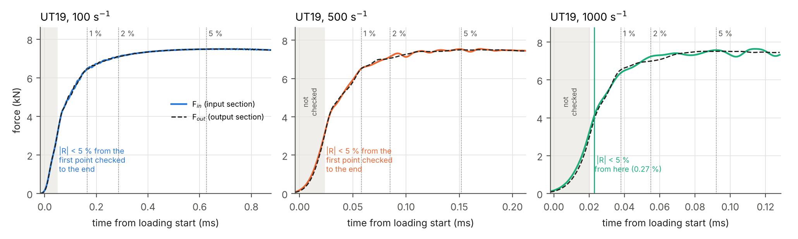

> **Figure 6 – UT19: start of loading.**
>
> *Plotted* – the exact forces $F_{in}$ (coloured solid line) and $F_{out}$ (black dashed line) against the time from the loading start, one panel per target rate, until shortly after 5 % strain. Dotted vertical lines: 1, 2 and 5 % strain. Grey band: start of loading where $R$ is not evaluated.
>
> *Source* – filtered section forces.
>
> *How to read it* – the two forces overlap from the beginning; no line is drawn when equilibrium holds from the first point checked.

### UT40

- **UT40 at 100 s⁻¹** (striker 4.83 m/s): equilibrium is established at 0.5 % strain, 0.11 ms after the loading start, and holds until the end of the loading (max $\lvert R\rvert$ after 5 % strain: 2.6 %).
- **UT40 at 500 s⁻¹** (striker 17.18 m/s): equilibrium is **only partly reached**: $\lvert R\rvert$ < 5 % from 2.4 % to 10.5 % strain, but it reaches 83.4 % at other instants after 5 % strain ($\lvert F_{in} - F_{out}\rvert$ up to 4.74 kN, i.e. 31.2 % of the maximum force).
- **UT40 at 1000 s⁻¹** (striker 32.62 m/s): equilibrium is **only partly reached**: $\lvert R\rvert$ < 5 % from 5.4 % to 8.9 % strain, but it reaches 24.7 % at other instants after 5 % strain ($\lvert F_{in} - F_{out}\rvert$ up to 2.51 kN, i.e. 16.0 % of the maximum force).

At 500 and 1000 s⁻¹ the UT40 is in equilibrium during the hardening phase and the beginning of necking, but not before and not after:

- **Before** (start of loading up to 2.4 % and 5.4 % strain): the force rises within ≈ 0.1–0.2 ms, during which the plastic waves cross the 40 mm parallel section only a few times (section *UT19 and UT40 compared*). The force difference oscillates: $R_{mod}$ between −9 % and +14 % at 500 s⁻¹, between −8 % and +24 % at 1000 s⁻¹, mostly with more force on the input side, which is pulled (Figure 7).
- **After** (from 10.5 % and 8.9 % strain): the neck forms. At 1000 s⁻¹, $R_{mod}$ reaches −16 % at 12.2 % strain: the input-side force has already dropped to 12.4 kN while the output side still carries 14.9 kN (maximum force 15.6 kN; Figure 5, Appendix A). At 500 s⁻¹ the force difference stays moderate (5.1 % of $F_{max}$ before 18 % strain) until the sudden localisation at 18.2 % strain, after which the forces at both ends oscillate in opposition (31 % of $F_{max}$).

At 100 s⁻¹ the UT40 is in equilibrium from 0.5 % strain to the end of the pulse (max $\lvert R_{mod}\rvert$ after 5 %: 1.5 %).

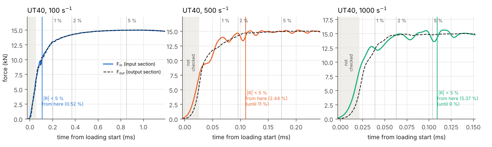

> **Figure 7 – UT40: start of loading.**
>
> *Plotted* – as Figure 6, for the UT40. Coloured vertical line: instant from which $\lvert R\rvert$ < 5 % (for a partial equilibrium: start of the longest interval).
>
> *Source* – filtered section forces.
>
> *How to read it* – at 500 and 1000 s⁻¹ the solid line (input side) rises before the dashed one (output side): the force needs time to cross the long parallel section.

### Effect of the filter

All indicators above use forces filtered at 100 kHz. Table 10 shows the same indicators on the raw forces written by Abaqus.

**Table 10 – Effect of the 100 kHz filter (exact section forces).**

| Specimen / target rate (s⁻¹) | Equilibrium from, raw / filtered | Max $\lvert R\rvert$ after 5 %, raw / filtered |
|---|---|---|
| UT19 / 100 | 0.2 % / 0.2 % | 0.6 % / 0.5 % |
| UT19 / 500 | 0.2 % / 0.2 % | 3.6 % / 2.7 % |
| UT19 / 1000 | n/a / 0.3 % | 5.3 % / 3.8 % |
| UT40 / 100 | 0.5 % / 0.5 % | 2.6 % / 2.6 % |
| UT40 / 500 | n/a / n/a | 101.2 % / 83.4 % |
| UT40 / 1000 | n/a / n/a | 30.8 % / 24.7 % |

"n/a": no equilibrium until the end of the window. *Raw*: one point per µs, as written by Abaqus.

The filter removes vibrations of a few microseconds that the experiment cannot resolve; it does not change the verdict of the UT40 cases (partial equilibrium with and without filter). Without filter, UT19 / 1000 reaches 5.3 % after 5 % strain instead of 3.8 %: the raw forces carry vibrations of a few µs that slightly exceed the 5 % limit; the filtered force difference stays small (UT19 / 1000: 0.28 kN).

## Answer 2 – Loading speeds for 30 % strain

### Results

**Table 11 – Test conditions and strain reached.**

| Specimen / target rate (s⁻¹) | Striker velocity | Incident stress | Achieved rate | Time to 30 % | Max strain |
|---|---|---|---|---|---|
| UT19 / 100 | 2.48 m/s | 47 MPa | 110 s⁻¹ (+10 %) | not reached | 23.3 % |
| UT19 / 500 | 7.69 m/s | 146 MPa | 546 s⁻¹ (+9 %) | 0.60 ms | 30.0 % |
| UT19 / 1000 | 14.20 m/s | 270 MPa | 1066 s⁻¹ (+7 %) | 0.32 ms | 30.1 % |
| UT40 / 100 | 4.83 m/s | 92 MPa | 82 s⁻¹ (−18 %) | not reached | 16.9 % |
| UT40 / 500 | 17.18 m/s | 326 MPa | 498 s⁻¹ (0 %) | 0.67 ms | 30.1 % |
| UT40 / 1000 | 32.62 m/s | 620 MPa | 940 s⁻¹ (−6 %) | 0.36 ms | 30.1 % |

*Incident stress*: stress of the incident wave in the input bar, $\rho c\,K V$ (elastic for maraging steel). *Achieved rate*: definition above, in brackets the deviation from the target. *Time to 30 %*: from the loading start. *Max strain*: 30 %, or less if the loading pulse ends before.

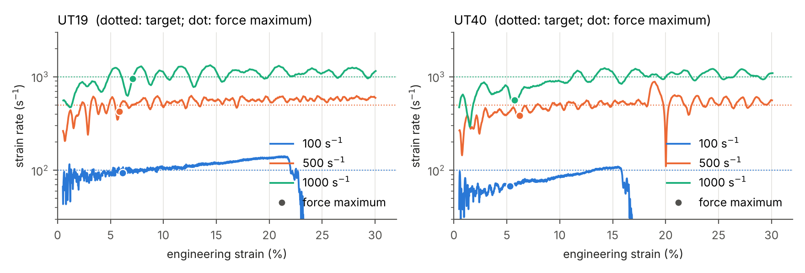

> **Figure 8 – Strain rate during the test.**
>
> *Plotted* – the strain rate (logarithmic scale) against the engineering strain, one panel per specimen; dotted lines: targets; dots: force maximum (onset of necking).
>
> *Source* – time derivative of the filtered extensometer strain.
>
> *How to read it* – the curve should stay close to its target. Being a derivative, it amplifies the small vibrations of the specimen (±10 to 30 % at 1000 s⁻¹). A curve that drops before 30 % shows the end of the loading pulse.

**Table 12 – Strain rate with different definitions (s⁻¹).**

| Specimen / target rate (s⁻¹) | Achieved ($\varepsilon_1 \to \varepsilon_2$) | At max force | Nominal | Before / after max force |
|---|---|---|---|---|
| UT19 / 100 | 110 (5 → 18.6 %) | 94 | 100 | 64–99 / 90–135 |
| UT19 / 500 | 546 (5 → 24.0 %) | 424 | 498 | 229–538 / 500–607 |
| UT19 / 1000 | 1066 (5 → 24.0 %) | 955 | 927 | 476–1019 / 929–1251 |
| UT40 / 100 | 82 (5 → 13.5 %) | 68 | 72 | 47–70 / 62–105 |
| UT40 / 500 | 498 (5 → 24.0 %) | 384 | 450 | 192–440 / 440–597 |
| UT40 / 1000 | 940 (5 → 24.1 %) | 564 | 827 | 318–795 / 792–1170 |

*At max force*: value of Figure 8 at the dot. *Nominal*: final strain divided by the whole loading time, start-up included. *Before / after max force*: range of the curve of Figure 8 before and after the dot (10th to 90th percentile).

After the force maximum the strain rate settles close to the target and increases slowly, because the force decreases (necking) and brakes the bench less. Before the force maximum, during uniform hardening, the rate is still building up at 500 and 1000 s⁻¹ (the "at max force" values are below the achieved rate).

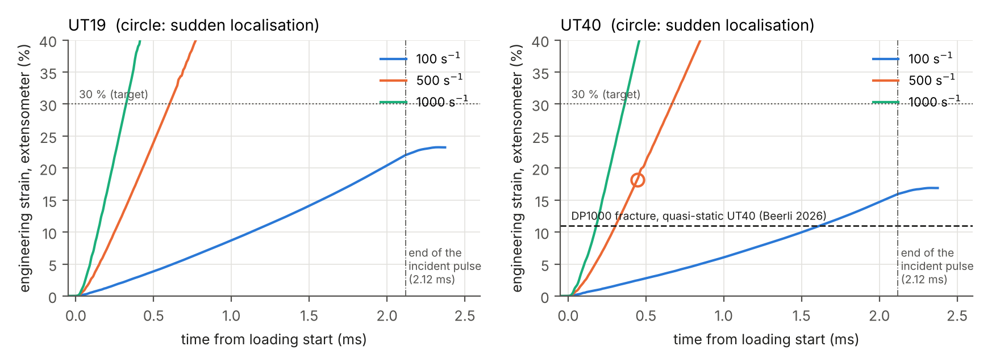

> **Figure 9 – Strain against time: the test window.**
>
> *Plotted* – the extensometer strain against the time from the loading start, one panel per specimen. Dotted line: 30 % target; dash-dotted line: end of the incident pulse of the 5 m striker; dashed line (UT40): fracture strain of DP1000 in a quasi-static test on the same geometry; circle: sudden localisation.
>
> *Source* – filtered extensometer strain.
>
> *How to read it* – the slope is the strain rate. At 100 s⁻¹ the strain stops growing at the end of the pulse, before 30 %; at 500 and 1000 s⁻¹ 30 % is reached well within the pulse.

### Striker velocity formula

**How the striker velocity is chosen.** The only setting of a test is the striker velocity $V$. The velocity needed for a target strain rate $\dot\varepsilon$ is estimated with one-dimensional wave theory, in five steps:

| Step | What happens | Equation |
|---|---|---|
| 1 | the striker hits the input bar; the bar material starts moving at the particle velocity $v_i$, smaller than $V$ (impedances $Z = \rho c A$ of striker and bar) | $v_i = K\,V$, $K = Z_{striker}/(Z_{striker}+Z_{bar})$ = 0.487 |
| 2 | at the end of the input bar the wave reflects: the pusher moves about twice as fast | $\approx 2\,v_i$ |
| 3 | the specimen pulls back with its force $F$: it brakes the pusher and pulls the output bar towards it; both reduce the elongation rate | $-\,2F/(\rho c A)$, $\rho c A$ = 12242 N·s/m |
| 4 | elongation rate of the specimen | $v = 2KV - 2F/(\rho c A)$ |
| 5 | the elongation rate is related to the strain rate of the extensometer by an effective length | $v = \dot\varepsilon\,L_{eff}$ |

Solving for $V$:

$$
V = \frac{\dot\varepsilon\,L_{eff} + 2F/(\rho c A)}{2K}
$$

Two quantities of this formula are **not known before the simulation**: $L_{eff}$, the length that effectively elongates as seen by the extensometer (not exactly the parallel section: fillets and heads also deform a little, and the extensometer is shorter than the parallel section), and $F$, the effective specimen force during the test (it rises to its maximum, then decreases during necking). Both are obtained by **calibration**: they are adjusted so that the formula matches simulations already run, and the adjusted formula is used to choose the velocities of the next simulations. The successive versions are:

**Table 13 – Successive versions of the striker velocity formula.**

| Specimen | Version | $L_{eff}$ / $F$ | How the constants were obtained | Used in study | Achieved rates (target 100 / 500 / 1000 s⁻¹) |
|---|---|---|---|---|---|
| UT19 | first attempt | no force term | striker velocity proportional to the strain rate, $V = \dot\varepsilon \times 15$ mm, without the force term | `taskI_20261013-1127` | 100 s⁻¹ targeted, only 21 s⁻¹ achieved: the specimen force brakes the pusher |
| UT19 | calibrated | 12.7 mm / 7.0 kN | force term added; $L_{eff}$ and $F$ calibrated on a first UT19 simulation at 500 s⁻¹ (485 s⁻¹ achieved, mean specimen force 6.4–6.8 kN) | `taskI_20261013-1554`, `taskI_20261022-1138` | 110 / 546 / 1066 s⁻¹ (in contact) |
| UT40 | first estimate | 34.0 mm / 15.0 kN | estimated from the UT19 before any UT40 simulation: $L_{eff}$ = 40 mm × 12.7 / 15 (same ratio to the parallel section as the UT19), $F$ = maximum force of the UT40 (twice the section of the UT19) | `taskI_20261023-1140` | 138 / 590 / 770 s⁻¹ (1000 s⁻¹: localisation outside the extensometer) |
| UT40 | recalibrated | 30.1 mm / 10.4 kN | two equations, two unknowns, from the runs at 100 and 500 s⁻¹ of the first estimate (138 s⁻¹ at 6.00 m/s, 590 s⁻¹ at 19.95 m/s) | `taskI_20261023-1518` | 82 / 498 / 940 s⁻¹ |

**Table 14 – Striker velocities of this report and the formula version they come from.**

| Specimen / target rate (s⁻¹) | Striker velocity | Formula version | Achieved rate | Deviation from target |
|---|---|---|---|---|
| UT19 / 100 | 2.48 m/s | calibrated | 110 s⁻¹ | +10 % |
| UT19 / 500 | 7.69 m/s | calibrated | 546 s⁻¹ | +9 % |
| UT19 / 1000 | 14.20 m/s | calibrated | 1066 s⁻¹ | +7 % |
| UT40 / 100 | 4.83 m/s | recalibrated | 82 s⁻¹ | −18 % |
| UT40 / 500 | 17.18 m/s | recalibrated | 498 s⁻¹ | 0 % |
| UT40 / 1000 | 32.62 m/s | recalibrated | 940 s⁻¹ | −6 % |

*Achieved rate*: see *Definitions and signal processing*; same values as in Table 11.

**Why the achieved rate differs from the target.** (1) $L_{eff}$ and $F$ are effective constants: a first estimate can be far off (UT40 first estimate: $F$ = 15 kN, whereas the force of the UT40 drops strongly during necking and the effective value is ≈ 10.4 kN; with $F$ too large the formula over-compensates the braking and the strain rate is too high). (2) The formula assumes a constant force and a constant strain rate, which is not the case: the force rises, then decreases during necking, and its average depends on how far the test goes. Probable consequence: a test that stops early (100 s⁻¹, end of the pulse) keeps a higher mean force than the one used for calibration, is braked more and runs slower than the target. (3) At low rate the braking term is of the same order as the useful term, so a small error on $F$ gives a large error on the rate:

**Table 15 – Sensitivity of the strain rate to the force constant $F$.**

| Specimen | Useful term $\dot\varepsilon L_{eff}$ at 100 s⁻¹ | Braking term $2F/\rho c A$ | Rate change for 1 kN error on $F$ | Same, relative at 100 / 500 / 1000 s⁻¹ |
|---|---|---|---|---|
| UT19 | 1.27 m/s | 1.14 m/s | 12.9 s⁻¹ | 13 % / 3 % / 1 % |
| UT40 | 3.01 m/s | 1.70 m/s | 5.4 s⁻¹ | 5 % / 1 % / 1 % |

*Rate change for 1 kN*: $\Delta\dot\varepsilon = 2\,\Delta F / (\rho c A\,L_{eff})$ at a given striker velocity, with the current constants.

$L_{eff}$ is shorter than the parallel section (12.7 instead of 15 mm for the UT19; 30.1 instead of 40 mm for the UT40), because the extensometer sees the most strained part of it. The effective force is lower than the maximum force (7.0 against ≈ 7.5 kN, 10.4 against ≈ 15 kN) because the force decreases during necking, much more for the UT40. The recalibration of the UT40 is detailed in Appendix B.

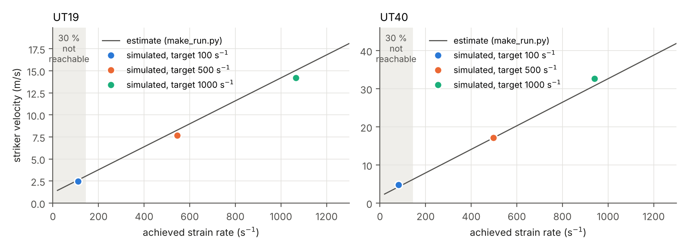

> **Figure 10 – Striker velocity required for a given strain rate.**
>
> *Plotted* – the striker velocity against the achieved strain rate, one panel per specimen. Line: the formula with the current constants (last version of each specimen in Table 13). Dots: the reference simulations, which used these constants (Table 14). Shaded: 30 % strain not reachable with the 5 m striker.
>
> *Source* – formula of `make_run.py`; simulation results.
>
> *How to read it* – choose a strain rate on the horizontal axis and read the striker velocity on the line; a dot on the line means that the formula predicted the simulation exactly.

**Accuracy and possible refinement.** With these constants the achieved rates deviate from the targets by +10 % / +9 % / +7 % (UT19) and −18 % / 0 % / −6 % (UT40) (Table 11). The constants can be refined by a least-squares fit of the formula on all the simulations of each specimen (three UT19 runs; five UT40 runs: the reference study and the two usable runs of the first one):

**Table 16 – Refined striker velocities (least-squares fit, not yet simulated).**

| Specimen | Fitted $L_{eff}$ | Fitted $F$ | Velocity for 100 / 500 / 1000 s⁻¹ | Change |
|---|---|---|---|---|
| UT19 | 12.0 mm | 6.5 kN | 2.31 / 7.22 / 13.35 m/s | −7 % / −6 % / −6 % |
| UT40 | 31.5 mm | 9.5 kN | 4.82 / 17.75 / 33.90 m/s | 0 % / +3 % / +4 % |

*Change*: relative to the velocities used in the reference simulations. These values are a better fit of the simulations, but they have not been checked by a simulation; they remain subject to the rate dependence of the real material (section *Limitations*).

### Limit for 30 % strain

The 5 m striker gives a 2.12 ms loading pulse, so 30 % strain requires at least 0.30 / 2.12 ms ≈ 142 s⁻¹; the output bar (5.99 m) also limits the measurement window to 2.33 ms (Beerli et al. 2026). At 100 s⁻¹ the strain stops at 23.3 % (UT19, 110 s⁻¹) and 16.9 % (UT40, 82 s⁻¹). Reaching 30 % at these rates would need a loading of about 2.9 ms (UT19) and 3.9 ms (UT40), i.e. a striker of about 6.9 m and 9.2 m: longer than the measurement window, and for the UT40 longer than the 7.5 m launch tube.

**Answer.** To reach 30 % engineering strain: about 7.7 m/s (500 s⁻¹) and 14.2 m/s (1000 s⁻¹) for the UT19; 17.2 m/s (500 s⁻¹) and 32.6 m/s (1000 s⁻¹) for the UT40. At 100 s⁻¹, 30 % is not reachable with the 5 m striker (above ≈ 142 s⁻¹ only). The maximum velocity of the launcher has to be checked for the UT40 at 1000 s⁻¹ (32.6 m/s; incident stress ≈ 620 MPa in the bars).

## UT19 and UT40 compared

The two specimens have the same heads and the same section-to-width ratio; they differ by the length of the parallel section (15 against 40 mm) and its width (5 against 10 mm).

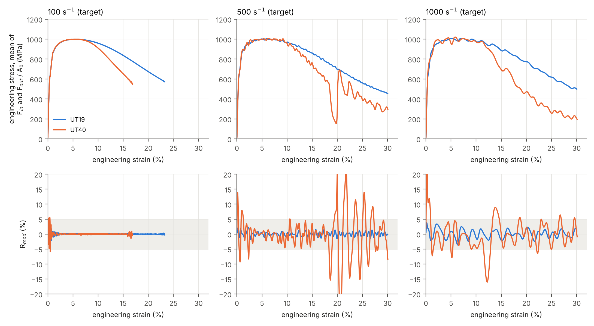

> **Figure 11 – UT19 and UT40 at the same target rate.**
>
> *Plotted* – top row: engineering stress (mean of $F_{in}$ and $F_{out}$ divided by $A_0$) against the engineering strain; bottom row: $R_{mod}$; one column per target rate; blue UT19, orange UT40.
>
> *Source* – filtered section forces of the reference simulations.
>
> *How to read it* – the stress curves coincide up to the force maximum (same material); after it, the longer UT40 loses its force much faster, because the same neck is averaged over a longer extensometer. In the bottom row, the UT40 leaves the ±5 % band at 500 and 1000 s⁻¹.

**Table 17 – UT19 / UT40 side by side.**

| Target rate | Strain at max force | Time to max force | Max $\lvert R_{mod}\rvert$ after 5 % | Force at 30 % / max force |
|---|---|---|---|---|
| 100 s⁻¹ | 6.1 % / 5.3 % | 744 / 894 µs | 0.3 % / 1.5 % | not reached |
| 500 s⁻¹ | 5.8 % / 6.2 % | 169 / 203 µs | 1.6 % / 31.2 % | 45 % / 29 % |
| 1000 s⁻¹ | 7.1 % / 5.7 % | 114 / 116 µs | 3.6 % / 16.0 % | 49 % / 19 % |

Each cell: UT19 / UT40. *Time to max force*: from the loading start. *Force at 30 %*: mean of $F_{in}$ and $F_{out}$; for the UT40 at 500 s⁻¹ it is read after the sudden localisation and only indicative.

**Why the UT40 is harder to equilibrate (interpretation).** Equilibrium needs the stress waves to cross the specimen several times while the force changes. In the elastic range the waves travel at $c_0 = \sqrt{E/\rho}$ = 4984 m/s and cross the parallel section in 3 µs (UT19) or 8 µs (UT40). Once the specimen yields, the changes of force travel at the plastic wave speed $c_p = \sqrt{h/\rho}$, with $h = dk/d\varepsilon_p$ the slope of the hardening law: $h$ = 9661 MPa and $c_p$ = 1109 m/s at 1 % plastic strain, 1046 MPa and 365 m/s at 5 %. One crossing of the parallel section then takes ≈ 14–41 µs for the UT19 and ≈ 36–110 µs for the UT40. The force maximum is reached ≈ 116 µs after the loading start at 1000 s⁻¹ (Table 17): about 3 to 8 plastic crossings for the UT19, but only 1.1 to 3.2 for the UT40. After the maximum force (Considère) the slope of the engineering stress–strain curve is negative, the neck concentrates the deformation, and the remaining force differences are no longer evened out. This is consistent with the simulations: the UT40 is in equilibrium at 100 s⁻¹ (894 µs to the force maximum) and only during an intermediate interval at 500 and 1000 s⁻¹.

**Consequence for the tests.** The neck needs about the same elongation in both specimens, but it is averaged over a 30 mm extensometer instead of 12 mm: to reach 30 % engineering strain the neck of the UT40 must provide ≈ 9.0 mm of elongation against ≈ 3.6 mm for the UT19, and the force falls to ≈ 19 % of its maximum instead of ≈ 49 % (1000 s⁻¹, Table 17). The UT40 is therefore much closer to fracture at 30 % strain.

## What the experiment will measure

In the experiment the specimen force is only known from the output bar gauge. Figure 12, Figure 13 and Figure 14 compare this signal, as it would be recorded, with the exact specimen force.

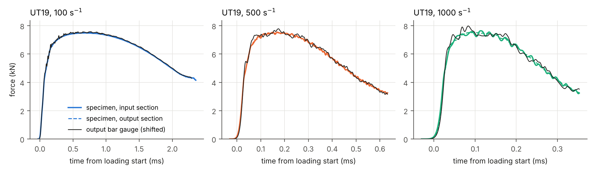

> **Figure 12 – UT19: specimen forces and output bar gauge.**
>
> *Plotted* – axial force against the time from the loading start, one panel per target rate. Coloured solid line: $F_{in}$; coloured dashed line: $F_{out}$; black line: force read on the output bar gauge.
>
> *Source* – gauge force $A_{bar} E_{bar} \varepsilon_{gauge}$ shifted by 82 µs; all signals filtered at 100 kHz.
>
> *How to read it* – overlapping coloured lines mean equilibrium; the distance between the black line and the coloured lines is the measurement error of the gauge.

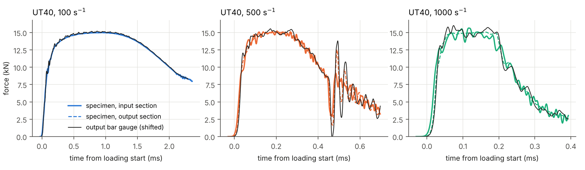

> **Figure 13 – UT40: specimen forces and output bar gauge.**
>
> *Plotted* – as Figure 12, for the UT40.
>
> *Source* – as Figure 12.
>
> *How to read it* – at 500 s⁻¹, after the sudden localisation, the forces at both ends and the gauge oscillate.

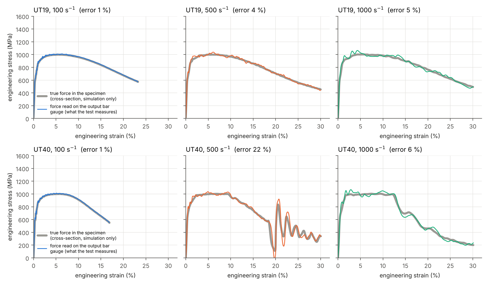

> **Figure 14 – Engineering stress–strain curves: true and measured.**
>
> *Plotted* – one panel per specimen (rows) and target rate (columns): engineering stress $F / A_0$ against the engineering strain. **Both curves come from the same simulation** and differ by where the force is taken. Thick grey line: true force in the specimen (cross-section, simulation only). Coloured line: force read by the virtual gauge on the output bar, 400 mm from the specimen, where the real gauge is: the curve the experiment will give.
>
> *Source* – filtered signals; gauge signal shifted as above. Error in the panel title: largest gap after 5 % strain, relative to the maximum force.
>
> *How to read it* – where the coloured line follows the grey one, the gauge measures the specimen correctly. The grey curves are the same at the three rates because the simulated material is rate independent.

**Table 18 – Error of the output bar gauge.**

| Specimen / target rate (s⁻¹) | Max error after 5 % | Before a sudden localisation | Fastest force drop (10 µs) |
|---|---|---|---|
| UT19 / 100 | 1.5 % | no localisation | 0.04 kN |
| UT19 / 500 | 3.9 % | no localisation | 0.23 kN |
| UT19 / 1000 | 4.8 % | no localisation | 0.47 kN |
| UT40 / 100 | 1.5 % | no localisation | 0.19 kN |
| UT40 / 500 | 22.0 % | 3.7 % | 4.92 kN |
| UT40 / 1000 | 5.8 % | no localisation | 1.93 kN |

*Error*: largest difference between the gauge force and the true specimen force, relative to the maximum force. *Fastest force drop*: largest decrease of the mean specimen force (unfiltered) within 10 µs after the force maximum.

Except after the sudden localisation of the UT40 at 500 s⁻¹, the gauge follows the specimen force within 5.8 % of the maximum force.

### The initial contact is essential

Before 22 Oct 2026 the specimen was centred in the pockets, with a clearance of 0.36 mm on each side. The same UT19 simulations (same striker velocities) gave a very different measurement:

**Table 19 – UT19: specimen centred with clearances (study `taskI_20261013-1554`) and in contact (`taskI_20261022-1138`).**

| Indicator | 100 s⁻¹ | 500 s⁻¹ | 1000 s⁻¹ |
|---|---|---|---|
| Equilibrium from | 0.9 % → 0.2 % | 2.5 % → 0.2 % | partial → 0.3 % |
| Max $\lvert R\rvert$ after 5 % | 0.9 % → 0.5 % | 3.8 % → 2.7 % | 13.2 % → 3.8 % |
| **Gauge error after 5 %** | 3.1 % → **1.5 %** | 15.0 % → **3.9 %** | 38.9 % → **4.8 %** |
| Achieved rate (s⁻¹) | 105 → 110 | 546 → 546 | 1073 → 1066 |
| Max strain | 18.5 % → 23.3 % | 30.0 % → 30.0 % | 30.1 % → 30.1 % |

Each cell: centred → in contact. Same processing for both studies.

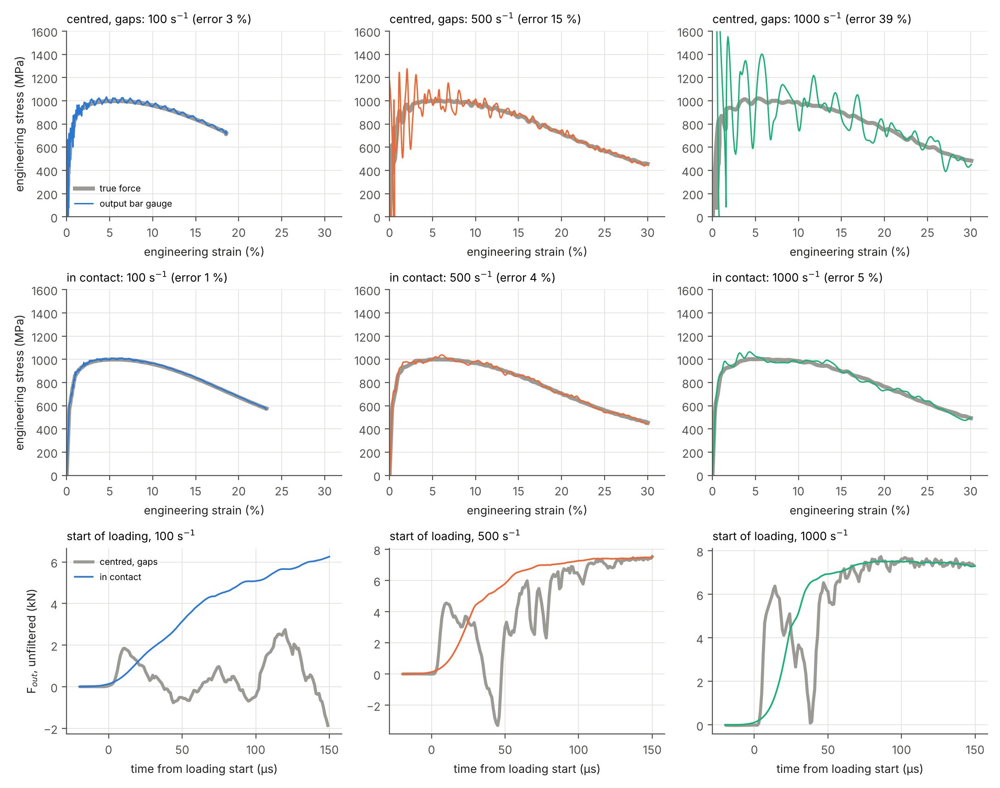

> **Figure 15 – UT19: effect of the initial contact.**
>
> *Plotted* – top row: centred specimen with clearances; middle row: specimen in contact; engineering stress from the true force (grey) and from the output gauge (colour) against strain. Bottom row: first 150 µs of loading, output-side specimen force, unfiltered, centred (grey) and in contact (colour).
>
> *Source* – studies `taskI_20261013-1554` and `taskI_20261022-1138`, same processing.
>
> *How to read it* – with clearances the measured curve oscillates around the true one, up to 1000 s⁻¹ where the error reaches 39 %; in contact the two curves coincide. Bottom: with clearances the force jumps, drops to zero and rebounds; in contact it rises smoothly.

**What happened with the clearances** (probe study `diag_20261021-1626`, UT19 at 1000 s⁻¹): the specimen, pulled by the pusher, travelled ≈ 0.3 mm across the clearance of the output pocket before pulling on the output head, and **hit** it: a force spike of ≈ 15 kN, twice the force the specimen can carry, after which the output head rang at ≈ 40 kHz for ≈ 0.25 ms. The gauge recorded this ringing on top of the specimen force (Figure 16). At 1000 s⁻¹, 30 % strain is reached in 0.33 ms, before the ringing has died out.

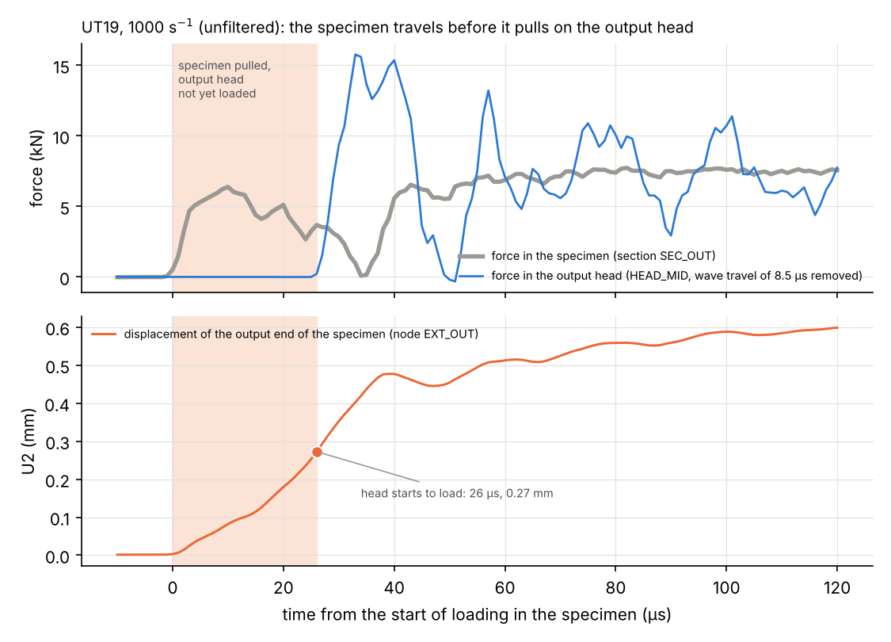

> **Figure 16 – UT19 centred at 1000 s⁻¹: the specimen crosses the clearance and hits the output head.**
>
> *Shown* – top: force in the specimen (grey) and in the output head (blue, moved back by its 8.5 µs of wave travel), first 120 µs, unfiltered; bottom: displacement of the output end of the specimen. Shaded: the specimen is pulled but the head does not feel anything yet.
>
> *Source* – probe study `diag_20261021-1626`; lab journal, 22 Oct 2026.

### Where a measurement error comes from: force probes

In the four simulations with force probes, the force through five slices of the output side (output head, tie, bar) was compared with the true specimen force, each signal moved back by its own wave travel time to the bar end (Figure 17, Table 20).

**Table 20 – Max error after 5 % strain at each probe (% of the max force).**

| Position | UT19 / 1000, centred (gaps) | UT19 / 1000, in contact | UT40 / 1000, first run (37.4 m/s) | UT40 / 1000, recalibrated (32.6 m/s) |
|---|---|---|---|---|
| output head, 14 mm above the tie | 37.5 % | 4.7 % | 73.0 % | 6.4 % |
| output head, 4 mm above the tie | 35.3 % | 5.1 % | 72.3 % | 5.9 % |
| bar, just below the tie | 37.2 % | 4.7 % | 73.1 % | 6.4 % |
| bar, 100 mm from its end | 36.8 % | 4.9 % | 72.2 % | 6.3 % |
| bar, 250 mm from its end | 43.0 % | 5.1 % | 70.3 % | 6.2 % |
| gauge, 400 mm from the bar end | 37.5 % | 4.9 % | 68.1 % | 6.0 % |

Same computation as `scripts/post/plot_probes.py`.

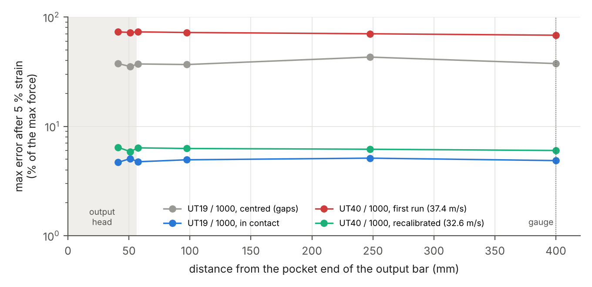

> **Figure 17 – Error of the force along the output side.**
>
> *Plotted* – the largest error after 5 % strain (logarithmic scale) at each probe, against its distance from the pocket end of the output bar, one line per simulation. Shaded: the output head (55.7 mm, tied to the bar).
>
> *Source* – probe forces and gauge, filtered at 100 kHz, each moved back by its wave travel time.
>
> *How to read it* – a flat line means that the error is already there in the head and is only carried along the bar: it is created between the specimen and the head. Error ≈ 5 % everywhere: the measurement is good.

In every case the error is the same at every position: it is created at the specimen–head interface, not by the tie or by the travel along the bar. The two large errors have the same mechanism, a force **step** that sets the head ringing: the impact after the clearance (UT19 centred) and the collapse of the neck (first UT40 run at 1000 s⁻¹, below). With the specimen in contact and no localisation, the error is 4.9 % (UT19) and 6.0 % (UT40) at every position.

### Why a sudden localisation makes the gauge wrong

The gauge does not measure the specimen: it measures the wave in the output bar, 400 mm away, after the force has gone through the specimen head, the pocket and the output head, and it is moved back in time by 82 µs. This works as long as the specimen force changes **slowly** compared with the time the waves need to cross these parts (a few tens of µs): they then simply pass the force on. All specimens neck, but in a normal neck the force decreases gradually: at most 1.9 kN in 10 µs in the runs without localisation. When a few elements collapse in the neck, the force drops by 4.9 kN (UT40 / 500) in 10 µs, a step instead of a slope; the heads and the output bar are set ringing, and the gauge records the ringing on top of the specimen force. Before the localisation the gauge error of the UT40 at 500 s⁻¹ is only 3.7 %.

## Necking, localisation and fracture: how far the results are valid

### Plasticity and necking: what happens in the specimen

**From elastic to plastic.** In the elastic range the atoms of the crystal lattice are only moved slightly apart, like springs: the deformation disappears on unloading. Beyond the yield stress, planes of atoms slide over each other and the deformation becomes permanent. The sliding does not happen in one block: it propagates through line defects of the lattice, the **dislocations**, which need much less force to move than a whole plane of atoms. With the law of the model, plastic flow starts at $k(0)$ ≈ 573 MPa.

**Hardening.** While the metal deforms, the dislocations multiply, become entangled and pile up at grain boundaries and, in a dual-phase steel such as DP1000, at the hard islands of martensite embedded in the soft ferrite. A higher stress is then needed to keep deforming: this is strain hardening, described by the Swift–Voce law $k(\varepsilon_p)$ of the model (≈ 1053 MPa at 5 % plastic strain). Plastic flow also **conserves the volume**: when the specimen gets longer, its cross-section gets smaller,

$$
A\,L = A_0\,L_0 \quad\Rightarrow\quad A = A_0\,e^{-\varepsilon}
$$

with $\varepsilon$ the true (logarithmic) strain.

**The force maximum (Considère).** The force carried by the specimen is $F = \sigma A$. Hardening increases $\sigma$, the elongation decreases $A$. At first hardening is strong and the force rises; hardening then slows down (the slope of the law decreases) until both effects balance and the force reaches a maximum. Writing $dF = 0$:

$$
dF = A\,d\sigma + \sigma\,dA = 0, \qquad \frac{dA}{A} = -d\varepsilon \quad\Rightarrow\quad \frac{d\sigma}{d\varepsilon} = \sigma
$$

The force is maximum when the slope of the hardening curve equals the stress itself. For the DP1000 law this happens at a true strain of 4.98 % (engineering strain 5.1 %), at a true stress of 1053 MPa and an engineering stress of 1002 MPa (Figure 18, left). The simulations reproduce it: the force maximum is reached between 5 and 7 % engineering strain (Table 8).

**Why necking is an instability: the role of defects.** No specimen is perfectly uniform: somewhere a section is slightly weaker (cutting tolerance, such as the 0.02 mm taper of the UT40 drawing; a grain with an unfavourable orientation; a cluster of martensite; an inclusion; a scratch). Every section carries the same force, so the weaker one has a slightly higher stress and deforms slightly more. What happens next depends on which side of the force maximum the specimen is (Figure 18, right):

|  | Before the force maximum | After the force maximum |
|---|---|---|
| The weaker section strains a little more… | …so it hardens more | …but hardening no longer compensates the loss of area |
| Consequence | it becomes stronger: the defect is **corrected**, the strain stays uniform | it becomes even weaker: the defect is **amplified** |
| Name | stable, homogeneous deformation | **necking** (plastic instability) |

Beyond the maximum the loop runs away: less area, higher stress, more strain, even less area. The deformation concentrates in a short zone, and the rest of the specimen stops deforming and even unloads elastically. In a simulation, which has no material defects, the trigger comes from the slight non-uniformities of the model: the shape of the specimen (fillets, heads), the mesh, the taper of the UT40 and, at high rates, the **waves**: the pulled end (pusher side) strains first. This is why, in the first UT40 run at 1000 s⁻¹, the neck formed at the pusher-side end of the parallel section.

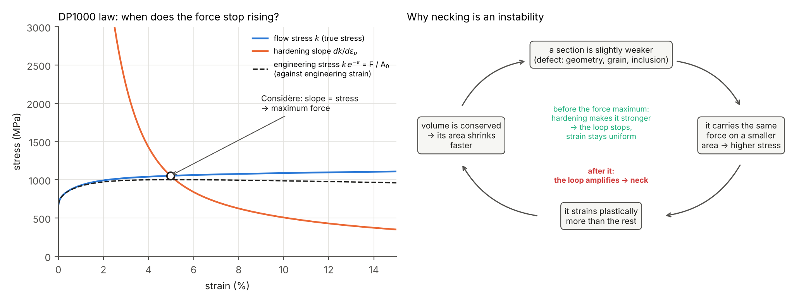

> **Figure 18 – Necking of the DP1000: force maximum and instability.**
>
> *Plotted* – left: flow stress $k$ (true stress) and hardening slope $dk/d\varepsilon_p$ of the DP1000 law against the true plastic strain, and engineering stress $k\,e^{-\varepsilon}$ against the engineering strain (dashed); circle: Considère point. Right: the feedback loop of necking.
>
> *Source* – Swift–Voce law of the model (Beerli et al. 2026, table 4); elastic strain neglected.
>
> *How to read it* – where the two solid curves cross, the slope of the law equals the stress: the dashed engineering curve reaches its maximum there. Before that point a local defect is corrected by hardening; after it the loop on the right amplifies it.

**Two stages of necking in a sheet.** First a **diffuse neck**: the parallel section thins in width and thickness over a fairly long zone, from the force maximum on. Later a **localised neck**: the strain concentrates in a narrow band, about as wide as the sheet thickness, where the sheet thins mostly through its thickness. For a power hardening law $\sigma = K\varepsilon^n$ in uniaxial tension, the diffuse neck starts at $\varepsilon = n$ and the localised neck at $\varepsilon = 2n$ (Hill), along a band inclined by ≈ 55° to the loading direction in an isotropic sheet. As an order of magnitude for our law, twice the Considère strain is ≈ 10 % true strain. In the half model, the symmetry condition at mid-width forces the neck to stay symmetric: a single inclined band cannot form, only a symmetric pattern. This only matters once the neck localises.

**Why the engineering curve after necking depends on the specimen.** The neck has about the same physical size in both specimens (it scales with the width and the thickness), but the engineering strain is its elongation divided by the extensometer length. To reach 30 % the neck must elongate by ≈ 3.6 mm over the 12 mm extensometer of the UT19, but by ≈ 9.0 mm over the 30 mm extensometer of the UT40: the UT40 neck becomes much thinner and its force falls much further (19 % at 30 % strain, 1000 s⁻¹, against 49 % for the UT19; Figure 11). After necking, the engineering stress–strain curve is therefore **no longer a property of the material**: it depends on the specimen geometry and on the extensometer.

**Fracture of a real DP1000 sheet.** A real DP1000 breaks by ductile damage in the neck: (1) **nucleation** of micro-voids, mostly at the ferrite–martensite interfaces, because the hard martensite does not follow the deforming ferrite; (2) **growth** of the voids, driven by the triaxial stress state in the neck (the surrounding material restrains the thinning zone); (3) **coalescence** of the voids into a crack, often along a shear band. Its martensite makes DP1000 one of the least ductile dual-phase steels.

**What the model cannot do: fracture.** The DP1000 model has neither voids nor a fracture criterion. A real sheet breaks in the neck; the simulated one keeps thinning until a few elements at the centre of the neck collapse. Once the strain is concentrated in a few elements, the result also depends on the element size (0.5 mm here): with a finer mesh the collapse would happen at a different strain. The results after that are a numerical consequence of the missing fracture model, not an effect of the test.

**Table 21 – Stages of deformation of a DP1000 UT40 and validity of the model.**

| Stage | Engineering strain (order of magnitude) | Model |
|---|---|---|
| elastic | 0 – 0.3 % | valid |
| uniform plastic deformation (hardening) | 0.3 – 5 % | valid |
| diffuse necking (after Considère) | 5 – ≈ 10 % | valid; result depends on the geometry |
| localised necking, then real fracture | ≈ 10 – 11 % | symmetry imposed at mid-width; no fracture |
| beyond (collapse of elements) | 18 % at 500 s⁻¹ | numerical artefact |

Fracture strain: Beerli et al. (2026), quasi-static, UT40 geometry; the other limits follow from the Considère point of the law and the simulations.

### The sudden localisation of the UT40 at 500 s⁻¹

At 0.44 ms after the loading start (18.2 % strain) both specimen forces drop within 10 µs (input side 8.2 → 4.3 kN, output side 8.6 → 5.4 kN, unfiltered), then reload with strong oscillations, while the extensometer keeps stretching to 30 %. Three explanations were checked in Abaqus/Viewer on the field outputs around this instant (frames 79, 81 and 83: 1.686, 1.728 and 1.771 ms of simulated time; lab journal, 27 Oct 2026):

**Table 22 – Three explanations of the force drop, and their check.**

| Explanation | Check in Abaqus/Viewer | Result |
|---|---|---|
| the teeth slip or lose contact in the pusher pocket | axial displacement of a specimen node and of the facing pusher node across a loaded tooth flank | rejected: the relative displacement changes by ≈ 10 µm (relaxation of the contact compression when the force drops); a slip would be tenths of a mm |
| the specimen lifts out of the pockets | out-of-plane displacement U3, frames 79 / 81 / 83 | rejected: heads and pusher stay at U3 ≈ 0; only the neck moves (±0.5 mm, thinning through the thickness) |
| something sudden happens in the neck | equivalent plastic strain PEEQ, frames 79 / 81 / 83 | **confirmed**: max PEEQ 1.15 → 9.19 → 11.7 in ≈ 40 µs, at one spot at the centre of the neck |

> **Figure 19 – Relative displacement across a loaded tooth flank.**
>
> *Shown* – axial displacement U2 of a specimen node minus that of the facing pusher node, against time, UT40 at 500 s⁻¹ (one point per field frame). Shaded: the force drop. While loaded the specimen node lags by 8–9 µm (elastic compression of the teeth); during the drop the difference changes by ≈ 10 µm only.
>
> *Source* – Abaqus/Viewer, XY report of `UT40_R0500_00.odb`; lab journal, 27 Oct 2026.

U3 (out of the sheet plane) at the three frames:

> **Figure 20 – UT40 / 500: out-of-plane displacement U3, frame 79 (1.686 ms).**
>
> *Shown* – contour of U3 on the specimen and the pusher head, side view. Heads and pusher at U3 ≈ 0 (green); non-zero values only in the neck.
>
> *Source* – Abaqus/Viewer, `UT40_R0500_00.odb`; lab journal, 27 Oct 2026.

> **Figure 21 – UT40 / 500: out-of-plane displacement U3, frame 81 (1.728 ms).**
>
> *Shown* – contour of U3 on the specimen and the pusher head, side view. Heads and pusher at U3 ≈ 0 (green); non-zero values only in the neck.
>
> *Source* – Abaqus/Viewer, `UT40_R0500_00.odb`; lab journal, 27 Oct 2026.

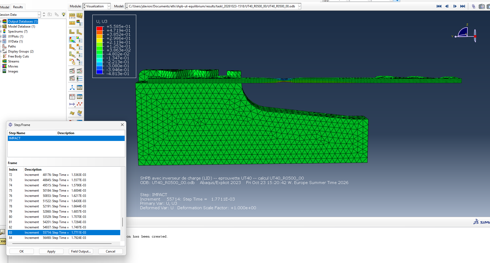

> **Figure 22 – UT40 / 500: out-of-plane displacement U3, frame 83 (1.771 ms).**
>
> *Shown* – contour of U3 on the specimen and the pusher head, side view. Heads and pusher at U3 ≈ 0 (green); non-zero values only in the neck.
>
> *Source* – Abaqus/Viewer, `UT40_R0500_00.odb`; lab journal, 27 Oct 2026.

PEEQ at the three frames (the colour scale changes from one frame to the next):

> **Figure 23 – UT40 / 500: equivalent plastic strain, frame 79 (1.686 ms).**
>
> *Shown* – contour of PEEQ, view from the top (half model, symmetry plane on the left): max 1.15, spread over a few mm of the parallel section.
>
> *Source* – Abaqus/Viewer, `UT40_R0500_00.odb`; lab journal, 27 Oct 2026.

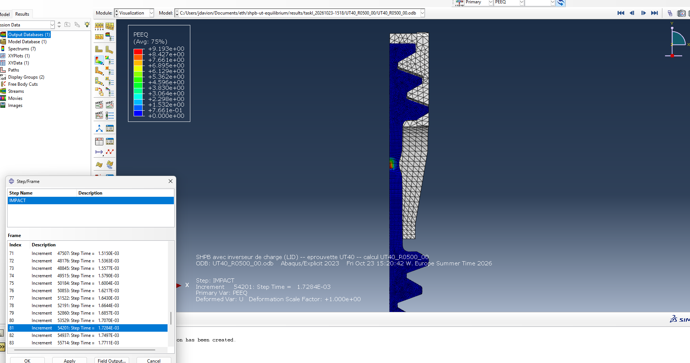

> **Figure 24 – UT40 / 500: equivalent plastic strain, frame 81 (1.728 ms).**
>
> *Shown* – contour of PEEQ, view from the top (half model, symmetry plane on the left): max 9.19 at one spot at the centre of the neck, on the symmetry plane.
>
> *Source* – Abaqus/Viewer, `UT40_R0500_00.odb`; lab journal, 27 Oct 2026.

> **Figure 25 – UT40 / 500: equivalent plastic strain, frame 83 (1.771 ms).**
>
> *Shown* – contour of PEEQ, view from the top (half model, symmetry plane on the left): max 11.7, same spot.
>
> *Source* – Abaqus/Viewer, `UT40_R0500_00.odb`; lab journal, 27 Oct 2026.

**Conclusion.** In ≈ 40 µs the deformation concentrates in a few elements at the centre of the neck, which thin out almost completely (PEEQ ≈ 9, a true strain of 900 %). The section loses its load-carrying capacity at that point, the specimen unloads elastically on both sides, then reloads and oscillates. A real DP1000 sheet would have broken long before.

### The first UT40 run at 1000 s⁻¹: localisation outside the extensometer

In the first UT40 study the striker velocity for 1000 s⁻¹ was estimated too high (37.39 m/s instead of 32.62 m/s after recalibration). The extensometer strain rose to ≈ 11 % in ≈ 0.2 ms and then stopped (12.6 % at the end), while the forces collapsed (sudden localisation at 11.8 % strain). The extensometer node on the pusher side stopped and even moved back (Figure 26, right): the material inside the extensometer was unloading, so the deformation continued **between the extensometer and the pusher head**. Abaqus/Viewer confirmed that the neck formed at the pusher-side end of the parallel section (Figure 27). With the recalibrated velocity and the same (slightly tapered) geometry, the strain stays inside the extensometer and reaches 30 %. Up to ≈ 0.2 ms both runs are almost identical (Figure 26); the localisation at the pulled end is therefore attributed to the higher pulling speed of the first run (pusher-side node up to ≈ 30 m/s), not to the 0.02 mm taper, which is the same in both runs.

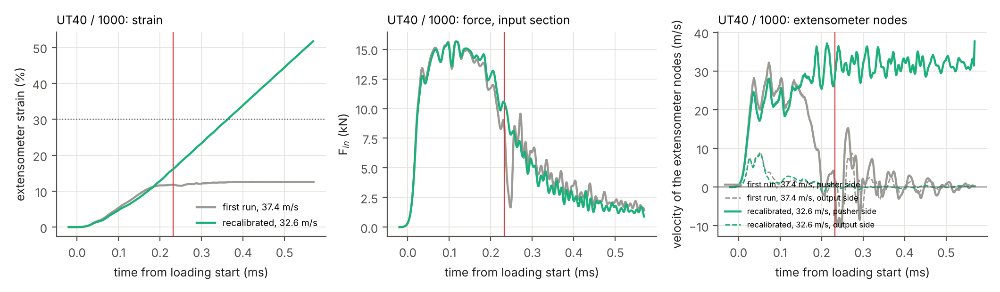

> **Figure 26 – UT40 at 1000 s⁻¹: first run and recalibrated run.**
>
> *Plotted* – against the time from the loading start: extensometer strain (left), input-side specimen force (middle), velocity of the two extensometer nodes (right; solid: pusher side, dashed: output side). Grey: first run; green: recalibrated run; red line: sudden localisation of the first run.
>
> *Source* – studies `taskI_20261023-1140` and `taskI_20261023-1518`, filtered at 100 kHz.
>
> *How to read it* – in the first run the pusher-side node stops and moves back at the localisation, and the strain stops at ≈ 12 %; in the recalibrated run both nodes keep moving apart.

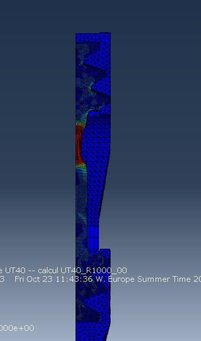

> **Figure 27 – First UT40 run at 1000 s⁻¹: plastic strain at the end.**
>
> *Shown* – PEEQ at the last frame (1.834 ms), side view, pusher head at the top. The neck (red) is at the pusher-side end of the parallel section, just below the pusher head, outside the extensometer.
>
> *Source* – Abaqus/Viewer, `taskI_20261023-1140/UT40_R1000_00.odb`; lab journal, 23 Oct 2026.

### When does a real DP1000 specimen break?

Beerli et al. (2026, section 4.1.1, fig. 7a) report an engineering strain to fracture of **11 %** for DP1000 in quasi-static uniaxial tension (0.001 s⁻¹) on the 40 × 10 mm UT specimen, i.e. the UT40 geometry, the lowest of the five DP steels of the paper. At high strain rates the elongation to fracture of DP1000 does not decrease (section 4.2.1), but no value is given. The paper's fracture model (Hosford–Coulomb with a neural-network rate dependence) has no published parameters. For the UT19 the engineering strain to fracture is larger, since the neck is a larger part of a shorter extensometer; no value is available.

**Table 23 – Validity of each reference simulation.**

| Specimen / target rate (s⁻¹) | Max strain | Sudden localisation | Beyond 11 % (DP1000 fracture, UT40)? |
|---|---|---|---|
| UT19 / 100 | 23.3 % | none | no value for this geometry |
| UT19 / 500 | 30.0 % | none | no value for this geometry |
| UT19 / 1000 | 30.1 % | none | no value for this geometry |
| UT40 / 100 | 16.9 % | none | yes, from 1.62 ms |
| UT40 / 500 | 30.1 % | at 18.2 % (0.44 ms) | yes, from 0.31 ms |
| UT40 / 1000 | 30.1 % | none | yes, from 0.18 ms |

*Sudden localisation*: definition above; time from the loading start.

**Consequences for Task I.**

- The equilibrium and gauge indicators are meaningful only before fracture. After a sudden localisation they describe a numerical artefact.
- For a DP1000 UT40, the question "which loading speed reaches 30 % strain?" has to be put together with fracture: with a quasi-static elongation to fracture of 11 %, 30 % engineering strain is very likely not reachable, whatever the loading speed. The speeds of Answer 2 remain valid for a more ductile material with similar strength.
- Even if the results are cut at 11 %, the conclusion of Answer 1 does not change: the UT40 is in equilibrium at 100 s⁻¹, but at 500 and 1000 s⁻¹ only from 2.4 % to 10.5 % and from 5.4 % to 8.9 % strain, i.e. not until fracture.

## Numerical quality and computing cost

These checks do not answer the Task I questions: they verify that the simulations can be trusted.

**Table 24 – Numerical checks.**

| Specimen / target rate (s⁻¹) | Incident strain / theory | Kinetic energy / ½mV² | Energy drift | Hourglass / internal |
|---|---|---|---|---|
| UT19 / 100 | 1.000 | 0.994 | 0.00 % | 0.3 % |
| UT19 / 500 | 1.000 | 0.994 | 0.18 % | 0.5 % |
| UT19 / 1000 | 1.000 | 0.994 | 0.05 % | 0.2 % |
| UT40 / 100 | 1.000 | 0.994 | 0.00 % | 0.4 % |
| UT40 / 500 | 1.000 | 0.994 | 0.13 % | 0.6 % |
| UT40 / 1000 | 1.000 | 0.994 | 0.00 % | 0.2 % |

- **Incident strain / theory** – is the loading right? One-dimensional wave theory gives the incident strain $\varepsilon_{inc} = K\,V/c$. The simulated value is the plateau of the virtual gauge on the input bar. 1.000 means that the impact, the bar materials and the gauge reading are correct.
- **Kinetic energy / ½mV²** – is the striker mass right? At $t = 0$ only the striker moves. The ratio is slightly below 1 because the meshed circular section is a polygon of slightly smaller area; this does not change the incident wave, which depends on the velocity.
- **Energy drift** – does the calculation create or lose energy? Largest variation of the total energy balance of Abaqus (`ETOTAL`) during the run, relative to the initial kinetic energy; below ≈ 1 %, contacts, ties and time integration create no artificial energy.
- **Hourglass / internal** – does the mesh deform in a non-physical way? Energy absorbed by the artificial stiffness against the zero-energy modes of the reduced-integration hexahedra (`ALLAE`), relative to the deformation energy (`ALLIE`) at the end; usual limit 5 %.

**Table 25 – Computing cost (Euler, 8 cores per simulation).**

| Specimen / target rate (s⁻¹) | Simulated time | Increments | Final stable time increment | Wall time |
|---|---|---|---|---|
| UT19 / 100 | 3.652 ms | 114527 | 3.2e-08 s | 48 min |
| UT19 / 500 | 2.134 ms | 68193 | 2.6e-08 s | 39 min |
| UT19 / 1000 | 1.834 ms | 58613 | 2.3e-08 s | 26 min |
| UT40 / 100 | 3.652 ms | 115909 | 2.3e-08 s | 59 min |
| UT40 / 500 | 2.134 ms | 76549 | 1.2e-08 s | 40 min |
| UT40 / 1000 | 1.834 ms | 83480 | 5.5e-09 s | 38 min |

From the `.sta` file of each run. The stable time increment falls when the neck elements become very thin (UT40 at 500 and 1000 s⁻¹).

## Limitations

- **No fracture model** for the specimen: results after fracture are not representative (DP1000 UT40: ≈ 11 % engineering strain in a quasi-static test).
- **Rate-independent material**: in the tests the force, hence the braking term $2F/\rho c A$ and the required striker velocity, will increase with the strain rate.
- **Striker formula**: $L_{eff}$ and $F$ are effective constants calibrated on the simulations; the formula is least accurate at low rate, where the force term dominates.
- **Gauge signal**: shifted by the wave travel time, not corrected for dispersion; the reference point of the 400 mm distance is to be confirmed (≈ 6 µs uncertainty).
- **Initial contact without pre-load**, as described by the lab; a residual clearance or a pre-load in a real test would change the start of the signals.
- **Assumed values**: densities of the bars and of the striker; material of the pusher (maraging according to Beerli et al. 2026, tool steel according to an old CAD file).
- **Guides** modelled as continuous, frictionless and without clearance.
- **Half model**: the symmetry at mid-width forces a symmetric neck; a single inclined localised band cannot form (relevant only once the neck localises).
- **UT40 drawing**: slight taper of the parallel section and teeth 0.10 mm thicker than on the UT19, as in the cutting file; to be confirmed on real specimens.

## Conclusions and recommendations

**Answer 1 – Force equilibrium.**

- **UT19**: quasi-static force equilibrium is reached from the very start of loading and maintained up to 30 % strain at 100, 500 and 1000 s⁻¹ ($\lvert R\rvert$ < 5 %, $\lvert R_{mod}\rvert$ < 4 % over the whole window).
- **UT40**: equilibrium at 100 s⁻¹ (from 0.5 % strain); at 500 and 1000 s⁻¹ only during the hardening phase and the beginning of necking (2.4 % to 10.5 % and 5.4 % to 8.9 % strain).
- The short specimen should be preferred for dynamic tests at 500 and 1000 s⁻¹.

**Answer 2 – Loading speeds.**

**Table 26 – Striker velocities for the experiments (5 m striker).**

| Specimen | 100 s⁻¹ | 500 s⁻¹ | 1000 s⁻¹ |
|---|---|---|---|
| UT19 | 2.48 m/s → 23 % max | 7.69 m/s → 30 % in 0.60 ms | 14.20 m/s → 30 % in 0.32 ms |
| UT40 | 4.83 m/s → 17 % max | 17.18 m/s → 30 % in 0.67 ms | 32.62 m/s → 30 % in 0.36 ms |

Velocities of the reference simulations (rate-independent material). Refined values: Table 16.

- 30 % strain cannot be reached below ≈ 142 s⁻¹ with the 5 m striker.
- For DP1000, 30 % engineering strain is beyond the fracture strain of the UT40 (≈ 11 %).
- **For the tests**: bring the specimen teeth into contact with both pockets before the shot (as done in the lab); otherwise the gauge measures the impact of the specimen on the output head.

## Appendix A – Specimen forces over the whole test

$F_{in}$ and $F_{out}$ (exact section forces, filtered at 100 kHz) from the loading start to the end of the useful window (+ 15 %), one panel per target rate. Dotted lines: 5, 10, 20 and 30 % strain; red line: sudden localisation, if any. Equilibrium means that the two curves overlap.

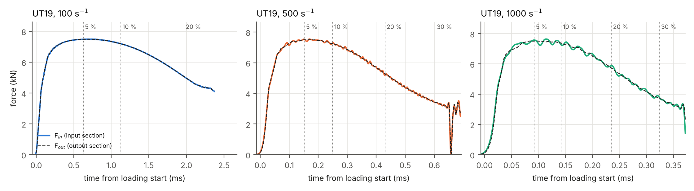

> **Figure 28 – UT19: input and output specimen forces over the whole test.**
>
> *Plotted* – $F_{in}$ (coloured) and $F_{out}$ (black dashed) against the time from the loading start, one panel per target rate.
>
> *Source* – reference study `taskI_20261022-1138`, filtered section forces.
>
> *How to read it* – where the two curves overlap the specimen is in equilibrium; the vertical distance between them is $\Delta F$.

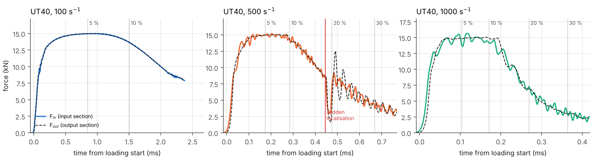

> **Figure 29 – UT40: input and output specimen forces over the whole test.**
>
> *Plotted* – $F_{in}$ (coloured) and $F_{out}$ (black dashed) against the time from the loading start, one panel per target rate.
>
> *Source* – reference study `taskI_20261023-1518`, filtered section forces.
>
> *How to read it* – where the two curves overlap the specimen is in equilibrium; the vertical distance between them is $\Delta F$.

## Appendix B – First UT40 study and recalibration (study `taskI_20261023-1140`)

The first UT40 velocities were estimated with $L_{eff}$ = 34 mm and $F$ = 15 kN (scaled from the UT19).

**Table 27 – First UT40 study: main indicators.**

| Target rate (s⁻¹) | Striker velocity | Achieved rate | Max strain | Equilibrium, $R$ | Sudden localisation |
|---|---|---|---|---|---|
| 100 | 6.00 m/s | 138 s⁻¹ | 30.0 % | yes, from 0.7 % | none |
| 500 | 19.95 m/s | 590 s⁻¹ | 30.0 % | partial, 2.9 % to 11.2 % | none |
| 1000 | 37.39 m/s | 770 s⁻¹ | 12.6 % | partial, 6.3 % to 9.8 % | at 11.8 % |

**Recalibration.** Writing $2KV = \dot\varepsilon\,L_{eff} + 2F/\rho c A$ for the runs at 100 and 500 s⁻¹ (the 1000 s⁻¹ run is not usable: localisation outside the extensometer) gives two equations for two unknowns:

$$
2 \times 0.487 \times 6.00 = 138\,L_{eff} + \frac{2F}{12242}, \qquad 2 \times 0.487 \times 19.95 = 590\,L_{eff} + \frac{2F}{12242}
$$

so $L_{eff}$ = 30.1 mm and $F$ = 10.4 kN (rounded to 30.1 mm and 10.4 kN in `make_run.py`). The effective force is low because the force of the UT40 drops strongly during necking.
